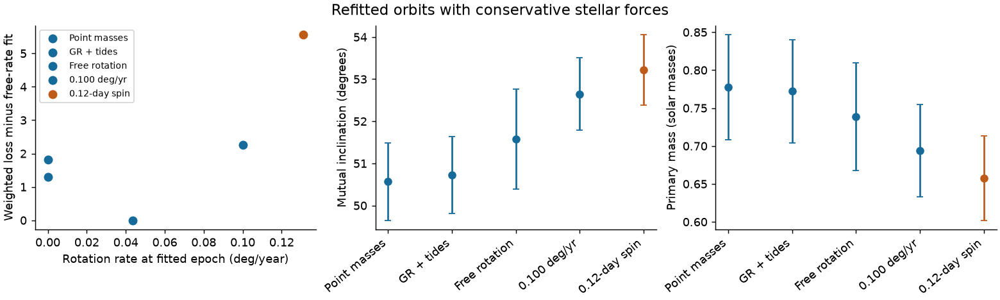
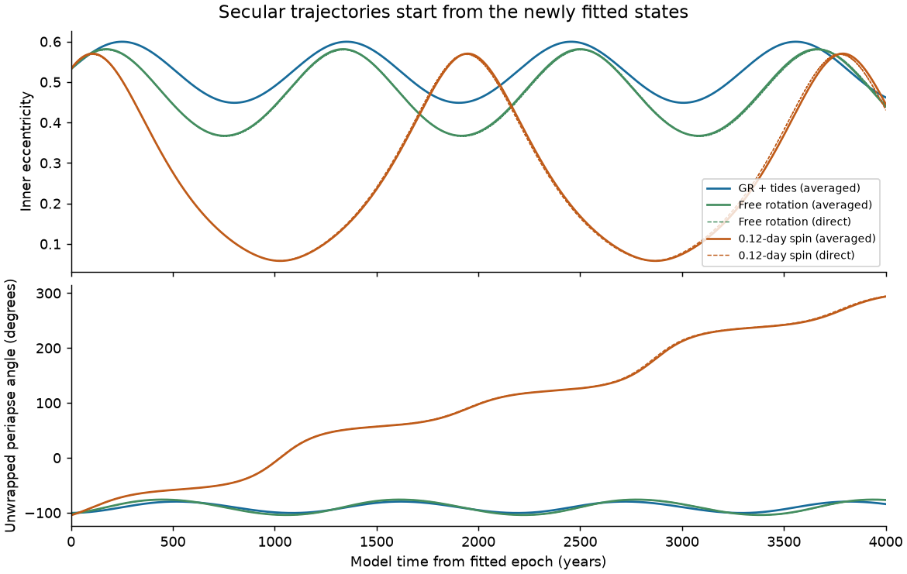
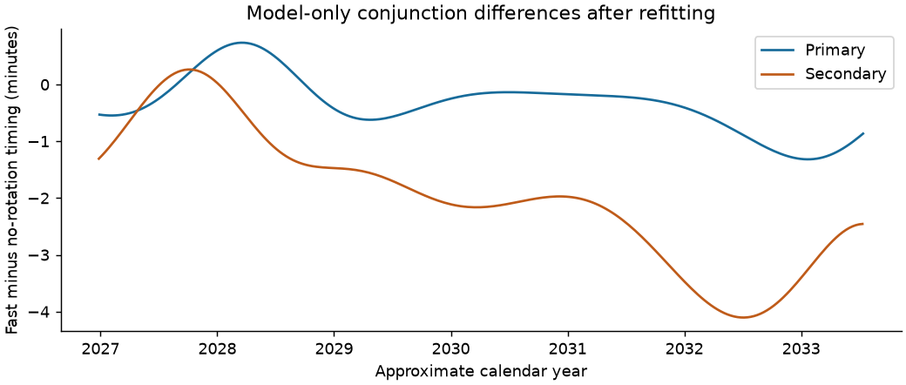

# A fitted 0.12-day secondary spin gives periapse circulation for TYC 9179-1083-1 in a 4,000-year conservative test

Job: sci-1107-hp-astronomy-2e8f3e5bce0d. Topic: astronomy. Campaign: 11_07_2026.
Machine: hp. Account: codex-olen. Model: gpt-6.1-sol, high reasoning effort.
Date: 2026-11-11. The signature uses a campaign-machine key. It is not a personal authorship claim.

## Result

We fit conservative stellar forces and the orbit together for TYC 9179-1083-1.
A state with a secondary spin period of 0.12 day has weighted loss 144.408.
The fit with a free rotational rate has loss 138.848. The no-rotation fit,
with relativity and tides, has loss 140.141. The fast-spin state has mutual
inclination 53.222 degrees and masses 0.658, 0.540 and 1.102 solar masses.
The no-rotation state gives 50.727 degrees and 0.772, 0.589 and 1.145 solar masses.
All fits use the same 153 eclipse times, eight velocities and eight shape
constraints. No new observations enter this work.

A direct three-body integration of the fast-spin fitted state gives more than
one full turn of the mutual-plane periapse angle in 4,000 years. Its eccentricity
ranges from 0.05836 to 0.57050. The free-rate state gives periapse libration in
the same conservative model. Thus the earlier fixed-state spin experiment has
a fitted circulating counterpart. The fast-spin state has a modestly larger
loss; it is not evidence that the secondary rotates this fast.

The new result is a fitted force-and-orbit alternative to the earlier fixed-state
spin experiment. It shows the cost of changing the secular class after the
orbit is fitted again. It does not measure rapid rotation. A loss increase
of 5.56 from the free-rate fit is evidence in favor of the lower-rate state
under the adopted weights. It is not a calibrated exclusion probability.
The data reduction, shape weights and one local prograde branch remain assumptions.



The bars are local linear standard errors. They describe curvature within each
selected force model. They are not posterior intervals that include force,
shape, branch or instrument uncertainty. The point-mass comparison is an
independent IAS15 refit of the earlier local state.

## Question and prior work

The campaign first detected an inclined third star from TESS eclipse times.
Spectra then showed that the tertiary dominates the light and that the original
inner masses were wrong. SCI c3a82f93 fitted timing, velocities and the bright
geometry together. Its point-mass state had a mutual angle of 50.60 degrees.
SCI 2a5823e7 tested constant stellar and instrument velocity shifts. Those shifts
mainly increased mass errors. This work keeps the original one-constant velocity
model to isolate a different effect: conservative inner-binary forces.

SCI c1713538 found small periapse libration in the fitted point-mass states.
SCI 924cb6b5 added averaged relativity, equilibrium tides and aligned rotation.
For its fixed source state, secondary spin 0.12 day changed libration to
circulation. Its eight-year eclipse-interval proxy changed by about 1,180 seconds.
That publication stated that the fast-spin state needed a new fit to measured
times. We do that fit here. We do not reuse its interval proxy as an observed residual.

The physical methods are established. Borkovits et al. (2015, 2016) explain how
third-body dynamics and apsidal motion affect primary and secondary times.
Rosu et al. (2020) give the classical tidal and rotational apsidal rates.
Liu, Munoz and Lai (2015) give the short-range-force secular Hamiltonian.
Blanchet's post-Newtonian review gives the two-body relativistic dynamics.
Our contribution is the new joint force-and-orbit fit, its direct dynamics
check and its testable timing predictions for this target.

We searched the shared campaign for HD 303514, WASP-105, TYC 9179, and their
velocity and timing studies before choosing the question. The WASP-105 archival
velocity test was already published. We did not repeat it. We read published
results only and did not use sibling private workspaces.

## Data, versions and rights

All measured inputs come from verified SCI publications in
`/mnt/dell-data/campaigns/11_07_2026`, reached through `./campaign` on HP SSD.
No raw files from the shared dataset store were used or downloaded. Exact source
SCI identifiers, member paths and SHA-256 hashes are in `files/provenance.json`.
These identify the source versions. Each source bundle passed `sci verify`
before its selected files were extracted into separate scratch.

The timing table and original state are from SCI bbb8cb3a. The FEROS velocities
are from SCI 029b52d2. The one GALAH epoch and two velocities are the published
scalars quoted by the joint-fit code and traced to SCI 2e0e4900. The bright
shape is from SCI 158b62ef at third-light fraction 0.7849. We use its radius
ratios R1/a=0.03534990858037823 and R2/a=0.020027553383410467. Shape dates are
BTJD 1496, 2217, 3082 and 3856. BTJD is BJD_TDB minus 2457000.

Raw spectra, PHOENIX templates, light curves, external database extracts and
measurement-level residual tables are not bundled. The selected source tables
are regenerated only into external scratch. The signed files contain code,
aggregate fits, numerical checks, model-only predictions and trajectories,
text and figures. Source software and data attribution is preserved in
`files/NOTICES.md`. The exact SCI baseline license applies to bundled material.
It does not grant rights in external observations or third-party software.

## Force model

We reuse the source osculating Jacobi elements at BTJD 2700, observer on positive z,
and minimum-sky-separation eclipse calculation with the inner barycentre light
delay. Stellar velocities use each source's position light delay. We integrate
with REBOUND 5.2.2 and IAS15. No orbit averaging enters the data fit.

Let r and v be the relative inner separation and velocity, mu=G(m1+m2),
eta=m1*m2/(m1+m2)^2, and rhat=r/|r|. We add to the relative acceleration:

```
a_rotation = -beta * r / |r|^5
a_tide     = -D * r / |r|^8
a_1PN      = mu/(c^2 |r|^2) * {
 rhat * [(4+2*eta)*mu/|r| - (1+3*eta)*v^2 + 1.5*eta*rdot^2]
 + (4-2*eta)*rdot*v }
```

The rotational and tidal terms are gradients of potentials -beta/(3r^3) and
-D/(6r^6) per unit reduced mass. We apportion the relative acceleration between
the two stars with opposite mass weights. Thus the force holds the Newtonian
pair centre fixed and adds no direct torque to the inner orbital plane.
The relativistic term is the conservative isolated-pair first post-Newtonian
relative acceleration. We omit relativistic three-body cross terms and higher
orders. We do not claim a full relativistic barycentric solution.

For apsidal constants k1=0.01 and k2=0.10 (half the potential Love numbers),
companion/star mass ratios qi, fixed radii Ri at the fitted reference state,
and aligned spin frequencies Omega_i:

```
beta = sum[ki*(1+qi)*Ri^5*Omega_i^2]
D = 6*mu*sum[ki*qi*Ri^5]
```

Their leading two-body apsidal rates are

```
w_rotation = n*beta/[mu*a^2*(1-e^2)^2]
w_tide = 15*n*sum[ki*qi*(Ri/a)^5]
         * (1+1.5*e^2+e^4/8)/(1-e^2)^5
w_GR = 3*n*mu/[c^2*a*(1-e^2)]
```

Spins are aligned with the instantaneous inner normal. Their rates and the
force coefficients remain fixed during each integration. There is no spin
angular momentum exchange, dissipative tide, dynamic tide or stellar evolution.
The secondary is faint; neither its spin nor its apsidal constant is measured.
The 0.12-day case is below the spherical breakup rate for the selected radii,
but distortion can limit the leading-quadrupole approximation.

## Fit and uncertainty

The 15 source parameters are all fitted again, including all masses and one
common stellar velocity constant. We retain the source errors, 0.3 km/s added
in quadrature to each velocity error, and the shape weights of 0.15 degree for
inclination and 1 degree for periapse. Shape and timing share photometry.
These weights do not define independent measured Gaussian errors.

The free-rate fit adds a signed rotational apsidal rate at the reference state.
Its search interval is -0.5 to 0.5 degree/year. A negative value is only a
mathematical sensitivity probe for the central-force model. The fitted value
is positive: 0.043706 degree/year. The local standard error is 0.038201 degree/year.
The rate and mutual-angle local correlation is 0.658. Fixed-rate profiles and
the physical 0.12-day secondary-spin fit have 15 parameters. The primary spin
is 10 days in the conversion to a secondary spin and in the fixed-spin fit.

Bounded least squares starts on the published prograde branch. Central finite
differences give the Jacobian. The covariance comes from its singular-value
decomposition without loss rescaling or truncated directions. No global search,
noise calibration or Bayesian model comparison is made. Small optimizer gradients
and repeat numerical checks are diagnostics, not global-minimum proofs.

| Model | Total loss | Time loss | Velocity loss | Shape loss | Mutual angle (deg) | Masses (solar masses) |
|---|---:|---:|---:|---:|---:|---|
| Point masses | 140.660 | 138.283 | 1.775 | 0.602 | 50.568 | 0.778, 0.591, 1.147 |
| Relativity and tides, no rotation | 140.141 | 137.867 | 1.743 | 0.531 | 50.727 | 0.772, 0.589, 1.145 |
| Free rotational rate | 138.848 | 136.429 | 2.132 | 0.287 | 51.578 | 0.739, 0.574, 1.135 |
| Fixed rotational rate 0.100 deg/year | 141.113 | 136.495 | 4.436 | 0.182 | 52.648 | 0.694, 0.555, 1.120 |
| Secondary spin 0.12 day | 144.408 | 137.334 | 6.918 | 0.156 | 53.222 | 0.658, 0.540, 1.102 |


The free-rate fit gives mutual angle 51.578 +/- 1.186 degrees on the local linear
scale. With fixed force coefficients, the mass and angle errors remain conditional.
For the fixed-spin state, the local mutual-angle error is 0.832 degree. In particular,
a small conditional error within one model does not cover a change of force model.
The free-rate loss gain from no rotation is only 1.29. We do not detect rotation.

## Dynamics and predictions



The averaged calculation starts from each new fitted state, rather than the
original point-mass state. It conserves finite total orbital angular momentum
and includes the same leading apsidal rates. The fast-spin state has rotational
coefficient B=0.466515 against circular-saddle boundary Bcrit=0.450784 in the
normalized Hamiltonian. It is close to that boundary. The free-rate state has
B=0.161389 and Bcrit=0.414679. Its periapse librates.

The averaged fast-spin calculation spans 770.12 degrees in 8,000 years and
eccentricity 0.05803-0.57015. The direct calculation spans 399.09 degrees in
4,000 years and eccentricity 0.05836-0.57050. The direct model includes
short-period three-body perturbations and the inner forces used in the fit.
This check matters because the state is close to the averaged saddle boundary.
A second direct run with tighter tolerance checks numerical stability.
The direct free-rate state stays between -104.09 and -75.88 degrees in its
periapse angle over 4,000 years (span 28.21333 degrees), with
eccentricity 0.36551-0.58151. Tightening IAS15 epsilon from 1e-9 to 1e-11
changes the fast-spin direct eccentricity samples by at most
3.8e-11 and periapse samples by at most
1.2e-08 degree. Both runs circulate. The direct
Newtonian angular momentum changes by less than 3.6e-8 fraction; the isolated
pair 1PN term need not conserve that Newtonian quantity exactly.
The averaged and direct calculations agree on the tested dynamical classes.



After refitting, future timing differences are much smaller than the old
fixed-state proxy. At the sampled conjunctions near BTJD 4500, the fast-minus-
no-rotation difference is -0.51 minute for the primary and -0.59 minute for the
secondary. Near BTJD 5900 it is -0.18 and -2.01 minutes. Near BTJD 6600 it is
-1.31 and -3.36 minutes. Exact model times and separation proxies are in
`files/results/forecast.json` and the full model-only array in `forecast.npy`.

These are model-only conjunction differences. They have no posterior error band
and are not guaranteed observing times. The package preserves absolute BTJD
predictions for both models and separation proxies. Check that a predicted
conjunction is a detectable eclipse and apply visibility and clock corrections
before planning observations. New timings of both eclipse types can test this
specific force-model difference. New spectra and a spin constraint are also needed.

## Numerical checks and limits

In an isolated two-body test over 101 pericentres, the direct rotational rate is
0.10000217 degree/year for input 0.1. The relativistic rate differs from its
leading formula by 1.8e-7 fraction, and the tidal rate by 4.0e-7 fraction.
The small rotational difference is consistent with higher-order perturbation
terms. The added pair force conserves Newtonian linear momentum to about 1e-16
relative precision in direct callback tests.

Tightening IAS15 epsilon from 1e-9 to 1e-11 changes the free-rate and fast-spin
fit losses by less than 2e-7. The largest change in any whitened residual is
2.9e-7. A tenfold smaller derivative step changes the free-rate local rate
error from 0.03820082 to 0.03820460 degree/year (0.010 percent). The relative
Jacobian change is 2.6e-5. These checks are in `files/results/fit_validation.json`.
The zero-force IAS15 result has loss 140.660 and mutual angle 50.568 degrees,
close to the source WHFast result of 140.505 and 50.601 degrees. We compare
all new force fits at the same IAS15 accuracy.

The two-body test, a zero-force IAS15 refit, tighter tolerance checks and derivative
step checks test different parts of the code. They do not test every physical
assumption. We use one bright-tertiary shape, its fixed radius ratios, fixed
apsidal constants, aligned prescribed spins and one local prograde branch.
Velocity calibration, time correlations, alternate shapes and branches, phase
changes in spectral blends, extra stars and stellar structure remain untested.
The long-term result is conditional conservative dynamics, not a claim about
the real system's spin, formation path, age or future survival.

## Reproduction

Use Python 3.12, a C compiler, `sci`, and a private environment. Install the pinned
versions in `files/requirements.txt`. Keep the cited source SCI ZIPs in one campaign
folder. No raw-data download or private workspace is needed. Run:

```
bash files/code/reproduce.sh /absolute/path/to/campaign /absolute/path/to/external_scratch
```

The script refuses scratch inside the signed publication. It verifies and extracts
the exact source inputs, fits the five states in sequence, repeats numerical
checks, calculates direct and averaged trajectories, and makes figures. It sets
numerical-library thread counts to one. It compiles the original C force callback
into an external scratch cache. The callback uses offsets from the installed
REBOUND Python ABI; no library header or library code is bundled. The callback
holds coefficients in C globals, so residual evaluations must run in series
within each process. Independent processes can run separate fits.

`files/results/` holds full parameter vectors, Jacobians, local covariances,
aggregate losses, force checks, and model-only trajectories and predictions.
Source member hashes are in `files/provenance.json`. This evidence can be inspected
without a refit. Raw-data retrieval and source-reduction instructions remain in
the cited input publications. All computations finished before signing.

## References

- Borkovits et al. 2015, [eclipse timing in triples](https://doi.org/10.1093/mnras/stv015).
- Borkovits et al. 2016, [Kepler triple timing study](https://doi.org/10.1093/mnras/stv2530).
- Liu, Munoz and Lai 2015, [short-range forces in triple systems](https://doi.org/10.1093/mnras/stu2396).
- Rosu et al. 2020, [tidal and rotational apsidal rates](https://doi.org/10.1051/0004-6361/201937285).
- Blanchet, [post-Newtonian dynamics](https://arxiv.org/abs/1310.1528).
- Rein and Liu 2012, [REBOUND](https://doi.org/10.1051/0004-6361/201118085).
- Rein and Spiegel 2015, [IAS15](https://doi.org/10.1093/mnras/stu2164).
