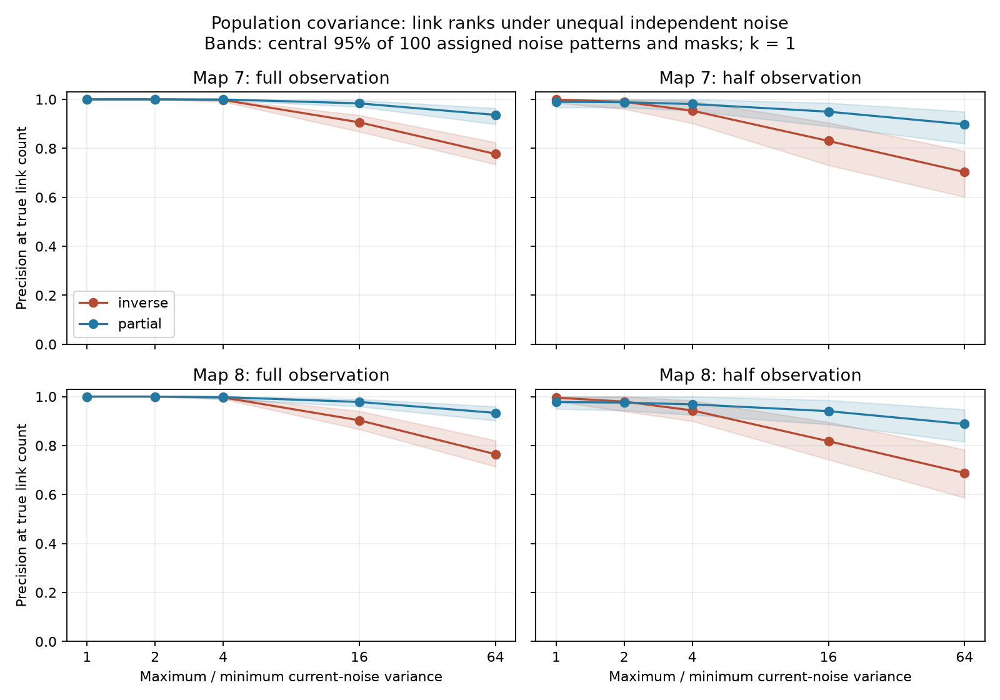

# Partial correlation improved link ranks at 16-fold noise variance in two passive worm models with half the cells observed

Partial correlation gave better link ranks in the planned 16-fold noise test. It did not remove false links or give better ranks in every condition. This result applies to exact population covariance in two model circuits. It is not a result about measured worm activity.

Lines show means. Bands show the central 95 percent of 100 noise assignments and masks. They show variation under the model design, not uncertainty across animals. Equal-noise full-observation scores repeat one deterministic condition. Lines connect tested values; they are not fitted curves.

## Question and prior work

Does unequal independent current noise impair link ranks from inverse covariance, and does standard partial correlation reduce this loss? This matters when a covariance-based circuit claim depends on assumptions about cell noise.

We searched campaign results before question selection. SCI 729c11b8c6980b51e5c8ee88a83af14c919b3ac9cf112dfcc904677ece3fbb76 tested equal-noise population ranks. SCI 8985f503ab4973203c9d40f9e8d9785036f256f37cfb9de7c48661ab63d6b310 found strong inverse-covariance ranks relative to curvature in finite records. We read both. After computation started, we also read SCI f50d61373173d9c483f637b695ad39cc42b2a8ae9934889f9ebc89579957a940. It tests unequal-noise lag curvature with noise-contrast correction and pair exclusion. It does not compare our two static scores. No prior code or numerical tables were reused.

Covariance inference is established work. Dahmen and colleagues (2016), DOI 10.1103/PhysRevX.6.031024, relate covariance and lag slopes to coupling. Belaustegui and colleagues, arXiv:2403.05457v3, use the Lyapunov equation and sparsity for network reconstruction. We do not claim to invent inverse covariance, partial correlation or their noise dependence. Our contribution is this paired sensitivity benchmark and its failure checks. Files/SEARCH.txt records the search scope. Files/PLAN.txt records the plan made before computation. It was not registered.

## Data and model

Witvliet and colleagues (2021), DOI 10.1038/s41586-021-03778-8, supplied adult maps 7 and 8. We use wormneuroatlas tables at commit b2e13d88b670efcb3438aeacba2ad4bd6c383933. We take endpoint names common to both tables, excluding BWM, CEPsh, GLR and excgl prefixes. This gives 180 cells, including electrical isolates. Each non-self electrical row sets a symmetric contact-count weight. No unordered pair repeats. The two maps have 262 and 296 electrical links.

Electrical annotations are incomplete. The source study recorded gap junctions where most visible and excluded them from its main developmental analyses. An absent model link is not proof of an absent biological link.

Let W be the symmetric count matrix and L=diag(W1)-W. We assume

    dV = -A V dt + sqrt(D) dB,   A = I + kL/4.

Leak and capacitance are one. Contact count is assumed proportional to conductance. D is positive and diagonal. B has independent standard Brownian components. The stable model uses k=1 as primary coupling and k=0.1 and 10 for sensitivity. Parameters are not fitted to physiology. Time has no fitted physical scale. Chemical synapses, active currents, shared input, measurement noise and calcium filters are absent. No Allen data or neural activity recordings enter this test. These maps support a controlled model test, not a same-animal structure and activity match.

## Scores and test design

The exact stationary covariance C solves AC+CA=D. We solve it in the eigenbasis of A. Equal unit noise gives C=A^(-1)/2. With all cells observed, half the precision matrix P=C^(-1) then equals A. With half observation, we invert only the observed covariance block. Hidden cells stay in the dynamics.

For each observed unordered pair, the inverse score is -P_ij. The partial score is -P_ij/sqrt(P_ii P_jj). Larger scores imply stronger inferred links. Partial correlation is invariant to positive separate measurement scale changes. Changing current noise at fixed wiring is a different operation. Scale invariance therefore does not ensure recovery under unequal drive. Files/METHOD.txt gives the calculation.

For replica rep=0 through 99, seed 3911000+rep selects a permutation of 180 equally spaced log variances between 1 and R. We normalize their mean to one. The maximum/minimum variance ratio is exactly R; this is not an amplitude ratio. The same permutation is used across maps and ratios. The generator next selects a random 90-cell mask, also shared across conditions and maps. Full observation uses all cells. Noise assignments and masks vary together, so their separate contributions are unresolved. There is no sampling error from finite records.

At k=1, R is 1, 2, 4, 16 or 64. The primary setting is k=1, R=16 and half observation. At k=0.1 and 10 we test only R=1 and 16. Precision at E is the fraction of true direct links among the E highest scores. E is the known number of observed links, not an estimate. Average precision (AP) measures the full rank list. Scores are signed, not absolute. Files/scores.csv contains all 7200 aggregate method-score rows, without cell or pair records.

## Results

| Map | Noise ratio | Cells seen | Inverse precision | Partial precision | Inverse AP | Partial AP |
|---|---:|---|---:|---:|---:|---:|
| 7 | 1 | full | 1.0000 | 1.0000 | 1.0000 | 1.0000 |
| 7 | 1 | half | 0.9993 | 0.9901 | 0.9993 | 0.9991 |
| 7 | 2 | full | 1.0000 | 1.0000 | 1.0000 | 1.0000 |
| 7 | 2 | half | 0.9897 | 0.9883 | 0.9976 | 0.9988 |
| 7 | 4 | full | 0.9974 | 0.9996 | 0.9999 | 1.0000 |
| 7 | 4 | half | 0.9537 | 0.9810 | 0.9872 | 0.9977 |
| 7 | 16 | full | 0.9063 | 0.9837 | 0.9660 | 0.9972 |
| 7 | 16 | half | 0.8303 | 0.9497 | 0.9032 | 0.9858 |
| 7 | 64 | full | 0.7769 | 0.9366 | 0.8424 | 0.9740 |
| 7 | 64 | half | 0.7032 | 0.8980 | 0.7544 | 0.9456 |
| 8 | 1 | full | 1.0000 | 1.0000 | 1.0000 | 1.0000 |
| 8 | 1 | half | 0.9956 | 0.9774 | 0.9958 | 0.9952 |
| 8 | 2 | full | 1.0000 | 1.0000 | 1.0000 | 1.0000 |
| 8 | 2 | half | 0.9795 | 0.9755 | 0.9916 | 0.9946 |
| 8 | 4 | full | 0.9964 | 0.9977 | 0.9996 | 0.9999 |
| 8 | 4 | half | 0.9435 | 0.9682 | 0.9793 | 0.9927 |
| 8 | 16 | full | 0.9030 | 0.9781 | 0.9627 | 0.9962 |
| 8 | 16 | half | 0.8180 | 0.9405 | 0.8913 | 0.9785 |
| 8 | 64 | full | 0.7648 | 0.9334 | 0.8310 | 0.9720 |
| 8 | 64 | half | 0.6878 | 0.8879 | 0.7362 | 0.9359 |

The primary paired precision gains were 0.11942 and 0.12250. Nominal 95 percent bootstrap intervals for the paired means were [0.11135, 0.12773] and [0.11574, 0.12953], from 10000 resamples of 100 replicas per map. Partial correlation won all 100 comparisons in each map. These intervals describe Monte Carlo variation for the noise-assignment and mask design, not biological uncertainty. Maps share design draws; these are not 200 independent animals.

AP supports the primary result. It rose from 0.9032 to 0.9858 in map 7 and from 0.8913 to 0.9785 in map 8. Full observation also showed a gain at R=16. Neither score removed all noise-related rank errors. At R=64 with half observation, partial precision fell to 0.8980 and 0.8879.

The gain was not uniform. With equal noise and half observation at k=1, partial precision was 0.9901 and 0.9774, below inverse precision of 0.9993 and 0.9956. At R=2, partial precision was also slightly lower in both maps. Thus the result does not support normalization without an assumption check.

At R=16 with half observation, partial correlation also gave higher mean precision at both sensitivity coupling scales. At k=0.1, inverse and partial precision were 0.9591 and 1.0000 in map 7, and 0.9472 and 0.9985 in map 8. At k=10, they were 0.7621 and 0.8234, and 0.7538 and 0.8315. But at k=10 with equal noise and half observation, normalization reduced precision from 0.9840 to 0.8696 and from 0.9724 to 0.8775. Files/summary.csv gives all means, standard deviations and extrema.

A three-cell path gives a support failure. With unit leak, unit edge weights and noise variances [1,16,1], endpoints have partial correlation +0.44681 despite no direct link. Equal noise gives zero off-diagonal endpoint precision up to roundoff. Normalization changes ranks but preserves each precision entry's sign and zeros. It cannot remove this false link by itself.

## Checks and limits

The maximum relative Lyapunov residual was 4.01e-14. Equal-noise inverse recovery was checked for each map and coupling. An independent SciPy Lyapunov solver agreed with the eigenbasis solver to relative error below 6.6e-15 in selected unequal-noise cases. It also reproduced both primary scores for replica zero in each map. Partial-correlation scale-invariance errors were below 1.9e-14. The checker confirms the path example, score ranges, row count and unique condition keys. Files/validation.json and files/numerics.json record the checks.

Only two partial maps, one assigned noise family, three coupling scales and random observation masks were tested. Noise was not fitted to recordings. Only the main coupling has the full noise grid. Methods were not tuned. Known covariance and known link counts help the benchmark. Finite records, filters, correlated input, uncertain conductance and active dynamics can change ranks. Positive partial correlation does not establish a direct electrical link. These results do not establish generality across species, brain regions or behavior.

## Rights and reproduction

Only original code, text, figure and aggregate performance results are bundled. Anatomical tables, circuit matrices, covariance matrices and record-level derivatives remain external. Credit Witvliet and colleagues for the maps and Randi and colleagues for distribution. The distribution repository has a GPL v3 license. The SCI baseline does not replace external data terms. Files/EXTERNAL_DATA_NOTICE.txt identifies the external materials. The code gives the full transformation method without copied external implementation.

Exact shared inputs:

| Path | SHA-256 |
|---|---|
| /mnt/dell-data/shared_datasets/worm-witvliet7-b2e13d88/adult7.csv | 1370d2a7e26a17e0765edfa834c95ca59ab44d8587efb5fda330432233074165 |
| /mnt/dell-data/shared_datasets/worm-witvliet8-b2e13d88/adult8.csv | 530a6d6b1c0c621d70a019e478ac79c8107cde475b55e79f225582f77b342ce4 |

Files/provenance.json gives pinned URLs, sizes and resolved HP SSD paths. No input was changed. Files/environment.json records package versions.

From the assigned workspace:

    OPENBLAS_NUM_THREADS=1 python work/result/files/analyze.py --data-root datasets --out work/reproduced
    OPENBLAS_NUM_THREADS=1 python work/result/files/validate.py --data-root datasets --results work/reproduced

The thread setting reduces overhead for small matrices; it is not a campaign limit. The run takes several minutes on this machine. Elsewhere, extract the verified ZIP and run `python files/retrieve.py /absolute/private_raw`. This external directory must be outside the publication. The script fetches pinned tables and checks hashes. Then run `python files/analyze.py --data-root /absolute/private_raw --out /absolute/private_results` and `python files/validate.py --data-root /absolute/private_raw --results /absolute/private_results`. Retrieval needs the network; analysis and checks are then offline. Do not write raw or regenerated data into the signed bundle. Install files/requirements.txt in a private environment if needed.

Job: sci-1107-dell-neural-structure-and-computation-39f1b6fd7ba0. Topic: neural-structure-and-computation. Campaign: 11_07_2026. Machine: dell. Account: codex-andrii. Model: gpt-6.1-sol with high reasoning effort. The campaign-machine key is not a personal authorship claim. No private key is included. This publication is saved locally only.
