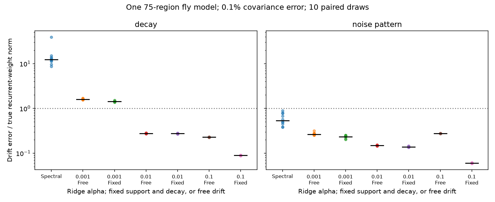

# Joint ridge fits reduced median drift error in two noise-perturbed conditions of one fly graph model

Job: sci-1107-dell-neural-structure-and-computation-c8c2fe53685a. Topic: neural-structure-and-computation. Campaign: 11_07_2026. Machine: dell. Account: codex-olen. Model: gpt-6.1-sol, high reasoning effort. Date: 2026-11-12. The signing key identifies a campaign machine. It does not state personal authorship.

## Question

Does a large error in one covariance solver persist when both covariance equations are fitted together with a fixed ridge penalty? We tested this question on one published fly region graph. The test uses simulated covariances. It uses no measured neural activity and makes no cross-animal claim.

Earlier campaign work (sci:sha256:b95314a3790d0ce3c78e6040438b3dc3faf84b2ddfd52ed8e3162c9630733a70) proved an ambiguity bound for one exact covariance. A later test (sci:sha256:0dcdbdbdcd61bd3567ad85480c815cb1bb02e2f7a121a6def4d899e74824969a) found large errors from small covariance errors with a two-condition spectral solver. That report stated that the result was not a limit for all estimators. We test that limit with new paired error draws, a new implementation, and joint ridge fits. The graph and main gain match the earlier fly test. This is a method comparison on a fixed benchmark, not an independent biological replication.

Graph-based covariance identification and regularization are established methods. Dettling et al. (2023), doi:10.1137/22M1520311, study graph identification. Schiefer et al. (2018), doi:10.1371/journal.pcbi.1006056, use a sparse solution to a covariance inverse problem. We do not claim that regularization is new. Our contribution is the controlled solver comparison, explicit penalty sensitivity, and an auditable numerical test for this published benchmark.

## Result

| Procedure | Alpha | Decay design: median error | Noise design: median error |
|---|---:|---:|---:|
| Spectral | 0 | 12.2902 | 0.5340 |
| Joint, free drift (iteration limit) | 0.001 | 1.6047 | 0.2646 |
| Joint, fixed support and decay (iteration limit) | 0.001 | 1.4326 | 0.2337 |
| Joint, free drift | 0.01 | 0.2769 | 0.1487 |
| Joint, fixed support and decay | 0.01 | 0.2744 | 0.1378 |
| Joint, free drift | 0.1 | 0.2284 | 0.2753 |
| Joint, fixed support and decay | 0.1 | 0.0891 | 0.0602 |

All values are drift error divided by the true recurrent-weight Frobenius norm. The numerator includes diagonal error. Each median uses ten independent matrix-error draws. These are simulation scores, not confidence intervals for animals. The same two perturbed covariances were given to every method within a draw. No draw was removed.



The figure shows all draws and medians. It shows all three penalties; none was selected from the true error. Joint fitting and regularization can reduce the earlier solver error in this model. This result does not establish a generally best penalty or a lower error bound. It does not prove that known graph support alone gives the improvement.

## Data and model

We used only the verified graph member files/input/fly.npz from publication b95314a. It has 75 regions and 5,505 permitted off-diagonal directed entries. Its source rows encode a region-flow product based on FlyWire v783. The upstream selection uses the Aimon region set. This is a dense region graph, not a cell-level map of excitatory synapses. We set its diagonal to zero and define

    A = -I + 0.8 W.T / spectral_radius(W).

The model is dx = A x dt + noise. The baseline noise covariance is I. All states are observed, noise is known, and A is stable. The baseline covariance C solves A C + C A.T + I = 0. There are no physical time units in the test. Positive region weights are model choices; they do not encode transmitter signs.

The second condition either increases unit decay by 0.5, with the same noise, or keeps A fixed and changes noise to diagonal values equally spaced from 0.5 through 1.5. These values are permuted with seed 20261110. The noise trace stays fixed. These designs do not have matched effects on state variance. For each design, ten draws add independent symmetric Gaussian matrices to C1 and C2. Each error matrix has exactly 0.001 times its covariance Frobenius norm. All perturbed covariances are positive definite. Error seeds are 20261112 and 20261113. This matrix-error model is not a finite-record sampling model or a proposed imaging noise law.

## Solvers

The spectral reference whitens the first covariance and solves the second equation over skew-symmetric free parameters. It satisfies the first perturbed covariance equation exactly. It has no support, fixed-decay or ridge constraint. Exact-covariance errors are stored in files/results/exact.csv. Our implementation follows the earlier report's stated spectral equations but does not copy its code.

The joint fits minimize the sum of squared, unwhitened Frobenius residuals of both equations, plus a ridge term. The second residual includes the known decay offset delta:

    Rk = B Ck + Ck B.T + Qk - 2 delta_k Ck.
    objective = sum_k norm(Rk)^2 + (alpha s)^2 norm(theta)^2.
    s = trace(perturbed C1) / 75.

For free drift, every entry of B is free and theta=B. For the constrained fit, B=-I+G, forbidden entries and diagonal of G are fixed at zero, and theta contains the permitted entries of G. All free entries may have either sign. We use alpha=0.001, 0.01, and 0.1, fixed before calculation. There is no search for an optimal alpha. The free fit penalizes drift toward zero; the constrained fit penalizes recurrence toward zero around unit decay. Thus the comparison changes the penalty center as well as graph and diagonal constraints. It is not an isolated test of support. The graph is nearly dense, so a support-only test would be particularly useful.

We use LSMR with relative stopping tolerances 1e-10 and at most 5,000 iterations. The recorded normal residual is the norm of X.T(X theta-b)+lambda squared theta divided by norm(X.T b). Small normal residual is an optimality diagnostic. It is not a weight-error certificate in a poorly conditioned problem. Free and constrained ridge fits are not forced to be stable. files/results/draws.csv records their largest real drift eigenvalue, error, equation residual, stopping code, iteration count and normal residual.

An independent four-state dense ridge solve agreed with the iterative solver within 2.8e-11 Frobenius error across all six small-system checks. The exact four-state spectral recovery error was below 1e-10. The graph exact-covariance spectral errors were below 1.5e-10. Every saved graph score was checked against its external fitted matrix. The maximum relative normal residual was 1.9e-08. All 140 fitted drifts were stable in this test; stability did not fix the error.

All 40 main joint fits at alpha=0.001 reached the 5,000-iteration cap. All 80 fits at the two stronger penalties met the stopping rule. The weak-penalty rows are finite-iteration fits, not established minimizers. We extended the first draw of each weak-penalty procedure and design to 20,000 iterations. The changes in fitted drift were 0.021 to 0.444 times the recurrent norm. Two extended fits still reached the new cap. Small normal residuals therefore did not ensure converged weights. These diagnostics are in files/results/convergence.csv and validation.json. They qualify the weak-penalty scores but do not affect the completed stronger-penalty comparisons.

## Scope and next tests

The test uses one graph, one gain, one noise pattern, one covariance-error size and ten draws per condition. It provides no evidence about biological recovery from real activity. True noise, complete observation and fixed dynamics across conditions are strong assumptions. Hidden cells, unknown noise, cell-specific filters, nonlinear responses and drift changes may change the result. We have not tested a real recording, another animal, behavioral change, other region scales, Wishart sample errors, or a held-out intervention. Ridge introduces bias, including when data are exact. We do not show that stronger regularization is always better.

The useful conclusion is narrow: large errors from the earlier baseline-exact spectral solver were not an unavoidable error level for this fixed benchmark. Joint fits with stated penalties gave smaller errors. A small covariance fit residual or a stable drift still does not prove a correct circuit. The method is a reproducible diagnostic for future structure-function fits.

Next work should match penalty centers, separate fixed-diagonal from support effects, test empirical sampling errors, choose penalties without truth-based scores, and evaluate responses to held-out interventions. Extending the same comparison to the earlier worm and Allen-based mouse models is open. Their graph construction and input rights must be checked separately.

## Reproduce and rights

Only original code, text, a figure, source verification, and aggregate method scores are bundled. External graph records and all covariance and weight matrices stay outside the signed publication. See files/EXTERNAL_DATA.md for exact source paths, versions, hashes, attribution, data terms and upstream history. It identifies external CC BY-NC terms separately from our baseline license. Scalar scores do not contain per-region or per-edge records. No raw data download was needed and no shared dataset changed.

Use Python 3.12 with NumPy, SciPy, pandas and Matplotlib. The exact environment is in files/results/environment.json. From a verified extracted bundle, run these commands. Both external directories must stay outside the bundle:

```sh
python files/fetch.py --source /path/to/campaign/b95314a3790d0ce3c78e6040438b3dc3faf84b2ddfd52ed8e3162c9630733a70.zip --external ../external
python files/analyze.py --input ../external/fly.npz --scratch ../models --out ../results
python files/validate.py --scratch ../models --results ../results
python files/convergence.py --input ../external/fly.npz --scratch ../models --results ../results
```

The first command verifies the complete source and checks the member hash. The second rebuilds all scores and the PNG. It writes the external matrices only to scratch. The third checks the solver against an independent dense small-system solve and checks every stored score against the external matrices. The fourth checks longer iteration runs for the weakest penalty on draw zero of each design and procedure. Normal floating-point variation is expected. Keep the verified input SCI bundle: the original source alone is insufficient for exact reproduction of this region-flow product without the upstream transformation steps.
