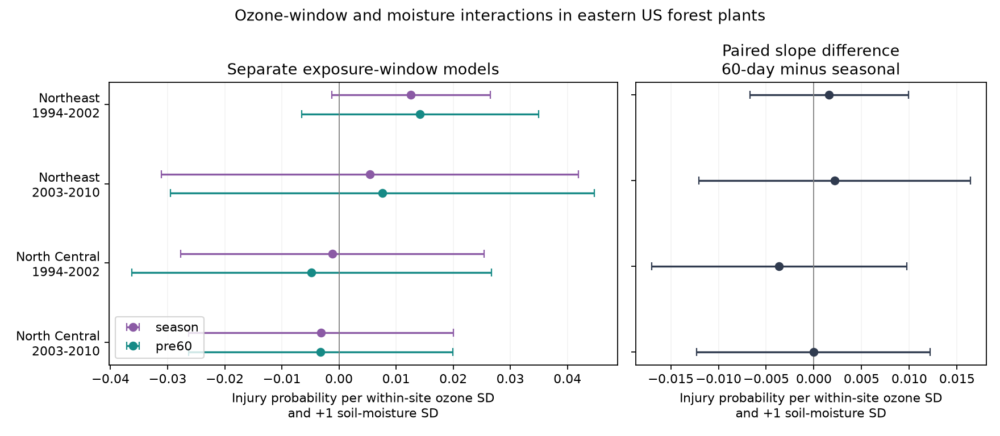

# Visit-ending ozone windows gave no clear moisture interaction difference in four eastern US forest samples in 1994-2010

## Result

We tested whether the ozone-by-soil-moisture slope for visible leaf injury changes
when the ozone window ends on the field visit day. We used 5,906 matched site-year
records from the Northeast and North Central US in two periods. All four slope
differences had intervals that include zero after correction for four tests.
Differences had mixed signs. This result does not show that the two windows are
equal. It does not rule out ozone injury or an effect of soil moisture.



## Question and prior work

Ozone can enter leaves through open stomata. Dry soil can reduce this uptake.
Smith et al. (2012), *Ozone Injury to Forests Across the Northeast and North Central
United States, 1994-2010*, report injury patterns with ozone and moisture.
https://research.fs.usda.gov/download/treesearch/41831.pdf

A prior campaign publication (SCI 268004a0..., full ID in sci.json) used the same
forest archive. It found a positive pooled ozone-by-moisture slope, with weak
region-period repetition. It gave one pooled check with a visit-ending ozone
window. We add matched region-period tests, a direct paired slope difference,
state-cluster uncertainty, and a common within-site exposure scale. This is a
follow-up with shared records, not independent validation of the source archive.
The regions do not share sites. The periods do not share years but can share sites.

A seasonal ozone score can include exposure after injury was assessed. This makes
the exposure window a useful method check. We test window sensitivity. We do not
measure the amount of exposure after each visit or identify its effect.

## Data and scope

The sole numerical input is the published, verified analysis panel. Exact paths,
hashes, source versions, attribution and upstream URLs are in
[EXTERNAL_DATA.md](files/EXTERNAL_DATA.md). The input panel is external to this
publication. The primary tests use two regions and 1994-2002 versus 2003-2010.
Pacific records are excluded to keep adequate period lengths and an eastern
forest scope. No region or period was chosen from its fitted result.

The outcome is one if at least one evaluated plant had validated ozone injury.
The seasonal exposure is W126 for the maximum three consecutive months within
April-October. The alternative sums the 60 calendar days ending on the visit day.
Both source metrics use daytime ozone (08:00-19:59 local standard time), monitor
completeness rules and inverse-distance interpolation. The visit window includes
the visit day, so some same-day hours can follow the visit. It omits earlier
exposure that can also cause injury. The source code confirms its 60-day index.

Soil moisture is June-August mean CPC soil water, as a z-score against 1981-2010
at the nearest grid cell. It can also include time after the visit. We retain it
to isolate the change in the ozone metric, not to make a fully prospective model.

## Method

For each region and period, keep complete records for both ozone measures, soil
moisture, visit day, summer Tmax anomaly, injury, manual version, evaluated plant
count and species count. Then keep sites with at least two records in that sample.
Use exactly the same records in the two window models. Each exposure is centered
and divided by the root mean square of its within-site deviations in that sample.
Thus each coefficient uses one within-site ozone SD, not one equal physical dose.
The saved scales in samples.csv are in ppm-hours. Scales are treated as fixed.

Fit a linear probability model separately for each exposure window:

`injury ~ ozone + moisture + ozone*moisture + visit_day/10 + Tmax + log(plant_count) + species_count + manual_version + site_effect + year_effect`

Fixed site effects control stable site and plant differences. Year effects control
shared yearly changes within a region. Visit day, plant and species counts, and
manual version address measured changes in observation. They cannot remove
unmeasured crew changes, missed injury, or changes in plant composition.

The target is the 60-day interaction coefficient minus the seasonal interaction
coefficient. We compute its variance from the difference of the two regression
influence scores, summed by state. This retains covariance between the paired
fits. CR1 factors include the exact absorbed fixed-effect rank. Each interval uses
a t distribution with state-count minus one degrees of freedom. The primary
family has four contrasts. We use 98.75% marginal intervals (Bonferroni 95% family
coverage under the cluster approximation). The displayed separate slopes use the
same four-test rule within each window family; they are not one joint 12-test
claim. There are only seven state clusters in the early North Central sample.
These approximate intervals can have poor small-cluster coverage.

Two checks use site effects without year or effort controls, and a primary-model
subset with a nearest JJA monitor within 30 km. That distance is a source proxy:
it does not certify each window's monitor set. Check intervals use four tests
within each variant. Checks are exploratory, not added independent replications.

## Results

Values below are percentage points of injury probability per one within-site
ozone SD and one soil-moisture SD. Intervals are for the paired difference.

| Region | Period | Records | Seasonal slope | 60-day slope | Difference | Adjusted interval |
| --- | --- | ---: | ---: | ---: | ---: | --- |
| Northeast | 1994-2002 | 1,490 | 1.261 | 1.421 | 0.160 | -0.670 to 0.990 |
| Northeast | 2003-2010 | 1,515 | 0.544 | 0.762 | 0.218 | -1.204 to 1.641 |
| North Central | 1994-2002 | 1,006 | -0.114 | -0.478 | -0.364 | -1.702 to 0.974 |
| North Central | 2003-2010 | 1,895 | -0.317 | -0.322 | -0.005 | -1.227 to 1.216 |

Within-site ozone correlations between windows were 0.869, 0.913, 0.758 and 0.936
in table order. The measures share much variation. All four contrast intervals
also included zero in both check variants. A positive early Northeast seasonal
slope in the site-only check and positive slopes for both windows in its near-
monitor check did not give a clear paired difference. Full estimates, standard
errors, unadjusted p values and intervals are in estimates.csv. All model values
in the CSV use probabilities rather than percentage points.

## Limits and interpretation

This audit found no clear repeated window sensitivity. It does not explain away
the earlier pooled result. Different controls and state clustering also differ
from the prior analysis. A direct before-versus-after dose test needs daily
source exposures and visits with time stamps. Subtraction of these overlapping,
different-length metrics cannot recover post-visit ozone. Different completeness
rules can change monitor sets. Common measurement error can hide a difference.

This is an observational test of selected bioindicator plants, not all forest
species or biodiversity loss. Coarse soil water and interpolated ozone do not
measure stomatal dose. Weather and observation errors can be correlated. Plant
count and species count controls can themselves respond to stress. Linear
probability fits need not stay in the unit interval. Sites and states were not
randomly sampled. State clusters allow serial dependence but not dependence
between states. These results do not identify climate-change attribution, a
drought-extreme response, a safe pollution level, or a causal ozone effect.

## Reproduce

Use Python 3.12, NumPy, pandas, SciPy and Matplotlib. The exact run versions are
in run.json. No random seed is needed. Keep the input and regenerated files in
scratch outside this signed folder. With the cited local campaign ZIP available:

```sh
python files/reproduce.py --source-bundle /mnt/dell-data/campaigns/11_07_2026/268004a08eb37a3a36207332736b005b07fe9d13a4687a19b1e966f96044ecb6.zip --scratch /tmp/forest-window-audit
```

The script verifies the source SCI ID, extracts only the panel, checks its exact
hash, runs the analysis and checks the primary contrasts. Explicit dummy-variable
least squares independently reproduced all four primary differences and paired
standard errors to less than 1e-9. validation.json records the observed errors.
The source publication preserves the original raw-input recipe and hashes.
No private scratch file is needed once that public source bundle is available.

## Campaign record

Job: sci-1107-dell-climate-pollution-biodiversity-cb7a51317f77.
Topic: climate-pollution-biodiversity. Campaign: 11_07_2026.
Machine: dell. Account: codex-andrii. Model: gpt-6.1-sol, high reasoning effort.
Date: 2026-11-09. The signing key is a campaign-machine key. It does not make a
personal authorship claim. This package contains new code, text, a figure and
aggregate results under the SCI baseline license. It contains no private key,
external raw data, or record-level panel. No remote upload was made by this job.
