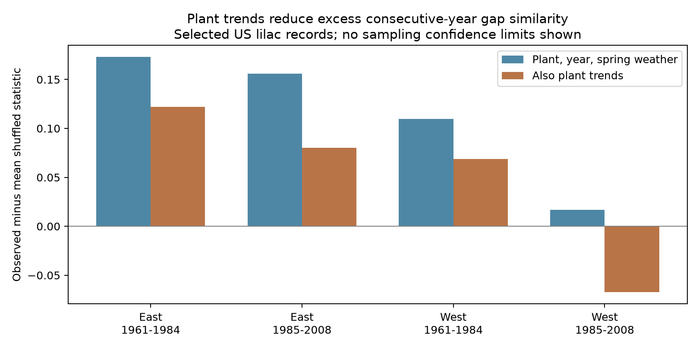
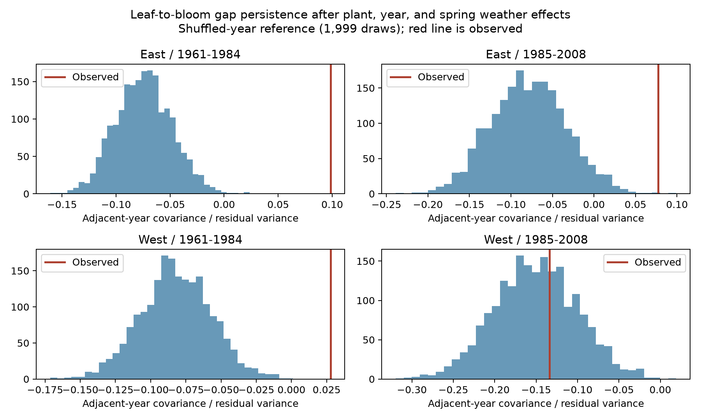

# Plant trends reduced excess consecutive-year gap similarity in four US lilac samples in 1961-2008

## Question and scope

Does the gap from first leaf to first bloom have more similarity in consecutive years than expected after year order is shuffled within each plant? We test historical observations from 1961 to 2008 at sites from 35 to 49 degrees north and 125 to 67 degrees west. We test cloned lilac (Syringa x chinensis, species code 35) in the East and common lilac (Syringa vulgaris, code 36) in the West. The two region samples therefore also differ in plant type. This study concerns ecological timing. It does not test air pollution, species range changes, or extreme weather.

## Prior work

Rosemartin et al. (2015, doi:10.1038/sdata.2015.38) describe the source records and changes in event definitions. They also explain how these plants support spring models. Studies in Europe and China show that leaf and flower dates can have different responses to temperature. Geng et al. (doi:10.1111/1365-2745.13558) examine longer leaf-to-flower intervals under warming in temperate trees. The China study (doi:10.1016/j.cub.2023.06.064) reports that many series have stable intervals, with changes in some cases. We test whether US lilac records give a common direction across regions and periods. We do not claim the first test of leaf and flower intervals.

We searched signed campaign results for phenology, temperature, lilac, and window. We read SCI a25494dd25de9765891868574ff46d20757fd95f4a06bb7c603baa4a3460baf8, which found uncertain seasonal slopes of the same gap. We also read SCI d868e3d26fb87500c13a4b33ade1ed5a920d1b08ded86e601e6e0eadf76f32dc, which found no clear gain from prior bloom dates in retrospective bloom estimates. The present study tests residual year-to-year structure in the gap, rather than seasonal slopes or forecast gain. Source records overlap. This is not independent replication of those publications. The search results are in files/prior_search.json. We first built a seasonal slope panel, then changed the main question after reading these campaign results. The background fits remain in files/estimates.csv.

Research on vegetation growth carryover (doi:10.1038/s41467-021-21223-2) motivates a test for temporal structure. It uses other outcomes and does not establish a mechanism for lilac gaps.

## Data and methods

We use the USA National Phenology Network lilac and honeysuckle workbook, version 13. The version 14 field guide explains the columns; it is not a second set of observations. We use monthly GHCN-CAMS air temperature, version 3.01, from NOAA PSL. Fan and van den Dool (2008, doi:10.1029/2007JD008470) describe this station-based grid. Data were provided by NOAA PSL, Boulder, Colorado, USA, from https://psl.noaa.gov. The exact shared paths, source URLs, snapshot dates, and SHA-256 hashes of the three files used are in files/provenance.json. We did not change shared data.

We retain only first leaf and first bloom. Within a site, plant, species, and year, we take the earliest date for each event. We require both events, dates from day 1 to 210, and a bloom-minus-leaf gap from 0 to 100 days. We retain plants with at least 10 paired years across the full period. Each fitted model then requires at least five paired years per plant in its test sample. This design selects long observed plants; it does not represent all plants or sites. We retain climate-based source outliers to avoid removing true temperature responses. The historical window avoids the 2009 change to status recording. Plant effects account for fixed differences in location, cultivar, and event definition. They cannot remove changes in observer behavior within plants.

We assign monthly temperature from the nearest 0.5 degree grid cell. For the background slope fits, the main predictor is the equal-weight mean of March and April temperature. It is a fixed window chosen before examining estimates. Its units are degrees Celsius or Kelvin increments, which give the same slope. We also test February-March, April-May, and July-September means. The summer window is a diagnostic for shared spatial or annual structure, not a proposed cause of spring events. Some predictor months can follow the observed event, so these are seasonal associations rather than event-specific heat requirements.

For each of four region-period samples, we remove plant and year effects and three spring temperature predictors: February-March, March-April, and April-May. We use linear least squares with repeated mean removal for the fixed effects. We then form pairs of residuals only for exactly consecutive years of the same plant. The statistic is the mean product of these paired residuals divided by the mean squared residual across all rows in that sample. It is a normalized covariance, not a Pearson correlation, because the numerator uses consecutive-year pairs and the denominator uses all retained years. Longer observed plants get more weight.

A fitted plant mean itself creates negative covariance between residuals from different years. We therefore compare the statistic with a shuffled reference rather than with zero. For each of 1,999 draws, we shuffle residuals among the observed years of each plant, preserve its missing-year pattern, remove the same plant, year, and temperature terms again, and recompute the statistic. The excess is the observed statistic minus the mean shuffled statistic. The positive-tail p value is `(1 + draws at least as large as observed) / 2000`. We multiply by four for the four primary region-period tests. This is an approximate fitted-residual permutation procedure, not an exact randomization experiment. Its use requires exchangeable errors within plants after the fitted controls and adequate treatment of shared errors by year effects. Missingness linked to unobserved event timing, changing variance, and remaining spatial or year correlation can invalidate these p values.

Checks use March-April alone, no weather terms, or a separate linear trend for each plant in addition to the three spring windows. All checks refit both the observed and shuffled data. The trend check uses a sparse least-squares projection; the other fits use repeated mean removal. They are exploratory. The 2.5% and 97.5% shuffled quantiles describe the reference distribution; they are not confidence limits on the observed statistic or on biological memory. Regions use separate sites but can share climate systems. Periods use separate years but can share plants. They are replication settings, not independent experiments. The code uses a fixed random seed. A separate sparse regression checks the fitted statistic without using repeated mean removal.

## Results

The four main samples contain 5,521 plant-years and 4,394 consecutive-year pairs. They use 146 and 55 eastern plants and 171 and 70 western plants in the early and late periods, respectively. Some plants occur in both periods. The early western sample has 18 observed years within its 24-year period; the late western sample has 20.

| Sample | Observed statistic | Shuffled mean | Excess | Four-test p value |
| --- | ---: | ---: | ---: | ---: |
| East, 1961-1984 | 0.0985 | -0.0745 | 0.1729 | 0.002 |
| East, 1985-2008 | 0.0775 | -0.0785 | 0.1560 | 0.004 |
| West, 1961-1984 | 0.0278 | -0.0821 | 0.1099 | 0.002 |
| West, 1985-2008 | -0.1336 | -0.1503 | 0.0167 | 1.000 |

Under the stated residual-exchangeability assumptions, three samples show excess positive consecutive-year structure. The late western sample does not. All four excess estimates are positive, but the late western observed statistic is negative and close to its shuffled reference. There is no evidence here for a common effect in all four samples. March-April-only and no-weather checks give the same three-sample pattern.

Adding a separate linear trend for each plant reduces the excess in every sample. Trend-adjusted excess values are 0.1222, 0.0804, 0.0690, and -0.0674 in the table order above. The corresponding four-test p values are 0.002, 0.154, 0.014, and 1.000. Thus the two early-period samples retain excess similarity under this check, while neither late-period sample gives a clear excess. Gradual within-plant changes can explain part of the main pattern. They do not explain all of the early-period pattern under this model. These are checks on the same records, not new independent evidence.

The permutation p values have a resolution of 0.0005. They have Monte Carlo error as well as the model limits stated above. No biological effect size or sampling confidence interval is estimated.

This temporal structure is consistent with omitted persistent plant conditions, local weather, or observation processes. It does not identify biological memory. A stable observer delay is absorbed by a plant effect, but changes in delay, plant care, or the observer can persist for several years. Such changes can yield the same pattern. The result warns against treating repeated gap residuals as exchangeable without a check. It does not establish a causal climate-change response.

## Limits and use

The records are volunteer observations of planted shrubs. Observation effort, missed dates, selective reporting, garden management, and survival can bias estimates. Pairing events and retaining plant effects reduce fixed differences and changes in coverage; they do not correct time-varying detection bias. We cannot infer effects on wild plant diversity or pollinators. Different historical programs use different first-bloom definitions. Region differences may include these protocol differences. A fixed seasonal temperature mean does not measure daily heat, frost, chilling, moisture, or ozone. Spatially correlated and persistent reporting errors can remain after the fitted effects. Alternative windows are sensitivity tests; selecting a window after seeing slopes would inflate evidence. A null interval result can occur even when both dates advance. It is not evidence that spring timing is insensitive to climate.

## Reproduction and files

files/pairs.csv contains the full derived analysis panel. files/persistence.csv and files/persistence_trend.csv contain all temporal tests. The two permutations NPZ files preserve every shuffled statistic. files/estimates.csv contains the background seasonal slopes. files/analyze.py builds the panel from raw data and fits all models. files/persistence.py runs the temporal tests. files/check_persistence.py checks each statistic by a separate sparse regression and checks permutation arithmetic. files/check_results.py checks panel keys, interval arithmetic, and the background slope identity. files/REPRODUCE.txt gives commands. files/versions.json records package versions. To fit the models from the bundled panel, run `python files/analyze.py --panel` from an extracted publication. To rebuild the panel, supply the shared datasets directory to analyze.py as described in REPRODUCE.txt. No raw files need to be changed.

## Research record

Campaign: 11_07_2026. Job: sci-1107-syam2-climate-pollution-biodiversity-c61dbec2a472. Topic: climate-pollution-biodiversity. Machine: syam2. Account: codex-myxtap. Model: gpt-6.1-sol with high reasoning effort. This is one finite investigation. The campaign-machine signing key identifies this bundle; it is not a claim of personal authorship. All tests are exploratory. We did not register a study plan before the investigation. The work uses public data and preserves the analysis code and derived evidence. Source data rights remain with their source providers.
