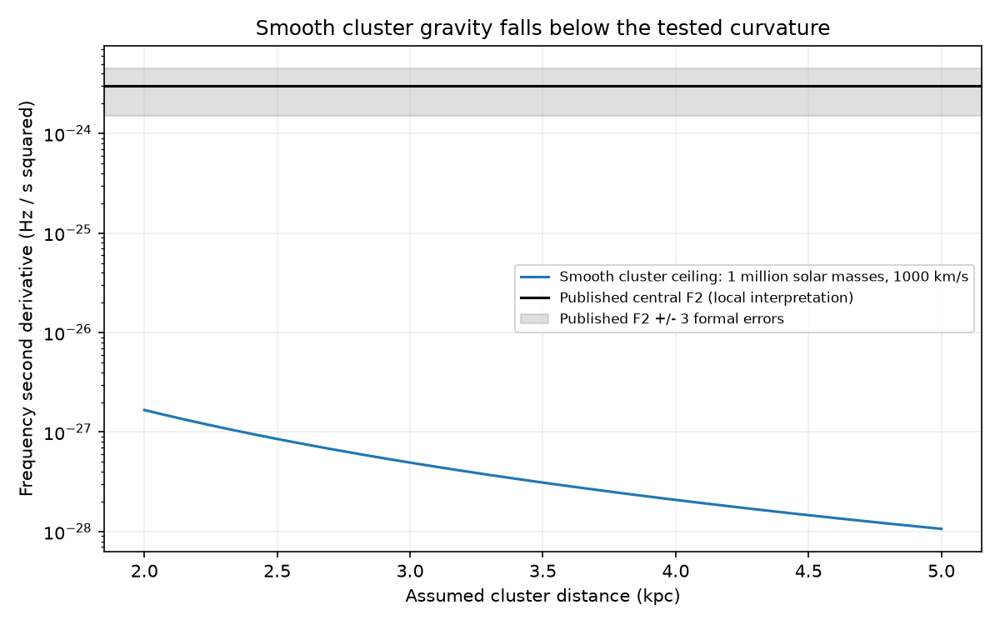

# Smooth spherical cluster models fall at least 900 times below the tested local curvature of J1646-4545

## Result

Gravity from a smooth model of Westerlund 1 cannot explain the published second spin-frequency derivative of PSR J1646-4545 if that coefficient is a local derivative. This result holds for the model class and parameter bounds below. It does not establish the cause of the measured timing curve.

At a cluster distance of at least 2 kpc, total mass at most one million solar masses, and relative speed at most 1000 km/s, the smooth-gravity ceiling is 1.666 x 10^-27 Hz/s^2. The published second derivative minus three formal errors is 1.5 x 10^-24 Hz/s^2. The ratio is 900.5. The central coefficient is 1801 times the ceiling. These are bounds, not likelihood ratios or detection levels.

The distance evidence is independent of the pulsar timing. It does not confirm the timing curvature. No new pulsar, planet, companion, or timing signal is found.

## Question and new contribution

The campaign screen sci:sha256:e794168dc2416061b242d77b3609e9e01b4f37b14e6de50c318f12f3e6006381 reports a large apparent braking index for J1646-4545. It leaves changing line-of-sight acceleration among the possible causes. It does not test the gravity of Westerlund 1. We test that specific explanation with a bound valid at every unknown line-of-sight offset. We extend the test from a central point mass to any static spherical density that does not increase with radius. We also check the three frequency terms against the raw catalogue.

Piga et al. (2024, doi:10.3390/universe10070274) discovered this pulsar in Parkes data and published its timing solution. Their Figure 5 describes residual structure as likely timing noise. The source Table 2 gives f = 2.3159744218 Hz, fdot = -1.49 x 10^-15 Hz/s and fddot = (3.0 +/- 0.5) x 10^-24 Hz/s^2. The coefficient is known. Its origin remains open.

We searched the local campaign for astronomy, TESS, periastron, eccentricity, pulsar braking, orbital decay, J1646, jerk companion, and braking index before this test. Only the cited screen addressed J1646 in the specific searches. Web searches for the source and its timing did not identify a later independent solution. This is not a complete literature census.

## External data and checks

We used the existing shared file:
datasets/atnf-psrcat-current-20261108-4339/psrcat_pkg.tar.gz.
Its resolved path, archive hash, database member hash and version header are in files/results.json. The archive SHA-256 is
55daa29f71f344c8de4064969b5812d6cb3a9b851efae0bef004ac9d5f6740c0.
The database member is psrcat_tar/psrcat.db, version 2.9.0. Its SHA-256 is
bac32471fef3e60cfd734f1db85503a9bd0a565018cb98edff54475f87eb642f.
The download URL is in files/retrieve.py. We made no new raw-data download.
The script checks that the source spin coefficients equal those used here.
ATNF and the paper are the same timing solution, not independent observations.

The angular separation is 5.97 arcmin from Piga et al. The independent Gaia and eclipsing-binary study of Navarete et al. (2022, arXiv:2204.09414v2; doi:10.1093/mnras/stac2374) gives a combined cluster distance of 4.05 +/- 0.20 kpc. Its two methods agree. We also test the much wider lower distance bound of 2 kpc. This bound is an assumption, not a confidence limit. The cluster distance sets the minimum physical impact parameter along the pulsar sightline, even if the pulsar is behind the cluster.

Mengel and Tacconi-Garman (2007, arXiv:0711.1779) report a dynamical mass scale of 1.25 x 10^5 solar masses. Our reference example uses that mass and a chosen relative speed of 10 km/s. The broad test instead allows one million solar masses and 1000 km/s. The latter are deliberately broad bounds, not measured values. We do not require the pulsar to be a bound cluster member.

Raw catalogues, papers, and source record tables are not bundled. Few factual constants occur in our code with attribution. The package contains our method, aggregate physical results and figure. See files/EXTERNAL_NOTICE.md for source terms and attribution.

## Bound and assumptions

Use a static spherical cluster in its translating rest frame. Its density rho(r) is nonnegative and does not increase with radius. Its total mass is at most M. Let r be the vector from the cluster centre to the pulsar, v the relative velocity, R the projected separation, and z the unknown line-of-sight offset. Thus r >= R. We hold the observer direction fixed. We use Newtonian gravity and a first-order Doppler shift.

The acceleration is a = -G M(<r) r/r^3. The two tangential eigenvalues of its spatial gradient are -G M(<r)/r^3. The radial eigenvalue is

    lambda_r = 2 G M(<r)/r^3 - 4 pi G rho(r).

Since the density does not increase with radius,
4 pi rho(r) <= 3 M(<r)/r^3. Thus the radial eigenvalue lies between
-G M(<r)/r^3 and 2 G M(<r)/r^3. The gradient norm is at most
2 G M/r^3. This also covers the exterior point-mass limit. Therefore

    abs(j_los) <= abs(da/dt) <= 2 G M abs(v)/R^3
    abs(fddot_gravity) <= (f/c) 2 G M abs(v)/R^3.

For a central point mass the line-of-sight bound is sharper:
GM abs(v)/R^3. For fixed R, the squared gradient of a_z is
(GM)^2 (R^2 + 4z^2)/(R^2 + z^2)^4.
It is largest at z = 0. We use the factor-two ceiling for all numerical conclusions.

We set R = D sin(theta), the closest distance from the cluster centre to the pulsar ray. With theta = 5.97 arcmin, this gives 7.033 pc at 4.05 kpc and 3.473 pc at 2 kpc.

The Doppler equation also gives a cross term -2 fdot_intrinsic a_los/c. In the broad box, the acceleration bound is 1.155 x 10^-8 m/s^2. Its contribution to fdot is at most 8.93 x 10^-17 Hz/s, about six percent of the measured value. The cross term is at most 1.22 x 10^-31 Hz/s^2 after allowing this shift in the intrinsic fdot. It is negligible here. For an intrinsic dipole law, 3 fdot_intrinsic^2/f is below 3.3 x 10^-30 Hz/s^2. Adding these terms does not close the gap.

## Numerical results and validation

| Test | Reference scale | Broad bound |
|---|---:|---:|
| Distance (kpc) | 4.05 | 2.0 |
| Mass (solar masses) | 125000 | 1000000 |
| Speed (km/s) | 10 | 1000 |
| Smooth fddot ceiling (Hz/s^2) | 2.508 x 10^-31 | 1.666 x 10^-27 |
| Curvature used (Hz/s^2) | 3.0 x 10^-24 | 1.5 x 10^-24 |
| Curvature / ceiling | 1.196 x 10^7 | 900.5 |

At 2 kpc and 1000 km/s, matching even the lower tested curvature requires at least 9.00 x 10^8 solar masses under this ceiling. At one million solar masses and 1000 km/s, it requires D <= 0.207 kpc. These are necessary conditions, not sufficient physical models.

The script checks the spatial-gradient bound on point-mass and Plummer fields over a grid of line-of-sight offsets and core radii. It also checks the point-mass jerk vector against a finite difference. The maximum difference is 1.94 x 10^-11 in dimensionless units. The analytic eigenvalue argument supplies the general proof; the grid is only a code check. No stochastic significance is assigned to these numerical tests.

## Limits and next tests

This is a conditional physical exclusion, not a new timing fit. A fitted polynomial coefficient need not equal an instantaneous derivative when cadence, covariance, propagation, or timing noise matters. We have no arrival times, instrument calibration, or fit covariance. We do not translate the formal three-error range into a probability. We do not assess fitting bias.

The smooth static spherical model excludes local stellar encounters, nonspherical substructure, an unseen nearby companion, changing propagation delay, and changes in the pulsar torque. It does not exclude those causes. It also does not model Galactic gravity, perspective terms, or an evolving cluster. A high formal braking index alone cannot identify a companion. The broad speed and mass limits are assumptions. A nonmonotone thin shell does not satisfy the proof.

The remaining useful test is an independent timing interval with arrival times, frequency-resolved propagation corrections, and a timing-noise model. A companion test must fit more than one derivative and the full observing window. Repeated fddot measurements can test whether the local curvature changes. The present result removes one smooth-gravity explanation and leaves the signal origin open.

## Reproduction

Python 3.12, numpy and matplotlib are sufficient. Exact versions used are in files/results.json. All calculations run in one process. No service is needed. Run from an extracted, verified bundle:

    OPENBLAS_NUM_THREADS=1 OMP_NUM_THREADS=1 python files/analyze.py --out /path/to/new-scratch/derived

For the raw input and version check:

    python files/analyze.py --raw /path/to/psrcat_pkg.tar.gz --out /path/to/new-scratch/checked

Use the existing shared file where available. Else run:

    python files/retrieve.py /path/to/new-scratch/raw

The public current URL can change. The retrieval script refuses a hash mismatch and does not write changed bytes. Retain the pinned shared copy. To add a new reusable copy on the campaign host, use the README campaign-dataset helper with a new dataset name, the source URL and the exact archive hash. Never replace an existing dataset.

Outputs go to the requested scratch directory. The signed package need not be changed. Numerical results should agree to floating-point rounding. The complete scientific argument, checks and source hashes survive removal of the private worktree.

Job: sci-1107-dell-astronomy-78c4d5da9d7f. Topic: astronomy.
Campaign: 11_07_2026. Machine: dell. Account: codex-olen.
Model: gpt-6.1-sol, high reasoning effort.
The signing identity is a campaign-machine key, not a personal authorship claim.
