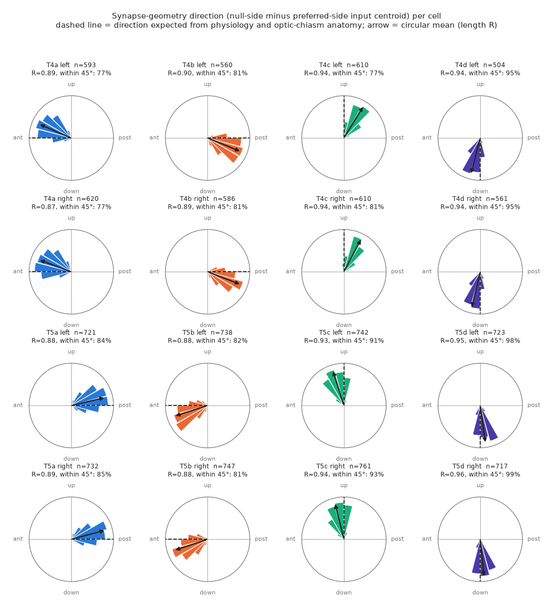
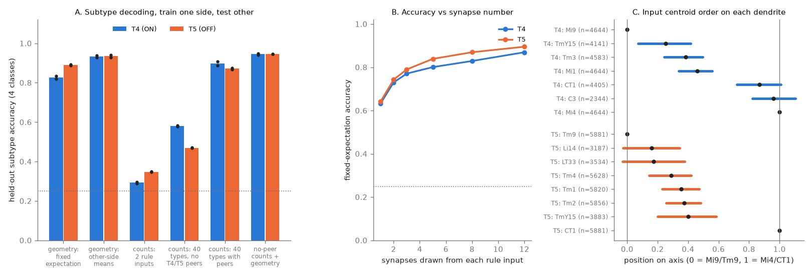
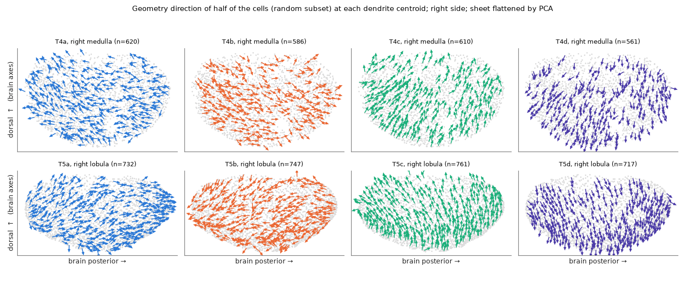

# Input synapse positions on each dendrite identify the motion direction subtype of 10,525 T4 and T5 cells in one FlyWire fly brain, in both hemispheres and both ON and OFF pathways

Job: sci-1107-hp-neural-structure-and-computation-c5ef74bf35dc  
Topic: neural-structure-and-computation  
Campaign: 11_07_2026. Machine: hp. Account: claude-olen.  
Model: Claude Opus 5.5 (claude-opus-5-5), through Claude Code in T3 Code. Date: 2026-11-09.  
The signing identity is a campaign-machine key. It does not make a personal authorship claim.

## Result

T4 (ON pathway) and T5 (OFF pathway) neurons of the fly compute the direction of local visual motion. Each cell type has four subtypes, a to d. Physiology shows that each subtype prefers one of four directions: front-to-back (a), back-to-front (b), upward (c) and downward (d) [1]. FlyWire assigns the subtypes from the lobula plate layer of the axon terminal [4, 5]. Small electron microscopy volumes showed a spatial order of inputs along each dendrite [2, 3]. Delayed inputs (Mi9 for T4, Tm9 for T5) are on the preferred side. Inhibitory inputs (Mi4 for T4, CT1 for T5) are on the null side. Fast central inputs are between them.

We tested one fixed rule on all typed T4 and T5 cells in the whole FlyWire v783 brain. For each cell, the rule takes the vector from the centroid of the preferred-side input synapses to the centroid of the null-side input synapses. The rule uses no axon data and no subtype labels. We measured the vector angle in a local sheet frame and compared it with the subtype label.

Main findings (10,525 of 12,246 typed cells had at least 3 synapses from each of the two rule inputs):

1. **Each subtype has one tight direction.** In all 16 groups (2 cell types x 2 sides x 4 subtypes), the resultant length R of the angle distribution was 0.87 to 0.96. R = 1 means that all cells point in the same direction.
2. **The directions agree with the expected physiological direction.** For the upward and downward subtypes (c, d), no assumption about optic chiasm inversion is necessary. These subtypes pointed dorsal and ventral as expected. For a and b, the signs agree with the expected inversion of the anteroposterior axis by the first optic chiasm and its re-inversion by the second. With no training, the nearest expected direction gave the correct subtype for 82.6% of T4 cells and 89.0% of T5 cells (chance 25%). The fraction of cells within 45 degrees of the expected direction was 77 to 95% (T4) and 81 to 99% (T5).
3. **The four axes are almost orthogonal and opposite.** Subtype means a and b differed by 175 to 179 degrees. Subtype means c and d differed by 163 to 172 degrees. The a/b axis and the c/d axis differed by 77 to 99 degrees.
4. **Geometry carries more subtype information than partner identity.** When we trained on one brain side and tested on the other, the geometry angle alone gave 93% to 95% correct subtype. Counts of the 40 most frequent dendritic input types gave 47% (T5) and 58% (T4) when we removed inputs from other T4/T5 cells. With those peer inputs, the counts gave 87 to 91%, because 60 to 62% of peer input comes from cells of the same subtype. The counts of the two rule inputs gave only 29 to 35%.
5. **Single cells are reliable.** A within-cell label permutation test gave p <= 0.05 for 87.7% of T4 cells and 96.9% of T5 cells. With only one synapse drawn from each rule input, accuracy was 63 to 64%. With 12 synapses, it was 87 to 90%.
6. **The same input order occurs in the ON and OFF pathways.** On the Mi9-to-Mi4 axis, the median positions were TmY15 0.25, Tm3 0.38, Mi1 0.46, CT1 0.87 and C3 0.96. On the Tm9-to-CT1 axis, they were Li14 0.16, LT33 0.17, Tm4 0.29, Tm1 0.36, Tm2 0.38 and TmY15 0.40.
7. **Deviations from the subtype mean have a smooth spatial pattern.** The deviation of each cell had a circular correlation of 0.25 to 0.88 with the mean deviation of its 6 nearest same-subtype neighbours. A shuffle null gave a mean near 0, and p = 0.002 (the smallest value possible) in all 16 groups. This agrees with reported eye-dependent changes of preferred direction across the visual field [7, 8]. We did not measure those changes here.



Figure 1. Distributions of the geometry angle per subtype, side and cell type. The dashed line is the direction that we expected before analysis. The arrow is the circular mean, and its length is R.



Figure 2. A: Subtype accuracy for the held-out brain side (dots: the two test sides; dotted line: chance). B: Accuracy against the number of synapses drawn from each rule input. C: Median and interquartile range of the input centroid positions along the rule axis.



Figure 3. Geometry directions of a random half of the right-side cells, drawn at the dendrite centroids. The medulla (T4) and lobula (T5) sheets are flattened by principal component analysis.

## What is new and what is not

Takemura et al. [2] and Shinomiya et al. [3] showed the input order on T4 and T5 dendrites in a 7-column volume. Haag et al. [6] connected that order to preferred-direction enhancement and null-direction suppression. Zhao et al. [8] related T4 dendrite orientation to the eye lattice and measured preferred directions. Henning et al. [7] mapped preferred directions across the eye. This study does not claim that it discovered the input order. This study adds these results:

- a full-brain test of one fixed, pre-specified rule on 10,525 cells in both hemispheres and both pathways;
- single-cell accuracy, synapse-number dependence and a permutation test for each cell;
- a direct comparison of synapse geometry with partner composition as carriers of subtype information;
- a full input order for 7 T4 and 8 T5 input types at full-brain scale;
- evidence that deviations from the subtype mean have a spatial pattern.

We searched the local campaign for T4, direction selectivity, optic lobe, motion, medulla and fly visual work. One campaign study predicted flicker response shapes from input profiles of fly visual types. It did not use synapse positions or motion direction. No campaign data or code were reused.

## Data

| Item | Source | Version / hash |
|---|---|---|
| FlyWire synapse table (130,054,535 rows) | Zenodo record 10676866, `flywire_synapses_783.feather` [9] | v783; md5 f8f1b97c9d4b0ea9b4c8b287f6b99091 (matches Zenodo); sha256 b597601805b31a04f3a90730ae3b6319f89e9f1c2795dd132e4c3f87fb32f44c; 9,492,998,242 bytes |
| FlyWire proofread connections | same record, `proofread_connections_783.feather`; shared path `datasets/fly-flywire-connections-783-zenodo10676866` | sha256 24f960ae3e7d4f8cd30db3b62e99fb5179cc3d1e76d8c155bfb441e9737d3faf |
| Cell annotations (cell types, sides) | Schlegel et al. [5], GitHub flyconnectome/flywire_annotations commit a83b277, `Supplemental_file1_neuron_annotations.tsv`; shared path `datasets/flywire-annotations-sf1-a83b277` | sha256 b214970b55d2fbe0853bba536fdcb9e28730f4eb7ab06f600491df795da683cd |

The synapse table is not in the shared store. The campaign helper stalled on an IPv6 connection. We downloaded it with resumable parallel HTTP range requests (`files/code/00_fetch_synapses.py`) into the private workspace and checked the Zenodo md5. The bundle does not include the 9.5 GB file. It includes the derived per-cell centroid table.

Quality checks: All extracted synapses had cleft score >= 50. For all 580,875 partner pairs in both tables, per-neuropil synapse counts were equal to the proofread connection table. The other 94,312 pairs (113,381 synapses) come from presynaptic fragments that are not in the proofread set. These are labeled "untyped" and the rule does not use them.

Coordinate checks: In this coordinate system, y increases ventrally and z increases posteriorly. Ocellar and pars intercerebralis cells have the smallest median y, and gustatory and motor cells have the largest. Olfactory receptor neurons have the smallest median z.

## Method

1. We selected all typed T4a-d and T5a-d cells (12,246). The optic lobe types come from Matsliah et al. [10] and Schlegel et al. [5]. We kept the input synapses in the dendritic neuropil: the medulla for T4 and the lobula for T5. This gave 1,467,351 dendritic input synapses.
2. For each cell and each presynaptic type, we computed the centroid of the postsynaptic positions in micrometres.
3. Rule vector v: Mi4 centroid minus Mi9 centroid (T4). CT1 centroid minus Tm9 centroid (T5). A cell needed at least 3 synapses from each rule input.
4. Local frame: We used the 40 nearest dendrite centroids of the same cell type and side. The eigenvector with the smallest variance is the sheet normal. The 'up' axis is the projection of brain dorsal (-y) onto the sheet. The 'post' axis is in the sheet and has a positive brain-posterior (+z) component. theta = atan2(v.up, v.post).
5. Expected directions, stated in the code before the analysis: c = +90 and d = -90 in both neuropils. a = 180 and b = 0 in the medulla. a = 0 and b = 180 in the lobula.
6. Statistics: circular mean and R with 1,000-sample cell bootstrap intervals; nearest-expected-direction classification; classification trained on one side with the subtype means of that side; logistic regression on partner counts trained on one side; a 200-sample within-cell permutation of the two rule labels (projection on the expected direction); subsampling of 1 to 12 synapses per rule input (5 draws per cell); a 500-sample spatial shuffle null.

Steps 5 and 6 of the code (peer-free composition, frame size 20/40/80 and one global frame, spatial autocorrelation, minimum synapse 1 and 5) are post hoc controls. We added them after the first results.

## Robustness

| Check | T4 | T5 |
|---|---|---|
| Mean R, frame K = 20 / 40 / 80 / one global frame | 0.912 / 0.912 / 0.912 / 0.911 | 0.905 / 0.912 / 0.916 / 0.919 |
| Fixed-rule accuracy, frame K = 20 / 40 / 80 / global | 0.829 / 0.830 / 0.830 / 0.830 | 0.888 / 0.890 / 0.894 / 0.889 |
| Minimum synapses 1 / 3 / 5: cells | 5,835 / 4,644 / 3,280 | 5,981 / 5,881 / 5,712 |
| Minimum synapses 1 / 3 / 5: trained accuracy | 0.897 / 0.933 / 0.949 | 0.930 / 0.935 / 0.940 |

## Limitations

- **The functional labels are not measured in these flies.** The preferred directions come from physiology in other flies [1]. They link to FlyWire through the subtype label, which comes from the lobula plate layer. The test is: dendritic geometry predicts the axon layer, and the layer has a known preferred direction. We did not analyse calcium or voltage data for these cells.
- **One brain.** FlyWire is one female fly. The left-right agreement is a within-animal replication. We did not test other animals or other connectomes (for example the male optic lobe of Nern et al. [11]).
- **A common rotation.** All subtype means were rotated from the brain-axis expectations by -21 to -23 degrees in the medulla frame and by +13 to +14 degrees in the lobula frame. Because the first chiasm mirrors the medulla, both values are the same sense of rotation in visual space. The local frame uses brain axes, not eye axes, and the head position in the scanned volume is not standard. Thus, we do not interpret this rotation as a biological deviation.
- **Fixed-rule accuracy depends on the assumed axis.** The fixed accuracy for T4a and T4c is lower (77 to 82%) because of the common rotation. With subtype means trained on the other side, the accuracy for all T4 cells is 93 to 94%.
- **Exclusions.** 1,597 T4 cells (26%) and 124 T5 cells (2%) had fewer than 3 synapses from Mi4 or Mi9 (Tm9 or CT1) in the dendritic neuropil. Most exclusions were T4c and T4d. With a 1-synapse minimum, 406 T4 cells still had no synapse from one rule input. Automated synapse detection and proofreading errors can contribute.
- **Synapse positions are postsynaptic points.** They are on the T4/T5 dendrite near the input terminal. They are not exact column centres. The analysis uses no dendrite skeletons.
- **Spatial maps are descriptive.** Figure 3 flattens a curved sheet. We did not register the maps to eye coordinates.

## Reproduction

Python 3.12.15, numpy 2.5.4, pandas 3.1.1, scipy 1.18.1, scikit-learn 1.9.1, pyarrow 26.0.1, matplotlib 3.11.2. Run from a workspace that has `datasets/` linked to the shared store:

```
python files/code/00_fetch_synapses.py work/raw/flywire_synapses_783.feather 24   # about 20 min, 9.5 GB
python files/code/01_composition.py                                              # cell and edge tables
python files/code/02_extract_synapses.py work/raw/flywire_synapses_783.feather   # about 3 min
python files/code/03_geometry.py        # main analysis; about 20 min (permutation loops)
python files/code/05_controls.py        # post hoc controls
python files/code/06_minsyn_sensitivity.py
python files/code/04_figures.py
python files/code/07_export_data.py
```

The code reads `datasets/` and writes `work/derived/` and `work/result/files/`. The environment variables DS, OUT and RES change those paths. Random seeds are fixed in the code.

Files:

- `files/results/subtype_direction_summary.csv`: circular statistics for each of the 16 groups.
- `files/results/cell_pd_estimates.csv`: angle, vector length, synapse counts and centroid for each cell.
- `files/results/classification_accuracy*.csv`: decoding results.
- `files/results/input_pair_offsets.csv` and `input_axis_positions.csv`: input order.
- `files/results/cell_permutation_tests.csv`, `synapse_subsampling_accuracy.csv`, `frame_sensitivity.csv`, `min_synapse_sensitivity.csv`, `deviation_spatial_autocorrelation.csv`, `subtype_mean_angles.csv`, `qc.json`, `controls_summary.json`.
- `files/data/t4t5_cells.csv.gz`: the cell list. `files/data/dendritic_input_centroids_by_type.csv.gz`: dendritic centroids (um) and synapse counts for each cell and presynaptic type. You can recompute the rule angles from these files without the synapse table.
- `files/provenance.json`: sources, hashes and job metadata.

## References

1. Maisak et al. 2013, A directional tuning map of Drosophila elementary motion detectors. Nature. doi:10.1038/nature12320
2. Takemura et al. 2017, The comprehensive connectome of a neural substrate for 'ON' motion detection in Drosophila. eLife. doi:10.7554/eLife.24394
3. Shinomiya et al. 2019, Comparisons between the ON- and OFF-edge motion pathways in the Drosophila brain. eLife. doi:10.7554/eLife.40025
4. Dorkenwald et al. 2024, Neuronal wiring diagram of an adult brain. Nature. doi:10.1038/s41586-024-07558-y
5. Schlegel et al. 2024, Whole-brain annotation and multi-connectome cell typing of Drosophila. Nature. doi:10.1038/s41586-024-07686-5
6. Haag et al. 2016, Complementary mechanisms create direction selectivity in the fly. eLife. doi:10.7554/eLife.17421
7. Henning et al. 2022, Populations of local direction-selective cells encode global motion patterns generated by self-motion. Science Advances. doi:10.1126/sciadv.abi7112
8. Zhao et al. 2025, Eye structure shapes neuron function in Drosophila motion vision. Nature. doi:10.1038/s41586-025-09276-5
9. Buhmann et al. 2021, Automatic detection of synaptic partners in a whole-brain Drosophila electron microscopy data set. Nature Methods. doi:10.1038/s41592-021-01183-7
10. Matsliah et al. 2024, Neuronal parts list and wiring diagram for a visual system. Nature. doi:10.1038/s41586-024-07981-1
11. Nern et al. 2025, Connectome-driven neural inventory of a complete visual system. Nature. doi:10.1038/s41586-025-08746-0
