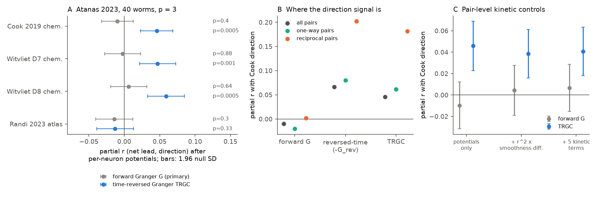
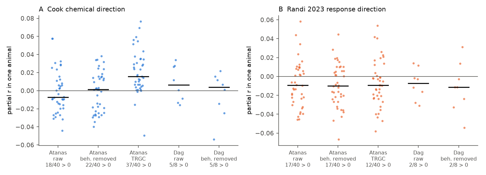
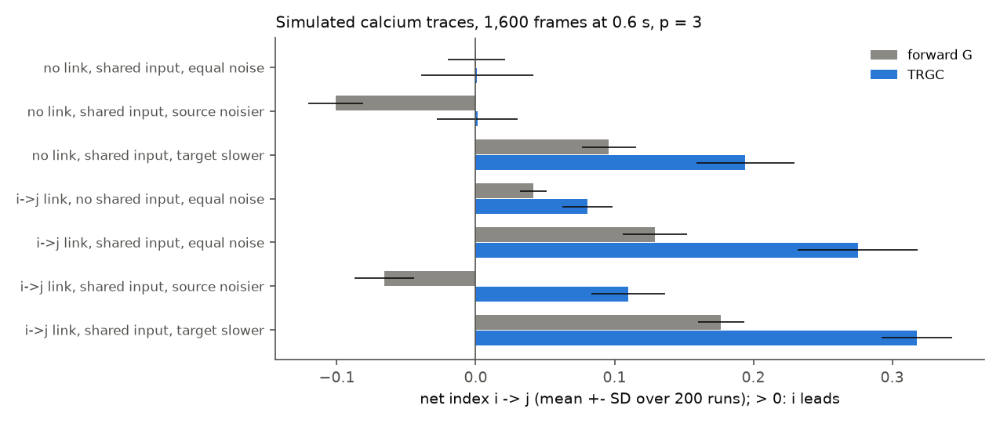

# Chemical synapse direction gave no forward Granger lead in 40 freely moving C. elegans after per-neuron timing control; time-reversed Granger gave a small presynaptic lead

## Summary

Campaign studies (`sci:sha256:a250df14…`, `sci:sha256:fea404fc…`) found that gap junctions predict zero-lag co-activity of identified *C. elegans* neurons, but chemical synapse weight does not. A zero-lag correlation has no direction. A chemical synapse has a direction. Thus, we asked a different question: **in spontaneous whole-brain activity, does the presynaptic neuron of a chemical connection lead the postsynaptic neuron in time?**

We used 40 freely moving NeuroPAL animals (Atanas, Kim et al. 2023) as the primary data set and 8 more animals from the same laboratory (Dag et al. 2023) as a replication set. For each pair of identified neurons in each animal, we calculated the net pairwise Granger index G (lag order 3, 1.8 s). We fitted one "timing potential" per neuron. This potential removes all per-neuron effects, for example indicator kinetics, signal-to-noise ratio and neuron type. Then we tested whether the chemical direction (Cook 2019; Witvliet 2021 Datasets 7 and 8) predicts the remaining, pair-specific lead. We wrote the test plan before the outcomes were calculated (`files/PLAN.md`).

Main results (Figure 1):

1. **The primary test was null.** Without the timing potentials, the postsynaptic neuron appeared to lead (r = −0.074, permutation p = 0.0005; 7,872 pairs, 932 with a chemical connection, 134 neurons). With the timing potentials, the chemical-direction effect was zero: partial r = −0.010 (p = 0.40) for Cook, −0.002 (p = 0.88) for Witvliet D7 and +0.006 (p = 0.64) for Witvliet D8. Only 18 of 40 animals had a positive value. Behaviour-removed traces, lag orders 1 and 6, unstimulated animals only and the Dag animals gave the same null result (Figure 2).
2. **A pre-specified robustness test, time-reversed Granger (TRGC), gave a small presynaptic lead.** TRGC subtracts the Granger index of the time-reversed traces. Partial r was +0.046 (p = 0.0005), +0.047 (p = 0.001) and +0.059 (p = 0.0005) for the three connectomes. It was positive in 37 of 40 animals (sign test p = 2 × 10⁻⁸). In the 8 Dag animals, the effect was smaller and uncertain: +0.024 (p = 0.065), +0.037 (p = 0.025) and +0.031 (p = 0.048).
3. **Forward Granger timing mostly shows trace smoothness, not wiring order.** The per-neuron forward-Granger potentials correlated with the lag-1 autocorrelation of each neuron's trace (Spearman 0.50, p = 1 × 10⁻⁹, 134 neurons). The TRGC potentials did not (−0.13, p = 0.14). In a simulation of calcium-like traces with a shared input, a noisier source gave the wrong sign for forward Granger in 100% of runs, but TRGC was unbiased (Figure 5).
4. **The optogenetic response direction did not agree with spontaneous lead.** For 5,752 pairs that the Randi 2023 signal propagation atlas measured in both directions, the response asymmetry gave partial r = −0.014 (p = 0.30) for G and −0.013 (p = 0.33) for TRGC. Per animal, the TRGC value was positive in only 12 of 40 animals (p = 0.017). Thus, if a relation exists, it has the opposite sign.
5. **At the neuron level, downstream neurons led in forward Granger.** The forward-G potential increased with the trophic level of the neuron in the chemical network (Spearman 0.33, p = 0.0001; within neuron type 0.28, p = 0.001). Because the same potential follows trace smoothness (result 3), we do not interpret this as a wiring-order effect (Figure 4).

Conclusion: pairwise Granger analysis of 0.6 s calcium frames does not show a robust pair-specific lead of the presynaptic neuron. Only the time-reversed Granger test showed a small effect (about 0.2% of the pair-level variance). The effect stayed after pair-level smoothness controls, but its replication in a second small set was weak. Indicator and cell kinetics can also cause it. The direction from optogenetic stimulation did not agree with spontaneous lead. Thus, the result does not support spontaneous lead-lag as a tool to find causal wiring direction in these data.

## Question and hypotheses

Question: does the direction of chemical wiring predict the direction of temporal precedence in spontaneous whole-brain activity, after we remove one timing value per neuron?

Hypotheses from `files/PLAN.md` (written before the outcomes were calculated):

| Hypothesis | Test | Outcome |
|---|---|---|
| H1 (primary): presynaptic neurons lead (β > 0) | forward G, Cook log-weight difference, Atanas raw traces | Not supported: partial r −0.010, p = 0.40 |
| H2: Randi 2023 response direction predicts G | response asymmetry (q < 0.05), wild type | Not supported: −0.014, p = 0.30 |
| H3 (exploratory): neurons with a higher trophic level lag | Spearman of potential and trophic level | Opposite sign: downstream neurons lead (0.33); the potential follows trace smoothness |
| Robustness: TRGC | same model | Positive in Atanas (0.046 to 0.059), weak in Dag (0.024 to 0.037) |

## Data

| Item | Value |
|---|---|
| Primary activity | Atanas, Kim et al. 2023 (Cell), Zenodo 19388374, 40 NeuroPAL animals, freely moving, 1,600 to 1,615 volumes at 0.6 s; 21 animals have a heat stimulus near volume 802 |
| Replication activity | Dag et al. 2023 (Cell), Zenodo 19414639, 8 NeuroPAL-labelled animals, 799 to 800 volumes at 0.6 s |
| Labels | confidence ≥ 3; duplicate labels and duplicate ROIs removed (same rule as `sci:a250df14`) |
| Connectomes | Cook 2019 hermaphrodite chemical weights (EM sections); Witvliet 2021 adult Datasets 7 and 8 (synapse counts). Edge tables reused from `sci:a250df14` |
| Causal atlas | Randi et al. 2023 signal propagation atlas, `funatlas.h5`, wild type `q` and `occ1`; `q[i, j]` is the response of neuron i to stimulation of neuron j (`get_kernel` docstring, "pair i<-j", wormneuroatlas commit b2e13d88) |
| Neurons and pairs | 134 neurons and 7,872 pairs (Cook, pairs seen in ≥ 5 animals); 116 neurons and 5,796 pairs (Witvliet); 129 neurons and 5,752 pairs with atlas data in both directions |

Sources, versions and SHA-256 values are in `files/PROVENANCE.md`.

## Methods

**Directed index** (`files/code/02_directed.py`). For each animal, we z-scored each ROI trace (`gcamp/trace_array`). For each ordered pair (i, j) of identified neurons, we calculated the Geweke Granger index F(i→j) = ln RSS(j | own past) − ln RSS(j | own past + past of i), with lag order p = 3 and a constant for each segment. For the 21 heat-stimulated animals, we used two segments (before the stimulus, and from 20 volumes after it). Lagged rows did not cross a segment edge. The net index is G_ij = F(i→j) − F(j→i). Positive G_ij means that i leads j. We also calculated G on the time-reversed traces (G_rev) and TRGC = G − G_rev (Haufe et al. 2013; Winkler et al. 2016). "Behaviour-removed" traces are residuals on the behaviour design of `sci:a250df14` (velocity, head angle, angular velocity, pumping, curvature and reversal state, each with causal exponential filters of 1, 5, 15 and 50 volumes, plus a constant, a linear time term and a quadratic time term).

**Pair model** (`files/code/03_models.py`). The outcome is the mean of G_ab over animals for each unordered pair (a < b), for pairs seen in ≥ 5 animals (≥ 3 for Dag). The model is G_ab = b_a − b_b + β·D_ab + e. The b values are the timing potentials of the neurons (the gradient part of a Hodge decomposition of the pair graph). D_ab = ln(1 + w_ab) − ln(1 + w_ba), where w is the chemical weight. We report the partial correlation of G and D after projection on the gradient design (Frisch–Waugh). For inference, we permuted the neuron identities of the D matrix 2,000 times. A second predictor is the one-way indicator (+1 for a→b only, −1 for b→a only, 0 otherwise). For the atlas, D_fun = 1[q(b | stim a) < 0.05] − 1[q(a | stim b) < 0.05], only for pairs with data in both directions. We also fitted the model in each animal and used a sign test over animals.

**Neuron level.** We estimated the potentials from the pair means (sum-zero constraint). We compared them with the trophic level of each neuron in the weighted chemical network (MacKay, Johnson and Sansom 2020), with a partial rank correlation that controls for neuron type (Witvliet type table; 10,000 within-type permutations).

**Exploratory checks, added after the planned tests** (`files/code/05_explore.py`, `files/code/06_simulation.py`). (a) We separated TRGC into the forward part (G) and the reversed part (−G_rev). (b) We split the pairs into one-way and reciprocal connections. (c) We calculated the lag-1 autocorrelation of each neuron's trace ("smoothness") and compared it with the potentials. (d) We added pair-level covariates to the model: the squared mean zero-lag correlation of the pair multiplied by the smoothness difference, and four more products of this type. (500 permutations.) (e) We simulated two calcium-like units with a shared input, a lagged link, unequal noise or unequal decay times (200 runs each).

## Results

### Figure 1. Main result



A: Partial correlation between the net lead and the wiring direction after the per-neuron potentials, Atanas data, raw traces. Grey: forward Granger (primary). Blue: time-reversed Granger (TRGC). Bars: ±1.96 SD of the permutation null. B: The direction signal is in the reversed-time part (−G_rev), not in the forward part. The effect is larger for reciprocal pairs with unequal weights. C: Pair-level kinetic covariates decrease the TRGC effect only a little.

| Connectome | Measure | Partial r | z | Permutation p | Positive animals |
|---|---|---|---|---|---|
| Cook 2019 | G (primary) | −0.010 | −0.87 | 0.40 | 18 / 40 |
| Witvliet D7 | G | −0.002 | −0.17 | 0.88 | |
| Witvliet D8 | G | +0.006 | +0.41 | 0.64 | |
| Cook 2019 | TRGC | +0.046 | +3.96 | 0.0005 | 37 / 40 |
| Witvliet D7 | TRGC | +0.047 | +3.60 | 0.001 | |
| Witvliet D8 | TRGC | +0.059 | +4.41 | 0.0005 | |
| Randi 2023 | G | −0.014 | −1.08 | 0.30 | 17 / 40 |
| Randi 2023 | TRGC | −0.013 | −0.98 | 0.33 | 12 / 40 |

p = 0.0005 is the smallest value that 2,000 permutations can give. The timing potentials explain 29% of the variance of the pair-mean G (14% of TRGC). The split-half reliability over animals (Spearman–Brown) is 0.58 for G, 0.64 for TRGC and 0.85 for the zero-lag correlation. For the G pair-specific residual it is 0.47, and for the potentials it is 0.84 (`files/results/models/reliability*.csv`).

Decomposition (Cook, exploratory; `files/results/explore/decomposition.csv`):

| Pairs | n | G | −G_rev | TRGC |
|---|---|---|---|---|
| all | 7,872 | −0.010 | +0.066 | +0.046 |
| one-way connection | 704 | −0.020 | +0.080 | +0.062 |
| reciprocal connection | 261 | +0.002 | +0.202 | +0.181 |

Pair-level kinetic covariates (exploratory; 500 permutations, smallest p = 0.002):

| Covariates in addition to potentials | G | TRGC |
|---|---|---|
| none | −0.010 (p = 0.39) | +0.046 (p = 0.002) |
| r² × smoothness difference | +0.004 (p = 0.74) | +0.039 (p = 0.006) |
| five kinetic products | +0.007 (p = 0.59) | +0.041 (p = 0.006) |

In connected pairs, the postsynaptic neuron had a slightly smoother trace than the presynaptic neuron (partial r between D and r² × smoothness difference: −0.047). The simulation shows that a slower target can make a false presynaptic lead in TRGC (Figure 5). The covariates remove only a small part of the effect, but the smoothness of a trace is not a direct measure of indicator kinetics.

### Figure 2. Robustness


A: Chemical direction for all pre-specified configurations and three connectomes. B: Randi 2023 response direction. The full table is `files/results/models/pair_tests.csv`.

Other results: the one-way indicator gave a small negative forward-G effect with Cook (−0.024, p = 0.036), but not with Witvliet D7 or D8 (−0.005 and +0.006). With TRGC, the one-way indicator gave +0.011 (p = 0.31), +0.027 (p = 0.044) and +0.053 (p = 0.0005). The continuous atlas measure (difference of −log10 q) gave small negative values for G (−0.029, p = 0.043; behaviour-removed −0.039, p = 0.003), which agrees with the sign of result 4.

### Figure 3. Single animals



Partial r in each animal (Cook direction, A; atlas direction, B). Black line: median. The TRGC effect is positive in 37 of 40 Atanas animals. The atlas direction gives mostly negative values.

### Figure 4. Neuron level


Left: the forward-G potential (positive: the neuron leads) increases with the trophic level (Spearman 0.33; Witvliet D7 0.42, D8 0.43; within neuron type 0.28 to 0.32, permutation p ≤ 0.0013). Middle: the same potential follows trace smoothness (0.50). Right: the TRGC potential does not follow smoothness (−0.13, p = 0.14). The TRGC potential has a weak relation to trophic level (0.19, p = 0.03). The atlas out-minus-in response rate did not predict the forward-G potential (0.06, p = 0.51).

### Figure 5. Simulation



Two calcium-like units (decay time 1.5 s or 4 s; 1,600 frames at 0.6 s; lag order 3; 200 runs for each condition). With a shared input and no link, unequal noise gave a false forward-G direction (the noisier unit "lags") in 100% of runs, and TRGC was near zero. A slower target gave a false i→j lead in both measures. With a real i→j link and a noisier source, forward G had the wrong sign in 99.5% of runs, and TRGC had the correct sign in 100%.

## Interpretation

Forward pairwise Granger analysis of these calcium traces does not find the direction of chemical wiring. Most of the forward timing structure is per-neuron, and it follows the smoothness of the trace. This agrees with the known bias of Granger analysis for signals with unequal noise. Time-reversed Granger removes this bias. With TRGC, we found a small presynaptic lead in the primary data set and a weaker, uncertain lead in 8 more animals. The effect is largest for reciprocal pairs with unequal weights. TRGC does not remove a bias from different decay times. Postsynaptic neurons had slightly smoother traces, and pair-level controls for smoothness decreased the effect by only 11 to 15%. Thus, a kinetic cause remains possible.

The optogenetic atlas gave no support. A neuron that responds to stimulation of a partner did not lag that partner in spontaneous activity. A campaign study (`sci:sha256:de1b3984…`) found that chemical direction does not predict the evoked response direction in the same atlas. Randi et al. (2023) recorded immobilised animals with repeated stimulation, and a campaign study (`sci:sha256:fea404fc…`) found that the co-activity pattern of those recordings is different from that of freely moving animals. Thus, the two measurements can show different dynamics.

## Limitations

- The connectomes and the atlas come from different animals than the activity data.
- Calcium imaging at 0.6 s per volume with GCaMP cannot resolve synaptic delays. The measured "lead" is a slow lead at the seconds scale.
- Pairwise Granger does not condition on other neurons. Common inputs with different delays can cause a lead without a direct link.
- Trace smoothness is a proxy. We could not measure indicator kinetics per neuron. A kinetic cause of the TRGC effect remains possible.
- The replication set is small (8 animals, 800 volumes) and comes from the same laboratory. Its TRGC effect was uncertain (p = 0.025 to 0.065).
- The TRGC result was a pre-specified robustness test, not the primary test. The decomposition, kinetic covariates and simulation were added after we saw the results.
- p = 0.0005 is the permutation floor. We did not apply a correction over the many robustness configurations; read them as a pattern, not as separate claims.
- The atlas direction uses q < 0.05 for each direction. Detection depends on the stimulation efficiency of each neuron. The potentials remove per-neuron effects only in an additive form.

## Reproduce

```
# inputs (see files/PROVENANCE.md for URLs and SHA-256 values)
mkdir -p data/atanas data/dag
tar -xjf processed_h5.tar.bz2 -C data/atanas      # Zenodo 19388374
bunzip2 -kc neuropal_label.json.bz2 > data/atanas/neuropal_label.json
tar -xjf dag_processed_h5.tar.bz2 -C data/dag     # Zenodo 19414639
bunzip2 -kc dag_neuropal_label.json.bz2 > data/dag/neuropal_label.json
export OMP_NUM_THREADS=1
C=files/code
python $C/02_directed.py data/atanas data/atanas/neuropal_label.json runs/atanas_p3 3
python $C/02_directed.py data/atanas data/atanas/neuropal_label.json runs/atanas_p1 1
python $C/02_directed.py data/atanas data/atanas/neuropal_label.json runs/atanas_p6 6
python $C/02_directed.py data/dag data/dag/neuropal_label.json runs/dag_p3 3
python $C/03_models.py runs files/derived funatlas.h5 runs/models 2000
python $C/05_explore.py runs files/derived data/atanas data/atanas/neuropal_label.json runs/models runs/explore
python $C/06_simulation.py runs/sim 200
python $C/04_figures.py runs/models files/derived runs/explore runs/sim files/figures
```

`02_directed.py` takes about 4 s for each animal. `03_models.py` takes about 25 minutes. The `05_explore.py` permutations take about 15 minutes. Random seeds are fixed (20261109, 20261110). Python 3.12.15, numpy 2.5.4, scipy 1.18.1, pandas 3.1.1, h5py 3.16.0, matplotlib 3.11.2 (`files/code/requirements.txt`). All outputs of our runs are in `files/results/` (`directed/` holds the per-animal pair tables).

## Provenance

Job sci-1107-hp-neural-structure-and-computation-e2dbe970487e, campaign 11_07_2026, topic neural-structure-and-computation, machine hp, account claude-andrii. Model: Claude Opus 5.5 (`claude-opus-5-5`). Analysis date: 2026-11-09. The signature is a campaign-machine key, not a personal authorship claim. The data are the work of Atanas, Kim et al. (2023), Dag et al. (2023), Randi et al. (2023), Cook et al. (2019) and Witvliet et al. (2021); cite their articles.
