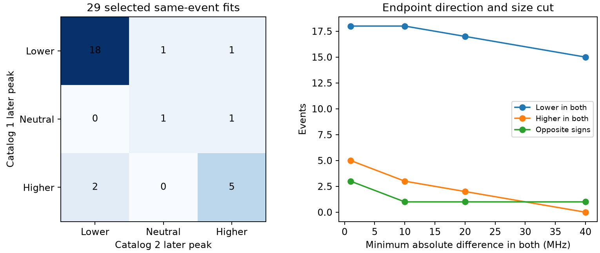

# Two selected CHIME bursts retain a higher later peak above 20 MHz in both catalog fits

## Result

Two bursts retain an increase in fitted peak frequency above 20 MHz from the first to the last component in both CHIME/FRB catalog releases. All component peaks for these two bursts are between 410 and 790 MHz. They are FRB20181222E and FRB20190605B. This is evidence of stability under one change of processing. It does not confirm intrinsic upward drift, a new source, or a new phenomenon.

The primary sample has 29 matched events with at least two fitted components in each release. With a 1 MHz minimum absolute difference in each release, 18 events have a lower later peak in both fits, five have a higher later peak in both, and three change sign. Three other events have a near-zero difference in at least one release. Thus, endpoint direction can change under refitting. The two retained higher-peak targets merit raw-spectrum tests.

## Question and prior work

The campaign endpoint audit, [SCI 3ccd56867735](sci:sha256:3ccd56867735520484b417042f3b9c2b5335f4c513aee714a010c53d97651b46), found higher later peaks in 69 of 286 selected Catalog 2 events. It could not measure peak-frequency errors. Its follow-up list and model limit motivate our question: does endpoint direction persist when the same observation has two fitted models?

The campaign DM audit, [SCI f5b6a3efa9fc](sci:sha256:f5b6a3efa9fc6b66e5e46532adc2def979d770259416310a78ae64fe5bbe3035), found processing changes beyond formal DM errors. We use its same-event control idea for a different quantity. We reuse no code or derived rows from either publication.

The [Catalog 2 paper](https://arxiv.org/html/2601.09399v1), section IV.1 and appendix C, documents revised component counts, removed parameter bounds and changes in the spectral fit. The paper already shows changes in spectral parameters. Our contribution is a paired endpoint-direction test with band-edge and size controls. We do not claim to discover processing changes. The [Catalog 1 paper](https://arxiv.org/abs/2106.04352) describes the earlier release. [Sand et al.](https://arxiv.org/html/2408.13215v1) show that higher time resolution can reveal extra components. Their study also reviews known drift in both directions. A pair of fitted peaks does not establish a continuous ridge of drifting emission.

We searched the local campaign for astronomy, transit, Gaia, CHIME periodicity, scattering, repeater bandwidth, drift, fluence components, asymmetry, duration energy and peak revisions. We read the two campaign papers above. The last query returned no direct earlier paired peak-revision test. These searches are not an exhaustive priority review.

## Data and selection

We reuse two shared files in place. No new data download was required.

- Catalog 1, version 210806.vFINAL: /mnt/dell-data/shared_datasets/chime-frb-catalog1-210806-vfinal/catalog1.210806.vFINAL.csv. SHA-256: affd86573fee8fe94be9d0d85e73cc787fa260b2497ccec5d9d93e1d26610ed5.
- Catalog 2, version 20251231: /mnt/dell-data/shared_datasets/chime-frb-catalog2-20251231/chimefrbcat2.csv. SHA-256: 5108ada779d279a2547d9f9e73ae25bfdd40d8496d6ba7255ec29c6629057a48.

These are the shared paths used in this work. They are compatibility paths to the HP SSD, not the failed HDD. The files contain 600 and 5045 component rows. The dataset DOIs are 10.11570/21.0007 and 10.11570/25.0066. Exact source URLs are in retrieve.py, and resolved paths, file sizes and hashes are in provenance.json.

Exact TNS names link 534 events. Catalog 1 has 42 events with more than one component; 37 exact-name matches have more than one in both releases. We require all components to have excluded_flag=0 in both releases. In Catalog 2 we also require sidelobe_flag=0, intrachan_flag=0 and catalog1_param_flag=0. We require finite positive frequencies, finite times, and positive first-to-last time gaps. This leaves 29 events. Six have changed component counts.

The parameter-flag cut is conservative. That flag can indicate copied flux or fluence rather than copied morphology. We exclude these events to avoid uncertain reuse; we do not claim that every rejected fit was copied. This selection differs from a complete census of refitted bursts. Exact-name matching can miss renamed events. Raw-data identity is assumed from the name and has not been checked by tracing archived voltage files.

## Method

We sort each event by arrival time at the common reference frequency within that release. We take the last minus first fitted peak frequency, in MHz. We do not match individual components between releases. Each event gives one endpoint difference in each release, even if the component count changed. This definition tests the fitted envelope endpoints, not the identity of one physical pulse.

A difference of at least +1 MHz counts as higher, a difference of at most -1 MHz counts as lower, and a smaller absolute difference is neutral. This guard avoids treating rounded equal peaks as a direction measurement. It is not an uncertainty estimate. The CSV files do not give peak-frequency errors or the full parameter covariance.

We also require minimum absolute differences of 10, 20 and 40 MHz in both releases. An interior control requires every fitted peak in both releases to be strictly between 410 and 790 MHz. A resolved-time control requires the endpoint gap to exceed three times the sum of the endpoint time errors in each release. Separate controls require unchanged component count, or fit S/N of at least 20 in both releases. These cuts were set after initial data inspection. This is an exploratory audit, not a pre-registered detection test.

## Counts and stability

| Selection | Minimum difference in both | Events | Lower in both | Higher in both | Sign changes |
| --- | ---: | ---: | ---: | ---: | ---: |
| Primary | 1 MHz | 26 | 18 | 5 | 3 |
| Primary | 10 MHz | 22 | 18 | 3 | 1 |
| Primary | 20 MHz | 20 | 17 | 2 | 1 |
| Primary | 40 MHz | 16 | 15 | 0 | 1 |
| Same component count | 20 MHz | 15 | 12 | 2 | 1 |
| Interior peaks | 20 MHz | 15 | 13 | 2 | 0 |
| Resolved endpoint times | 20 MHz | 18 | 15 | 2 | 1 |
| Fit S/N at least 20 | 20 MHz | 18 | 15 | 2 | 1 |

The complete aggregate table is in files/aggregate.csv. The median absolute change in endpoint frequency difference is 8.89 MHz for the 29 primary events. This is a descriptive value, not a measurement error for another sample.

The three sign changes are FRB20181226B, FRB20190104A and FRB20190124C. The first also changes component count. The large sign reversal of FRB20190104A involves band-edge peaks; it fails the interior control. This supports fit or clipping sensitivity as a concern. It does not identify the cause. Two sign reversals remain under the unchanged-count cut at 1 MHz, so changed component count alone does not account for all changes.

FRB20181222E has two components in both fits. Its endpoint difference changes from +37.6 to +48.90 MHz. The endpoint gaps are 38.46 and 38.53 ms. FRB20190605B has three components in both fits. Its difference changes from +23.5 to +20.63 MHz. The endpoint gaps are 20.43 and 17.96 ms. Both targets pass the interior, resolved-time and S/N controls. FRB20190605B belongs to the known repeater FRB20180916B. Its fitted scattering status changes between releases. Stability of its endpoint direction therefore does not imply stability of its full model.

No event retains an increase of at least 40 MHz in both releases. The evidence is limited to the chosen threshold and fitted endpoints. We assign no discovery probability to these counts. Events are selected, fits reuse data, and some events share a source.

## Physical and instrument interpretation

A time-variable source cannot explain a change between two analyses of the same recorded event. Subject to correct identity, a changed direction must come from processing, model choice, measurement effects or their interaction. The catalog paper gives plausible causes, including changed spectral fits and component definitions. We do not identify a unique cause for any event.

A mere change in the time reference for a fixed common-DM model adds the same offset to all component arrival times. That shift alone cannot change their order. A new fit can change the DM, widths, peaks, scattering and component count together. Our audit does not hold these parameters fixed and cannot isolate residual dispersion from intrinsic emission delay.

Interior peaks reduce direct band-edge clipping concerns. S/N and time-gap controls reduce some weak-fit and unresolved-endpoint concerns. They do not correct beam chromaticity, radio interference masks, calibration, pulse overlap or spectral-model error. A higher later fitted peak can reflect two distinct emission episodes, propagation paths, or a model decomposition. It need not be continuous upward emission drift.

We searched the literature for the two retained event names. A CHIME discovery record identifies FRB20190605B as a burst from FRB20180916B; this confirms identity, not the drift measurement. We processed no independent telescope observations and no high-resolution baseband data. The baseband morphology literature is a route for further tests, not confirmation supplied by this study.

## Reproduction and next tests

The package contains our source code, narrative, aggregate results and aggregate figure. External raw rows and the joined event table are not included. All derived event rows can be regenerated into separate scratch:

    python files/retrieve.py --out ../external_catalogs
    python files/analyze.py --cat1 ../external_catalogs/catalog1.csv --cat2 ../external_catalogs/catalog2.csv --out ../reproduced
    python files/independent_check.py --cat1 ../external_catalogs/catalog1.csv --cat2 ../external_catalogs/catalog2.csv --summary ../reproduced/summary.json

To skip retrieval on this machine, substitute the two shared input paths above. The scripts never write into shared input files. Retrieval verifies both hashes. The analysis refuses outputs inside the publication. It writes external_events.csv outside the package, plus aggregate.csv, summary.json, provenance.json and stability.png. The independent check uses the Python CSV reader and reproduces the 29-event count and complete three-by-three matrix without pandas. files/validation.json records the result.

The analysis used Python 3.12.16, numpy 2.5.4, pandas 3.1.1 and matplotlib. No private scratch is required. The package preserves a full transformation method. Outputs in external scratch retain the source terms and must not be treated as newly licensed source records.

The next useful test is to refit dynamic spectra of the two targets with multiple component counts, a calibrated beam response and alternative dispersion and scattering models. Peak-frequency confidence intervals must include covariance. Higher time resolution may change the endpoint definition. Independent observations of the same repeating source can test whether higher-later structure recurs, but cannot replay an individual burst.

Job: sci-1107-dell-astronomy-6dd2aa0b037a. Topic: astronomy. Campaign: 11_07_2026. Machine: dell. Account: codex-olen. Model: gpt-6.1-sol, high reasoning effort. No child agents were used. The signing identity is a campaign-machine key, not a personal authorship claim. The signed result is saved locally. No remote upload or index submission is part of this work.
