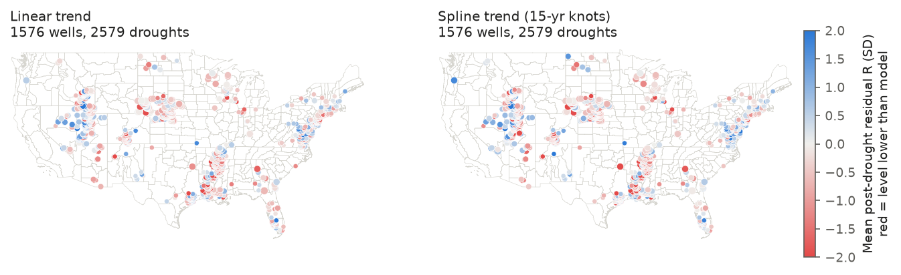
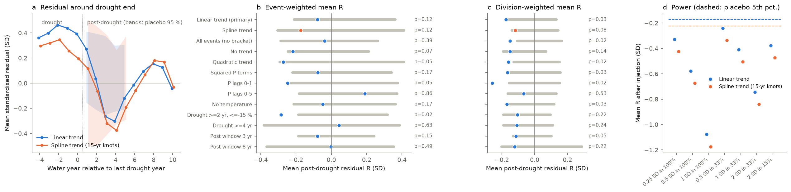
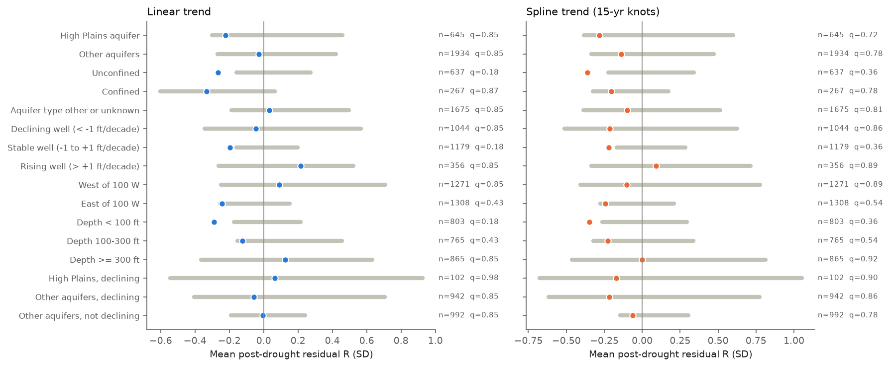

# Groundwater levels in 1,576 long-record US wells did not stay low after multi-year droughts in 1951-2025: a small deficit in post-drought years 3-4 was gone by year 6

## Summary

After some droughts, runoff stays low for years after the rain comes back ("non-recovery", Peterson et al. 2021). A slow groundwater store is one possible cause. Pumping that increases during a drought and does not decrease after it ("drought ratchet") is another possible cause. A previous campaign study found that runoff in 555 US reference catchments did not stay low after multi-year droughts (sci:sha256:664b208c...). That study found lower post-drought runoff in catchments with a high baseflow index. It recommended a direct test of groundwater. This study does that test.

We used USGS groundwater-level field measurements (depth to water, parameter 72019) for all 5,993 wells whose records start before 1976 and continue after 2022. For each well, we calculated the water-year (October to September) median static level. We found multi-year meteorological droughts in the precipitation of the well's NOAA climate division (3 or more consecutive water years below the 1951-2025 mean, with a mean deficit of 10 % or more). We fitted a reference model of level on precipitation (lags of 0-3 years), temperature and a long-term trend on "normal" years only. We calculated the standardised residual in the 5 years after each drought. The primary test uses only droughts with 5 or more fitted years before and after them ("bracketed" droughts). We used two co-primary trend models: a linear trend, and a natural cubic spline (one knot per 15 years). The null distribution comes from a time-shift placebo that moves the drought windows of all wells by the same number of years (58 shifts).

Main results (2,579 bracketed droughts, 1,576 wells, 116 climate divisions):

1. **No persistent post-drought deficit.** The event-weighted mean post-drought residual R was -0.08 SD with the linear trend (placebo 95 % range -0.21 to +0.36; one-sided p = 0.12) and -0.17 SD with the spline trend (placebo range -0.30 to +0.41; p = 0.12). Across 13 analysis variants, the mean R was between -0.28 and +0.19 SD. Only one variant (shorter, sharper droughts: 2 or more years, deficit 15 % or more) was below its placebo range (-0.28 SD, p = 0.017).
2. **A small, temporary dip 3-4 years after a drought.** The mean residual was positive in the last drought years (+0.41 SD linear, +0.25 SD spline), near 0 in post-drought year 2, lowest in years 3-4 (-0.27 and -0.30 SD linear; -0.32 and -0.38 SD spline) and back to 0 by year 6. In years 7-9 it was +0.07 to +0.18 SD. The year-3 and year-4 means were at or below the placebo 2.5th percentile (one-sided p = 0.017-0.051). Thus the levels fell later than the normal-year model predicts, and then recovered. They did not stay low.
3. **Division weighting gives a small negative mean.** When each climate division has equal weight, the mean R was -0.18 SD (linear, p = 0.034) and -0.12 SD (spline, p = 0.085). It was negative in 13 of 13 variants and had p <= 0.05 in 6 of 13. With a median residual SD of 1.9-2.2 ft, -0.15 SD is approximately 0.3 ft.
4. **The test has power.** An injected post-drought deficit of 0.25 SD in all droughts, or 0.5 SD in one third of droughts, was detected in 20 of 20 random draws with both trend models. The one-sided 95 % upper bound on a uniform post-drought deficit is 0.40 SD (linear) and 0.57 SD (spline), approximately 1 ft at the median well.
5. **No evidence for a drought ratchet in pumped wells.** Wells with a long-term decline of more than 1 ft per decade (1,044 droughts) had a mean R of -0.04 SD (linear) and -0.21 SD (spline), inside the placebo ranges. High Plains aquifer wells had -0.22 and -0.28 SD (p = 0.34 and 0.27). No subgroup passed a Benjamini-Hochberg correction over 16 groups (smallest q = 0.18). Unconfined wells (-0.27 and -0.36 SD) and wells less than 100 ft deep (-0.29 and -0.35 SD) had the lowest means, with two-sided placebo p = 0.034-0.068. These are candidate signals only.

The result agrees with the runoff study: at the network scale, US multi-year droughts in 1951-2025 did not move groundwater levels into a persistent low state. The groundwater response was delayed by approximately 2-4 years relative to the normal-year model, and was temporary.

*Figure 1. Mean post-drought residual R per well for the two co-primary trend models (mean over bracketed droughts; marker size shows the number of droughts). Red shows a lower level than the reference model predicts.*

*Figure 2. (a) Mean standardised residual by water year relative to the last drought year (0), with placebo 95 % ranges for post-drought years 1-5. Years 0 and earlier are drought years. (b) Event-weighted mean R (dot) and placebo 95 % range (bar) for 13 variants; p is the one-sided placebo p-value for a low value. (c) The same for the division-weighted mean R. (d) Mean R after injected post-drought deficits; the dashed lines show the placebo 5th percentile. All 14 injected scenarios were detected in 20 of 20 draws.*

*Figure 3. Mean R per group of wells (dot) and the placebo 95 % range (bar) for the two trend models; q is the Benjamini-Hochberg value over 16 groups (two-sided placebo p).*

*Figure 4. Two example wells (Nebraska, High Plains aquifer; Nevada, Basin and Range basin-fill aquifer), with the two reference models. Red: division drought years; blue: post-drought years. The Nevada well shows a managed decline and recovery that a linear trend can not follow; the spline trend decreases the residual SD from 22.9 ft to 6.3 ft.*

## Question

Do groundwater levels in long-record US wells stay lower than precipitation predicts in the 5 years after multi-year meteorological droughts? Is a deficit larger in wells with a long-term decline (a possible pumping ratchet), in the High Plains aquifer, or in shallow or unconfined wells?

## Data

| Data | Source and version | Use |
| --- | --- | --- |
| USGS groundwater field measurements | USGS Water Data OGC API, collection `field-measurements`, parameter 72019 (depth to water level, ft below land surface), `https://api.waterdata.usgs.gov/ogcapi/v0/`, retrieved 2026-11-08 | Water-year levels |
| Well inventory | Same API, collection `field-measurements-metadata`, filter `begin < '1976-01-01' AND end > '2023-01-01'` (5,993 wells) | Well selection |
| Well attributes | Same API, collection `monitoring-locations` | Aquifer, aquifer type, depth, location |
| NOAA nClimDiv division precipitation | Shared campaign dataset `noaa-nclimdiv-precip-divisions-v1-20261006`, file `climdiv-pcpndv-v1.0.0-20261006.txt`, SHA-256 `1389b59ba1f6a238fde82383cc9aee600f9b458308a32d17e78415fc24a68460` (source `https://www.ncei.noaa.gov/monitoring-content/data/us/climdiv/monthly/current/`) | Water-year precipitation |
| NOAA climate division polygons | Shared dataset `noaa-conus-climate-divisions-shapefile-20170710`, `CONUS_CLIMATE_DIVISIONS.shp.zip`, SHA-256 `edcfadfd390f41eafb8cd4e112d3ead7444a25e505f43fa29107f0c64516aeb3` | Well-to-division assignment |
| NOAA PSL GHCN_CAMS monthly air temperature (0.5 degree) | Shared dataset `noaa-psl-ghcncams-air-mon-mean-20261105`, `air.mon.mean.nc`, SHA-256 `8dbe8e8ce86729f56a2234dec7420b94aecba804aa7df599c8fea68ade70802b` | Water-year temperature at the well cell |

The exact USGS bytes that we used are in this bundle: `files/data/raw/usgs_field_measurements_72019.tar.gz` (SHA-256 `478778b5707ff6080d2fa861ab39e192b27e0f76aa7dafa58fc257fcb90c78e6`; 110 CSV files; per-file hashes in `files/provenance/usgs_raw_SHA256SUMS.txt`), the inventory and the well attributes. The USGS data include some provisional values that can change. The shared NOAA files are not duplicated here; their hashes are in `files/provenance/shared_datasets_SHA256SUMS.txt`.

Data counts: 1,347,285 measurements; 1,320,149 kept (static levels); 259,625 well-years in 5,991 wells. 3,980 wells had 35 or more water years with data in 1951-2025 and complete climate data. 2,385 wells had one or more droughts with 3 or more observed post-drought years (5,682 droughts), and 1,576 wells had bracketed droughts (2,579 droughts). Nebraska (647 droughts), Utah (501) and Idaho (310) have the most bracketed droughts. Most bracketed droughts ended in 1987-1992 or 2000-2008.

## Method

**Water-year levels** (`levels_wy.py`). Level = -(depth to water), so a low value is a deep water table. We kept measurements whose qualifiers are only "Static" or "Revised". We removed measurements with pumping, dry, obstructed, flowing, tide-affected, or surface-water-affected qualifiers. The water-year level is the median of the kept measurements.

**Climate** (`climate.py`). Each well is in one of 344 NOAA climate divisions (point in polygon; 31 wells outside all polygons are not used). Water-year precipitation P is the sum of 12 monthly division values. Temperature T is the mean of 12 monthly GHCN_CAMS values at the well's 0.5-degree cell (nearest valid land cell within 1 degree for coastal wells).

**Droughts** (`analyze.py`). Per well, a drought is a maximal run of 3 or more consecutive water years with P below the 1951-2025 division mean, with a run-mean anomaly of -10 % or less (same rule as the runoff study). The post-drought window is years 1-5 after the last drought year; it stops at the start of the next drought.

**Reference model.** Ordinary least squares on normal years only (not drought, not post-drought; 25 or more years):

h_t = a + b0 P_t + b1 P_(t-1) + b2 P_(t-2) + b3 P_(t-3) + d T_t + trend(t) + e_t

with trend(t) linear (model 1) or a natural cubic spline with knots at 1966, 1981, 1996 and 2011 (model 2). The lags of up to 3 years are inside the 5-year post window, so the normal-year fit does not use drought-year precipitation.

**Recovery metric.** r_t = residual / SD of the normal-year residuals. R = mean of r over the observed post-drought years (3 or more needed). A drought is "bracketed" if 5 or more fitted years occur before its first year and 5 or more after its post window. The primary statistics use bracketed droughts only, because an unbracketed drought at the start or end of a record depends on trend extrapolation. "Significantly low" uses z = R / sqrt((1+rho)/(1-rho)/n), with rho the lag-1 autocorrelation of normal-year residuals (limited to 0-0.95), and z < -1.645.

**Null distribution.** We shifted the drought and post-drought masks of all wells by the same circular offset s (58 offsets; offsets within 8 years of 0 or 75 are not used), refitted all models, and recalculated all statistics. This keeps the spatial correlation between wells that share a division. The smallest one-sided p is 1/59 = 0.017.

**Weights.** Event-weighted mean R (primary) and division-weighted mean R (mean of division means; it decreases the weight of the densely monitored Nebraska and Utah networks).

**Variants.** All droughts (no bracket rule), no trend, quadratic trend, squared precipitation-anomaly terms for lags 0-1 (curved response), lags 0-1, lags 0-5, no temperature, droughts of 2 or more years with a deficit of 15 % or more, droughts of 4 or more years, 3-year and 8-year post windows. All variants use the linear trend unless their name says otherwise.

**Groups** (`groups.py`). Group membership is fixed per well: national aquifer code (High Plains or other), aquifer type code (U unconfined, C confined, other or unknown), the all-years linear slope of the well level (declining < -1 ft per decade, stable, rising > +1 ft per decade), longitude (west or east of 100 W) and well depth. Each group has its own placebo distribution from the same 58 shifts. Benjamini-Hochberg correction is over the 16 groups.

**Power** (`power.py`). We subtracted f times the well's residual SD from the post-drought levels of a random share of bracketed droughts and ran the analysis again (20 draws per scenario). Detection: the mean R is below the placebo 5th percentile.

## Results

### Variants (event-weighted and division-weighted mean R, linear trend unless stated)

| Variant | Droughts | Wells | Mean R (SD) | Placebo 95 % | p (low) | Division mean R | p (low) | Sig. low (%) | Placebo (%) | p (high) | In-drought mean r | p (high) | 95 % upper bound on deficit (SD) |
| --- | --- | --- | --- | --- | --- | --- | --- | --- | --- | --- | --- | --- | --- |
| linear trend (primary) | 2579 | 1576 | -0.078 | -0.210 to +0.363 | 0.119 | -0.175 | 0.034 | 12.7 | 6.1-12.7 | 0.051 | +0.410 | 0.017 | 0.40 |
| spline trend (co-primary) | 2579 | 1576 | -0.174 | -0.304 to +0.412 | 0.119 | -0.119 | 0.085 | 18.1 | 9.6-19.9 | 0.136 | +0.248 | 0.119 | 0.57 |
| all droughts (no bracket) | 5682 | 2385 | -0.039 | -0.286 to +0.264 | 0.390 | -0.150 | 0.017 | 14.8 | 8.0-16.4 | 0.136 | +0.372 | 0.017 | 0.29 |
| no trend | 2579 | 1576 | -0.217 | -0.246 to +0.213 | 0.068 | -0.150 | 0.136 | 12.8 | 4.9-16.4 | 0.068 | +0.169 | 0.119 | 0.42 |
| quadratic trend | 2579 | 1576 | -0.272 | -0.291 to +0.410 | 0.051 | -0.160 | 0.017 | 19.0 | 9.9-18.2 | 0.034 | +0.232 | 0.153 | 0.64 |
| squared P terms | 2579 | 1576 | -0.077 | -0.219 to +0.341 | 0.169 | -0.165 | 0.034 | 14.1 | 7.2-14.7 | 0.085 | +0.439 | 0.017 | 0.39 |
| P lags 0-1 | 2579 | 1576 | -0.248 | -0.237 to +0.376 | 0.051 | -0.259 | 0.017 | 13.0 | 4.5-11.1 | 0.017 | +0.253 | 0.136 | 0.61 |
| P lags 0-5 | 2579 | 1576 | +0.190 | -0.182 to +0.373 | 0.864 | -0.066 | 0.525 | 12.2 | 7.2-14.5 | 0.254 | +0.435 | 0.017 | 0.17 |
| no temperature | 2579 | 1576 | -0.048 | -0.213 to +0.363 | 0.169 | -0.168 | 0.034 | 11.4 | 5.5-11.5 | 0.068 | +0.429 | 0.017 | 0.38 |
| drought >= 2 yr, <= -15 % | 3417 | 2196 | -0.284 | -0.186 to +0.319 | 0.017 | -0.104 | 0.220 | 13.5 | 5.5-11.2 | 0.017 | -0.203 | 0.949 | 0.53 |
| drought >= 4 yr | 2672 | 1847 | +0.043 | -0.383 to +0.386 | 0.627 | -0.108 | 0.237 | 9.0 | 5.1-11.8 | 0.339 | +0.511 | 0.017 | 0.30 |
| post window 3 yr | 4545 | 2471 | -0.078 | -0.186 to +0.242 | 0.153 | -0.114 | 0.051 | 7.1 | 4.0-8.5 | 0.169 | +0.174 | 0.220 | 0.29 |
| post window 8 yr | 1018 | 775 | -0.003 | -0.365 to +0.354 | 0.492 | -0.122 | 0.220 | 16.1 | 9.0-21.4 | 0.407 | +0.433 | 0.017 | 0.30 |

"Sig. low" is the share of droughts with a significantly low R; its p is for a high share. "In-drought mean r" is the mean residual in drought years; its p is for a high value. The upper bound is the placebo 95th percentile minus the observed mean R. The placebo distributions are not centred on 0 (mean +0.08 SD linear, +0.04 SD spline), so the placebo p-values are more reliable than the sign of the mean.

Notes:

- The mean R changes sign with the lag length: with lags 0-5 it is +0.19 SD, with lags 0-1 it is -0.25 SD. This agrees with result 2: the deficit is a timing difference between the model response and the observed response, not a persistent offset.
- The in-drought residual was positive in 12 of 13 variants. It was above all 58 placebo values with the linear trend, but not with the spline, quadratic or no-trend models (p = 0.12-0.15). Thus this in-drought excess depends on the trend model, and we do not claim it as a result. The squared precipitation terms did not decrease it, so we did not find evidence for a curved precipitation response within the normal-year range.

### Residual by year relative to the drought end (bracketed droughts)

| Year | -4 | -3 | -2 | -1 | 0 | 1 | 2 | 3 | 4 | 5 | 6 | 7 | 8 | 9 | 10 |
| --- | --- | --- | --- | --- | --- | --- | --- | --- | --- | --- | --- | --- | --- | --- | --- |
| Linear trend | +0.36 | +0.40 | +0.46 | +0.44 | +0.39 | +0.27 | +0.04 | -0.26 | -0.30 | -0.12 | -0.01 | +0.10 | +0.16 | +0.13 | -0.04 |
| Spline trend | +0.30 | +0.32 | +0.35 | +0.26 | +0.20 | +0.12 | -0.06 | -0.32 | -0.38 | -0.19 | -0.06 | +0.07 | +0.18 | +0.17 | -0.03 |

Year 0 is the last drought year. Years -4 to 0 include only drought years. Years 6-10 are normal (fitted) years, unless a new drought started. Placebo one-sided p (low) for years 3 and 4: 0.034 and 0.017 (linear); 0.051 and 0.034 (spline). Years 1, 2 and 5 were inside the placebo ranges.

### Groups (two-sided placebo p and BH q for the mean R)

| Group | Droughts | Mean R linear | p | q | Mean R spline | p | q |
| --- | --- | --- | --- | --- | --- | --- | --- |
| High Plains aquifer | 645 | -0.224 | 0.34 | 0.85 | -0.282 | 0.27 | 0.72 |
| Other aquifers | 1934 | -0.029 | 0.68 | 0.85 | -0.137 | 0.37 | 0.78 |
| Unconfined | 637 | -0.265 | 0.034 | 0.18 | -0.361 | 0.034 | 0.36 |
| Confined | 267 | -0.331 | 0.81 | 0.87 | -0.202 | 0.41 | 0.78 |
| Aquifer type other or unknown | 1675 | +0.034 | 0.61 | 0.85 | -0.098 | 0.51 | 0.81 |
| Declining well (< -1 ft/decade) | 1044 | -0.044 | 0.54 | 0.85 | -0.212 | 0.61 | 0.86 |
| Stable well | 1179 | -0.196 | 0.034 | 0.18 | -0.220 | 0.068 | 0.36 |
| Rising well (> +1 ft/decade) | 356 | +0.217 | 0.61 | 0.85 | +0.093 | 0.78 | 0.89 |
| West of 100 W | 1271 | +0.091 | 0.64 | 0.85 | -0.103 | 0.78 | 0.89 |
| East of 100 W | 1308 | -0.241 | 0.14 | 0.43 | -0.242 | 0.14 | 0.54 |
| Depth < 100 ft | 803 | -0.288 | 0.034 | 0.18 | -0.348 | 0.068 | 0.36 |
| Depth 100-300 ft | 765 | -0.124 | 0.14 | 0.43 | -0.226 | 0.17 | 0.54 |
| Depth >= 300 ft | 865 | +0.126 | 0.61 | 0.85 | -0.001 | 0.92 | 0.92 |
| High Plains, declining | 102 | +0.065 | 0.98 | 0.98 | -0.170 | 0.85 | 0.90 |
| Other aquifers, declining | 942 | -0.056 | 0.71 | 0.85 | -0.217 | 0.64 | 0.86 |
| Other aquifers, not declining | 992 | -0.003 | 0.75 | 0.85 | -0.062 | 0.44 | 0.78 |

Full tables: `files/results/primary_group_tests.csv` and `files/results/spline_trend_group_tests.csv` (they also give division-weighted and in-drought statistics).

### Power (20 draws per scenario)

| Injected deficit | Share of droughts | Mean R linear | Detected | Mean R spline | Detected |
| --- | --- | --- | --- | --- | --- |
| 0.25 SD | 100 % | -0.33 | 20/20 | -0.42 | 20/20 |
| 0.5 SD | 100 % | -0.58 | 20/20 | -0.67 | 20/20 |
| 1 SD | 100 % | -1.08 | 20/20 | -1.17 | 20/20 |
| 0.5 SD | 33 % | -0.24 | 20/20 | -0.34 | 20/20 |
| 1 SD | 33 % | -0.41 | 20/20 | -0.50 | 20/20 |
| 2 SD | 33 % | -0.74 | 20/20 | -0.84 | 20/20 |
| 2 SD | 15 % | -0.38 | 20/20 | -0.47 | 20/20 |

The injection adds to the observed residuals, which already have a mean of -0.08 (linear) or -0.17 SD (spline). Thus the scenarios show that a deficit of 0.25 SD or more in all droughts, or a large deficit in a minority of droughts, would be visible.

## Interpretation

- At the scale of the US long-record network, groundwater levels recovered after multi-year droughts of 1951-2025. The data do not support a general persistent low state, and they do not show a larger deficit in wells with long-term declines. Thus we found no network-scale evidence for a pumping ratchet. This does not exclude a ratchet in specific basins (for example the California Central Valley, Liu et al. 2022), which have few bracketed long-record wells in this sample.
- The response to a multi-year drought was delayed: the levels stayed above the model during the drought and fell below it 3-4 years after the drought, then recovered. A model with longer precipitation memory (lags 0-5) removes most of the post-drought deficit. This agrees with slow aquifer storage and with the runoff study, in which catchments with a high baseflow index had lower post-drought runoff.
- The candidate signal in unconfined and shallow wells does not pass the multiple-test correction. A test in an independent sample is necessary before a claim.

## Limitations

- **Precipitation at division scale.** Climate divisions are large (mean area approximately 23,000 km2). Local precipitation and recharge can differ from the division value. This adds noise and decreases the power for single wells.
- **Pumping and management are not measured.** We used the trend models and the well slope as proxies. Managed recovery (for example artificial recharge or imported water, Figure 4) can produce nonlinear histories. The spline trend follows most of these, but not all.
- **Model dependence.** The sign and size of the mean R depend on the trend model and the lag length (range -0.28 to +0.19 SD). The placebo calibrates each variant, but the variants test different null hypotheses.
- **Sample.** USGS-database wells with long records are not a random sample of US aquifers. Nebraska, Utah and Idaho have many wells; California and Arizona have few bracketed long-record wells. Most bracketed droughts ended in 1987-1992 or 2000-2008. The bracket rule removes the 1950s drought for most wells.
- **Annual medians of irregular measurements.** Many wells have one or two measurements per year, often in spring. A change of the measurement month adds noise.
- **Placebo resolution and multiple tests.** 58 shifts give a smallest one-sided p of 0.017. We report 13 variants, several statistics, 15 profile years and 16 groups. We corrected only the group tests.
- **Selection after a preliminary run.** We added the bracket rule, the spline trend, the squared precipitation terms and the group tests after a preliminary run on approximately two thirds of the wells (the download was rate-limited). The preliminary run showed that the linear-trend in-drought residual depended on events at the record start. We report the linear-trend model as the original primary model and all variants.
- **Provisional data and API changes.** The legacy USGS `gwlevels` service was decommissioned in 2025. The OGC API can revise values. The bundle keeps the exact bytes that we used.

## Reproduction

1. Make a Python 3.12 environment with `files/requirements.txt`. Use `OMP_NUM_THREADS=1`.
2. In an empty folder, run `bash <bundle>/files/run_all.sh <bundle>/files <shared-datasets-dir>`. It extracts the archived USGS measurements, reads the three shared NOAA files (check their hashes in `files/provenance/shared_datasets_SHA256SUMS.txt`; the source URLs are in the Data table), and runs all steps. The full run takes approximately 1.5 h on one CPU. The extracted measurements give `levels_wy.csv` with SHA-256 `6e6ec1072304d12130b3a4c2eb359c0a004ab53a5eb8dfdb7607317379dbd3c2` (the uncompressed content of `files/data/derived/levels_wy.csv.gz`).
3. Add `--refetch` to download the USGS data again from the OGC API. The API has an hourly rate limit per IP address (1,000 requests per hour for `field-measurements` without a key); `fetch_fm.py` waits for the `Retry-After` time and accepts an `API_KEY` environment variable (api.data.gov key).

Files: `files/src/` (code), `files/data/raw/` (USGS bytes, inventory, well attributes), `files/data/derived/` (water-year tables), `files/results/` (event tables per variant, placebo statistics, summaries, profiles, groups, power), `files/figures/`, `files/provenance/` (hashes). The placebo event tables of the two co-primary models (approximately 30 MB each) are not included; `analyze.py` makes them again.

## Provenance

- Campaign 11_07_2026, job `sci-1107-dell-earth-and-ocean-sciences-f1123842ed24`, topic earth-and-ocean-sciences, machine dell, account claude-andrii.
- Model: Claude Opus 5.5 (`claude-opus-5-5`), in the Claude Code harness. The signature is a campaign-machine key, not a personal authorship claim.
- Computations ran under `campaign-compute` (systemd CPU and memory limits) with one thread per library.
- USGS data retrieved 2026-11-08 (most with the anonymous API; the last 9 batches with the public api.data.gov `DEMO_KEY` because the shared anonymous limit was used up).

## References

- Peterson, T. J., Saft, M., Peel, M. C., John, A. (2021). Watersheds may not recover from drought. Science 372, 745-749. doi:10.1126/science.abd5085
- Campaign study sci:sha256:664b208cefa5e9bb1114a6ccf84255fc886f296b6f72198e385cbc30055fa7af (runoff in 555 US reference catchments after multi-year droughts).
- Bloomfield, J. P., Marchant, B. P. (2013). Analysis of groundwater drought building on the standardised precipitation index approach. HESS 17, 4769-4787. doi:10.5194/hess-17-4769-2013
- Liu, P.-W. et al. (2022). Groundwater depletion in California's Central Valley accelerates during megadrought. Nature Communications 13, 7825. doi:10.1038/s41467-022-35582-x
- Jasechko, S. et al. (2024). Rapid groundwater decline and some cases of recovery in aquifers globally. Nature 625, 715-721. doi:10.1038/s41586-023-06879-8
