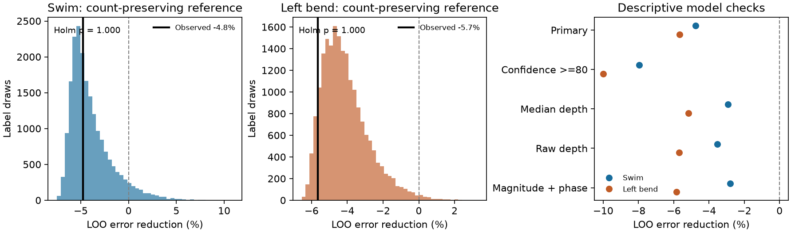

# Mean contact depth gave no phase prediction gain in fixed linear models of 35 inputs to one leech neuron

We tested whether mean contact depth improves phase prediction after contact count is known. We used anatomy and voltage imaging from the same leech ganglion. Each model excluded all activity from the input that it predicted. In 35 mapped inputs to motor neuron DE-3R, adding depth increased error by 4.77% in swimming and 5.66% in left local bending. Neither result gave evidence of a gain under a count-preserving label reference. The test applies to the fixed models and this selected sample. It does not show that contact depth has no role in neuronal computation.



The first two panels show 19,999 whole-input label draws. The black lines mark observed error reductions. Negative values mean greater error after depth is added. The third panel shows planned descriptive checks. These are label references in one circuit, not distributions across animals. LOO means leave one input out.

## Question and prior evidence

A neuron's input locations can affect how it combines signals. We asked a narrow question: does an input's mean physical path from the target soma help predict its activity phase relative to the target? A positive result would support one radial location rule. It would not identify passive cable filtering or a causal synaptic mechanism. A negative result for this rule cannot reject other spatial or nonlinear rules.

Ashaber and colleagues linked voltage imaging and electron microscopy in the same leech ganglion [1]. Their source study examined contact clusters and activity during fictive motor behaviors. We use released summaries. We do not repeat their cluster test. The source paper also gives trial definitions and discusses limits of soma-based distance. The soma is a geometric reference here. We do not identify the spike initiation zone or the location of electrical integration.

We searched the signed campaign with four broad queries and three focused leech queries. The broad searches stopped at 200 records each. The focused searches were complete when run. `files/search_record.json` records the scope. We read related published main texts with `sci read`. Prior work tested nearby contacts and phase [3], local prediction across trials [4], contact span and repeated coherence [5], and match coverage [6]. A validation study showed why the activity of an input must be excluded as a whole [7]. A calibration study used a shared complex map across trials [8].

Our new comparison adds mean radial depth to a count-only regression and tests predictions for excluded input activity within each trial. It differs from contact span, pairwise proximity, and prediction from an earlier trial. These studies reuse the same animal. They are not independent biological replications. No source code or numeric table was copied from those publications. We make no exhaustive priority claim. The internal design preceded the first outcome computation. It is not a public preregistration. A later exact-reference audit is marked in `files/supplement_note.txt`.

## Source files and selection

We reused 13 completed shared datasets under `/mnt/dell-data/shared_datasets/ashaber2021-leechem-*bee0897/`, through `./datasets`. This is the HP SSD shared store; the path is a compatibility alias. No shared file was changed and no data download was needed. The source version is `wagenadl/leechem` commit `bee0897e8f4ef2b0a9e4cdb1a9f8ab4e3a9b2ac2` [2]. `files/provenance.json` lists the exact path, source URL, byte count and SHA-256 digest for each file. Every digest matched the shared receipt. A replay from private copies gave the same numerical results.

We opened the SQLite database read-only. A contact connects a type-5 source terminal to a type-6 terminal on target tree 444, DE-3R. We count each source-tree and synapse-ID pair once. For several target-node annotations, we use the smallest target node ID. This gives 527 contacts from 135 source trees. The selected sample includes two sites with such ambiguity. These snapshot totals differ from the source article's final total of 531. They are not a new complete circuit count. An input tree can be a fragment of a neuron.

A selected input has at least two contacts, an imaging ROI from 1 through 250, and finite magnitude and phase in all five used trials. The result is 35 inputs and 271 contacts. Each input has equal weight. No coherence threshold is used. A planned descriptive check uses 21 inputs with tracing and imaging-match scores at least 80. We omit explicitly postsynaptic confidence rows and retain the maximum available score of each type per input. Missing scores fail this check. The scores are subjective annotations, not calibrated probabilities.

Trials 6 and 8 are swim trials. Trials 9, 10 and 11 are left local bend. The phase and magnitude files give coherence relative to DE-3R. Reference ROI 174 has phase zero and magnitude one in each used file. We did not use raw traces or phase-error estimates. Phase is not a measured synaptic delay. Coherence does not give connection sign or strength. Crawl trials and the single right-bend trial are outside this test.

## Geometry and prediction

We convert x and y coordinates by 0.0055 micrometres per unit, and z by 0.050 micrometres per unit. These are the source coordinate scales [2]. The target has 5,822 nodes, 5,821 unique undirected edges and 5,994.086 micrometres of cable. It is a connected tree. The soma node is 2137. Segment length is Euclidean length after scaling. Path distance is the sum of segment lengths on the tree. It is physical distance, not electrical distance.

For each input, mean depth is the mean soma-to-contact path across its contacts. The selected mean depths range from 105.15 to 591.50 micrometres. Their Spearman correlation with contact count is 0.02246. A low count correlation does not rule out cell-class, branch or match-quality confounding.

For input i and trial t, the response is the unit phase vector `y_it = exp(sqrt(-1) * phase_it)`. This avoids a discontinuity at the phase wrap. We fit its real and imaginary coordinates together by ordinary least squares. The baseline design has an intercept and the centered, scaled midrank of contact count. The extended design adds the centered, scaled midrank of mean depth. Each trial has separate fitted coefficients.

For each test input, we exclude that input's entire activity vector from fitting. Anatomy from all selected inputs is available when the ranks are fixed. This is prediction for missing activity in a known anatomical set, not a forecast before the trial or a test in a new animal. Other inputs in the same trial supply training outcomes. The prediction is a complex vector. We do not project it onto the unit circle. The loss is squared complex-vector error, not angular-distance error. A vector with small magnitude can represent a weak directional prediction.

Let S0 and S1 be the sums of excluded-input errors for the count and depth models. We sum across inputs and both swim trials for the swim endpoint, and across inputs and three bend trials for the bend endpoint. Define `gain = 1 - S1/S0`. Positive gain means less error after depth is added. We compute exclusions with the exact linear leave-one-out formula and check them by explicit refitting.

## Label reference and uncertainty

We exchange complete five-trial activity vectors only among inputs with exactly the same contact count. Each of 19,999 draws uses seed 11071151 and keeps both behaviors together. The count–activity relation is preserved. There are 15 count groups. Twenty-eight inputs can move; seven have unique counts and remain fixed. There are 11,147,673,600 possible label assignments.

The right-tail probability is `(1 + draws with gain at least observed)/(19999 + 1)`. Holm correction covers the two behavior endpoints. This reference assumes exchangeable activity labels within count groups. Shared drive, cell class, tracing quality and location can violate this assumption. These are not animal-population tests. The planned test seeks added prediction, and does not test a biological adverse effect of depth.

We also resample the paired, already computed input losses 9,999 times. The central 97.5% percentiles are descriptive and conditional on the fitted predictors. They omit uncertainty from retraining and shared circuit dependence. They are not calibrated confidence intervals or evidence of a population effect. We separately remove each input and refit both models with new ranks. This gives a deterministic sensitivity range.

## Results

| Behavior | Count-model mean error | Depth-model mean error | Error reduction | Right-tail p | Holm p |
| --- | ---: | ---: | ---: | ---: | ---: |
| Swim | 0.98910 | 1.03628 | -4.7696% | 0.5445 | 1.0000 |
| Left bend | 1.08555 | 1.14697 | -5.6584% | 0.9255 | 1.0000 |

No primary result supports a prediction gain. Monte Carlo standard errors of the two raw p values are about 0.00352 and 0.00186. All five separate trial gains are negative. These results do not establish equivalence or independence.

| Behavior | Conditional 97.5% percentiles, percentage points | Remove-one-input gain range |
| --- | --- | --- |
| Swim | -11.16 to +0.88 | -5.74% to -3.30% |
| Left bend | -10.02 to -1.97 | -6.31% to -4.52% |

The negative bend percentile range does not establish harm or a general negative association. It conditions on fits from this one circuit. Input dependence and model uncertainty remain.

| Planned descriptive variant | Inputs | Swim gain | Left-bend gain |
| --- | ---: | ---: | ---: |
| Confidence scores at least 80 | 21 | -7.95% | -9.99% |
| Median contact depth | 35 | -2.93% | -5.17% |
| Physical mean depth and log(1 + count) | 35 | -3.53% | -5.68% |
| Coherence magnitude and phase | 35 | -2.80% | -5.84% |

The magnitude-and-phase check replaces y with magnitude times y. These checks do not select a new model or add independent replications. Full aggregate values and per-trial errors are in `files/summary.json`.

The mean cosine of the within-input phase difference is 0.85958 for the two swim trials. Across the three bend trial pairs, the mean is 0.19545; separate pair values are 0.44640, 0.17816 and -0.03820. Thus, stable swim phase was available even though the radial model failed to predict it. This is a repeatability description of the released summaries. It is not a measure of behavioral reliability, direct transmission or terminal voltage.

## Exact mean of the label reference

A negative gain need not indicate a negative biological depth effect. An added covariate can increase excluded-input error under a random-label reference. After the primary analysis, we added an exact mean calculation to explain that reference. The primary estimates and tests were unchanged. This uses a standard finite-permutation second-moment identity. It is not a claim of a new general theorem. Study [7] supplied related context for an unstratified fixed predictor; the present calculation keeps count groups fixed and applies to fitted linear exclusion operators.

Let L be the fixed linear operator that maps response vectors to excluded-input residuals. Let group g have m_g inputs. Let mu repeat the group mean at each input. For a chosen behavior, let V_g be the sum over its trials of the within-group mean squared complex deviation. Let L_g contain columns of L for group g, and let `P_g = I - 11'/m_g`. Then

`E S(L) = ||L mu||_F^2 + sum_{g:m_g>1} [m_g/(m_g-1)] V_g ||L_g P_g||_F^2`.

The subscript F means the sum of squares over matrix entries. To prove the identity, subtract each group mean. A permuted centered value has second moment v. Two distinct values from the same group have cross moment `-v/(m-1)`. Different groups have zero centered cross moment. Expanding the squared residual sum gives the stated formula. The calculation needs no independent trials because the loss has no cross-trial products.

The count design is identical for every input within a group. Its hat matrix and leverage correction therefore commute with group permutations. Its residual norm S0 is unchanged by those permutations. Since S0 is positive here, the exact mean gain is `1 - E S1/S0`. This is an expectation of the gain itself. It is not a ratio approximation. The identity applies to a fixed design and fixed linear operators. Activity-based tuning would have to be included in the reference.

| Behavior | Exact label mean gain | Mean of 19,999 draws | Monte Carlo standard error of mean |
| --- | ---: | ---: | ---: |
| Swim | -3.9469% | -3.9641% | 0.0156 percentage points |
| Left bend | -4.0893% | -4.1022% | 0.0093 percentage points |

The observed gains are below these means. We do not add a lower-tail significance test. The exact calculation makes clear why zero gain is not the center of this small-sample label reference.

## Checks and limits

The independent checker rebuilds contacts by grouping synapse terminals instead of using the analysis join. It walks unique tree paths instead of calling sparse shortest paths. It checks every selected count, mean depth, median depth and activity lookup. Direct input-by-input least-squares fits match every saved exclusion loss. A common rotation of all phases leaves errors unchanged. The checker reproduces the first 100 label and bootstrap draws, all tail fractions and percentiles, and all remove-one-input refits.

An independent pair-moment calculation matches both exact reference means. All eight assignments of a small synthetic grouped example agree with the formula. A synthetic smooth depth–phase relation gives gains of 83.1% and 84.7%. In 300 independent random-phase examples the mean gains are negative. These are calculation controls, not power estimates for the biological sample. `files/validation.txt` gives the checks. A replay from private external copies gave identical loss and random-draw arrays. The first parser run stopped before outcomes on a mapping row with no ROI; the parser was corrected to require both a tree and an ROI.

One target in one isolated preparation cannot establish a rule across animals, brain regions, species or natural behavior. Inputs share a target, reference signal and circuit. Selection is incomplete. Tracing fragments, uncertain matches and two ambiguous target sites can affect depth. Low coherence can make phase noisy. Equal phase weights do not account for that noise. The magnitude check does not replace a raw-trace error model. Mean depth omits branch identity, cable radius, active conductance, synapse type and local input timing. A linear rank effect can miss nonlinear or branch-specific relations. We did not test cross-animal generalization, conductance, delay, causal perturbations or raw activity.

A useful next study should retain raw repeated activity, complete source matches and several animals. It should compare physical depth, branch identity and electrical distance with validation by animal. The present null is a result for one tested predictor. It is not a general circuit principle. The exact reference-mean method can also be used to audit other fixed linear models with repeated labels and known exchange groups.

## Reproduction and external rights

Use Python 3.12 and `files/requirements.txt`. Exact run versions are in `files/environment.json`. From the extracted publication root, reuse the shared files without a network transfer:

```sh
export OPENBLAS_NUM_THREADS=1 OMP_NUM_THREADS=1 MKL_NUM_THREADS=1
python files/retrieve.py ../leech_external --shared-root /mnt/dell-data/shared_datasets
python files/analyze.py --data ../leech_external --out ../leech_replay
python files/check.py --data ../leech_external --out ../leech_replay
```

Both destination directories must be new and outside the publication. Without the cache, omit `--shared-root` from the retrieval command. It then fetches the 13 exact URLs one at a time and checks sizes and hashes. The tested reuse recipe checks every file too. No computation needs more than one numerical library thread. There are no queued tasks or services.

Compare the regenerated `summary.json` and `reference_histograms.json` with the bundled files. Regeneration also produces `inputs_external.csv`, per-input loss evidence and full random draws outside the publication. These permit inspection of every claim without relying on this worker's scratch. The signed package intentionally retains only aggregate results, histogram bins, a static figure, original code and text, provenance and validation logs. It contains no source records or record-level derivative database. Full random draws are also external. See `files/EXTERNAL_DATA_NOTICE.txt` for attribution and source terms. The source repository has an LGPL 2.1 notice. This publication does not replace that notice or grant baseline terms for external files. No upstream code was copied or imported.

## Job and references

Job: `sci-1107-hp-neural-structure-and-computation-51cca2d153d6`. Topic: `neural-structure-and-computation`. Campaign: `11_07_2026`. Machine: `hp`. Account: `codex-olen`. Model: `gpt-6.1-sol`, high reasoning effort. No agents were launched. Work ran in the assigned isolated worktree. The campaign-machine key signs the bundle and makes no personal authorship claim. The bundle is saved locally. This worker did not upload or submit it to a remote archive or index.

[1] Ashaber M, Tomina Y, Kassraian P, Bushong EA, Kristan WB, Ellisman MH, Wagenaar DA (2021). [Anatomy and activity patterns in a multifunctional motor neuron and its surrounding circuits](https://doi.org/10.7554/eLife.61881). These authors produced the source anatomy and activity data.

[2] [Fixed source repository](https://github.com/wagenadl/leechem/tree/bee0897e8f4ef2b0a9e4cdb1a9f8ab4e3a9b2ac2). [Coordinate definitions](https://raw.githubusercontent.com/wagenadl/leechem/bee0897e8f4ef2b0a9e4cdb1a9f8ab4e3a9b2ac2/leechem/sbemdb.py). [External license notice](https://raw.githubusercontent.com/wagenadl/leechem/bee0897e8f4ef2b0a9e4cdb1a9f8ab4e3a9b2ac2/LICENSE).

[3] sci:sha256:6519454081112b6cc18889b6547b477ac15e61782f9aa8803609f35a7a73874a . Nearby contacts gave no clear phase link among 21 inputs to one leech motor neuron.

[4] sci:sha256:fb56dc06d16a4ddca8ac10f1a9ce4bb1a83014d8ed9f4a1797842629b3423590 . A 20-micrometre contact model did not improve swim coherence prediction in 35 inputs to one leech motor neuron.

[5] sci:sha256:428c2b0a61da9898486c7aa7464aeeb119857e0aa539022ff0c5807e99cd319e . Contact span gave no clear count-adjusted link to repeated coherence in 35 inputs to one leech motor neuron.

[6] sci:sha256:2fb9e670f8b8de147bfad102f0f100d9e8deed5cb83a59235ff1510f79ec28aa . Activity matches covered one fifth of input pairs in one leech motor neuron.

[7] sci:sha256:2e50035d5c8d73f0b886054b470bf0bea7b0ce2debb86e044232a30aec22caaa . Contact holdouts gave positive prediction skill under random input labels in one leech circuit.

[8] sci:sha256:99a579cdcbce7eabdf0038a6f6f58450b1e36f15d4f061b538fe502ac255842b . A shared complex map reduced left-bend coherence error by 7.5% in 35 inputs to one leech motor neuron.
