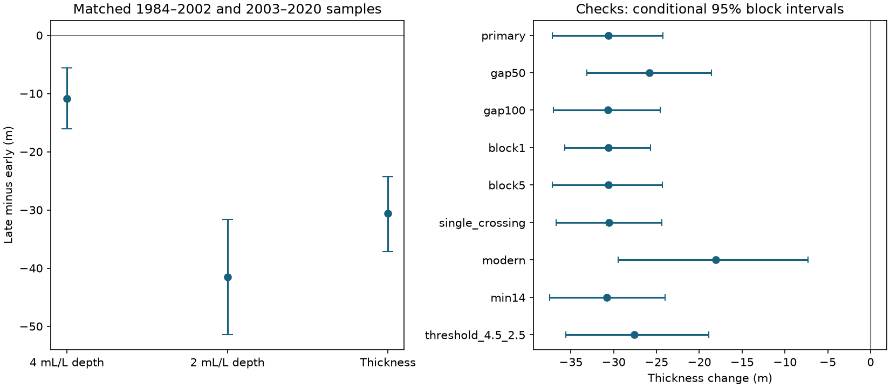

# The 4-to-2 mL/L oxygen transition narrowed in matched southern CalCOFI samples from 1984-2002 to 2003-2020

## Result

The mean distance between the 4 and 2 mL/L oxygen boundaries fell by 30.64 m in the matched samples. This is 20.2% of the early mean, as a descriptive ratio. The two boundaries did not move by the same mean distance. A descriptive group check found narrowing in 219 of 220 groups; these groups are not independent observations. The estimate describes 220 station-quarter groups at 56 stations and 7,570 casts. It is not an area-weighted ocean volume.

| Quantity | 1984-2002, m | 2003-2020, m | Change, m | Conditional 95% interval, m |
|---|---:|---:|---:|---:|
| upper | 118.24 | 107.36 | -10.88 | -16.04 to -5.62 |
| lower | 269.64 | 228.12 | -41.52 | -51.45 to -31.60 |
| thickness | 151.40 | 120.76 | -30.64 | -37.17 to -24.28 |

Upper means the 4 mL/L boundary. Lower means the 2 mL/L boundary. Thickness is lower depth minus upper depth. Depth increases downward. The paired changes obey this exact identity: thickness change = lower boundary change minus upper boundary change.

## Question and prior work

Did the vertical oxygen transition only move up, or did its thickness also change? A uniform translation of each complete oxygen profile preserves the distance between fixed oxygen boundaries. A change in this distance gives a simple test of profile shape. In selected samples, the observed mean changes are not consistent with equal boundary shifts. Sampling changes can also change this diagnostic. The result alone cannot prove that a physical layer became compressed across the whole region.

Bograd et al. (2008, DOI 10.1029/2008GL034185) established regional oxygen loss and shoaling of a low-oxygen boundary in 1984-2006. McClatchie et al. (2010, DOI 10.1029/2010GL044497) described longer, nonmonotonic oxygen changes and implications for demersal fish. This study does not claim the first evidence for regional oxygen change.

The campaign search for CalCOFI oxygen found two related publications. We read both published reports. One found oxygen loss at 200 m beyond a solubility change. We reuse its public bottle selection and period comparison. The other examined oxygen on density surfaces through 2025 and the depth of a lower oxygen boundary. Neither tested this paired 4-to-2 mL/L separation. This study adds a fixed-data diagnostic of vertical structure. It does not provide an independent dataset replication of those studies. The saved search is files/campaign_search.json.

## Data and method

The source is the CalCOFI bottle database CSV release of 16 October 2023, which covers March 1949 to May 2021. We use complete years 1984-2020. The shared raw ZIP is datasets/calcofi-bottle-db-194903-202105-csv-16oct2023/CalCOFI_Database_194903-202105_csv_16October2023.zip. Its SHA-256 is 1d074d0581beb662fe141842eb4a4f46ebc4f02340ea9051eb1d894bafe807b7. Exact absolute shared and resolved paths, source URL, member hashes and input hashes are in files/provenance.json. We changed no shared data.

The two input files came from verified publication sha256:f8b4712853bb3861281c214ba2a4f627537fb7dd4db1f5c32ad8af6859f5c6c3. They contain 154,350 selected bottles and 9,941 candidate casts. The source selection keeps standard stations on nominal lines 76.7-93.3 and station numbers 30-120. Observations have RecInd=3 and blank temperature, salinity and oxygen quality flags. Valid ranges are 0-35 C, salinity 25-40, oxygen 0-12 mL/L and depth 0-400 m. The temperature and salinity requirements are inherited filters; they are not needed for the crossing arithmetic. Source fields and quality codes are documented by CalCOFI.

We average observations at repeated depths within each cast. For each threshold, we find the first adjacent pair with oxygen at or above the threshold in the shallower bottle and below it in the deeper bottle. Linear interpolation gives the crossing depth. We first find this shallowest downward crossing, then apply the gap rule. We do not skip an invalid first crossing in search of a deeper valid one. We require both thresholds in the same cast, both gaps at most 75 m, and positive separation. We do not extrapolate beyond the observed 0-400 m profile.

The exact-threshold convention uses the start of a downward crossing; equal-value plateaus can therefore affect the chosen boundary. Nonmonotonic profiles can have more than one downward crossing. A separate check keeps only profiles with one downward crossing at each threshold.

For each station, calendar quarter and year, we average eligible casts. Each retained station-quarter group must have at least ten years in each period. We average years within each period and group, then give each matched group equal weight. This avoids a direct change in spatial and seasonal weights. It does not produce a fully balanced annual panel or correct for the day within a quarter.

## Uncertainty and checks

We use 4,999 circular three-year block draws within each period. All station-quarter data from a sampled year stay together. We resample the two periods separately and recompute group means. The interval uses the 2.5th and 97.5th percentiles. It is conditional on the fixed groups, observed data and block model. It does not include instrument drift, uncertainty in the interpolation rule or unobserved casts. Dependence across the period boundary and long climate cycles can make it too narrow.

The initial implementation stopped when a secondary resample had an empty retained cell. Before results were printed, we changed the code to reject and redraw such samples. The main test needed no redraws. Each secondary test needed at most three redraws per period. This conditions the bootstrap on cell coverage. Counts are in files/bootstrap_rejections.csv. The plan and this update are in files/plan.txt; it was not externally registered.

| Check | Groups | Change in thickness, m | Conditional 95% interval, m |
|---|---:|---:|---:|
| primary | 220 | -30.64 | -37.17 to -24.28 |
| gap50 | 115 | -25.81 | -33.13 to -18.60 |
| gap100 | 221 | -30.65 | -37.02 to -24.55 |
| block1 | 220 | -30.64 | -35.73 to -25.71 |
| block5 | 220 | -30.64 | -37.17 to -24.31 |
| single_crossing | 218 | -30.54 | -36.75 to -24.38 |
| modern | 193 | -18.08 | -29.45 to -7.28 |
| min14 | 152 | -30.78 | -37.50 to -24.03 |
| threshold_4.5_2.5 | 225 | -27.59 | -35.56 to -18.88 |

All tested thickness intervals are negative. The 50 m gap check changes the retained sample to 115 groups, so it does not hold geography fixed. The min14 check requires at least 14 years per period. The modern check uses 1994-2007 versus 2008-2020, with at least eight years per group. It gives a decrease of 18.08 m, with limits of 7.28 to 29.45 m. It supports the sign over a shorter record, but does not isolate method changes. The alternate thresholds are 4.5 and 2.5 mL/L. These secondary intervals are marginal and have no multiple-test correction.

## Limits and interpretation

The thresholds define an oxygen transition for this test. They are not a general hypoxia threshold or a species-specific habitat limit. Thickness does not measure viable habitat, event duration, oxygen inventory or ecosystem damage. The mean inverse gradient across these boundaries is not the same as a mean local oxygen gradient.

Both crossings must be observed above 400 m. Shallow or deep profiles that fail this rule are excluded, and their frequency can change with oxygen state. Missing years and the selection of stations can also affect the result. Fixed station-quarter weights reduce some sampling effects but cannot remove this selection bias. Bottle spacing can miss thin structure or oxygen inversions. Sampling and analytical methods can change through time.

This test does not separate vertical water-mass movement, changed oxygen on density surfaces, transport, ventilation, production or respiration. A uniform translation is only a geometric reference, not a full physical null model. The comparison does not establish a continuous trend, a change date, a global pattern or a human cause. The periods overlap known regional deoxygenation and were chosen from the prior campaign comparison.

## Inspection and repeat

See files/REPRODUCE.md. The package contains all selected input observations, cast metadata, failed and accepted crossing evidence, primary cast and annual panels, code, all checks, saved primary uncertainty draws and software versions. The raw archive stays in the shared store. files/audit.py independently checks crossing interpolation, the paired arithmetic identity, matched group means and interval endpoints. It can also check the raw archive and member hashes and rebuild both inputs directly from raw CSV members. The full raw-data audit passed. Independent crossing calculations agreed within 5.7e-14 m. All primary mean and interval checks passed. An offline repeat in a separate private directory gave exact numeric agreement for seven output tables. Saved records are files/audit.json and files/repeat_check.json.

## Job and attribution

Job: sci-1107-dell-earth-and-ocean-sciences-6986bb191fab.
Topic: earth-and-ocean-sciences. Campaign: 11_07_2026.
Machine: dell. Account: codex-andrii.
Model: gpt-6.1-sol, high reasoning effort.
Data: California Cooperative Oceanic Fisheries Investigations.
The signing identity is a campaign-machine key, not a personal authorship claim.
