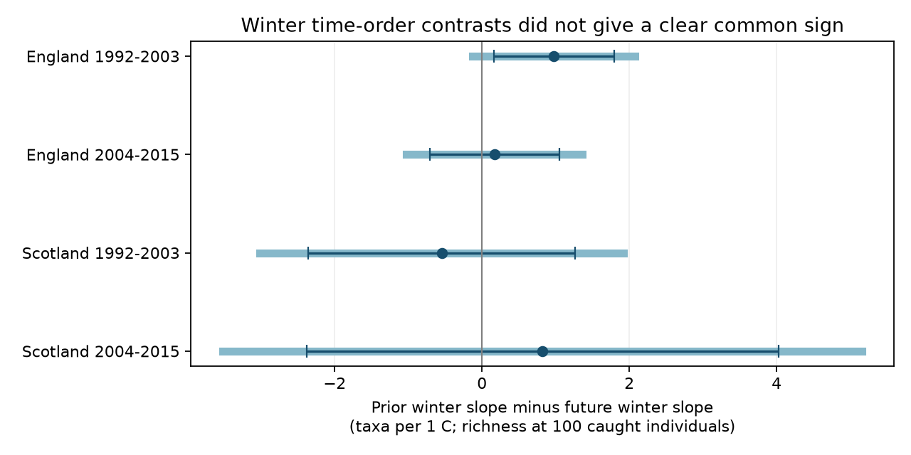

# Prior and future winter warmth gave uncertain richness slope contrasts in four British moth samples in 1992-2015

We tested whether winter warmth before the flight season had a different link to moth richness than winter warmth after that season. We used 685 ECN trap-months from England and Scotland in 1992-2003 and 2004-2015. Richness was set to the expected taxon count at 100 caught individuals. Models controlled trap by month, sample effort, current monthly weather, winter rain and time. Prior-minus-future winter slopes ranged from -0.55 to +0.98 taxa per C. All four intervals included zero after correction for four tests. The early English contrast was positive with an ordinary 95 percent interval, but did not repeat in the later period. Some early English checks were positive after correction. This result does not show that winter warmth has no effect. Few year clusters, coarse country weather, selected catches and unknown detection rates limit inference. This is a time-order check, not a causal climate effect. Pollution and daily extremes were not tested.

| Sample | Months | Prior slope | Future slope | Contrast | Four-test interval |
|---|---:|---:|---:|---:|---:|
| England 1992-2003 | 300 | +0.44 | -0.54 | +0.98 | [-0.12, +2.08] |
| England 2004-2015 | 271 | +0.39 | +0.22 | +0.17 | [-1.02, +1.36] |
| Scotland 1992-2003 | 69 | +1.24 | +1.78 | -0.55 | [-3.01, +1.92] |
| Scotland 2004-2015 | 45 | +1.42 | +0.60 | +0.82 | [-3.52, +5.16] |

All slopes use taxa per 1 C. The contrast is the prior slope minus the future slope from the same model. Its error uses their covariance. It is not a comparison of two separate significance tests.



## Question and basis

Does the winter before flight have a different link to fixed-size moth richness than the winter after flight? Winter conditions can change survival, development and emergence. A later winter cannot change the earlier catch. But weather persistence and unmeasured change can link it to that catch. We use the direct slope contrast as a time-order check. It does not by itself identify winter survival or a causal effect.

The experiment on fall webworm in Japan (Matsuura, Bangay and Tuno, 2023, doi:10.3390/insects14060534) found higher loss under mild winter conditions. A 36-year butterfly study (doi:10.1111/gcb.17044) also studied winter warmth and occurrence. These results motivate the seasonal question. Their species, places and outcomes differ from ours. They do not predict the sign of assemblage richness at a fixed catch size. Jonason, Franzen and Ranius (2014, doi:10.1371/journal.pone.0092453) studied weather and moth catches and used rarefaction. We do not claim a new sampling method.

We searched the campaign for phenology, climate, pollution, moths and winter before selecting this test. The prior SCI result cited in sci.json compared current monthly warmth slopes in raw and fixed-size richness. We reuse its public code and selection, not a private workspace. We add a winter time-order test. The observations fully overlap that work. This is an exploratory follow-up, not a new independent archive or a registered test.

## Data and selection

Rennie and colleagues (2017), UK Environmental Change Network moth data: 1992-2015, NERC Environmental Information Data Centre, doi:10.5285/a2a49f47-49b3-46da-a434-bb22e524c5d2, supply catch, duration and quality records. Contains data supplied by UK Centre for Ecology & Hydrology. We thank the collectors and data managers listed in that source. The source uses the Open Government Licence v3. Met Office country monthly series supply temperature and rain. Source URLs, exact used-file SHA-256 hashes, byte counts, versions and resolved shared paths are in files/provenance.json. No new download was needed. Only the six used files were hashed.

We keep May-September, numeric core macro-moth codes 1-969, positive integer counts, and confirmed single-night samples. We remove Q-prefixed quality flags, conflicting duration rows and site dates in any quality-text interval. A numeric biological record or explicit XX zero marker must confirm a visit. We do not turn missing dates into zero catches. Taxon counts are pooled within trap, year and calendar month. A main month needs ten valid nights and at least 100 core individuals. These rules give 685 months, 16,912 visits and 226,173 individuals, as in the prior panel. Excluded codes can omit species or forms. This is core taxon richness, not complete moth species richness.

England supplies seven sites and nine early or eight late trap units. Scotland supplies two sites and three early or two late trap units. Countries have distinct sites; periods have distinct outcome years but can share traps. Weather is correlated across countries. Adjacent periods use some common winter months at the boundary. The four fits are thus disjoint outcome samples, not four independent experiments. The early Scottish sample has eleven observed years; the others have twelve.

## Measures and model

Expected richness at m individuals is sum_i [1 - choose(N-n_i,m)/choose(N,m)]. We use m=100 without replacement. This measure reduces variation from catch size. It does not estimate unseen taxa or remove species-specific capture bias. Real abundance changes can also alter catch size. Conditioning on catch size changes the biological question.

Prior winter for year y is December y-1 and January-February y. Future winter is December y and January-February y+1. Temperature is an equal-month mean in C. Rain is a three-month total divided by 100 mm. All winter months, including boundary months, come from the pinned series. Country means can miss local cold, snow, drought and extremes.

Separate ordinary least squares fits use each country and period. Predictors are prior and future winter temperature together, prior and future winter rain, current monthly temperature and rain, valid night count, mean day sampled, linear year, and a fixed effect for each trap by calendar month. Each month has equal weight. The contrast tests beta_prior - beta_future = 0. Different winter temperature effects could still cancel in richness, so this is a limited mechanism check. We do not fit year effects because they would absorb both winter predictors.

Errors cluster by outcome year. We use the finite-sample sandwich correction and a t reference with G-1 degrees of freedom. Four-test intervals use t(1-0.05/8, G-1), with Bonferroni correction over the four main contrasts. This correction does not cover all exploratory variants. Eleven or twelve year clusters give weak interval calibration. The model allows within-year dependence but does not allow arbitrary serial dependence. Shared winter months and serial biological effects can violate the latter assumption. Many fixed effects, particularly in Scotland, further limit precision.

## Checks and interpretation

All four corrected main intervals include zero. Early England has an ordinary 95 percent interval of +0.16 to +1.79 taxa per C and p=0.023. Its corrected interval includes zero. The prior slope is positive in all four fits, but that fact does not show a prior-winter mechanism: future slopes and uncertainty must also be considered.

Five variants require twenty valid nights, remove linear time, add trap-specific trends, or use 50 or 200 individuals with matching catch thresholds. Early England has a positive corrected contrast without a time trend (+1.06, interval +0.07 to +2.06) and at 200 individuals (+1.75, +0.53 to +2.97). No other variant has a corrected interval that excludes zero. These results must not be hidden behind the main null result. The 200-individual fit uses a different sample and outcome. It is not a clean trend check. Early Scottish point signs reverse at 50 individuals; late Scottish signs also change. Full aggregate results are in files/results.csv.

Leaving one year out gives early English contrasts from +0.32 to +1.96. The other three samples each give both signs. These ranges are sensitivity results, not confidence intervals. Numerical least squares and a separately computed cluster sandwich agree with the main fits to less than 1e-7. All main matrices have full column rank. files/validation.csv and files/checks.json record checks. The rebuilt monthly panel exactly matches the verified prior publication panel. Synthetic count examples agree with SciPy hypergeometric probabilities to less than 1e-7.

The evidence does not support a repeated time-order contrast across these regions and periods. It also does not show that winter warmth has no effect. Low precision, coarse weather and opposing species responses can hide effects. Selected complete catches, unmeasured sampling gaps, trap changes, habitat change, migrant species and detection error remain possible explanations. Future exposure can proxy persistent conditions; a contrast is not a proof of causation. Pollution, daily weather extremes, range shifts and climate-change attribution were not tested. A useful next study would use longer independent trap networks and species-specific overwintering traits with local weather.

## Reproduction and rights

The signed draft contains our code, text, figure and model summaries. It contains no external raw file, sample-level panel, count table or derivative record database. Source terms and attribution are identified in files/EXTERNAL_NOTICE.txt. The SCI baseline applies to the bundled work. It does not replace external licenses. Record-level outputs must stay in separate local scratch. build_panel.py adapts baseline MIT code from the cited SCI publication.

From an extracted bundle, use a new scratch directory outside the bundle:

```sh
python files/retrieve.py /absolute/new-input-root
python files/build_panel.py /absolute/new-input-root /absolute/new-scratch
python files/analyze.py /absolute/new-input-root /absolute/new-scratch /absolute/new-aggregates
```

On the assigned machine, the worktree with its datasets link can replace new-input-root. Retrieval checks hashes and stops on a revised source. Rebuild does not require the prior ZIP. It requires the six pinned public files. Mutable URLs can stop full reproduction; no private input is needed. Package versions are in files/environment.json. Compare regenerated aggregate CSVs with the signed copies. The code performs numerical validation during the run. External panels remain in new-scratch. Never point scratch at the signed draft.

## Job record

Job: sci-1107-dell-climate-pollution-biodiversity-da575f6ebb41. Topic: climate-pollution-biodiversity. Campaign: 11_07_2026. Machine: dell. Account: codex-myxtap. Model: gpt-6.1-sol with high reasoning effort. The key identifies a campaign machine, not personal authorship. Data were reused from the shared HP SSD paths. This publication is signed and stored locally; this worker does not upload or submit it.
