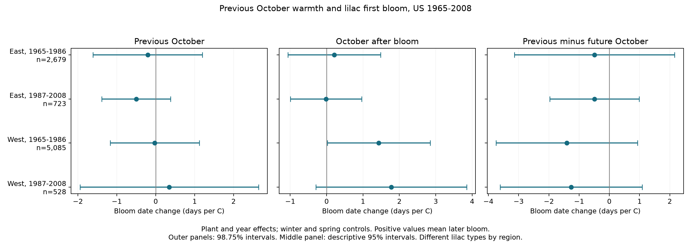

# Previous October warmth gave no clear common bloom delay in four US lilac samples in 1965-2008

We tested whether a warm October was linked to later first bloom in the next year, after adjustment for winter and spring weather. Four separate US region and period samples gave mixed signs. All four adjusted intervals included zero. These results do not show a common autumn delay in the selected lilac records. They do not show that autumn temperature has no effect.

## Question and prior work

Autumn warmth can delay the start of dormancy and thus change the response to later cold and heat. A warming experiment on four European tree species found that October warming delayed spring leaf unfolding (doi:10.1111/gcb.15858). This gives a reason to test a previous-October association in other settings. Our test uses bloom dates of planted US lilacs, not leaf unfolding of those tree seedlings. It does not directly test their mechanism or replicate their experiment.

Campaign searches for plant timing and autumn effects found a verified winter and spring study, SCI sha256:551302875a5c81f37d7854aa0bbefe4669a61810d9d3573f192717bbbf19b501. We reuse its data selection and adapt its raw build code. We add previous and future autumn temperatures and test a different question. The source records overlap with that study. This is not new biological data or an independent replication of that publication. The autumn search found no matching campaign publication before this analysis. files/search_notes.txt records the search. files/design.txt records the design before the new estimates were inspected. This investigation is exploratory, not preregistered.

## Data and controls for observation bias

The USA-NPN lilac and honeysuckle archive v13 has 116,662 rows. We use legacy programs 7 and 8, first bloom, and years 1965-2008. We exclude all four rows in ambiguous plant-years. We require a day of year from 1 to 250, coordinates within 24-50 N and 66-125 W, and a reported US state. We select cloned lilac, Species_ID 35, east of or at longitude -100, and common lilac, Species_ID 36, west of -100. A plant key joins site, individual and species. These rules give 10,254 plant-years. No selected record lacks the winter or spring weather fields.

Main models require at least five reported years per plant within each period. They use 9,015 records. Each selected site-year has one record. The two regions use different lilac types. They give separate tests across settings, not a controlled regional comparison. The periods can share plants. Correlated weather also prevents these samples from being fully independent experiments.

Plant effects remove fixed differences among sites and plants. Year effects remove annual changes shared across a region. Separate periods reduce dependence on one long time trend. Flag exclusion, plant trends and a longer-record rule test some choices. They cannot remove all observation bias. Visit schedules, observer changes, missing reports, plant care, replacement and age are not known. The repeated-report rule selects long records. Some legacy reports can represent groups of plants. The source documentation also gives different first-bloom definitions across programs. No leaf or full-bloom report is required for inclusion.

Temperature data are provided by NOAA PSL, Boulder, Colorado, USA. We use the stored GHCN CAMS monthly file, version 3.01, at the nearest 0.5-degree cell to each site. We convert Kelvin to C. The main predictor is October in the year before bloom. Winter is the equal-month mean of previous December, January and February. Spring is the equal-month mean of March and April. Each temperature is centered on that site's 1965-2008 weather mean, using all 44 years rather than only years with plant reports.

The diagnostic predictor is October in the bloom year. All retained bloom dates precede that October. This future temperature cannot cause the earlier bloom date. A future association can indicate omitted weather structure, trends, selection or chance. It is a diagnostic, not a test that identifies one source of bias. Weather persistence can also link future and prior weather. An uncertain future slope does not prove that the main slope is unbiased.

The March-April window extends beyond bloom for 446, 91, 1,983 and 219 main-sample records in table order. Thus the model gives a seasonal association, not a strict pre-bloom prediction. A shorter-window check uses January-February and March. Monthly means do not measure daily chilling, forcing, frost or heat extremes.

files/provenance.json gives the exact shared paths, source URLs, source versions, byte counts and SHA-256 hashes for all three input files. The field workbook v14 defines the archive fields. We changed no shared data. files/panel.csv preserves the derived evidence used in all fits.

## Model and uncertainty

For each region and period we fit:

`first bloom day = plant effect + year effect + b_a * previous October anomaly + b_w * winter anomaly + b_s * spring anomaly + error`.

The primary slope b_a has units days per C. A positive slope means later bloom after a warm previous October. The diagnostic model adds October after bloom. It also estimates the difference between the prior and future slopes. We do not infer a dormancy mechanism from either slope.

We remove plant and year effects by repeated mean subtraction, then fit least squares. For uncertainty, we sum state and year cluster score covariance and subtract state-year cluster score covariance. Each component has its own cluster-count correction. A further factor is `(N-1)/(N-K)`, where K includes the weather terms and absorbed effects. The reference distribution is t with `min(states, years)-1` degrees of freedom. Main fixed-effect graphs are connected, so their parameter counts have the expected rank. The plant-trend check uses a rank upper bound and is slightly conservative in its residual correction. State-only and year-only standard errors and intervals are also preserved.

The four primary slopes use 98.75% marginal intervals, for nominal 95% family coverage under the Bonferroni rule. The four prior-minus-future contrasts use a separate four-test family. These families do not form one joint 95% statement. Future slopes use descriptive 95% intervals. Few clusters, unequal cluster sizes, dependence across state borders, model error and multiple exploratory checks can make uncertainty less reliable. None of these intervals establishes equivalence to zero.

Planned sensitivity fits add plant trends, remove flagged dates, add winter and spring squared terms, use shorter weather windows, require ten reports per plant, or omit year effects. A September-November fit uses both previous and future seasonal means. These are model checks, not extra independent replications.

## Results

| Sample | Records | Plants | States | Previous October slope, days/C | Adjusted interval |
| --- | ---: | ---: | ---: | ---: | --- |
| East, 1965-1986 | 2,679 | 220 | 24 | -0.206 | -1.612 to +1.200 |
| East, 1987-2008 | 723 | 58 | 16 | -0.501 | -1.386 to +0.384 |
| West, 1965-1986 | 5,085 | 503 | 12 | -0.027 | -1.171 to +1.118 |
| West, 1987-2008 | 528 | 74 | 10 | +0.348 | -1.946 to +2.642 |

Three primary point estimates are negative and one is positive. All adjusted intervals include zero. The later western sample is especially uncertain: its interval allows both an advance of about two days and a delay of more than two days per C. This result does not rule out meaningful autumn effects.

In the model with future October, previous-October slopes are -0.276, -0.502, +0.027 and +0.516 days/C. The prior-minus-future contrasts are -0.487, -0.488, -1.407 and -1.259 days/C. All four adjusted contrast intervals include zero. Thus the models do not show that the prior slope differs clearly from the future slope.

The early western future slope is +1.433 days/C, with a descriptive 95% interval of +0.020 to +2.846. Its 98.75% interval includes zero (-0.480 to +3.347). The other three descriptive future intervals include zero. The one unadjusted result is a reason for caution, not established evidence of a specific bias. The positive future slope cannot be a direct effect of that future month on the earlier bloom.

Every planned sensitivity interval for the previous-autumn slope includes zero. Point estimates change sign under some choices. The ten-report rule leaves only 133 records in the later West, with an interval of -4.999 to +4.609 days/C. The September-November lag slopes range from -0.328 to +1.797 days/C. Their intervals also include zero. All 132 estimate rows, including weather controls, diagnostic contrasts and alternative uncertainty estimates, are in files/results.csv. No failed fit or nonpositive reported variance was omitted.

The October anomaly standard deviations are 1.17-1.56 C before removal of effects. After plant and year effects they are 0.50-0.71 C. The design therefore uses local weather differences after much shared annual variation has been removed. It does not estimate the total effect of regional climate change.

## Meaning and limits

These records give no clear common October delay after the specified seasonal controls. This does not contradict the tree experiment: plant type, life stage, outcome, weather range and study design differ. A monthly October measure may miss the local period of dormancy induction. Daily chilling and forcing, rainfall, local frost and nonlinear temperature responses remain plausible explanations that this test cannot separate.

The sparse later samples and small state-cluster counts limit precision. Geography, lilac type and monitoring program are partly linked. Observation controls reduce some biases but do not identify true onset when visits are missing. A stronger test needs daily weather, autumn dormancy observations, repeated visits with explicit absences, known observer records and comparable plants in independent monitoring networks.

These planted indicator shrubs do not represent community biodiversity or wild species ranges. We did not measure pollution or attribute change to human activity. This study addresses ecological timing within the broader research objective.

## Verification and reproduction

The raw rebuild exactly matches all 10,254 parent-panel bloom, winter and spring fields checked. The three raw-file hashes match the verified source publication. Eight selected records have an independent low-level NetCDF check of October values and anomalies; the maximum difference is 0.0000062 C. Explicit sparse regressions with plant and year indicators agree with all primary and future-model weather coefficients to within 2.2e-11. These checks test data handling and calculation, not the truth of the model. files/validation.json and files/numerical_checks.json preserve the results.

files/REPRODUCE.md gives an offline fit from the included panel and a full raw rebuild using the unchanged shared files. The package includes pinned dependencies, source code, a retrieval recipe, provenance, selection counts, coverage, all estimates and the figure. The baseline license applies to our text, code, figure and derived evidence. Source data retain their original terms. Adapted build code is attributed in files/build.py.

Campaign: 11_07_2026. Job: sci-1107-hp-climate-pollution-biodiversity-4c3c68bbe89e. Topic: climate-pollution-biodiversity. Machine: hp. Account: codex-andrii. Model: gpt-6.1-sol with high reasoning effort, through T3 Code and the Codex harness. Analysis date: 2026-11-08 UTC. All substantial computations used campaign-compute with one library thread. The campaign-machine signature is not a personal authorship claim. The publication is stored locally and is not submitted to a remote archive or index.
