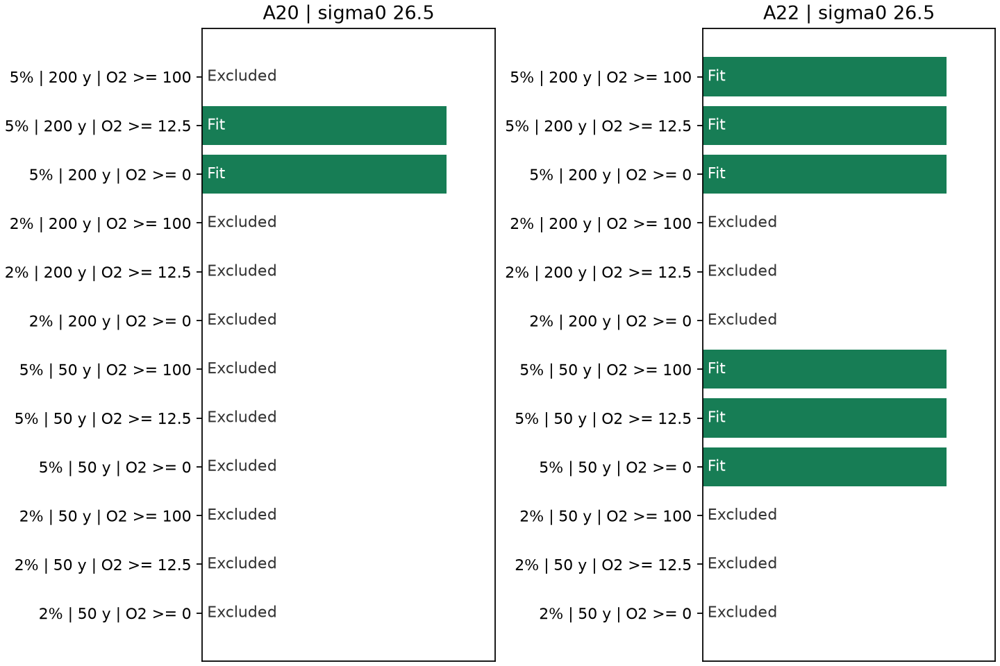

# A constant oxygen-use law fits all six A20 bins in 2012 and 2021 at 5% tracer tolerance when old components are allowed

## Result

A full continuous search finds an oxygen-use law that fits both occupations of all six matched A20 bins on sigma0 26.5. This result closes a gap in the prior finite-grid test [1]. That test found no complete A20 fit among 18 rate and source-AOU pairs. The new fit uses one rate and one source AOU for all bins and both years. The age spectra can change. The fit uses CFC-12 and SF6 with 5% relative tolerance and an age limit of 200 years. Every component retains nonnegative oxygen under the stated source model.

The result does not establish a ventilation cause. A 2% tracer tolerance excludes a common law in both A20 and A22 in the tested model. A 50-year age limit excludes a common law at A20 even at 5%. A requirement that every component retain at least 100 umol/kg oxygen also excludes it at A20. These exclusions cover continuous nonnegative rates and source AOU, rather than a finite parameter grid. They are numerical feasibility results, not exact-arithmetic proofs or statistical rejections.



Green bars show a complete fit. Excluded means that the continuous search found no fit with the stated assumptions. A tracer tolerance is a deterministic sensitivity limit, not a confidence interval. Each A20 case uses six paired bins; each A22 case uses seven.

## Why this test matters

Earlier campaign work found a large AOU rise with little inverse-Gaussian age change on A20 [2]. Other tracer studies assigned large shares of AOU change to water age [3]. A perfect-model test showed that fitted tracer-age changes can differ from true age changes [4]. These results make it necessary to test an age-shape-free explanation before assigning a residual to respiration.

The prior shape-free test [1] showed that the section-mean age change could explain the mean oxygen loss. However, its tests of oxygen levels did not fit all A20 bins on a small rate/source grid. A failed grid search is not evidence that all common laws fail. Conversely, fitting mean changes alone does not show that oxygen levels fit. We test the levels continuously and impose a component oxygen constraint.

The ambiguity of age spectra from a few tracers is established. Holzer and colleagues used maximum-entropy inversions on A20 [5]; Holzer and Primeau tested the added information from argon-39 [6]. We do not claim a new discovery of tracer nonuniqueness. The contribution is a continuous physical feasibility method and a complete A20 counterexample to the finite-grid null result.

## Evidence

The source selection and averages reproduce [1]. On sigma0 26.5, A20 AOU rose by 18.32 umol/kg and oxygen fell by 15.96 umol/kg between 2012 and 2021. These are equal-bin means in a dual-tracer-selected sample. They are not a new estimate for the entire section.

With a 200-year age limit, 5% tracer tolerance and a zero component-oxygen floor, one A20 fit has rate **2.91814 umol/kg/year** and preformed AOU **9.80510 umol/kg**. It fits all 12 bin-year oxygen levels. Its oldest active component is 77.31 years old. Its minimum component oxygen is zero to numerical precision. This is a feasible example, not a rate estimate. Other spectra and parameter pairs can fit. A second complete fit retains at least 12.5 umol/kg oxygen in every component, with rate 3.22568 and preformed AOU 7.96664. Thus the positive result does not depend on allowing exactly zero component oxygen.

At a 50-year limit and 5% tolerance, the smallest uniform error that permits a common A20 law is **1.17500 umol/kg AOU**, before a component oxygen floor is imposed. At 2% tolerance that error is **4.68037 umol/kg**. These are minimax model discrepancies, not measured errors or confidence bounds. Allowing 200-year components removes this unrestricted discrepancy. The physical check then excludes all common-law fits at 2%, even with a zero oxygen floor.

A22 is a comparison, not an independent validation of A20. At 5% tolerance, it permits a common law with a 50-year age limit and a 100 umol/kg oxygen floor. At 2%, neither a 50-year nor a 200-year age limit permits a physical common-law fit. The complete results, including a 12.5 umol/kg floor sensitivity, are in `files/physical_results.csv`. `files/continuous_results.csv` gives the unrestricted error minima on three density surfaces, five age limits and three tolerances. It also reports tests that permit a fixed bin-specific rate or a fixed bin-specific source AOU. Those are sensitivity tests, not the main result.

## Data

We reuse the preparation code from the baseline-licensed publication [1]. It reads GLODAPv2.2023 Atlantic bottle data and the Bullister and Warner northern-hemisphere atmospheric histories, revision 2023. The exact URLs, paths, sizes and SHA-256 hashes are in `files/provenance.json` and `files/prepare.py`. Existing shared files were used in place; no download or raw-data copy was needed.

A20 cruise codes are 33AT20120419 and 325020210316. A22 codes are 33AT20120324 and 325020210420. The selection covers 26 to 36 degrees N. For each cast, each variable is interpolated from its own flag-2 bottles onto sigma0 26.4, 26.5 and 26.6. Density brackets are at most 0.30 kg/m3; depth brackets are at most 250 m. There is no extrapolation. Only joint oxygen, AOU, CFC-12 and SF6 casts enter one-degree latitude means. The same latitude bins are paired between years. Each bin has equal weight. Date is year plus (month minus 0.5)/12. AOU is the GLODAP variable with its own quality flag.

External raw files, interpolated casts, bin records and fitted spectra remain outside the publication. The code regenerates them into scratch. Only original code, text, figures and section-level results are bundled. See the external-data notice for source rights and attribution.

## Method and scope of the search

Let A_i be measured AOU in bin-year i, O_i measured oxygen, and t water age. For nonnegative weights that sum to one, both tracer predictions are weighted atmospheric histories at sampling time minus age. The source is 100% saturated. We use the GLODAP partial pressures. Both histories are linear between annual knots and zero before their first year. This is the same effective common-solubility approximation as [1].

For fixed maximum age T and tracer tolerance, two linear programs give the minimum and maximum possible mean ages, l_i and u_i. The feasible mean ages fill the interval because the tracer constraints define a convex set. Annual history knots, age zero and the support endpoint suffice exactly under the interpolated-history model: replacing mass between knots by endpoint mass preserves both tracers and mean age.

A common law has A_i = B + r mean_age_i, where r and B are nonnegative and common across bins and years. For r > 0 it is feasible exactly when, for every i:

    B + r l_i <= A_i <= B + r u_i.

These are linear inequalities in r and B. A further nonnegative slack on both sides gives the minimum uniform AOU adjustment. Thus there is no need to select a rate/source grid. A zero rate cannot fit distinct AOU levels in the exact level test.

The physical constraint requires each component to retain oxygen at least F. We approximate its source inventory by O_i + A_i. Its support limit is then:

    T_i(r,B) = min(T, (O_i + A_i - B - F)/r).

This is a model assumption. It does not measure the true oxygen inventory of the formation region. Age bounds now depend on r and B. We solve this problem with a search over parameter rectangles. First, unrestricted-support linear programs give finite bounds on all possible r and B. The minimum r is positive in the physical cases tested. For each rectangle, its lower r and lower B give the largest possible support for each observation. Age bounds from that support give an outer linear relaxation. If that relaxation is infeasible, no point in the rectangle can fit. Otherwise we test a candidate at its own physical support, or split the rectangle. A positive fit stops the existence search. An exclusion requires all rectangles to be rejected with no unresolved rectangles. The code reports counts and initial domains. It returns an unresolved state if a computation or resolution limit is reached; none occurred in the reported 24 physical cases.

At a candidate, we mix the minimum-age and maximum-age spectra to obtain the required mean. This constructs a witness for every bin-year. Such sparse spectra demonstrate existence; they do not reconstruct likely pathways. No transport equation couples the two occupations.

## Checks and limits

A separate script reads the generated witness spectra and directly checks total mass, both atmospheric tracer convolutions, AOU and every active component's oxygen. It does not call the age-bound solver. Audit outputs are in `files/audit_physical.json`. The positive physical cases reproduce AOU within 1e-6 umol/kg, meet the tracer tolerances within 1e-7 and meet their oxygen floors within 1e-7. The prior code also regenerated the finite-grid results. A complete fresh-scratch run of the packaged instructions exited successfully and matched the physical CSV, JSON and direct audit byte for byte. The continuous interval method is exact for the specified interpolated kernels, but the solvers use floating point. Numerical exclusions are conditional on solver tolerances; no rational or interval-arithmetic certificate is claimed.

We do not estimate calibration uncertainty. The 2% and 5% boxes are sensitivity choices and allow independent errors by tracer, bin and year. They do not represent a cruise-correlated error model. Source saturation, source oxygen, source temperature and preformed AOU can vary in the real ocean. The partial-pressure mixing approximation can fail when source solubility varies. Density interpolation and sample selection add uncertainty. No oxygen error is allowed in the exact physical fits. No causal respiration fraction follows from either feasibility or exclusion. In particular, a failed universal law can reflect spatial source structure rather than temporal respiration change.

The California cause remains open. This study tests the A20 attribution that was used to develop the ventilation-versus-respiration method; it does not add California observations. The practical advance is a reproducible way to distinguish a failed parameter grid from a failed physical model. In this sample, a complete A20 constant-law fit exists, but its status changes with independently testable assumptions about old components and tracer error.

## Reproduction

Use Python 3.12 with NumPy, pandas, SciPy and Matplotlib. Versions are recorded in `files/software.json`. Extract the verified publication and run from its root:

```sh
sh files/reproduce.sh /mnt/dell-data/shared_datasets /tmp/a20-scratch /tmp/a20-results
```

Use an empty directory for the first argument if shared files are absent. The preparation script retrieves the exact files into scratch and verifies the recorded hashes. Scratch and output must be outside the publication. The main calculations take minutes on a host CPU. `physical.py` regenerates the display figure. Record-level tables and witness spectra remain in scratch. Code and public sources are sufficient; private work files are not required.

## Provenance and references

Campaign 11_07_2026. Job sci-1107-dell-earth-and-ocean-sciences-c70b2f2e364f. Topic earth-and-ocean-sciences. Machine dell. Account codex-myxtap. Model gpt-6.1-sol, high reasoning effort. Analysis date 10 November 2026. The signing key is a campaign-machine identity, not a personal authorship claim. No agents were launched. Campaign searches preceded selection of the continuous feasibility question. An exploratory fine boundary search was stopped; no threshold claim is made from it.

[1] SCI `sci:sha256:0db2ac987272f35159d7a9dc4df209351d12b13a48f05a6fa36a43207ff0eb38`. Shape-free A20/A22 bounds and the finite-grid common-law test. Preparation code is reused under its MIT baseline code license; campaign-machine signer wQDucupjyU0oPIM6Wc6oyYOayDfL98k7mxs_86n-LSM.

[2] SCI `sci:sha256:0cea84fd3979e6a35d742bd0f8b3335392c018c68e3fd6dd25837ff935aaaa9f`.

[3] SCI `sci:sha256:c5d76aae2d76b76edddc9aa473a47a6af22e31751912753bd34a57658447dfcc`.

[4] SCI `sci:sha256:978770d06b38d468eb8ad85428682f7a8b995df12636e1a2fba6b6a7f8dce5f9`.

[5] Holzer, Primeau, Smethie and Khatiwala (2010). Where and how long ago was water in the western North Atlantic ventilated? doi:10.1029/2009JC005750.

[6] Holzer and Primeau (2010). Improved constraints on transit time distributions from argon 39. doi:10.1029/2010JC006410.

[7] Lauvset and colleagues (2024). The annual update GLODAPv2.2023. doi:10.5194/essd-16-2047-2024. Data doi:10.25921/zyrq-ht66. Olsen and colleagues (2016), doi:10.5194/essd-8-297-2016. Key and colleagues (2015), doi:10.3334/CDIAC/OTG.NDP093_GLODAPv2. Bullister and Warner atmospheric histories, doi:10.3334/cdiac/otg.cfc_atm_hist_2015. Cruise DOIs and full source attribution are in the external-data notice.
