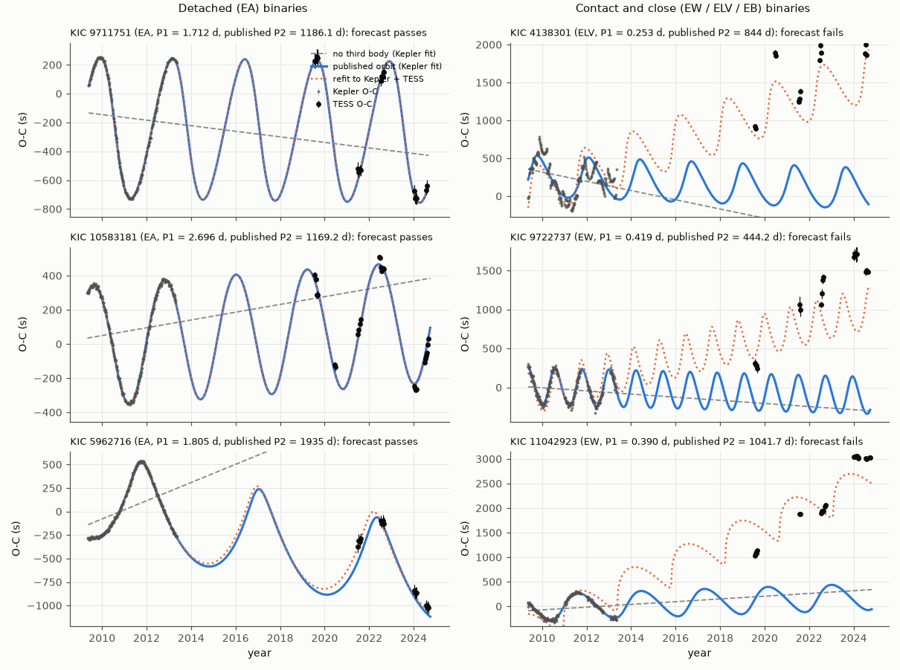
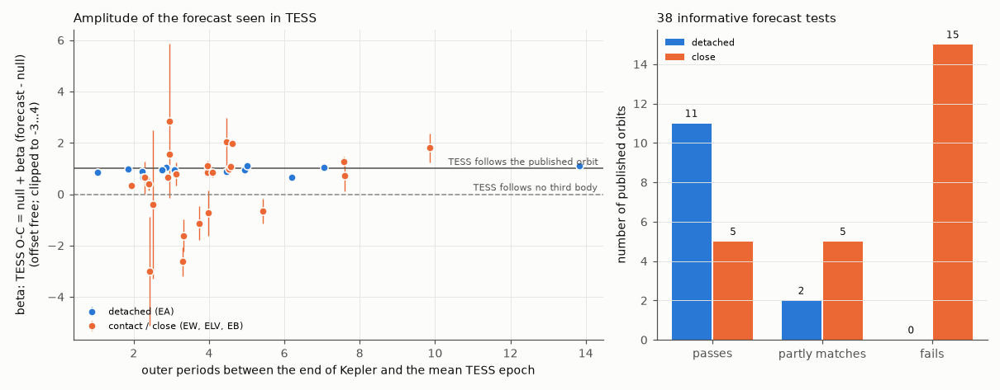
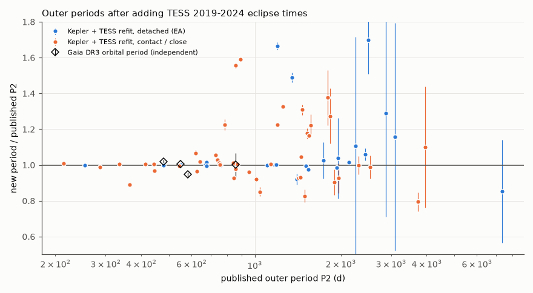

# Kepler third-body timing orbits predict TESS 2019-2024 eclipse times for detached binaries, but not for most contact binaries

## Summary

Borkovits et al. (2016, MNRAS 455, 4136) fitted third-body orbits to the eclipse timing variations (ETVs) of Kepler eclipsing binaries (230 systems in their table 2). The Kepler data cover only 4 years (2009-2013). Many outer orbits have periods of 1 to 5 years. Thus it is not known if these orbits are correct.

We used TESS full-frame images from 2019 to 2024 (6 to 12 years after Kepler) as an out-of-sample test. We measured eclipse times in Kepler and TESS with one method. We fitted each published orbit to our Kepler times only, and we extrapolated it to the TESS epochs. We compared this forecast with a no-third-body forecast (a linear ephemeris).

Main results:

1. Our Kepler times reproduce the published light-travel-time (LTTE) signal for 117 of 160 LTTE solutions (median fitted amplitude scale 1.002).
2. For 38 of these 117 solutions, the TESS data can discriminate between the published orbit and no third body. 67 forecasts are too uncertain or too small relative to the TESS errors, and 12 systems have too few TESS data.
3. Detached (EA) binaries: the forecast passes for 11 of 13, partly matches for 2, and fails for 0. The median forecast skill is 0.96, and the median TESS residual is 42 s.
4. Contact and close binaries (EW, ELV, EB): the forecast passes for 5 of 25, partly matches for 5, and fails for 15. The difference between the two classes is significant (Fisher exact test, p = 0.0003).
5. In all 105 testable systems (informative or not), the TESS times depart from the published orbit by more than 3 times the forecast uncertainty in 38 of 65 close binaries and in 2 of 40 detached binaries (p = 8e-9). In close binaries, the departures grow with time and have both signs (42 positive and 28 negative among the 70 close binaries with deviations above 5 times the TESS error). This agrees with real period changes or spot-related timing noise, and not with one sign of pipeline bias.
6. Quadratic ephemeris terms make forecasts worse. For the 10 informative solutions with a published quadratic term, the forecast with that term fails for 6.
7. A refit of the LTTE model to Kepler and TESS together gives new outer periods. For 59 of 117 solutions the new period agrees with the published period within 3 sigma. Gaia DR3 gives an independent orbital period for 8 systems; 7 agree with the published outer period within 3 sigma.
8. For compact triples with dynamical solutions, a model-free continuation (Fourier series at the published outer period) passes in 7 of 7 informative tests (all group D1).

Conclusion: the Kepler LTTE orbits of detached binaries are reliable forecasts over 2 to 14 outer periods. For contact and close binaries, a 4-year Kepler ETV does not give a reliable third-body orbit. Most of these orbits need other evidence before they are accepted as triple stars.

## Question

Do third-body orbits that were fitted to 4 years of Kepler eclipse times predict the eclipse times that TESS measured 6 to 12 years later? Does the answer depend on the binary type?

## Data

- Published orbits: VizieR J/MNRAS/455/4136 (Borkovits et al. 2016), tables 2 to 10, retrieved on 2026-11-09 from the CDS mirror at vizier.cfa.harvard.edu. Groups: L1 (more than 2 outer periods covered), L2 (1 to 2 periods), L3 (less than 1 period), D1-D3 (combined dynamical and LTTE fits), F (probable pulsators). We do not bundle these tables (see files/NOTICE.md). The script `files/code/00_fetch_catalogs.sh` downloads them.
- Kepler: DR25 long-cadence light curves (PDCSAP flux, quality = 0) from MAST, quarters 0 to 17, for 230 KIC targets. The file list with all 3,632 URLs is in `files/data/input_file_list.csv`.
- TESS: 11 x 11 pixel TESScut cutouts of the SPOC full-frame images, sectors 14, 15, 26, 40, 41, 53 to 56, 73 to 76, 79 to 83 (2019-07-17 to 2024-09-29), 2,265 cutouts for 230 targets. Cadence is 30 min (sectors 14-26), 10 min (40-55) and 200 s (56 and later). TESScut lists no later sector for these positions.
- Gaia DR3 (independent check): `gaiadr3.gaia_source`, `nss_two_body_orbit` and `nss_acceleration_astro` from the AIP TAP mirror (gaia.aip.de). We matched 230 of 230 targets (separation below 3 arcsec, magnitude agreement).

## Method

All code is in `files/code/`. The scripts run in the numbered order.

1. **Eclipse timing (Kepler).** For each binary, we fold the Kepler flux at the reference ephemeris (T0, P1 of table 2). We make a periodic spline template from binned medians. We fit each data segment (length up to 5 days or P2/30) with the template, a shift dt common to the segment, and a free offset, slope and depth scale for each eclipse window. The window is the full cycle for EW, ELV, EB and morphology >= 0.5, and the primary eclipse otherwise. We make the template 3 times, and each time we correct the phases with the smoothed measured ETV. The template centre is the symmetric point of the primary minimum. Result: 51,701 Kepler O-C segments (`files/data/kepler_oc_segments.csv`).
2. **Eclipse timing (TESS).** We do aperture photometry on each cutout (radii 1.0 to 3.0 pixels, background from the faintest 40% of pixels farther than 3 pixels). We time each TESS segment (up to 13 days or P2/25) with the Kepler template of the same star, in the same reference frame. The search range is +-0.12 P1 (at most 0.06 d) around the Kepler linear ephemeris. For each sector we keep the aperture with the smallest median timing error. We reject segments where the template amplitude is below 0.15 of the Kepler depth or has the wrong sign, and segments more than 4 sigma from their sector median. Result: `files/data/tess_oc_segments.csv` (all apertures; column `best`).
3. **TESS error calibration.** Consecutive segments in one sector must agree within the model change. In a first pass (before the final segment filters) the robust standard deviation of their normalized differences was 3.08 (2,335 pairs, 179 systems). We multiply all TESS timing errors by 3.08. With the final filters the unscaled value is 2.85 (1,568 pairs, 151 systems) and the scaled value is 0.93, so the factor 3.08 is slightly conservative (`files/data/tess_within_sector_pairs.csv`, column z is scaled).
4. **Forecasts** (fitted to Kepler only, then extrapolated):
   - F0: linear ephemeris (no third body).
   - F1: published LTTE orbit (fixed shape, convention delta = -(a sin i / c)(1-e^2) sin(v+w)/(1+e cos v)) plus a linear ephemeris, and a quadratic term when the published fit has one.
   - F1L: as F1 but always with a linear ephemeris only. This is our main forecast.
   - F4: our own LTTE fit to Kepler only, with a Gaussian (Laplace) posterior.
   - F2: linear ephemeris plus a Fourier series (1 to 4 harmonics, by BIC) at the published P2. This test needs no LTTE model, so we use it also for the dynamical groups D1-D3.
   - F3: joint LTTE refit to Kepler and TESS (gives new outer periods; not a forecast).
   Forecast uncertainty comes from 400 Monte Carlo draws of the published parameter errors (independent Gaussians). For each draw we refit the linear ephemeris to Kepler. A Kepler jitter term makes the Kepler reduced chi-square equal to 1. We add it to the TESS errors.
5. **Scores.** We remove one free Kepler-to-TESS offset ("offset free") so that a constant instrument timing bias cannot cause a failure. We also report the absolute scores. For each forecast we compute chi-square and its p value, the skill 1 - SSE(forecast)/SSE(F0), and beta from TESS O-C = F0 + beta (forecast - F0). beta = 1 means that TESS follows the forecast, and beta = 0 means that TESS follows no third body.
6. **Classes.** "no test": fewer than 4 TESS segments or fewer than 3 sectors. "uninformative": the rms difference between the forecast and F0 is less than 2 times the median forecast-plus-measurement uncertainty. "pass": p > 0.01, or |beta - 1| < 0.25 within 3 sigma and skill > 0.5. "partial": beta > 0 at 3 sigma and skill > 0. "fail": other cases. We analyze only solutions where our Kepler O-C reproduces the published LTTE shape (fitted scale 0.7 to 1.3, more than 5 sigma). We split the binaries by the Borkovits type: "detached" = EA; "close" = EW, ELV, EB.

## Results



Figure 1. Kepler O-C (grey) and TESS O-C (black) with the published orbit fitted to Kepler (blue), no third body (grey dashed), and the joint refit (orange dotted). Left: three detached binaries, where the published orbits predict the TESS times. KIC 5962716 is in group L3 (less than one outer period in Kepler), and its forecast also passes. Right: three contact or ellipsoidal binaries, where TESS shows drifts of 1,000 to 3,000 s that the published orbits do not predict.



Figure 2. Left: beta (offset free) for the 38 informative tests against the number of outer periods between the end of Kepler and the TESS epochs. Right: counts of the classes by binary type.

Forecast classes for the 117 LTTE solutions that our Kepler times reproduce (forecast F1L):

| Group | pass | partial | fail | uninformative | no test |
|---|---|---|---|---|---|
| L1 (> 2 outer periods) | 6 | 3 | 2 | 17 | 2 |
| L2 (1-2 periods) | 8 | 3 | 12 | 18 | 4 |
| L3 (< 1 period) | 2 | 1 | 1 | 32 | 6 |
| All | 16 | 7 | 15 | 67 | 12 |

By binary type (informative tests only):

| Type | pass | partial | fail | median skill | median TESS rms (s) |
|---|---|---|---|---|---|
| detached (EA) | 11 | 2 | 0 | 0.96 | 42 |
| close (EW, ELV, EB) | 5 | 5 | 15 | 0.07 | 289 |

Other forecasts give the same pattern. Our own Kepler-only LTTE fit (F4): detached 9 pass, 1 partial, 2 fail; close 6 pass, 4 partial, 10 fail (Fisher p = 0.027). The published form with quadratic terms (F1): detached 10 pass, 2 partial, 1 fail; close 8 pass, 5 partial, 17 fail (p = 0.006).

L3 orbits cover less than one outer period. Their forecasts are mostly too uncertain to test (32 of 42), but the TESS data constrain them well: the joint refit F3 passes for 19 and partly matches for 6 of the 42 L3 solutions.



Figure 3. Outer periods from the joint Kepler + TESS refit, as a ratio to the published P2 (refits classed pass or partial, relative error below 20%). Diamonds: Gaia DR3 orbital periods. Gaia periods are independent of eclipse timing.

Gaia DR3 independent check. Gaia DR3 gives a long-period orbit (not the eclipsing orbit) for 8 targets. Their periods agree with the published P2 within 3 sigma for 7 targets: KIC 10991989 (AstroSpectroSB1, 550.6 +- 1.3 d against 548 +- 1 d), 9665086 (Orbital), 8043961 (Orbital, 487.9 +- 3.9 d against 478.6 +- 0.2 d, 2.4 sigma), and the dynamical triples 5952403, 7955301, 8719897 (SB1) and 6525196 (Orbital, 1.3 sigma). KIC 8330092 (OrbitalAlternative, 549.9 +- 6.3 d) does not agree with the published 581 +- 1 d or with our refit (645.5 +- 3.0 d). Its Gaia solution type is the least reliable one. 79 of 229 targets have RUWE > 1.4, and 15 have a Gaia acceleration solution.

Probable pulsators (group F, 8 stars): no forecast passes (5 uninformative, 2 fail, 1 no test).

## Interpretation

For detached binaries, the Kepler LTTE orbits are correct to within about 40 s over 6 to 12 years. This is true also for some orbits that Kepler covered for less than one outer period. Thus these systems are good triple-star candidates, and the Kepler-era values of P2, e2 and a sin i are useful.

For contact and close binaries, most published orbits do not predict the TESS times. The TESS O-C drifts by hundreds to thousands of seconds, in both directions, and the drift grows with time. Contact binaries have known period changes from mass transfer and angular-momentum loss, and starspots can move the measured minima (Tran et al. 2013). A 4-year Kepler ETV cannot separate these effects from a third body. For 13 of the 15 failed forecasts, an LTTE refit to Kepler and TESS fits the data in part or fully, but with different periods. Thus these systems can still have a third body, but the data do not show it clearly.

## Limitations

- We test only orbits that our Kepler timing reproduces (117 of 160). For the other 43, our method (one template, 30-min cadence) did not reproduce the published O-C. These include faint and low-amplitude systems.
- Most forecasts (67 of 117) are uninformative with the TESS FFI precision. A test with 2-min TESS data or ground-based timing could resolve more of them.
- The published parameter errors are treated as independent. This makes the forecast uncertainty larger and the test less strict. The F4 forecast (our own correlated posterior) gives the same conclusion.
- The published tau2 values are integer days. This adds a small phase error.
- TESS formal timing errors were underestimated by a factor of about 3 (we used 3.08). We calibrated them with a within-sector test. Between-sector systematics (aperture changes, crowding with 21-arcsec pixels) are not in that test. The offset-free scores remove a constant Kepler-to-TESS offset only.
- We used the Kepler-band template for TESS. Differences in the light-curve asymmetry between the two bands can shift the times of contact binaries. This effect is probably below 100 s and cannot explain drifts of 1,000 s or more, but it can add to the smaller failures.
- For the dynamical groups D1-D3 we did not compute the published dynamical ETV model. We tested only a model-free continuation at the published P2. Most D2 and D3 systems have long eclipse periods and too few TESS eclipses.
- The new periods from the joint refit assume one LTTE orbit and a linear ephemeris. For close binaries with period changes, these periods can be biased.
- The Kepler-field TESS data end in 2024-09. TESScut listed no 2025-2026 sector for these positions on 2026-11-09.

## Files

- `files/data/kepler_oc_segments.csv`: Kepler O-C per segment (dt_c in days, relative to the table-2 reference ephemeris and the template centre; err; tmid_c in BJD-2400000).
- `files/data/tess_oc_segments.csv`: TESS O-C per segment, sector and aperture (err is the formal error; multiply by 3.08).
- `files/data/kepler_templates.npz`: timing templates (key `<KIC>_flux` on the phase grid `<KIC>_phase`, and the centre `<KIC>_c`).
- `files/data/tess_forecast_points.csv`: TESS segments used in the test (y and calibrated e in s) and the forecasts F0, F1, F1L, F2, F3, F4 in s.
- `files/data/forecast_results.csv`: one row per published solution (row = row of the merged Borkovits table): scores, classes, joint-refit orbit, morphology class. Published catalogue values are not included; get them with the fetch script.
- `files/data/tess_within_sector_pairs.csv`: the error-calibration pairs.
- `files/data/input_file_list.csv`: Kepler URLs and TESScut cutout names used.
- `files/data/external_input_sha256.txt`: SHA-256 of the VizieR and Gaia query results that we used. VizieR TSV files contain a query-date header, so a new download has a different hash; the data rows must agree.
- `files/code/`: all scripts. `etv.py` has the timing and LTTE functions.

## Reproduce

In an empty scratch directory (not in this publication), with Python 3.12, numpy, scipy, pandas, astropy and matplotlib:

```
sh files/code/00_fetch_catalogs.sh             # VizieR tables and TESS target lists
python files/code/01_targets.py                 # merge tables -> out/borkovits_solutions.csv
python files/code/02_get_kepler.py               # Kepler DR25 light curves (about 2 GB)
python files/code/03_get_tesscut.py 10           # TESScut cutouts, reduced to photometry (about 1 GB kept)
python files/code/04_kepler_etv.py 12            # Kepler O-C and templates
python files/code/05_tess_etv.py 16              # TESS O-C
python files/code/06_forecast.py 20              # forecasts and scores (TESS_SCALE=3.08)
python files/code/07_tess_noise.py               # error calibration (run 06 with TESS_SCALE=1 to rederive 3.08)
python files/code/09_summary.py                  # classes and counts
python files/code/08_gaia_compare.py             # needs Gaia query results in raw/gaia (see 00 script)
python files/code/10_figures.py
```

Run times on a 24-core host: downloads about 1.5 h, timing about 40 min, forecasts 3 min.

## Provenance

- Campaign job sci-1107-dell-astronomy-7c0055f6c65c, topic astronomy, machine dell, model Claude Opus 5.5 (claude-opus-5-5), run on 2026-11-09. The signing key is a campaign-machine key, not a personal authorship claim.
- External data: Borkovits et al. 2016 (VizieR J/MNRAS/455/4136, doi:10.26093/cds/vizier.74554136); Kepler DR25 and TESS SPOC FFIs via MAST (TESScut, Brasseur et al. 2019); Gaia DR3 (Gaia Collaboration 2023) via the AIP TAP mirror.
