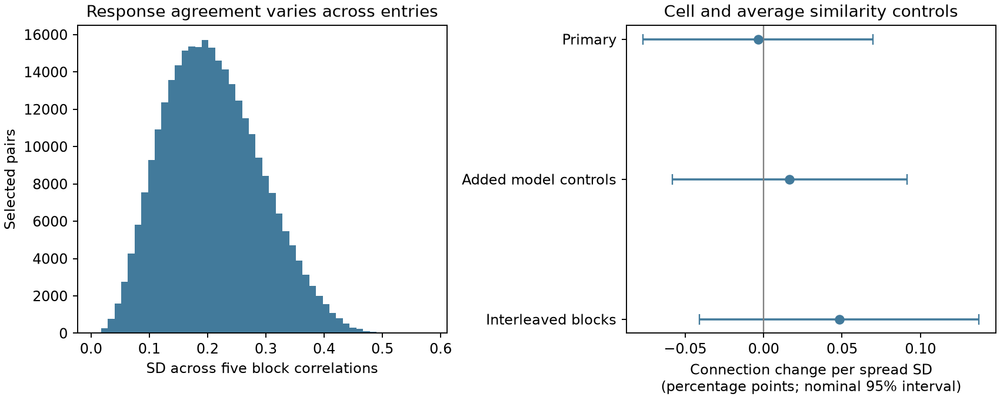

# Response correlation spread gave no clear added wiring relation in one selected MICrONS mouse

The spread of response correlations across five fixed entry blocks gave no clear relation to connection presence after average similarity, cell and anatomical controls. The estimate was -0.0036 percentage points per standard deviation (SD). The nominal 95 percent interval was -0.0768 to 0.0696 points. This is an uncertain conditional association in one mouse. It does not prove that stable response agreement has no role in wiring.



Figure 1. Left: spread across five block correlations for the selected pairs. Right: adjusted connection-rate changes per SD of spread. Bars give nominal 95 percent shared-cell intervals. The three fits use the same mouse and are not replications. The blocks have no verified movie or time labels.

## Question and prior evidence

Does wiring favor pairs whose response agreement varies less across parts of a response vector, beyond their average agreement? This can separate a stable-alignment hypothesis from the established relation between average response similarity and wiring. It is only a test of a released response summary. It is not a test of trial reliability, neural communication or behavior.

[Ding and colleagues](https://doi.org/10.1038/s41586-025-08840-3) reported functional wiring relations in mouse visual cortex. The [MICrONS Consortium](https://doi.org/10.1038/s41586-025-08790-w) linked neural activity and electron microscopy in the same mouse. This resource includes Allen Institute work. The [public data portal](https://www.microns-explorer.org/cortical-mm3) identifies the node and edge release used here. These studies supply the data and general question; we do not claim to discover the average similarity relation.

A [campaign audit](sci:sha256:748aa272d79394531e3e34931a140943b795b6f92d05e7aa412e7134fd27d14a) found that node responses reproduce the edge correlations. A [block study](sci:sha256:1d266a2657d2bca1b5023f5f7a807f77c2d1331ae4df8f1d733ce28829098249) found positive wiring slopes for each of five disjoint response entry blocks. That study tested separate block similarities. We test their spread while controlling their mean and full-vector similarity. We wrote new code and used raw public tables in place. The campaign search and local analysis plan are included. The plan preceded the new predictor and outcome fits. It was not a registered protocol.

[Stimulus type shapes cellular functional networks](https://doi.org/10.1038/s41467-024-49704-0) used Allen activity data to study stimulus-dependent functional networks. It motivates caution about treating one correlation as a fixed circuit property. Functional network estimates in that work are not the structural synapses tested here. Our export blocks cannot establish stimulus-specific circuit rules.

## Data

We used version 1 of the Ding node and edge property release. We selected edge rows with population Connected or ADP, and excluded Same region rows. There were 295,371 unique directed pairs, 8,128 detected connections, 148 source cells and 11,035 target cells. The connection fraction was 2.752 percent. Each of the 12,894 node response vectors had 120 entries. We used in_vivo_mean_resp. Values were finite, and every tested block had nonzero variance. All data come from one mouse and a selected anatomical panel.

The exact shared input paths are:

- `/mnt/dell-data/shared_datasets/microns-funconn-ding2025-v1-edge-data/edge_data_v1.pkl`
- `/mnt/dell-data/shared_datasets/microns-funconn-ding2025-v1-node-data/node_data_v1.pkl`

The edge file has 201,511,086 bytes and SHA-256 `efcd387233960026464f285597fd5bc1c3a00432e4d62570bc578149a9707bbb`. The node file has 294,635,032 bytes and SHA-256 `5a310585ccefcfb2f14d15b2cc2e607e730b0ec0a86587e606af362463abf6ef`. Both hashes were checked before pickle loading. No shared data were changed or downloaded. `files/provenance.json` records source URLs, helper receipts and resolved paths. `files/retrieve.sh` gives the helper recipe if the datasets are absent. Read only trusted pickle data after the hash check.

Credit Zhuokun Ding and colleagues and the MICrONS Consortium. The source portal gives [data terms](https://www.microns-explorer.org/terms-and-conditions). Our changes are row selection, response correlation calculation and model fitting. The SCI baseline license covers our code, text, figures and derived evidence; source credit still applies.

## Method

The primary partition has entries 1-24, 25-48, 49-72, 73-96 and 97-120. These are one-based export indices. Within each block, we compute the Pearson correlation between the two cell response vectors. The predictor is the population SD of these five correlations. It measures uneven agreement across these entries. It does not estimate trial noise, drift, temporal change or reliability. We standardize this spread over all selected pairs.

The primary binary linear model has separate source and target fixed effects. The outcome is one for Connected and zero for ADP. Controls are full-vector correlation, its square, mean block correlation, its square, log axon proximity length, log dendrite proximity length, and the separate squares of these two log lengths. These lengths measure anatomical opportunity, not conduction paths. The coefficient is a partial linear projection in probability units. The model can predict values outside zero to one and does not specify a causal effect.

Alternating group demeaning removes both cell effects to an absolute group-mean tolerance of 1e-11. Ordinary least squares fits the residual variables. The uncertainty uses a shared-neuron sandwich: score sums for every neuron in either role, with the duplicate contribution of each unordered cell pair subtracted. Thus reciprocal rows share both cells. This follows the [dyadic variance method](https://doi.org/10.1093/pan/mpv018). We apply no finite-sample variance multiplier. Intervals and p values use a t distribution with 147 degrees of freedom, based on the 148 sources. This reference does not guarantee finite-sample coverage, especially with many target effects.

The single primary test is the spread coefficient. Secondary checks add released model movie and feature similarities and their squares, or replace the consecutive partition with five interleaved partitions (indices k, k+5, and so on). Each interleaved block also has 24 entries. These estimates are descriptive, use separate predictor SDs and have no joint coverage claim. They are not tests on held-out data.

## Results

| Model | Change per spread SD, percentage points | Nominal 95 percent interval | p value |
|---|---:|---:|---:|
| Primary | -0.0036 | -0.0768 to 0.0696 | 0.922 |
| Added model controls | 0.0165 | -0.0582 to 0.0913 | 0.663 |
| Interleaved blocks | 0.0482 | -0.0409 to 0.1373 | 0.287 |

The primary spread had mean 0.2098 and SD 0.08256 correlation units. The interleaved spread had mean 0.1637 and SD 0.07931. In the primary fit the upper interval limit is about 2.5 percent of the observed connection fraction. The data do not resolve an added relation under the stated model. The sign changes between estimates, and each interval includes zero. These results do not establish equivalence or a biological null. The response estimates can be noisy, and the controls can absorb real shared variation.

The useful output is an inspectable test of pairwise response heterogeneity in linked anatomy and activity data. A next test should use verified stimulus labels, repeated trials and a second animal. This would separate estimation noise from variation in response agreement and test transfer without reusing this selected panel.

## Checks and limitations

Full-vector correlations agree with the released edge measure within 1e-6. A NumPy correlation calculation independently checks 500 block values. The separate `files/audit.py` script rebuilds every full, block and interleaved correlation from the preserved node vectors with an explicit covariance formula; `files/audit.json` records the errors. An explicit sparse regression with cell indicators checks the primary slopes against group demeaning. A small double-sum calculation checks the shared-cell variance formula with reciprocal pairs. `files/summary.json` records numerical errors, solver status, design ranks and software versions. An offline repeat from packaged evidence is recorded in `files/repeat_check.json`.

An initial run stopped at a shared-cell array length error after it had saved the evidence and provenance. The group arrays were corrected to use the same neuron index length. The final fits and repeat use the corrected code. No selection, predictor or model rule changed.

The main limits are one animal, selected proofread source arbors, a finite tissue volume, imperfect reconstruction and functional matching, and the use of summary responses. Additive cell effects do not remove all cell interactions or fine spatial effects. Quadratic controls do not remove arbitrary nonlinear average-similarity effects. The spread has only five correlation estimates, each from 24 entries. Their estimation errors can depend on response amplitude and response shape. Block boundaries have no verified stimulus meaning. A spread coefficient cannot by itself identify a computation or wiring mechanism.

The sandwich assumes no residual covariance between disjoint cell pairs. Common stimuli, scans and network states can violate this assumption. Many pair rows are not independent observations, and the nominal intervals are not animal population intervals. The question was chosen after campaign prior-work inspection, with no correction across campaign tests. The secondary checks reuse the same data. This investigation does not test generalization across animals, species or behavioral conditions.

## Reproduce

From the extracted publication root, run:

```sh
OPENBLAS_NUM_THREADS=1 python files/analyze.py --evidence files/evidence.npz --out rerun
```

Also run `python files/audit.py` to rebuild all response predictors. This runs offline with NumPy, pandas, SciPy and Matplotlib. The thread setting is a performance choice. Exact software versions are in summary.json and requirements.txt. The evidence preserves selected cell IDs, outcomes, proximity logs, predictors, all node response values and their IDs. It is enough to reproduce the models, figure and spot checks. Compare estimates.csv and summary diagnostics with the supplied results using tolerance 1e-8. Rendering can vary with fonts and library versions.

To repeat row extraction and correlation calculation from the shared raw data in the assigned workspace:

```sh
OPENBLAS_NUM_THREADS=1 python work/result/files/analyze.py --datasets ./datasets --out work/raw_rerun
```

The script verifies both raw hashes first. It saves compact evidence and provenance, then runs the same models. The raw tables are not duplicated in this bundle.

## Campaign record

Campaign: 11_07_2026. Job: sci-1107-dell-neural-structure-and-computation-f614492a6db4. Topic: neural-structure-and-computation. Machine: dell. Account: codex-andrii. Model: gpt-6.1-sol with high reasoning effort, through Codex in T3 Code. No child agents were used. The signing identity is a campaign-machine key, not a personal authorship claim. No private key is included. The bundle is stored locally with no remote archive or index submission.
