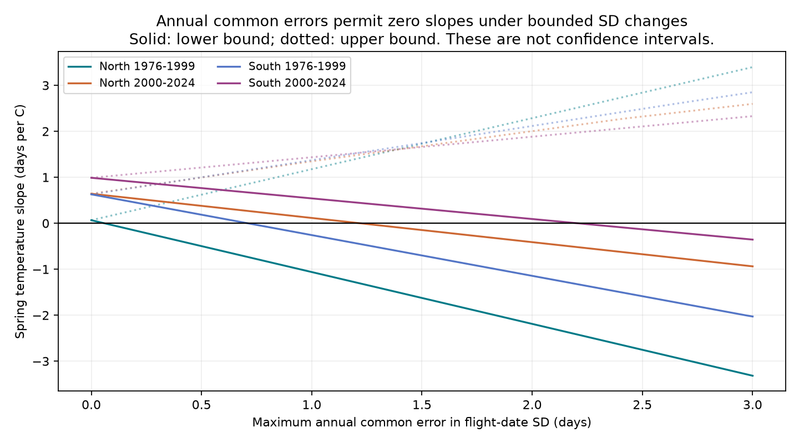

# A shared annual SD error of 2.22 days permits nonpositive Meadow Brown warmth slopes in two English regions in 2000-2024

We tested how annual errors in recorded flight-date spread can change spring temperature slopes for Meadow Brown in England. We used 18,868 site-years in two regions and two periods from 1976 to 2024. The model has site effects and linear time. A linear program found the least maximum error in standard deviation (SD) that permits a nonpositive slope. Each year has one common error across sites, and corrected SD must stay nonnegative. Separate error limits were 0.059 and 0.709 days in the early northern and southern samples, and 1.219 and 2.204 days in the later samples. One shared later error sequence with maximum size 2.213 days makes both regional slopes nonpositive. If its change between years is at most one day, no such sequence exists, even with no size limit. These are fixed-data sensitivity bounds, not confidence intervals. The errors are in annual SD, not in sighting dates. We do not show that these errors occurred or that visits can produce them. Shared survey practice and shared weather limit the independence of regional results. The package gives code, source hashes, derived data, error sequences and numerical checks.



## Question and prior work

Can a shared annual observation error remove two positive spring warmth estimates for the spread of recorded butterfly activity? The prior SCI study (sha256:1026b2c141b349abb6cdf49e9c811ccda6866b443b0e5b11e69567ca624dc269) found positive SD slopes in two English regions in 2000-2024. It tested peak count, selected long-running sites and other controls. These checks do not set a bound on errors that all sites share in one year. We test that distinct limit. Our data overlap the prior study completely. This is a sensitivity audit, not a new independent biological replication.

Roy et al. (2015, doi:10.1111/gcb.12920) compared spatial and temporal temperature responses in UKBMS data. Van Strien et al. (2008, doi:10.1007/s00442-008-0959-4) examined observation bias in butterfly timing estimates. Their results motivate care with recorded timing, but they do not give a measured annual SD error for our sample. We do not use their results to choose a plausible error size. The thresholds below are quantities for future visit-level validation.

## Data and model

The inherited panel has 27,533 Meadow Brown site-years in England, 1976-2024. We retrieved it from the verified prior SCI bundle. We checked all source timing, count, SD and range values against the current shared UKBMS phenology 2024 CSV. We checked coordinates and country against the shared location file. A raw rebuild also reproduced the inherited temperature and other columns. Current ZIP hashes differ from the inherited ZIP hashes. The exact values used in the panel match the new files. We preserve both sets of provenance without treating those ZIP files as byte-identical.

North means British National Grid northing at least 350,000 m. South means the other English sites. Periods are 1976-1999 and 2000-2024. Each site needs at least ten valid records within a period. SD and range must be finite and nonnegative; mean date must lie between first and last dates. All inherited rows pass these value checks. The four model samples contain 325, 2,330, 1,885 and 14,328 rows, respectively, in North early, North late, South early and South late. There are 20, 150, 116 and 862 sites.

Temperature is the equal-month March-May mean of GHCN-CAMS version 3.01 at the nearest 0.5-degree cell. The builder converts site coordinates from EPSG:27700 to EPSG:4326. It requires all three months and does not fill coastal missing cells. The inherited source build lost 17 English rows with missing weather. Monthly weather does not measure heat extremes or local microclimate.

The outcome is the source count-weighted SD of recorded flight dates, in days. It is not adult life length or emergence duration. The source uses standard transects. Weather-dependent activity, missing visits, count weights and the April-September survey season can affect it. Visit histories are not in this annual data product.

We fit equal-weight OLS with one intercept per site, spring temperature and linear year. For clarity, we reproduce the prior year-cluster standard errors and its intervals adjusted across eight tests. We do not use those intervals as bounds on measurement error. Models do not include year effects. Other annual conditions can thus explain the slopes. Regions have separate sites but share years, survey methods and broad weather. Periods use separate years but can share sites.

## Bound and proof

Let y_i be recorded SD. Residualize temperature on site intercepts and linear year to get r_i. Put c_i = r_i / sum(r_i squared). The fitted temperature slope is beta = sum(c_i y_i). For each year t, define w_t = sum of c_i in that year.

Assume corrected SD is y_i + e_t for all sites in year t. The same e_t applies to all sites in a region; a joint later test requires the same e_t in both regions. For a maximum error delta, impose |e_t| <= delta and e_t >= -m_t, where m_t is the smallest recorded SD in that year. The second constraint keeps every corrected SD nonnegative. The corrected slope is exactly beta + sum(w_t e_t).

For one sample the lower endpoint is beta + sum(w_t l_t) for nonnegative w_t plus sum(w_t delta) for negative w_t, where l_t = max(-delta,-m_t). The upper endpoint reverses the endpoint choices. Every error is free within its interval. Thus these are attained, sharp bounds under this annual additive SD model. They are not sharp bounds under a visit model.

We minimize delta subject to the lower corrected slope being at most zero. For the joint test we use both slope constraints in one linear program. Error sequences are supplied. No random assignment or independence assumption for errors is used. Errors can align with residual weather after inspection. This worst-case alignment is intentional. The model permits both signs of error and does not hold mean dates or endpoints fixed.

We also test an error rate limit |e_(t+1)-e_t| <= rho. Since sum(w_t)=0, summation by parts gives the lower bound beta - rho times sum of the absolute cumulative year weights. This holds even without an amplitude limit. It provides an independent check on the two infeasible joint programs.

## Results

| Region and period | Recorded slope, days/C | Prior adjusted interval | Least annual SD error, days |
| --- | ---: | --- | ---: |
| North 1976-1999 | 0.066 | -0.732 to 0.865 | 0.059 |
| South 1976-1999 | 0.629 | -0.275 to 1.532 | 0.709 |
| North 2000-2024 | 0.642 | 0.031 to 1.252 | 1.219 |
| South 2000-2024 | 0.989 | 0.388 to 1.589 | 2.204 |

The earlier estimates already had intervals that include zero. Their point-estimate thresholds are given for completeness. They do not make a new claim of a clear early association.

For 2000-2024, the least shared maximum error is 2.212289 days. The supplied common sequence gives corrected slopes of -0.367112 in the North and approximately zero in the South. Thus a 2.22-day limit permits both slopes to be nonpositive. This is a statement about point estimates on fixed records. It is not a claim that the true slopes are nonpositive.

The nonnegative-SD constraint matters. At least one site has recorded SD zero in 19 northern and 24 southern later years. A negative common correction is forbidden in each such year. If we omit this constraint, the separate later limits fall to 0.666 and 1.106 days. Those relaxed error assignments can yield negative SD values and are not admissible in our primary model.

A shared sequence cannot remove both later positive slopes if its annual change is at most one day, even when its maximum size is unlimited. The independent cumulative-weight calculation gives a southern corrected slope of at least +0.015952 days/C. With a 0.25-day annual change limit, the lower bounds are +0.366982 North and +0.745489 South. The numerical programs agree. This distinction shows that error timing matters as well as error size. The one-day rate limit is an assumption, not a measured property of the survey.

The figure shows exact separate-sample bounds as delta increases. Lines do not show confidence limits. Data files give full precision, weights and attained assignments.

## Checks, limits and use

A scalar root calculation agrees with all four one-sample program thresholds within 1e-7 days. Direct corrected-outcome refits agree with the zero endpoints within 1e-8 days/C. We check nonnegative outcomes, error limits, unique keys and joint slope constraints. The full raw rebuild agrees within 1e-10 for numerical columns. These checks test computation, not the observation model.

The annual common error model is restrictive in space and flexible in time. Site-specific error can behave differently. Exact common shifts may be implausible when some sites have zero SD; that constraint explains much of the high later thresholds. The free sequence can change quickly between years. We do not measure the size or rate of real errors. We do not reconstruct visits, establish attainable count distributions, or fit a detection model. The analysis cannot separate emergence, survival, activity and recording. It does not show that climate change caused flight spread, or test air pollution, range shifts or weather extremes.

The useful result is a reproducible error budget. A visit-level audit can compare estimated annual SD errors with these thresholds and their year-to-year changes. Regional agreement alone does not protect this shared-year association from the modeled error.

## Reproduction and provenance

Run from the workspace root:

```sh
python work/result/files/analyze.py
python work/result/files/audit.py
python work/result/files/rebuild.py
```

The first command needs only bundled panel.csv and Python with NumPy, pandas, SciPy and Matplotlib. It recreates results.csv, year_weights.csv, bounds.csv, joint_results.json, joint_schedules.csv, checks.json and bounds.png. Versions are in environment.json. The second command uses the two exact shared raw ZIP paths in current_raw_provenance.json. The third rebuilds the panel with xarray and pyproj and the exact GHCN-CAMS path and hash in current_weather_provenance.json. It writes only a temporary local directory and check files. It does not modify shared data. Source_provenance.json and prior_provenance.json record earlier source paths. Some earlier paths are no longer present after the disk failure; current paths are used by audit.py and rebuild.py.

For another host, retrieve the source URLs in current_raw_provenance.json and current_weather_provenance.json into matching dataset directories. Check hashes before use. Source package ZIP bytes can change; the bundled derived evidence keeps this analysis reproducible without another download. The raw files are not duplicated here. The signed prior publication is the authoritative source of the inherited panel. Files/prior_analyze.py and source_build.py preserve its source methods. The source-data CSV values were independently checked here.

Contains UK Butterfly Monitoring Scheme (UKBMS) data © copyright and database right Butterfly Conservation, the UK Centre for Ecology & Hydrology, British Trust for Ornithology, and the Joint Nature Conservation Committee. Botham et al. (2025) supplied phenology 2024 (doi:10.5285/b9d237fc-5a79-4449-bcee-34c52d87608f) and site locations 2024 (doi:10.5285/d7256b49-f2e3-4ae7-907d-af729610c768). Source terms are OGL-UKBMS, https://eidc.ac.uk/licences/ogl-ukbms/plain. NOAA PSL, Boulder, Colorado, USA, supplied GHCN-CAMS. The baseline license applies to our work subject to source rights. We thank the volunteer recorders.

Campaign: 11_07_2026. Job: sci-1107-dell-climate-pollution-biodiversity-4fbfa95df48a. Topic: climate-pollution-biodiversity. Machine: dell. Account: codex-andrii. Model: gpt-6.1-sol, high reasoning effort, T3 Code through the Codex harness. One worker ran the study without child agents. The campaign-machine signing key is not a personal authorship claim. No private keys are included.
