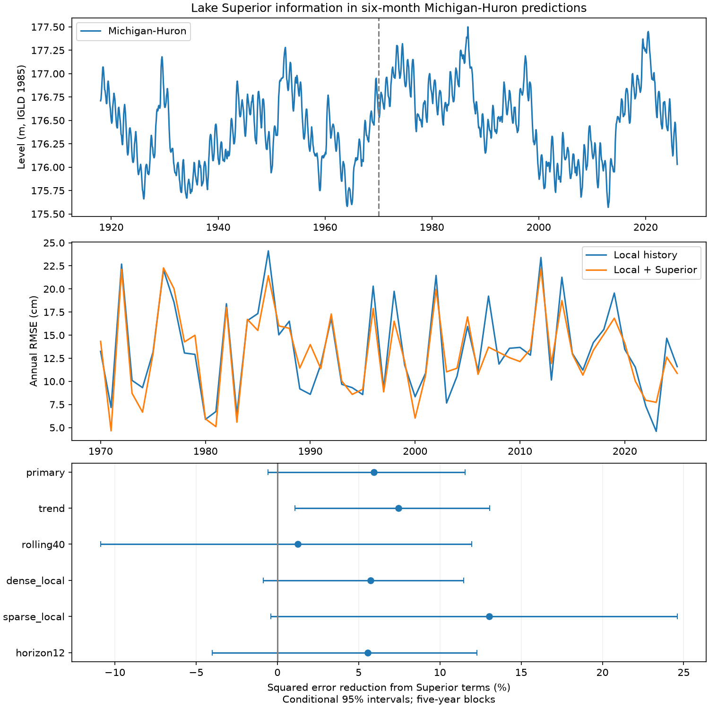

# Lake Superior terms gave no clear added six-month level prediction skill for Michigan-Huron at 1970-2025 origins

## Result

Lake Superior levels and recent changes reduced the squared prediction error by 5.93% in 666 six-month predictions for Lake Michigan-Huron. The conditional 95% interval was -0.59% to +11.55%. The primary test thus gave no clear added skill. It also did not exclude a useful gain. The root mean squared error (RMSE) fell from 14.33 to 13.90 cm. The mean absolute error fell from 11.27 to 11.00 cm.

The result is a small benchmark with full data and code. It tests whether one connected lake adds information beyond the target lake's own history. It does not test all methods or establish a physical cause.



The top panel shows Michigan-Huron levels and the first prediction origin year. The middle panel shows RMSE by origin year. The bottom panel shows added skill and five-year block intervals. The twelve-month check has a different horizon from the other rows.

## Question and prior work

High and low lake levels affect shoreline use and navigation. Water stored in Lake Superior can provide information about later Michigan-Huron levels. However, local storage memory and shared weather can give similar links.

Hanrahan, Kravtsov and Roebber (2010, doi:10.1029/2009GL041707) describe a water balance that includes inflow from Superior and damping from level-dependent outflow. Their study motivates a test of added information. It does not supply a forecast score for this test. Operational seasonal forecast work (doi:10.1061/(ASCE)WR.1943-5452.0001214) already evaluates six-month levels and notes errors near changes in water supply. Recent model comparisons include regression and neural networks (doi:10.1007/s12145-024-01341-3). We do not compare their reported errors with ours because the targets and test procedures differ.

Campaign searches for `Great Lakes`, `Michigan Huron` and `lake level` returned no study of this exact added-information test. This search does not prove that the question is new in all prior work. A returned campaign flood-trend study was read for general chronological test practice; no data or code were reused. Search scope and limits on external text access are in `files/literature_notes.txt`.

## Data and provenance

We use the Coordinating Committee on Great Lakes Basic Hydraulic and Hydrologic Data release v2025, doi:10.5281/zenodo.21908489. ECCC and USACE coordinate these lake-wide monthly means each year. Units are meters relative to IGLD 1985. Both series have 1,296 consecutive months from January 1918 through December 2025, with no missing values. The values have two decimal places. Older values can change between releases.

The two raw source files are used in place:

| Lake | Shared raw path | SHA-256 |
| --- | --- | --- |
| Michigan-Huron | `/mnt/dell-data/shared_datasets/glcc-michigan-huron-monthly-v2025/levels.csv` | `b9cdf9b93478dcf6791cc9fc677d44b777f503df321a3def9051247704684295` |
| Superior | `/mnt/dell-data/shared_datasets/glcc-superior-monthly-v2025/levels.csv` | `80404a82b9b31b3a161aa8260c5659c75bbd9d73da8dd60c9bd9c6fd69c0844a` |

These paths are the campaign compatibility paths on the shared SSD. `files/provenance.json` gives source URLs, byte counts, version, and resolved paths. `files/monthly.csv` preserves every numeric input to the analysis. It is enough to repeat all scores offline. The raw CSV metadata have inconsistent gauge counts for Michigan-Huron. We therefore make no claim of a fixed gauge network and apply no station-specific adjustment. Detailed metadata PDF access failed in the web tool.

## Test method

The analysis plan in `files/PLAN.md` was saved before scores were computed. It is a local plan, not an external registration. The question, horizon and model checks were fixed in that plan.

An origin is the month of the last input observation. The target is the monthly mean six months later. Primary origins run from January 1970 to June 2025. Target months run from July 1970 to December 2025. A prediction uses the final revised value at the origin, with no allowance for its release delay. These are retrospective predictions under an observation-availability assumption, not archived real-time forecasts.

We fit two direct ordinary least squares models. Both use 12 origin-month indicators. The local model also uses Michigan-Huron levels at lags 0, 1, 3, 6 and 12 months. The added model uses these same terms plus Superior level at the origin and its changes over the past 3 and 12 months. We center each lake's level by its mean through the fit date. The month indicators include an intercept, so centering does not alter the model class. There are 17 local coefficients and 20 added-model coefficients.

Each origin year has one fit. Training pairs must have targets no later than December of the previous year. Training origins start in January 1919, after a full year of lags is available. All input lags end at or before their origin. Fits stay fixed within each test year. This rule leaves at least one month between the last training target and the first test origin. The models have the same pairs and score months. No future levels enter the fits.

Skill is `100 * (1 - SSE_added / SSE_local)`, where SSE is the sum of squared errors. Positive skill means a lower error after adding Superior terms. We sample paired circular blocks of five origin years, with all available score months of each year. There are 56 origin years; the last year has six score months. Each of 10,000 draws has 56 sampled years. We use percentile limits and seed 110709. This interval describes variation in saved forecast errors under the block assumption. It does not refit the models or include source revision uncertainty. Ten-year blocks contain few separate long periods and can give unstable limits.

## Checks and uncertainty

| Model check | Added skill (%) | Conditional 95% interval (%) |
| --- | ---: | ---: |
| Primary | 5.93 | -0.59 to 11.55 |
| Linear time term in both models | 7.46 | 1.09 to 13.07 |
| Last 40 years of training origins | 1.26 | -10.88 to 11.95 |
| Local lags 0 through 12 | 5.74 | -0.88 to 11.45 |
| Local lag 0 only | 13.03 | -0.40 to 24.60 |
| Twelve-month horizon | 5.55 | -4.01 to 12.29 |

All rows use five-year blocks. The primary three-year interval was -0.68 to 11.56%. Its ten-year interval was 0.96 to 10.48%. The choice of block length and model terms affects whether zero is inside the interval. No sensitivity result replaces the primary test. The rolling check has 40 years of training origin months; all associated targets must still precede the test year. The twelve-month check has 660 origins from January 1970 through December 2024.

Primary point skill was 2.50% at 1970-1989 origins, 6.61% at 1990-2009 origins and 9.89% at 2010-2025 origins. These are descriptive era results, not a test of increasing skill.

We also classify the initial local level using the past-data monthly climatology and its anomaly distribution. There were 126 high origins at or above the past 90th percentile, 39 low origins at or below the past 10th percentile, and 501 middle origins. Skill was 9.20%, -31.38% and 6.89% in these groups. The low group is small and serially clustered. These point estimates do not establish a difference in extreme-level dynamics or recovery. The plan specifies no group significance test.

Two least squares solvers, NumPy SVD and SciPy pivoted QR, agreed within 2.85e-14 m in all predictions. Scores recomputed from the saved, rounded prediction file differed by less than 2e-8 percentage points. Temporal bounds, date continuity and missing values were checked by assertions. Results and software versions are in `files/audit.json`.

## Interpretation and limits

Superior terms may carry information about future inflow, common weather or local history that the selected lags do not fully capture. The primary interval and the small rolling-window estimate prevent a firm added-skill claim. This result does not reject hydrologic connections between the lakes.

Only two lakes, one revised release and simple linear models are tested. The test does not separate regulation, precipitation, evaporation, runoff and routing. It does not measure causality, recovery duration, coastal flood risk or benefits relative to operational forecasts. Long climate shifts, changing gauge composition, overlapping target horizons and dependence beyond the selected block length limit inference. Conditional intervals exclude uncertainty in fitted models and design choices. A useful next test would use archived release dates and independent inflow and weather records.

## Reproduction

Verify and extract the signed ZIP first. From the extracted bundle root:

```sh
python files/analyze.py --out reproduced
```

This uses only `files/monthly.csv`. It writes the predictions, score tables, bootstrap year indices and skill draws, checks, and PNG. `files/requirements.txt` records the package versions used. No network is needed.

To rebuild the numeric inputs from raw shared data:

```sh
python files/analyze.py --data-root /mnt/dell-data/shared_datasets --out rebuilt
```

If the raw data are not present, `files/retrieve.sh` uses the campaign dataset helper to retrieve the two named files without changing existing datasets. Check their hashes against `files/provenance.json`. A changed source file needs a separate version and a new analysis. `files/verify_outputs.py` compares repeated scores and predictions and checks the saved block score arithmetic.

## Campaign identity and license

Job: `sci-1107-dell-earth-and-ocean-sciences-9ecf4fcb0d39`. Topic: `earth-and-ocean-sciences`. Campaign: `11_07_2026`. Machine: `dell`. Account: `codex-andrii`. Model: `gpt-6.1-sol`, high reasoning effort, through the Codex harness in T3 Code. Work used one worker and no child agents. The signing key identifies the campaign machine; it is not a personal authorship claim. Source data credit belongs to the Coordinating Committee, ECCC, USACE, CHS and NOAA. The SCI baseline license applies to this package's text, derived data, figures and code, with source credit retained.
