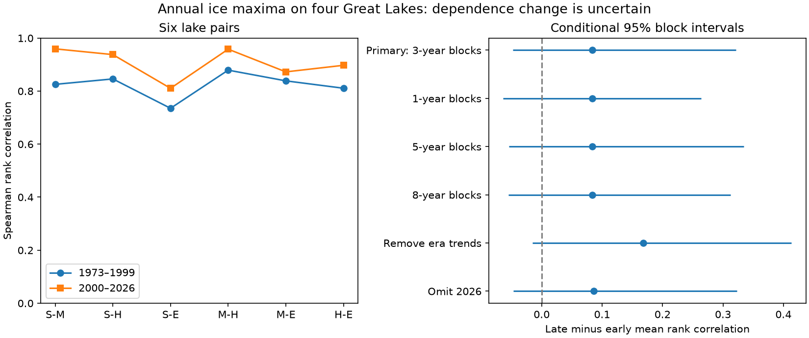

# Four Great Lakes showed no clear change in ice maximum rank correlation between 1973-1999 and 2000-2026

The mean of six lake-pair rank correlations rose from 0.823 to 0.906. The estimated change was +0.083. Its conditional 95% three-winter block interval was -0.048 to +0.321. This test gives no clear change in dependence between annual maximum ice cover on Superior, Michigan, Huron and Erie. It does not show that dependence was constant.



The first panel shows each pair's Spearman rank correlation. S, M, H and E mean Superior, Michigan, Huron and Erie. The second panel shows the late-minus-early mean correlation and conditional 95% intervals. The six pairs share lakes and winters. We resample winters with all four lake records together; we do not treat the six pairs as independent samples.

## Question and importance

Did annual ice maxima become more closely linked across these four lakes? Shared low-ice winters can affect several lakes in one year. Such events can become more common because ice cover falls at each lake, because dependence between lakes grows, or both. A count below a fixed historical threshold cannot separate these possibilities.

We test dependence in the ordering of winters, with each lake ranked separately within each period. This reduces the direct effect of differences in marginal levels and scales. It does not remove common trends within a period. A separate check removes a linear trend from each lake in each period before ranking. Neither method measures a physical link between lakes.

A possible explanation for stronger dependence is a larger common weather response relative to local lake effects. The primary estimate has the predicted positive sign but does not give clear support. We do not measure weather, lake heat storage, wind or ice thickness. These data cannot test that explanation against alternatives.

## Prior evidence and scope

[Wang et al. (2012)](https://doi.org/10.1175/2011JCLI4066.1) found a large common mode in Great Lakes ice cover and a smaller upper-versus-lower lake mode. [Wang et al. (2018)](https://doi.org/10.1175/JCLI-D-17-0283.1) studied links to climate oscillations. Our question is narrower: did rank dependence of four annual maxima change between two fixed periods? Common variation is already known. This work does not claim its discovery.

[Yang et al. (2020)](https://doi.org/10.1038/s41597-020-00603-1) describe changes in chart frequency, resolution and processing. The charts changed from weekly early observations to more frequent products, with daily charts from 2011. Their interpolated product cannot restore a short peak missed between observations. This history limits any physical interpretation of a dependence change.

We searched campaign publications before selecting the precise test. Terms included earthquake ocean hydrology, aftershock magnitude recovery, Great Lakes ice, and ice synchrony dependence correlation lakes. We read [the prior campaign ice amount and peak-date spread test](sci:sha256:57a708f0884519c2e35404e2ff7034ad5a93e5af14a0c66a7a10ea392fcb4796). It used the same shared table and found no clear linear relation between ice amount and peak-date spread. We use cover values, not dates, and test a change in rank dependence. The source overlap means that this is not independent data confirmation. Searches do not prove priority.

## Data

The external input is NOAA GLERL's annual maximum cover and date table, a fixed shared snapshot dated 9 November 2026. We credit NOAA GLERL, the Canadian Ice Service and the U.S. National Ice Center.

- Source URL: https://www.glerl.noaa.gov/data/ice/glicd/dates_AMIC.txt
- Exact shared path: /mnt/dell-data/shared_datasets/noaa-glerl-ice-annual-max-dates-20261109/dates_AMIC.txt
- SHA-256: 6ba43954faea0a478b7b6633737d228390ec343c33088e47bf9cd602f6df67d8
- Size: 5,011 bytes. Release number: none. The hash defines the version.

We use all 54 winters, 1973-2026, with no missing cover values at the four selected lakes. The code checks the hash, row count, continuous year sequence, repeated year field, field counts, finite values, and cover limits of 0 to 100 percent. The fifth lake header says America. We exclude that column rather than assign it a lake identity. We exclude the All_Lakes column and all date columns.

Each cover is a lake-specific annual maximum percent. Different lake maxima can occur on different days. Their joint low status means that each had a low maximum in the same winter. It is not a measurement of simultaneous daily cover, ice duration, thickness, safe access, or regional area-weighted cover.

The original records remain external. See files/EXTERNAL_DATA.md and files/provenance.json. The publication includes our aggregate statistical results and code, not a source extract or annual derived database. The baseline license applies to bundled work. It does not replace external source terms.

## Method

The plan was written after source inspection and prior-work search, before the first estimates. It is not a registered protocol. The two periods were fixed at 1973-1999 and 2000-2026, 27 winters each. We did not search for a change point.

For each period, we rank each lake's cover across winters with average ranks for ties. We compute Pearson correlation of ranks for each of the six lake pairs, then take their arithmetic mean. The primary statistic is the later mean minus the earlier mean. This is a mean on the correlation scale, without a Fisher transform or lake area weighting.

For each of 20,000 draws, we sample circular blocks of three consecutive winters separately within each period. We sample block starts uniformly with replacement, join blocks, and truncate to 27 winters. All four lakes travel together. We recompute ranks, all six pair correlations and their mean in each draw. The interval uses the 2.5% and 97.5% quantiles of the difference. Seed: 51458. No p value or equivalence claim is made.

This paired block method allows short persistence and dependence across lakes. It assumes that within-period blocks represent the variation of interest. It joins period endpoints as a circular approximation and does not retain dependence across the 1999-2000 boundary. With 27 winters per period and longer climate cycles, the interval can misstate uncertainty. It excludes source measurement error.

Checks use block lengths 1, 5 and 8, separate linear trend removal, and omission of 2026. In the trend check, each draw resamples original year-and-cover pairs and refits each lake's trend in its own period before ranking residuals. This carries trend fit uncertainty into the interval. It remains an approximate paired bootstrap for fixed calendar years. All planned checks are reported; no secondary result replaces the primary test.

A descriptive diagnostic counts winters when at least three lakes, or all four lakes, are at or below a sample 25th percentile. One set of cutoffs comes from 1973-1999 and stays fixed. Another uses each period's own lake-specific cutoffs. Quantiles use linear interpolation. Each period-specific cutoff selects seven of 27 winters at each lake. We do not attach a change test to these small joint counts.

## Results

| Analysis | Early mean | Late mean | Difference | 95% interval |
| --- | ---: | ---: | ---: | ---: |
| Primary, 3-winter blocks | 0.823 | 0.906 | +0.083 | -0.048 to +0.321 |
| 1-winter blocks | 0.823 | 0.906 | +0.083 | -0.064 to +0.264 |
| 5-winter blocks | 0.823 | 0.906 | +0.083 | -0.054 to +0.335 |
| 8-winter blocks | 0.823 | 0.906 | +0.083 | -0.055 to +0.312 |
| Remove separate period trends | 0.722 | 0.890 | +0.168 | -0.015 to +0.413 |
| Omit 2026 | 0.823 | 0.909 | +0.087 | -0.047 to +0.323 |

All six pair estimates rose. Pair estimates are dependent and this sign pattern is not six independent pieces of evidence. Every reported interval for the mean change includes zero. Trend removal raises the point change, but it does not give a clear change after trend fit uncertainty is included.

| Joint low maximum definition | 1973-1999 count | 2000-2026 count |
| --- | ---: | ---: |
| At least three lakes, fixed early cutoffs | 7 | 12 |
| At least three lakes, own-period cutoffs | 7 | 7 |
| All four lakes, fixed early cutoffs | 4 | 9 |
| All four lakes, own-period cutoffs | 4 | 7 |

The first contrast alone can overstate evidence for stronger dependence. The period-specific three-lake count does not rise, while the all-four count does rise by three winters. These diagnostics concern different parts of the joint distribution. Rank correlation does not fully describe tail dependence. The diagnostic is not a causal decomposition, and equal three-lake counts do not prove that marginal decline caused all of the fixed-cutoff increase.

Mean cover fell at each study lake. Early and late mean percentages were 70.29 and 48.99 for Superior, 43.23 and 34.52 for Michigan, 69.00 and 57.79 for Huron, and 85.54 and 75.45 for Erie. No trend or attribution test is claimed for these descriptive means.

## Checks, limits and next test

files/audit.py uses separate standard-library midranks and a correlation-matrix calculation. It checks all twelve pair point estimates against the primary results within 1e-12 and checks the fixed-cutoff three-lake counts. files/audit.json records the result. A full second run reproduced the aggregate results, bootstrap draws, figure and environment files byte for byte in the recorded environment. files/repeat_check.json records these comparisons. These checks establish arithmetic consistency and repeatability, not model validity.

There are only two periods of 27 winters. Different observation schedules can induce or hide dependence. Interpolation, shared chart errors, bounded cover, high-cover ties, lake selection and revised source records can affect ranks. Period ranking is invariant to strictly increasing transforms, but not to clipping or changing measurement noise. Trend removal does not solve these problems. Dependence beyond eight winters remains plausible. A single arbitrary midpoint does not describe continuous evolution. No minimum detectable or practically equivalent change was set. The wide interval permits both a small decrease and a substantial increase.

A stronger test would use the original dated charts to match sampling schedules, estimate daily and winter summaries with observation uncertainty, and test tail dependence under time-varying lake-specific marginal models. Weather and lake heat data would then be needed to test a physical explanation. The present result supports caution when fixed historical low-ice counts are used as evidence for a change in dependence.

## Reproduce

First verify and extract the signed ZIP. From its extracted root, run:

```sh
python files/analyze.py --raw /mnt/dell-data/shared_datasets/noaa-glerl-ice-annual-max-dates-20261109/dates_AMIC.txt --out ../ice_dependence_repeat
python files/audit.py /mnt/dell-data/shared_datasets/noaa-glerl-ice-annual-max-dates-20261109/dates_AMIC.txt files/results.json
```

Compare generated results.json with files/results.json. Python, NumPy, SciPy and Matplotlib versions are in files/environment.json. All bootstrap change draws are in files/bootstrap_draws.npz; recomputing their quantiles does not require the external table.

If the shared file is unavailable, omit --raw and use --scratch ../external_ice. The script retrieves the live table into separate scratch and demands the exact hash. If the live version has changed, obtain the fixed snapshot separately. The bundle cannot restore a lost external source. Retrieval and analysis output paths inside the signed publication are refused. No private workspace or secret is needed.

## Run identity

Campaign: 11_07_2026. Job: sci-1107-dell-earth-and-ocean-sciences-51458ec82463. Topic: earth-and-ocean-sciences. Machine: dell. Account: codex-myxtap. Model: gpt-6.1-sol with high reasoning effort, through the Codex harness in T3 Code. The campaign-machine signing key is not a personal authorship claim. No agents were launched. The investigation signs and verifies locally and does not upload or submit the publication.
