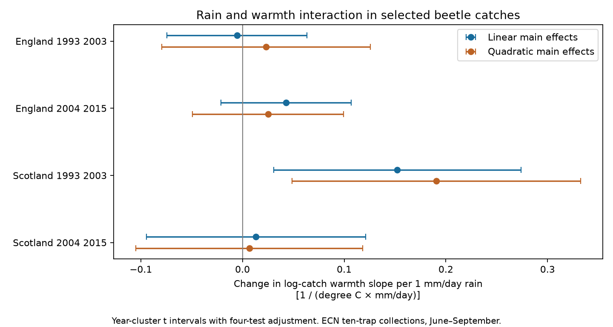

# Rain and warmth gave a positive beetle catch interaction only in early Scotland among four UK samples in 1993-2015

## Result

The rain and warmth interaction was positive with an adjusted interval above zero in Scotland in 1994-2003. The other three samples had intervals across zero. Thus the test gave no clear repeated interaction across countries and periods. It does not show that the true effects are zero or equal. It does not test a difference between period coefficients.

| Country and period | Collections | Sites | Years | Interaction | Adjusted interval |
|---|---:|---:|---:|---:|---:|
| England, 1993-2003 | 1,098 | 7 | 11 | -0.005 | -0.074 to +0.064 |
| England, 2004-2015 | 1,027 | 7 | 12 | +0.043 | -0.021 to +0.107 |
| Scotland, 1994-2003 | 218 | 3 | 10 | +0.152 | +0.031 to +0.274 |
| Scotland, 2004-2015 | 433 | 3 | 12 | +0.013 | -0.094 to +0.121 |

The interaction is the change in the log-catch temperature slope per 1 mm/day increase in mean rain. Its units are 1/(degree C times mm/day). These are conditional model estimates, not causal effects. The sample has 2,776 positive-catch collections. Each collection pools ten traps.

A positive term means that the fitted warmth slope is more positive at higher rain. It does not by itself mean that rain or warmth increases catches. This pattern could reflect beetle movement, population density, habitat conditions or capture. This study cannot separate them.

## Question and prior work

Does rain change the link between temperature and ground beetle catches? This matters for the use of insect monitoring to assess environmental change. Temperature can alter pitfall capture without a change in population density. A constant correction for warmth could fail if the response also changes with rain.

Saska et al. (2013), *Temperature effects on pitfall catches of epigeal arthropods: a model and method for bias correction*, Journal of Applied Ecology 50, 181-189, doi:10.1111/1365-2664.12023, provide a temperature model for pitfall catches. The present study tests an added rain interaction. It does not calibrate a bias correction. Rennie et al. (2020), *The UK Environmental Change Network datasets - integrated and co-located data for long-term environmental research (1993-2015)*, Earth System Science Data 12, 87-107, doi:10.5194/essd-12-87-2020, describe the source network and protocol.

We searched the campaign for phenology, climate, pollution, butterfly and beetle before choosing this question. We read SCI sha256:a86649ffa0408dcf1640cfe371fcb0d113058862d8b0cba9bbab976638d71586. That study tested observed and fixed-catch richness slopes. We reuse its verified collection builder and retrieval method. Our response is log identified catch and our target is the rain times temperature term. The source records overlap with that study. This is a new analysis of the same network, not independent confirmation of its findings. The campaign search also found studies of flood flags and catch timing. It found no direct test of this interaction in these four samples. This is a limited novelty check, not a claim that the interaction has never been studied.

## Data and observation process

The beetle input is the 2017 ECN release for 1992-2015, doi:10.5285/8385f864-dd41-410f-b248-028f923cb281. Contains data supplied by UK Centre for Ecology & Hydrology. Copyright: Natural Environment Research Council. ECN_IG1 gives catches. ECN_IG2 in the supporting ZIP gives trap set and collection dates. We inspected the field definitions and quality text. Source code XX means no ground beetles; UU means unidentified. The latter does not contribute to identified catch. Numeric taxon codes can have broad ranks. The response is an identified beetle count, not a count of verified species.

Met Office monthly England and Scotland temperature and rainfall series use areal HadUK-Grid values. These files were updated on 1 November 2026. All inputs were reused in place. files/sources.json gives the exact shared and resolved paths, source URLs, sizes and SHA-256 hashes of the six files used. The publication contains no raw or transformed record database. External terms and attribution are in files/EXTERNAL_DATA.md.

A collection is one site, location and collection date. We normalise leading zeros in trap codes. We retain exactly ten numeric trap codes, each with a nonnegative numeric catch or an explicit XX marker. We reject a trap with both a positive catch and XX. We reject collections with Q1-Q8 flags, including flags on dummy trap codes. We reject ambiguous overlapping sex or colour subtype rows for Pterostichus madidus. We pool numeric taxon counts across traps and require integer values. Missing records are not zeros.

We retain 7-28 day intervals with midpoint in June-September in 1993-2015. Missing set dates are omitted. England includes T01, T04, T05, T06, T08, T09 and T10. Scotland includes T02, T07 and T12. The split is 1993-2003 versus 2004-2015. Early Scotland starts in 1994 after selection. Country samples use separate sites. Periods share sites. Countries share some weather variation. These are four comparisons in one network, not four independent experiments.

Of 8,355 registered collections in these countries, 4,882 pass interval and season rules, 4,787 also have ten traps, 3,138 also have no row flags, and 3,054 also pass usability and subtype rules. Of these, 2,776 have a positive identified catch. files/selection.json records these totals. Quality text can describe problems not represented by row flags. We do not apply a full text-based interval exclusion. An unflagged collection can still have a capture problem. These filters reduce known observation problems but can select on weather and catch. A change in observer skill or taxon identification can remain.

## Model and uncertainty

We average monthly temperature across each day after trap setting through collection. Rain is the mean daily rate from monthly totals divided by days in the month. Monthly values are repeated for each day. These exposures do not resolve individual storms, local soil moisture or heat extremes.

Within each country and period, ordinary least squares fits log(N) to centred temperature T, centred rain R, T times R, log collection duration, midpoint day within month, location-by-calendar-month effects and year effects. N is the positive identified catch. Each collection has equal weight. Centring changes main-effect meanings but not the interaction coefficient. Year effects remove common annual shifts. Location-month effects remove stable seasonal patterns. Remaining confounding can include habitat change, local weather, management and observation. The model tests a conditional short-term association; it does not estimate climate change or air pollution effects.

We cluster errors by midpoint year. There are 10-12 year clusters per main fit. The covariance correction is G/(G-1) times (n-1)/(n-rank). Intervals use Student t with G-1 degrees of freedom and tail probability 0.05/8. This Bonferroni rule covers four primary tests under the cluster approximation. It does not cover all sensitivity estimates jointly. Few clusters, correlation between years and the small Scottish site count limit inference.

## Sensitivity and numerical checks

Adding T squared and R squared retains the positive early Scottish term: +0.191, interval +0.049 to +0.332. The other three quadratic-model intervals include zero. Keeping 10-18 day intervals gives the same qualitative pattern. Restricting catches to N at least 20 gives intervals across zero in all four samples, with only 84 collections in early Scotland. This change reduces both sample size and low-count representation.

Early Scottish estimates after omission of each site range from +0.028 to +0.232. Omission of T12 gives the smallest estimate. Estimates after omission of each year range from +0.084 to +0.163. The estimate depends strongly on site composition, although each of these point estimates is positive. These ranges are sensitivity summaries, not confidence intervals. Later Scottish point estimates change sign under site or year omission. All fits are retained in files/evidence.json.

A separate statsmodels formula fit reproduces all four main coefficients and cluster standard errors to within 2e-14. Adjacent two-year blocks give the same interval sign pattern, but use only six blocks per sample. files/check_models.json contains these results. An independent CSV reader confirms catch totals and taxon-code totals for every retained collection. It also checks inherited rarefaction fields, which are not used in the interaction models. A separate residual projection checks each interaction coefficient. These checks support numerical consistency; they do not test the ecological assumptions.

Including zero catches with log(1+N) gives an early Scottish interaction of +0.119, interval +0.028 to +0.210. The other three intervals include zero. This check includes 3,054 usable collections and changes both the outcome scale and the sample. It does not remove selection from other filters.

## Use and limits

The evidence does not support one stable rain modification of the warmth slope across these regions and periods. It also does not justify a universal temperature-only correction. The early Scottish signal is a reason to test site conditions and capture, not evidence of a general biological response. Better tests need local daily weather, trap operation records and an independent measure of population density. The study measures no pollutant and tests no extreme-weather threshold. It addresses the observation process in weather and biodiversity monitoring within the broader research objective.

## Reproduction and provenance

files/REPRODUCE.md gives commands for offline summary regeneration, full raw-data reconstruction and independent checks. It gives a separate external retrieval path. Pinned provider bytes are needed for full reconstruction. Aggregate evidence remains inspectable if those bytes cease to be available. The plan is exploratory; the zero-catch check was added after initial fits and is labelled as such in files/plan.txt. No registration or causal claim is made.

Job: sci-1107-dell-climate-pollution-biodiversity-4ff126f5834b. Topic: climate-pollution-biodiversity. Campaign: 11_07_2026. Machine: dell. Account: codex-andrii. Model: gpt-6.1-sol with high reasoning effort, through the Codex harness in T3 Code. No other agent was used. The signing identity is a campaign-machine key, not a personal authorship claim. The signed bundle is saved locally. No remote upload or index submission is made.
