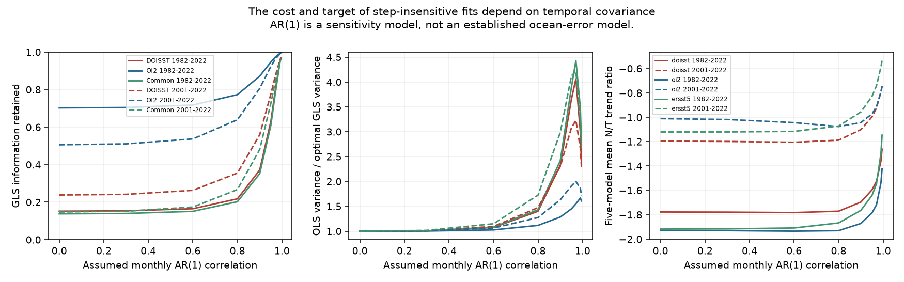

# Serial correlation reduces the relative cost of SST step protection in an AR(1) model

A fit can ignore unknown sea surface temperature (SST) offsets at known dates. Its precision cost depends on temporal covariance. For a common six-date design, the best linear fit retains 13.79% of trend information in 1982-2022 under independent noise. It retains 35.18% under stationary monthly AR(1) noise with correlation 0.9. In 2001-2022, the corresponding fractions are 14.76% and 48.11%. These are exact conditional design results, not measured information fractions for the ocean.

At correlation 0.9, ordinary least squares (OLS) with the same offset constraints has 2.42 and 2.99 times the variance of the optimal generalized least squares (GLS) trend estimator. Thus serial dependence changes more than the standard error attached to a fixed fit: it can change the best time weights. With those weights, the five-model mean DOISST response-to-SST trend ratio changes from -1.778 to -1.696 in the long window, and from -1.196 to -1.101 in the short window. These are different conditional summaries of the fixed record. They do not identify Earth's feedback.

Figure 1. Left: information retained by an optimal fit that ignores dated offsets, relative to an optimal fit without those offsets under the same covariance. Middle: variance of the OLS offset fit divided by that of the GLS offset fit. Right: radiation-to-SST trend ratios under the common six-date GLS design. Lines join tested correlation values. They are sensitivity curves, not confidence intervals.

## Question and prior work

SCI 80c2c62c showed that a common six-date offset fit retains about 14-15% of trend information under equal independent noise. It proved the minimum-variance bound for that model. It also showed that agreement of raw and corrected SST after an offset fit follows from the algebra. SCI 167ff86c quantified confusion between gradual drift and DOISST steps. SCI 0c7c0536 showed that feedback conclusions depend on the estimator. These findings remain valid in their scope.

Our initial test overlapped 80c2c62c. We then selected its explicit unresolved covariance limitation. The contribution here is the exact stationary AR(1) extension of its design bound, a measured OLS efficiency loss, and a test of the resulting weights on five published linear model responses. We do not claim GLS, partial regression, or offset regression as new statistical methods. The failure to identify an unrestricted historical climate trend remains.

The selected campaign work found input steps in DOISST, OI SST v2 and AMIP forcing. Our calculation does not challenge those input comparisons. It tests one response to uncertain step sizes. No new SST observation, atmosphere-model run, or radiation measurement is added. Campaign searches for SST, homogenisation and feedback preceded final selection. Published offset, drift, regression, and ratio tests were read. No private worker files supplied evidence. Web searches found the standard partial-regression result (Lovell, 2008) and the AMIP boundary protocol; these provide context, not numerical inputs.

## Data and scope

The direct numerical input is files/data/feedback_series.npz in SCI 78d7f2e0e904a30d9d8856aef2e045507dd6f1c6621614f0637521274e3b8db2. Its SHA-256 is b25d6c51e6832696aa41ffb5ecb6ec5c59b2e4bdf2303a9da7bcec145e0d1f91; size 366,346 bytes. Exact resolved shared path, entry hashes and source verification are in files/provenance.json and files/source_verify.json. The compatibility campaign path is on HP SSD. We read no raw shared dataset. Inherited raw paths, versions, URLs and hashes are in files/upstream_sources.json; those raw hashes were not newly checked.

T is area-mean SST over the fixed ice-free 60 S to 60 N mask. N is the global net downward top-of-atmosphere response from a fixed linear Green function. SST changes outside the mask are zero. The five symmetric maps are CAM5, CanESM5, ECHAM6, GFDL-AM4 and HadAM3. The ratio is per K of masked SST, not global surface air temperature or equilibrium feedback. Source masks, processing and correction maps are fixed.

We use complete monthly series in 1982-2022 and 2001-2022. DOISST has two published step corrections, fitted against in situ products and ESA CCI. OI v2 has the source June 2018 correction. Later OI v2 events in 2021 are not corrected here.

The native DOISST date design uses 4 January 1985, 1 January 2005, 1 January 2007, 7 July 2020 and 1 October 2021. The native OI v2 design uses 1 June 2018. The common design uses their union for every product. Step columns give the fraction of each month after the date. Calendar-month intercepts remove source anomaly centering. Unlike 80c2c62c, we retain the two mixed transition months and model their fractions. This explains small differences in independent-noise results. Inclusion does not assert that every date is a proven artifact.

## Method and proof

For each series y, fit y = Z a + t b + e. Z contains month indicators and dated steps. Each series has free offset amplitudes a. Time t is in years. For each fixed rho in 0, 0.3, 0.6, 0.8, 0.9, 0.95, 0.97, 0.99 and 0.995, assume stationary noise:

~~~
e_t = rho e_(t-1) + u_t
Var(u_t) = sigma_u^2
Var(e_1) = sigma_u^2 / (1-rho^2)
~~~

L whitens this covariance up to sigma_u: (Ly)_1 = sqrt(1-rho^2) y_1 and (Ly)_t = y_t - rho y_(t-1) thereafter. M removes the projection on LZ; r = M Lt. Then:

~~~
b_hat = r' Ly / (r' r) = w' y
w = L' r / (r' r)
Var(b_hat) = sigma_u^2 / (r' r)
~~~

The code allows redundant constant columns in the short window. It tests w'Z = 0 and w't = 1. Arbitrary offsets in these columns have zero trend effect at every rho.

For any linear unbiased estimator v'y that ignores the same offsets, let q = L^(-T)v. Its constraints give q'r = 1. Cauchy-Schwarz gives q'q >= 1/(r'r), the variance bound under this covariance. Let I = r'r and let I0 use month effects only. Information retained is I/I0. The same-covariance variance penalty is I0/I. The scalar noise variance cancels. We also calculate the OLS-to-GLS variance ratio with identical offset constraints.

GLS and OLS are unbiased for the same common linear trend under the model. Their historical estimates can differ if climate evolution departs from that model. The T and N fits use the same assumed rho, so that their temporal weights match.

## Results

| Window | Design | Information, rho=0 | rho=0.9 | rho=0.99 | OLS/GLS variance, rho=0.9 |
|---|---|---:|---:|---:|---:|
| 1982-2022 | DOISST dates | 15.18% | 37.11% | 94.55% | 2.33 |
| 1982-2022 | OI v2 date | 70.24% | 87.14% | 99.19% | 1.28 |
| 1982-2022 | Common dates | 13.79% | 35.18% | 93.83% | 2.42 |
| 2001-2022 | DOISST dates | 23.82% | 55.90% | 95.33% | 2.30 |
| 2001-2022 | OI v2 date | 50.57% | 80.61% | 98.87% | 1.63 |
| 2001-2022 | Common dates | 14.76% | 48.11% | 94.30% | 2.99 |

For the common design, independent-noise minimum standard-error penalties are 2.69 and 2.60. At rho=0.9 they are 1.69 and 1.44. At rho=0.6 they remain 2.57 and 2.40. The reduction is most marked for strong persistence. A step is easier to distinguish from smooth noise when adjacent observations constrain changes.

High retained information does not mean high absolute precision. With innovation variance one, long-window common-fit slope variance rises from about 0.000106 at rho=0 to 0.003705 at rho=0.9 and 0.057445 at rho=0.99. Units are squared K per year for a hypothetical scalar temperature series. The no-step GLS variance also rises. The relative cost falls against that more uncertain baseline. Cross-rho variance comparisons require this scale convention.

The common-design five-model mean ratios are:

| Window | Product | rho=0 | rho=0.9 | rho=0.99 |
|---|---|---:|---:|---:|
| 1982-2022 | DOISST | -1.778 | -1.696 | -1.359 |
| 1982-2022 | OI v2 | -1.930 | -1.872 | -1.538 |
| 1982-2022 | ERSSTv5 | -1.918 | -1.764 | -1.296 |
| 2001-2022 | DOISST | -1.196 | -1.101 | -0.791 |
| 2001-2022 | OI v2 | -1.011 | -1.044 | -0.792 |
| 2001-2022 | ERSSTv5 | -1.121 | -0.956 | -0.587 |

Units are W m-2 K-1 of masked SST. Model and product estimates, including COBE-SST2 and HadISST1, are in red_estimates.csv. These ranges are not probability intervals. Raw DOISST and both corrections agree within numerical precision for each fit. This is built in and supplies no correction validation.

For a quadratic signal around the midpoint, the effective epoch is midpoint + w't_squared/2. In the long common design it moves from 1997.79 at rho=0 to 2000.44 at rho=0.9 and 2002.35 at rho=0.99. The ordinary equal-month epoch is 2002.50. This exact weighting diagnostic explains why a changing physical pattern can give different ratios even after all dated offsets are removed.

OLS common-fit residual lag-one coefficients span 0.889-0.929 for long-window SST and 0.859-0.899 for short-window SST across five raw products. Radiation residual coefficients span 0.813-0.888 and 0.786-0.873. These show persistence, but do not establish a single stationary AR(1) error law. Residuals contain climate variability, product error and model mismatch. The rho=0.99 case is an extreme sensitivity test, not a fitted value.

## Validation and limits

The identity Var(w'y) I / (1-rho^2) = 1 passes for unit marginal noise variance. Independent dense covariance solves reproduce selected weights within 1e-9. Offset and unit-slope constraints pass for every design and rho. Six thousand stationary AR(1) noise draws at rho=0.6, 0.9 and 0.99 reproduce native long-window theoretical OLS/GLS variance ratios within 5%. This validates the calculation, not the ocean model. Source correction-invariance and direct OLS checks are also preserved.

This extends the prior bound without refuting it. Correlated noise can reduce the relative precision cost and make OLS inefficient. It cannot resolve unrestricted climate/offset confounding: y=C+Za also equals (C+Zh)+Z(a-h), with potentially different ordinary climate trends. GLS still needs suitable climate and covariance models.

We did not select rho by likelihood or treat residual correlations as known error parameters. There is no new confidence interval for feedback. Estimated covariance, long memory, nonstationarity, unknown dates, gradual drift, source error, map uncertainty, atmospheric nonlinearity and model spread remain. OI v2's later forcing events are outside this test. Different T and N covariances could require a joint model. These common-rho fits are controlled sensitivities with matching weights. The equal-weight five-model mean is not a probability distribution over models.

## Reproduction

From an unpacked publication root, use Python 3.12, NumPy, pandas, Matplotlib and sci:

~~~
sh files/run.sh /path/to/campaign /path/to/separate-scratch
~~~

The first script verifies the entire numerical source ZIP and entry hash, then runs OLS checks. The second runs the AR(1) analysis and new checks. Outputs go into the supplied scratch path outside the publication. Compare red_geometry.csv, red_estimates.csv, red_checks.csv, red_simulation.csv and red_residual_diagnostics.csv with bundled copies. The figure is regenerated as red_noise.png. The exact source ZIP is sufficient; no download is needed. Its signed code and provenance provide upstream raw-data retrieval.

analyze.py is a precursor and verification script. Its OLS benchmark repeats prior work and is not claimed as new. red_noise.py is the new analysis. Computations use one BLAS thread and fixed noise seeds. No external monthly record or response map is bundled. External rights and attribution are in files/NOTICE.md.

Campaign 11_07_2026. Job sci-1107-dell-earth-and-ocean-sciences-5a6cf8a3e82f. Topic earth-and-ocean-sciences. Machine dell. Account codex-olen. Model gpt-6.1-sol, high reasoning effort. Date 2026-11-11. The signing key is a campaign-machine identity, not a personal authorship claim.
