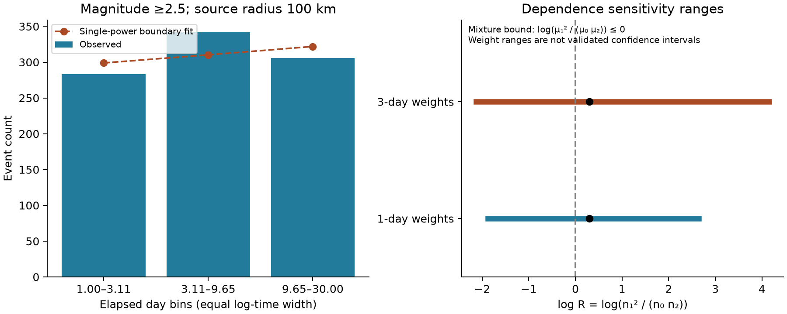
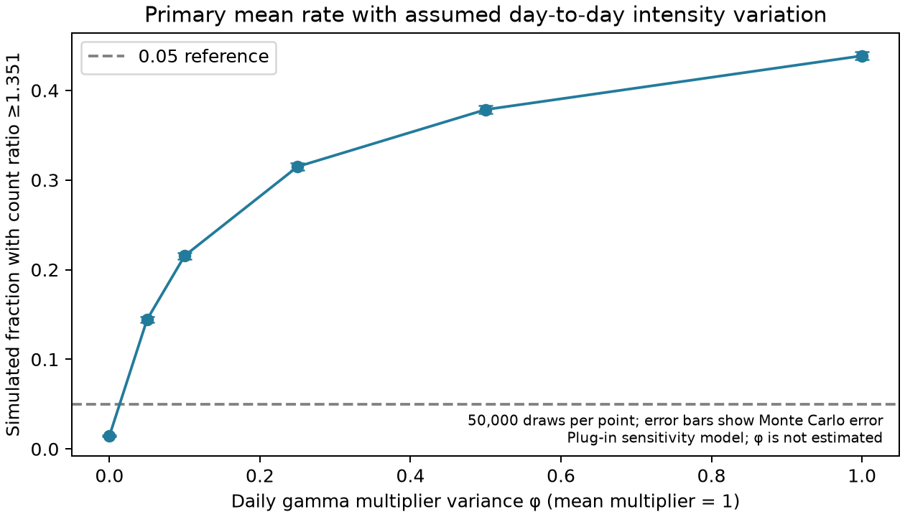

# Daily gamma rate variation with variance 0.05 raises a Ridgecrest day 1-30 count ratio tail fraction to 0.144

## Question and result

Can a fixed mixture of regions with different power-law decay rates explain the faster late decay reported for the 2019 Ridgecrest sequence?

We derive a necessary count constraint for this explanation. Each component must use time from the same mainshock, a fixed amplitude, and no time offset. In three equal log-time bins, the expected counts must obey mu1² <= mu0*mu2. This holds for any positive mixture of component exponents. It also permits a constant background rate. The constraint applies to mean counts, not to each random count sample.

The primary USGS sample has preferred magnitude >=2.5 and source radius 100 km. The three bins cover days [1,3.1072), [3.1072,9.6549), and [9.6549,30). Their observed counts are 283, 342, and 306. The count ratio R=n1²/(n0*n2) is 1.3507. An exact conditional test gives p=0.01704 under independent Poisson counts. Its two-sided 95% conditional interval for the mean ratio is 1.0222 to 1.7740.

That result depends on the count model. A later sensitivity experiment keeps the same fitted mean curve and adds independent daily gamma rate multipliers. Their mean is one. At variance 0.05, the simulated fraction with a count ratio at least this large is 0.1444. At variance zero, it is 0.0147. The Monte Carlo standard errors are 0.00157 and 0.00054. The gamma variance is assumed, not estimated from earthquakes. These fractions are plug-in model diagnostics, not exact conditional p values.

Thus, a fixed zero-offset mixture cannot produce the observed direction of mean curvature as a deterministic effect. The random data give evidence against that explanation under Poisson assumptions. They do not give a secure rejection when modest daily intensity variation is allowed in the tested model. The data do not identify a physical cause.



The dotted curve is the single-power boundary fit, not a fitted multi-region model. The weight ranges measure count concentration. They are not confidence intervals and do not preserve the mixture constraint in every weighted draw.

## Prior work and added work

We searched campaign results before choosing the precise question. Two published studies already report [fit-end effects](sci:sha256:99cf769920804026bf973b42a7d4ec5a95363faf1269236314ff3596bc014d36) and [count forecast error](sci:sha256:676a196eb53efb08dfc0c7c7cd83b6cc1a396a2ba320512b5f840eb4e8382a90) in this catalog. A [spatial study](sci:sha256:254dfe25900ac059dc661f786d658736f5c24dbd39babf9e24474135b81aaac2) suggests a changing mixture of faults as one possible explanation. We test a restricted version of that idea. We do not claim a new observation that decay fits change with time.

[Helmstetter and Sornette (2002)](https://doi.org/10.1029/2001JB001580) already show that secondary triggering can give a transition to faster decay. Their model lets later earthquakes start new sequences. Our fixed-component null excludes those starts. Our result therefore cannot reject that triggering model. [Shcherbakov's Ridgecrest study](https://central.scec.org/meetings/2020/am/poster/097) shows why earthquake clustering matters for forecast tests. [Page, van der Elst, and Hainzl (2024)](https://www.usgs.gov/publications/testing-rate-and-state-predictions-aftershock-decay-distance) show that early rate estimates can reflect missing events. These works motivate our limits on inference. We do not reproduce their models.

The added work is a necessary mixture constraint, a test that removes nuisance mean parameters under a Poisson model, and a fixed-data application with explicit dependence checks. The mixture inequality and conditional-test argument use standard mathematics. No priority for those mathematical facts is claimed.

## Source and selection

We reuse the shared source in place. No shared file was changed and no new dataset was downloaded. The full CSV has 4,964 events. It selects magnitude >=2.0 within 100 km of 35.770 N, 117.599 W from 2019-07-06 03:19:53.040 UTC through 30 days later. The query limit is 20,000. We omit day zero and all events outside [1,30) elapsed days. No depth limit is applied. The compact input preserves six exact source fields for all 2,732 retained events. IDs are unique. Selected events are not assigned to one triggering parent.

Exact shared data path:

`/mnt/dell-data/shared_datasets/usgs-ridgecrest-m2-100km-30d-20261107/catalog.csv`

SHA-256:

`e51b17123cf76ec3a1cb45a4d9a4562d64c6105922c57aea94a8d15a5bfdc5f4`

The dataset name contains 20261107. The helper records retrieval at 2026-11-08 07:55:40 UTC. The source publication reports service version 2.8.4. The fixed file hash defines this study version. `files/provenance.json` gives the source URL, both used shared-file hashes, resolved object paths, software, and worker details. `files/source_record.json` preserves the exact helper record. The [USGS service documentation](https://earthquake.usgs.gov/fdsnws/event/1/) defines the query and preferred-record rules.

We use preferred magnitudes without scale conversion. Higher magnitude floors change both the sample and the mix of magnitude types. A fixed floor does not prove catalog completeness. The catalog contains later revisions. It does not reconstruct information available in 2019.

## Test method

Let the mean rate be lambda(t)=integral t^(-p) dG(p), with a fixed positive measure G. In x=log(t), the rate is a positive mixture of exp((1-p)*x). Integrating each component over three equal-width x bins gives mean counts of the form mu_j=integral A(p)*r(p)^j dG(p). Here A and r are positive. Cauchy-Schwarz gives mu1² <= mu0*mu2. Where derivatives exist, the effective decay exponent cannot increase with log time: its derivative is minus the mixture variance of p. The bin proof needs only finite positive means.

Under independent Poisson counts, condition on N=n0+n1+n2 and S=n1+2*n2. For k=n1, the conditional mass is proportional to exp(theta*k/2)/(n0!*k!*n2!), where theta=log(mu1²/(mu0*mu2)). The fixed-mixture null has theta<=0. The upper-tail probability is largest at zero. We sum that inclusive tail exactly over the feasible integer triples. We invert this family for the conditional interval. This test covers all means that satisfy the constraint; it does not require a chosen number of regions.

`files/method_proof.md` gives the proof, assumptions, interval definition, and dependence limits. `files/analysis_plan.txt` was saved before the new bin counts. It is a local plan, not an external registration. Prior published results informed the question, time range, and direction. This is a retrospective explanation test.

## All planned checks

Every row ends at day 30. Bins have equal width in log time from the stated start. Offset rows instead use log(t+c), with the same stated c in every component. All upper time bounds are excluded. Counts overlap across rows; rows are not independent replications. Only the first row is the primary test. Other p values are descriptive and have no multiple-test correction.

| Sample | Counts in bins 0 / 1 / 2 | R | Poisson p |
| --- | --- | --- | --- |
| M>=2.5, 100 km | 283 / 342 / 306 | 1.351 | 0.0170 |
| M>=3.0, 100 km | 86 / 121 / 93 | 1.831 | 0.0080 |
| M>=3.5, 100 km | 22 / 42 / 24 | 3.341 | 0.0053 |
| M>=2.5, 80 km | 283 / 342 / 305 | 1.355 | 0.0161 |
| M>=3.0, 80 km | 86 / 121 / 92 | 1.850 | 0.0071 |
| M>=3.5, 80 km | 22 / 42 / 24 | 3.341 | 0.0053 |
| M>=2.5, 50 km | 279 / 306 / 291 | 1.153 | 0.1778 |
| M>=3.0, 50 km | 86 / 104 / 89 | 1.413 | 0.1061 |
| M>=3.5, 50 km | 22 / 33 / 24 | 2.062 | 0.0946 |
| ml only, M>=2.5, 100 km | 258 / 294 / 281 | 1.192 | 0.1300 |
| Start day 2, M>=2.5, 100 km | 263 / 286 / 211 | 1.474 | 0.0066 |
| Start day 3, M>=2.5, 100 km | 255 / 232 / 169 | 1.249 | 0.1052 |
| Common c=0.1 day, primary sample | 295 / 337 / 299 | 1.288 | 0.0387 |
| Common c=1 day, primary sample | 351 / 337 / 243 | 1.332 | 0.0229 |

All point ratios exceed one. However, the 50 km, ml-only, and day-3 checks give no clear Poisson evidence at a 0.05 reference. The high-floor samples are sparse. Identical 80 km and 100 km high-floor rows use identical events. These checks limit any claim of a stable result across catalog choices.

The primary adjacent effective exponents from count ratios are 0.833 and 1.098. These are summaries of integrated counts, not unbinned likelihood estimates. Their increase is the direction that a fixed zero-offset mixture cannot create in its mean curve.

## Dependence checks

The planned experiment gives one exponential weight of mean one to each calendar-day block. All events in the block get that weight. We use 10,000 draws for one-day and three-day groups. The primary log R range is -1.873 to 2.646 for one-day groups and -2.124 to 4.152 for three-day groups. There are 29 daily groups and ten three-day groups. The final three-day group has two days.

These weights also disturb deterministic exposure across bins of unequal calendar duration. Their ranges are count-concentration checks, not calibrated process intervals. Zero is not a null boundary for every reweighted exposure. This limit led to the labeled experiment in `files/plan_addendum.txt`, saved after inspection of the initial results.

The added experiment fits a single-power mean at the mixture boundary. It matches the total count and mean bin index. Its exponent is 0.9673. Its three mean counts are 298.90, 310.19, and 321.90. We integrate this rate over each day/bin intersection. Independent daily gamma multipliers have mean one and the stated variance phi. Given the multipliers, counts are Poisson. This adds within-day dependence and count variation while the overall mean still obeys the mixture constraint.

| Assumed phi | Multiplier coefficient of variation | Tail fraction | Monte Carlo standard error |
| --- | --- | --- | --- |
| 0 | 0 | 0.01470 | 0.00054 |
| 0.05 | 0.224 | 0.14440 | 0.00157 |
| 0.10 | 0.316 | 0.21558 | 0.00184 |
| 0.25 | 0.500 | 0.31494 | 0.00208 |
| 0.50 | 0.707 | 0.37858 | 0.00217 |
| 1.00 | 1.000 | 0.43856 | 0.00222 |



There are 50,000 draws per row. These tail fractions do not condition on N and S, and they do not maximize over every mixture mean. Thus, 0.01470 need not equal the exact conditional p of 0.01704. No phi value is selected as the true process. This model makes separate days independent and does not model individual triggering events. It shows that the mean rate constraint and the random-count assumptions must be assessed separately.

## Limits and interpretation

The deterministic bound excludes a particular explanation: changing relative shares among fixed positive power laws that all start at the mainshock with zero offset. It does not exclude general spatial mixtures, unequal offsets, delayed starts, detection changes, or secondary triggering. A common-offset check does not cover different offsets in different regions. Constant background alone is already inside the zero-offset null and cannot reverse its mean constraint.

One selected sequence, retrospective choices informed by prior results, mixed magnitudes, uncertain detection, and a sparse high-magnitude sample limit inference. No physical region is fitted here. A larger catalog with measured detection and an explicit triggering model is needed to test mechanisms. No stress, fluid pressure, or groundwater observation is used. We make no claim about fluid flow, a future large earthquake, operational skill, or a general aftershock law.

## Validation and reproduction

All substantial computation used `campaign-compute` on hp with one library thread. No child agents were used. The independent `validate.py` imports neither analysis script. It checks full-source selection and hashes, all counts, geometry with 3-D unit vectors, exact probabilities with integer combinatorial weights, conditional interval endpoints, all stored block draws, and simulation mean and variance formulas. It checks conditional test size for 864 small-count cases and the mixture bound for 2,000 positive mixtures. The largest probability difference is below 9e-15. Numerical integration of daily null means differs by less than 4e-6 events.

An offline repeat used a separate local output directory. Tables, result JSON, and figures matched byte for byte. All block and count simulation arrays matched exactly. The repeat passed independent validation. The source retrieval script also recovered the full raw hash from the verified prior source bundle. See `files/validation.json` and `files/reproduction_validation.json`.

Copy the publication to a writable directory. Keep the signed source unchanged. From the copy:

```sh
python3 -m venv .venv
.venv/bin/pip install -r files/requirements.txt
PYTHON=.venv/bin/python sh files/reproduce.sh
```

The scripts need no network after dependency installation. `requirements.txt` pins the clean environment used for the final run. `software_versions.txt` records the final and exploratory environments. On another host, use an equivalent resource limiter in place of `campaign-compute` and retain the one-thread limits. Floating-point and figure bytes can differ across library builds. `files/DATA_DICTIONARY.txt` defines all evidence files.

To audit the full-source selection, first recover its fixed bytes:

```sh
.venv/bin/python files/retrieve.py --prior-bundle /path/to/99cf769920804026bf973b42a7d4ec5a95363faf1269236314ff3596bc014d36.zip --output catalog.csv
OPENBLAS_NUM_THREADS=1 OMP_NUM_THREADS=1 campaign-compute -- .venv/bin/python files/validate.py --catalog catalog.csv
```

The optional live retrieval uses the saved URL and requires the original hash. Later USGS revisions can make it fail. That does not prevent an offline repeat from the saved input.

## Worker and license

Campaign: 11_07_2026. Job: sci-1107-hp-earth-and-ocean-sciences-6c8143f4863c. Topic: earth-and-ocean-sciences. Machine: hp. Account: codex-andrii. Model: gpt-6.1-sol with high reasoning effort. The signing identity is a campaign-machine key and makes no personal authorship claim. Private keys are outside this package. Source data are public USGS records. The baseline license applies as specified in LICENSE. The signed ZIP is saved locally. It is not uploaded or submitted to a remote archive or index.
