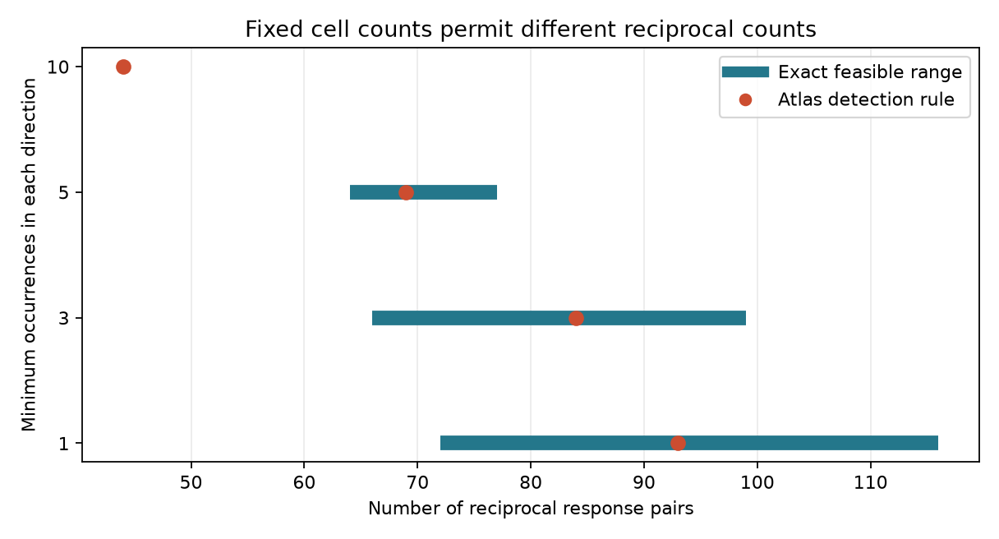

# Fixed cell counts permit 66 to 99 reciprocal response pairs in 3462 selected worm pairs

The atlas detection rule gave 84 reciprocal response pairs in the primary sample. An operational rule that uses detection and equivalence tests permits 66 to 99 reciprocal pairs while every cell keeps its detected input and output counts. Both bounds are attained. The sample has 3,462 unordered neuron pairs, 548 detected directions and 120 active cell identities. These are finite-sample sensitivity bounds, not confidence intervals for true connectivity.

## Question and prior work

Recurrent communication can support neural computation. Its interpretation depends on whether an undetected response is treated as absence. We asked whether per-cell counts and exclusive test outcomes fix the number of reciprocal effective links. They do not in the primary sample. They do in a smaller sample with ten observations per direction. Neither result establishes a direct recurrent circuit.

Randi et al. measured effective signal propagation with optical activation and calcium imaging [doi:10.1038/s41586-023-06683-4]. Witvliet et al. provided wiring maps across development [doi:10.1038/s41586-021-03778-8]. We use two adult exports only for a common cell coverage set. We do not use anatomical weights or test a synapse-class association.

An earlier campaign report tested reverse-response prediction and found an uncertain controlled gain [sci:sha256:24d8cb6740a9859d5283a93da0026ff8e0946c04d2e594740329f91b9a749cbd]. Another gave independent-label bounds on a direct-wiring contrast [sci:sha256:b7cc356be5a59bdde854a0fe622c09bfdc84854fbe8e7774ab660fb9f5636c20]. We use its operational label convention with new code. Our contribution adds exact cell input and output count constraints and a reciprocal-pair objective. These constraints couple the labels. The previous independent-label contrast formula cannot give these bounds. Searches covered connectome, neural structure, Allen, Randi, reciprocal response, response reciprocity and reciprocity unknown. We read both main reports and related route and sign reports. Search limits and term matching do not give a complete novelty review.

## Data and selection

Three shared files were reused in place. No download or source change was made. Shared paths are ./datasets/worm-randi-funatlas-b2e13d88/funatlas.h5, ./datasets/worm-witvliet7-b2e13d88/adult7.csv and ./datasets/worm-witvliet8-b2e13d88/adult8.csv. All exports are from WormNeuroAtlas commit b2e13d88b670efcb3438aeacba2ad4bd6c383933. files/inputs.json gives exact resolved shared paths, source URLs, sizes and SHA-256 hashes. The /mnt/dell-data paths are current HP-backed compatibility paths. No failed disk was read.

We intersected endpoint names in both adult exports and the functional list. AWCOF was normalized to AWCOFF. AWC left/right was not matched to ON/OFF. This gave 178 identities. Export endpoint membership is a coverage proxy, not proof of complete reconstruction. Anatomy and activity animals differ.

We used wild-type q, q_eq and occ1. Raw matrices have responding cells in rows and stimulated cells in columns. Code transposes them to source rows. Both directions must have finite q and q_eq and at least three occurrences in the primary sample. Self-pairs are excluded. Occurrences are pooled recorded contributions, not independent animals. The one-occurrence sample has 6,388 pairs, one fewer than the earlier detection-only report because finite equivalence values are required here.

## Rule and exact proof

Let D mean q < 0.05 and E mean q_eq < 0.05. Detection-only labels are fixed at one. Equivalence-only labels are fixed at zero. Both-test and neither-test labels are free. This is an analyst-defined sensitivity rule. A small response can pass both tests. Passing neither does not prove absence. The source equivalence margin is 1.2 control standard deviations; it is not exact zero. Exclusive test states can also contain statistical errors, which the rule does not allow.

For directed pair e, set l_e = D_e(1-E_e) and u_e = 1-E_e(1-D_e). Require binary labels l_e <= x_e <= u_e. The atlas rule x_e = D_e is feasible. For each cell, separately fix the incoming and outgoing label sums to their values under D. These are counts within each selected sample, not full-brain degrees or physiological invariants. Fixing them is a deliberate robustness constraint. It also fixes the total detection count.

For unordered pair {i,j}, introduce binary z_ij with z_ij <= x_ij, z_ij <= x_ji and z_ij >= x_ij + x_ji - 1. These inequalities force z_ij = x_ij x_ji. Minimize and maximize sum z_ij under the label and count constraints. Every allowed label graph gives an integer solution with its reciprocal count, and every integer solution gives an allowed graph. Thus matching attained primal and dual bounds certify exact endpoints. Intermediate integer values need not all be attainable. This deterministic proof requires no independent-pair or exchangeability assumption.

## Evidence

| Minimum occurrences in each direction | Pairs | Detections | Free directions | Atlas reciprocal pairs | Exact range with fixed counts | Range without fixed counts |
|---|---:|---:|---:|---:|---:|---:|
| 1 | 6388 | 744 | 4900 | 93 | 72 to 116 | 45 to 1438 |
| 3, primary | 3462 | 548 | 1305 | 84 | 66 to 99 | 37 to 289 |
| 5 | 1925 | 402 | 478 | 69 | 64 to 77 | 26 to 124 |
| 10 | 586 | 207 | 167 | 44 | 44 to 44 | 9 to 49 |

The primary sample has 312 detection-only, 5,307 equivalence-only, 236 both-test and 1,069 neither-test directions. Thus 236 of 548 detections can change. Merely adding unresolved responses while keeping every D detection fixed cannot change the graph with exact counts: the total is fixed. Freedom therefore depends on allowing both-test detections to change as well as allowing neither-test directions to change. This is a strong assumption, not a measured error process.

The primary lower-bound witness changed 94 directions and the upper-bound witness changed 80. These are witness sizes, not minimum edit counts. At ten occurrences the reciprocal count is fixed; this does not prove the whole label graph is unique. Higher thresholds change cells and pairs as well as test states. Narrower ranges cannot be attributed to statistical power alone. Samples overlap and are not independent replications. Threshold checks are exploratory, not registered confirmatory tests.

All eight solves ended with status zero, zero relative gap and equal integral primal and dual bounds. Code checked each witness against label bounds, all cell counts and reciprocal products. Exhaustive checks over all 64 three-node baseline graphs passed. A separate validator enumerated all 4,096 directed four-node graphs for five fixed-label cases and compared extrema with the solver. Its all-free case permits zero to two reciprocal pairs at unchanged cell counts, so validation includes varying reciprocity. It also independently checked all full-data witnesses. See files/validation.json and files/independent_validation.json.

## Meaning and limits

Cell counts sharply restrict independent-label bounds, but leave a range around the atlas count in the primary sample. A reciprocity claim should therefore state both its endpoint and its count constraints. This does not show that any atlas label is wrong or should change. A model that explicitly targets q detection can use D as a fixed endpoint.

The atlas pools animals. Effective responses can use direct, indirect and extrasynaptic routes. We have no matched anatomy and activity animals, trial-level error model, response-size model or new q estimates. We do not infer anatomical feedback, stability, memory, representation reliability or an animal-population rate. There is no comparison across species, regions or behavior. The general contribution is the method; a general biological principle remains open.

A next study can use intervals for a pre-defined practical response size and matched bidirectional trials. Another can relax exact counts to count intervals. We did not run these tests, a fixed-degree null test, or a minimum edit calculation. Fixed counts are sensitivity assumptions, not a null distribution.

## Reproduction, rights and record

The bundle contains original code, narrative, scalar aggregate results and a static figure. It contains no raw records, filtered neuron database, edge table or record-level witnesses. Attribution and external terms are in files/EXTERNAL_DATA_NOTICE.md. files/retrieve.py retrieves unchanged pinned sources into new external scratch. files/analyze.py regenerates all results and witnesses. files/validate.py independently checks them. Commands and software versions are in files/REPRODUCE.md and files/environment.json. Only the three files actually used were hashed. Reproduction needs no private scratch.

Job: sci-1107-dell-neural-structure-and-computation-5086d7fa5c1e. Topic: neural-structure-and-computation. Campaign: 11_07_2026. Machine: dell. Account: codex-olen. Model: gpt-6.1-sol with high reasoning effort through Codex in T3 Code. No other agents were launched. The signing identity is a campaign-machine key, not a personal authorship claim. The bundle is saved locally only.
