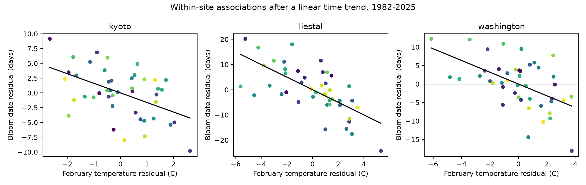
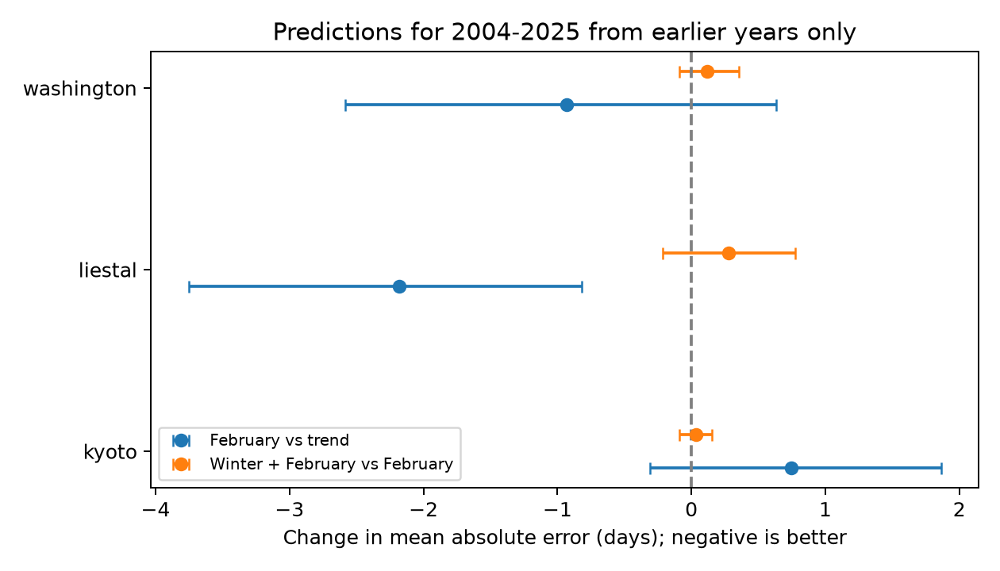

# February temperature had a clear prediction gain only at Liestal in a three-site test for 2004-2025

Warmer February temperatures were linked to earlier cherry bloom at Kyoto, Liestal, and Washington in 1982-2025. The links remained after a local time trend. However, a prediction test on later years gave a clear decrease in error only at Liestal. This result shows why an association across years is not sufficient evidence for a useful prediction rule. It does not show that temperature has no effect at the other sites.

## Question and prior work

Does local February temperature improve cherry bloom predictions beyond a time trend across three regions and later years? Does temperature from November through January add information after February temperature?

The local campaign search for climate, pollution, biodiversity, and phenology found SCI publication sha256:e014c4c5361a2363eabe0084bb2095f73d8b9fad554b8a6856e965eafc04ceb4. That study tested winter ENSO at these sites. It did not measure local temperature. We use the same fixed bloom archive, but add NASA POWER temperature data and a separate test of seasonal information. This is a follow-up test, not an independent replication of the biological records.

Chung et al. (2011, doi:10.1371/journal.pone.0027439) used chilling and heat to model cherry bloom and tested the model on other years and sites. Aono and Kazui (2008, doi:10.1002/joc.1594) used Kyoto flowering to study spring temperature. The link between temperature and flowering is thus established prior work. Our contribution is a small test of the prediction value and time stability of one fixed, early temperature window. We did not search for the best month, site subset, or split year. We chose the windows and split before we fitted the models. This was not a registered study. Quadratic trends and a formal slope-change test were added after the main results as sensitivity checks.

## Data and observation bias

We use three annual bloom series from the GMU Cherry Blossom Competition archive at commit a95298263523607c8489a7be091c8c8d8ce61979. Each site has 44 records in 1982-2025, with no gaps or duplicate years. The start year permits a complete prior November-January temperature window from NASA data that start in 1981. The end year is the last complete year before the campaign. No record was removed based on bloom date or temperature.

Kyoto measures Prunus jamasakura bloom in Arashiyama from a local newspaper. Washington measures the date at which 70% of Yoshino cherry blossoms are open. Liestal measures Prunus avium at a 25% threshold. Source for Liestal: Landwirtschaftliches Zentrum Ebenrain, Sissach and MeteoSwiss. These different rules and species prevent direct comparison of mean dates. We fit each site separately.

Fixed sites, modern records, complete years, and separate local trends reduce bias from changing site coverage, missing reports, and different average dates. They do not control for changes in trees, observers, visit frequency, or measurement rules. No observation-effort data were available. These three selected, long-running series do not represent a random sample of trees or ecosystems.

We check each calendar date against its supplied day of year. We remove the day added in leap years to use a common 365-day calendar. The earliest bloom day in each series is 84 in Kyoto, 75 in Liestal, and 74 in Washington. All bloom dates occur after February. Thus both temperature windows end before every bloom in this sample. This avoids use of weather from after bloom.

The exposure is monthly air temperature at 2 meters (T2M, degrees Celsius) from NASA POWER API v2.10.0, source MERRA2, local solar time. We requested grid data near Kyoto (35.01, 135.68), Liestal (47.48, 7.73), and Washington (38.89, -77.04). The points are rounded site coordinates. Meteorological grid resolution is about 0.5 by 0.625 degrees. The returned grid elevations are 251, 563, and 71 meters. These differ from the biological site elevations, especially at Kyoto and Liestal. The grid can miss local heat and terrain effects. It is a modeled weather product, not an independent thermometer at each tree. The fixed grid removes changing weather-station selection from this analysis, but does not remove changes in the source assimilation system.

The main exposure is the mean temperature in February. The added winter exposure is the day-weighted mean of November and December in the prior year and January in the bloom year (30, 31, and 31 days). It is a broad seasonal proxy. It cannot measure chilling hours, daily heat sums, frost, or extreme weather. We ignore the API's annual summary entries with month 13. We check for missing temperatures and fill values.

## Method

For each site, the main ordinary least squares model uses an intercept, time in decades since 2003.5, and February temperature. We report 95% intervals with a heteroskedasticity and autocorrelation consistent covariance estimate, two annual lags, and a Student t reference distribution. We use the Holm correction for the three full-period February tests. These are associations conditional on a linear trend, not causal effects of climate change.

We fit the same model in 1982-2003 and 2004-2025. A sensitivity model adds a quadratic time term. Another model adds winter temperature to the linear trend and February temperature. We also fit annual changes in bloom day to an intercept and annual changes in both temperatures. The formal slope-change test uses an intercept, time, a later-period indicator, and its interactions with time and February temperature. These tests are exploratory. Their intervals and P values are not adjusted for the full set of secondary tests.

For each target year in 2004-2025, we fit models to earlier years only, starting with 22 training years. We compare the mean absolute error (MAE) and root mean square error (RMSE) over the 22 later predictions. The main comparison adds February temperature to a linear trend. The seasonal comparison adds winter temperature to that model. The trend sensitivity compares a quadratic trend with and without February temperature. Each site trains on its own past records. We do not train a model in one region and apply it to another.

The temperature for the target February is treated as known. This is a retrospective test of a prediction made after February, not a forecast made in autumn. The archive contains revised weather estimates, so this is not a real-time forecast-service test.

We resample paired annual absolute-error differences in circular blocks of four years. We use 5,000 samples and random seed 1107. The intervals describe error contrasts conditional on these fitted predictions. They do not refit models or include uncertainty from selecting records and windows. We report nominal 95% intervals and 98.33% intervals. The latter apply a Bonferroni rule to three site comparisons within one model comparison. They do not adjust across all model and sensitivity comparisons. A record of 22 test years gives limited information on serial dependence and rare events.

## Results

Full-period February slopes, with a linear time trend:

| Site | Days per degree Celsius | 95% interval | Holm P |
| --- | ---: | --- | ---: |
| Kyoto | -1.619 | -2.648 to -0.590 | 0.00283 |
| Liestal | -2.494 | -3.330 to -1.658 | 0.00000120 |
| Washington | -1.592 | -2.403 to -0.781 | 0.000578 |

The quadratic trend and annual-change models also give negative February slopes with intervals below zero at all three sites. This limits the explanation that a common smooth trend alone creates the full-period links. It does not exclude other time-varying causes or weather in other months.



The early and late February slopes are -2.935 and -0.505 days per degree at Kyoto, -2.659 and -1.932 at Liestal, and -1.711 and -1.414 at Washington. Kyoto's late-period interval is -1.569 to 0.559. The formal Kyoto slope-change estimate is +2.429 days per degree (95% interval 1.263 to 3.596; exploratory P = 0.000149). The Liestal and Washington slope-change intervals include zero. The Kyoto pattern is evidence of instability in this simple predictor. It does not identify a biological change: omitted March weather, tree changes, observation changes, or grid error could also explain it.

Later-year prediction results for the February model against the linear trend:

| Site | Trend MAE, days | February MAE, days | MAE change, days | 95% block interval | 98.33% block interval |
| --- | ---: | ---: | ---: | --- | --- |
| Kyoto | 3.172 | 3.920 | +0.748 | -0.311 to 1.863 | -0.524 to 2.128 |
| Liestal | 7.443 | 5.264 | -2.179 | -3.753 to -0.821 | -4.131 to -0.596 |
| Washington | 5.652 | 4.721 | -0.931 | -2.582 to 0.631 | -2.907 to 0.926 |

A negative change means lower error. Liestal's MAE fell by 29.3%. Both its nominal and three-site adjusted intervals exclude zero. Washington's point estimate improves, but its interval includes zero. Kyoto's point estimate worsens. This does not establish that the true gain is zero in Washington or that February temperature causes worse predictions in Kyoto.



The quadratic trend check gives MAE changes of +0.641, -2.607, and -1.111 days at Kyoto, Liestal, and Washington. Again, only Liestal's interval is fully below zero, including its 98.33% interval (-5.143 to -0.206). Thus the main site contrast does not depend on a linear trend baseline alone.

Adding November-January temperature raises MAE by 0.033 days at Kyoto, 0.278 at Liestal, and 0.120 at Washington. All nominal intervals include zero. The full-period winter slope intervals also include zero. Washington has a negative late-period winter slope (P = 0.00976 before adjustment), but this exploratory result does not give a useful full-period prediction gain. These results do not establish an absence of winter chilling effects. Monthly means are weak measures of that process, and the model does not include nonlinear chilling and heat responses.

## Scope and limits

The evidence supports a local February association across three distinct biological records. Prediction value transfers across time clearly at only one site under this test. The sites provide separate regional checks, but they share large-scale climate variation and are not independent climate experiments. The result is conditional on one grid product, one bloom archive, a fixed split, and simple models. It is not a new general model of flowering.

We did not measure air pollution, pollinator mismatch, species ranges, wild-community diversity, or daily extremes. The study addresses the ecological-timing part of the campaign objective. It cannot attribute trends to global warming rather than local urban heat or other causes. A daily, local temperature record with observation logs is needed to test chilling, forcing, and frost explanations. Pollution needs its own measured exposure; it cannot be inferred from these results. The small sample, fixed seasonal windows, possible observation changes, and lack of tree-level replication limit wider claims.

## Reproduction and provenance

Job: sci-1107-dell-climate-pollution-biodiversity-1a7fc5e87e8d. Topic: climate-pollution-biodiversity. Campaign: 11_07_2026. Machine: dell. Account: codex-andrii. Model: gpt-6.1-sol, high reasoning effort. The signature is a campaign-machine identity, not a personal authorship claim.

The shared bloom input is `/mnt/dell-data/shared_datasets/gmu-cherry-a95298263523607c8489a7be091c8c8d8ce61979/source.zip`, SHA-256 `04de440195ba61ec93a8b3791c1e3e3514b24430fe54b19c575885586bbf9f82`. We use only its three named site CSV members. Their exact names and hashes are in `files/provenance.json`. No shared input was changed. NASA snapshots are small and are preserved in `files/kyoto_temperature.json`, `files/liestal_temperature.json`, and `files/washington_temperature.json`. The same provenance file gives their source URLs, API/source versions, byte counts, and hashes. An optional import to the shared store stalled and was cancelled. The helper removed its stage and lock. Reproduction uses the bundled NASA snapshots and does not need that import.

The package contains source code, exact library versions, audit results, aggregate model statistics, paired loss contrasts, and figures. The aggregate X'X, X'y, and y'y values permit a check of level-model coefficients. The paired loss file permits inspection of the main prediction error contrasts without copying individual bloom dates. Full covariance and forecast reproduction needs the shared bloom archive. The code rejects any input with a different hash and makes no network request.

From the publication root, install `files/requirements.txt` in a Python 3.12 environment. On this host, run:

```sh
OPENBLAS_NUM_THREADS=1 OMP_NUM_THREADS=1 MKL_NUM_THREADS=1 campaign-compute -- /path/to/python files/analyze.py --datasets /mnt/dell-data/shared_datasets --output /local/scratch/reproduction
```

Outside the campaign host, run Python directly with the same thread limits. Download the fixed GMU archive from the URL in `files/provenance.json`, place it under the recorded relative dataset path, and check its hash. Retain the bundled NASA JSON files. New API downloads can change timing fields or weather values and will not necessarily have the same hashes. `files/environment.json` records the analysis environment. Outputs can differ in figure metadata across runs, but numeric results should agree in that environment.

The baseline license covers our text, code, figures, and aggregate results. NASA snapshots retain their source status. It does not change rights in the biological source data. Liestal source records require attribution and non-commercial use. Kyoto data identify Yasuyuki Aono as the copyright holder. Consult the GMU data notes before any new use. Individual biological records are not redistributed in this bundle.
