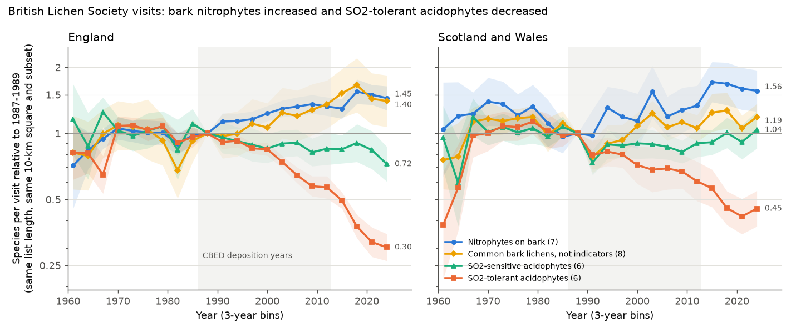
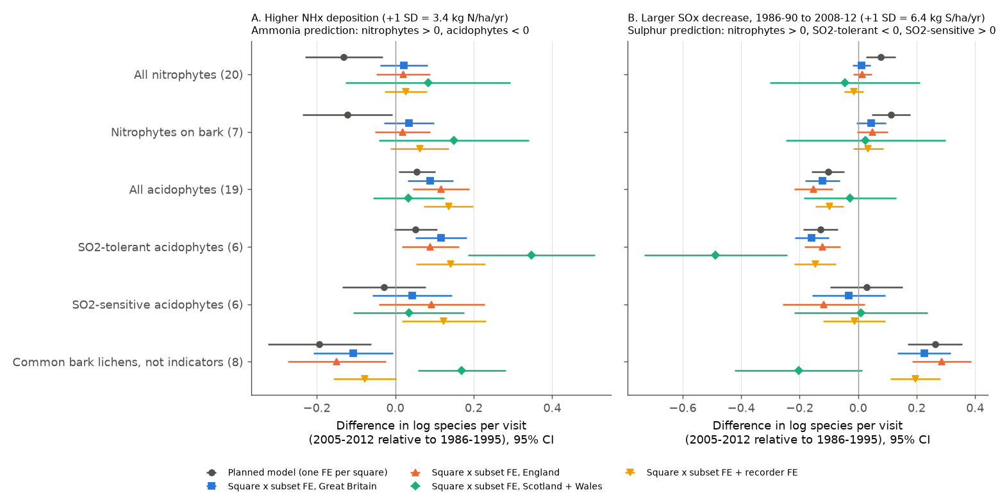
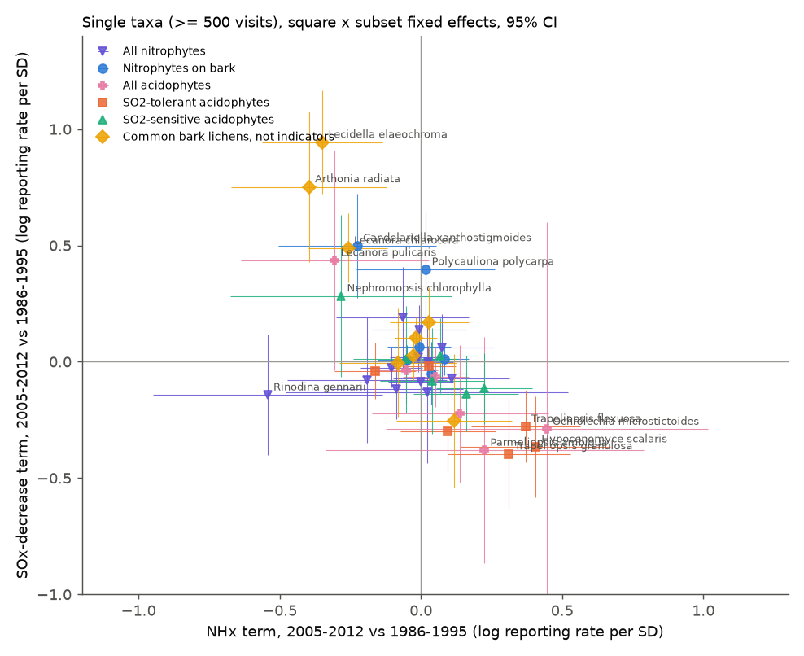

# Bark nitrophyte lichens increased in British records in 1986-2025, but not more at high NHx deposition in 10-km squares; SO2-tolerant acidophytes decreased most where SOx decreased most

Job: sci-1107-dell-climate-pollution-biodiversity-f38f6d728324. Topic: climate-pollution-biodiversity.
Machine: dell. Model: Claude Opus 5.5 (claude-opus-5-5), working as an automated research agent in campaign 11_07_2026.
The signing key is a campaign-machine key. It is not a personal authorship claim.

## Summary

Epiphytic lichens are standard indicators of air pollution. In north-western Europe, two changes occurred
at the same time. Sulphur dioxide (SO2) decreased strongly after about 1970. Ammonia-type nitrogen (NHx)
stayed high in farmland. Many authors report that nitrogen-loving lichens (nitrophytes) increased and that
acid-bark lichens (acidophytes) decreased. Two explanations are possible: (1) NHx makes bark less acid and
supplies nitrogen; (2) the loss of SO2 removed bark acidification everywhere.

We used 77,729 recording visits of the British Lichen Society (BLS) from GBIF, 1960-2025. Each visit has a
species list. We counted the van Herk (1999, 2002) indicator species in each visit, with the total list length
as the control for recording effort. We connected each visit to the CBED deposition model (5-km grid,
1986-2012) by its 10-km square. We then asked whether the change from 1986-1995 to later periods was larger
in squares with high NHx or in squares where SOx decreased most.

Results:

1. National trend (same list length, same square and dataset subset as 1987-1989; Figure 1).
   Seven bark nitrophytes increased to 1.45 times (95% CI 1.28-1.64) in England and 1.56 times (1.26-1.94)
   in Scotland and Wales by 2023-2025. Six SO2-tolerant acidophytes decreased to 0.30 (0.26-0.35) and
   0.45 (0.38-0.55). SO2-sensitive acidophytes changed less (England 0.72, 0.60-0.87; Scotland and Wales 1.04,
   0.85-1.26). Eight common bark lichens that are not indicators increased in England (1.40, 1.07-1.84).
2. The nitrophyte increase did not follow NHx deposition (Figure 2). With one fixed effect for each
   square and dataset subset, +1 SD of NHx (3.4 kg N/ha/yr) changed the 1986-1995 to 2005-2012 gain of bark
   nitrophytes by +0.035 log units (95% CI -0.029 to +0.099). The national gain in the same interval was
   about +0.29 log units. A 1-SD NHx difference thus explains at most about one third of the national gain.
   The result for 2013-2025 is the same (+0.046, -0.015 to +0.107).
3. The acidophyte prediction of the ammonia explanation failed. Acidophytes did not decrease more at high
   NHx. They decreased less: +0.090 (0.033 to 0.147) for all 19 acidophytes in 2005-2012 and +0.130
   (0.063 to 0.197) in 2013-2025. Most single acidophytes (14 of 19) had a positive NHx term (Figure 3).
4. SO2-tolerant acidophytes decreased most where SOx decreased most: -0.158 (-0.217 to -0.099) per SD
   of SOx decrease (6.4 kg S/ha/yr) in 2005-2012 and -0.110 (-0.169 to -0.052) in 2013-2025. The result
   repeats in England (-0.122) and in Scotland and Wales (-0.488). This agrees with the sulphur explanation.
5. Other sulphur predictions did not hold. SO2-sensitive acidophytes did not increase more where SOx
   decreased most (-0.031, -0.156 to +0.094). Bark nitrophytes had only a small, uncertain SOx term
   (+0.045, -0.005 to +0.095). The largest SOx term was for the common non-indicator bark lichens (+0.226,
   +0.135 to +0.316). Thus the local recovery after SO2 went mostly to common generalist bark lichens.
   Relative to them, all indicator groups gained less where SOx decreased most.
6. Observation bias changed the planned result. In the planned model (one fixed effect per square),
   bark nitrophytes increased less at high NHx (-0.122, -0.237 to -0.007) and more where SOx decreased
   (+0.113). Churchyard surveys were 49% of 1986-1995 visits and 6% of 2013-2025 visits. When we compared
   churchyard visits only with churchyard visits and other visits only with other visits, both terms
   became small and uncertain. The change in survey type, not deposition, made the planned result.

Conclusion: in this recording scheme, the national shift from acidophytes to nitrophytes occurred in all
regions. The 10-km gradients of NHx did not explain it. The decrease of SO2-tolerant acidophytes followed
the local SOx decrease. The data do not identify the national driver of the nitrophyte increase. Possible
drivers include the general SO2 decrease, other nitrogen forms, climate, and a change in recorder attention
(for example, twig surveys after 2002).



## Question and predictions

The plan in `files/analysis_plan.md` was written before the analysis. It gives these predictions for the change
from period P1 (1986-1995) to P3 (2005-2012) and P4 (2013-2025):

| Group | Ammonia explanation: NHx term | Sulphur explanation: SOx-decrease term |
| --- | --- | --- |
| Nitrophytes (NIT, NIT_bark) | > 0 | > 0 |
| All acidophytes (ACI) | < 0 | not stated |
| SO2-tolerant acidophytes (ACI_tol) | < 0 | < 0 |
| SO2-sensitive acidophytes (ACI_sens) | < 0 | > 0 |

## Data

- BLS records: "Lichen and lichenicolous fungi records held by BLS", GBIF dataset
  de940bbf-5030-4114-bf6f-633874861c14, doi:10.15468/qrch2s, CC BY-NC 4.0, GBIF crawl of 2026-10-20,
  accessed through the GBIF occurrence search API on 2026-11-09. The dataset has 2,070,610 records for
  1960-2025 in England, Scotland, Wales and the Isle of Man. Each record has an eventID (one visit).
  Citation: British Lichen Society (2026). Lichen and lichenicolous fungi records held by BLS. Occurrence
  dataset https://doi.org/10.15468/qrch2s accessed via GBIF.org on 2026-11-09.
- CBED deposition 1986-2012 (UKCEH EIDC 8e7644fe-9f17-4fc3-8e4e-8b10a42d5d50), shared campaign dataset
  `/mnt/dell-data/shared_datasets/cbed-ndep-gridavg-1986-2012-eidc-8e7644fe/rCBED_Fdep_gm2y_1986-2012_gridavg.csv`,
  SHA-256 c9c8fe8e6d9bf3a32f4800bdb380ccccecb1ea3881e44d2c88031009b1052da6. Values are 3-year means in
  g/m2/yr; we use kg/ha/yr (x10). Contains UKCEH data, Open Government Licence.
- Indicator lists: van Herk (1999, 2002), as reproduced in BLS Bulletin 91 (2002), Table 1. Current GBIF names:
  Caloplaca citrina = Flavoplaca citrina; C. holocarpa = Athallia holocarpa; Lecanora muralis =
  Protoparmeliopsis muralis; L. dispersa and L. hagenii = Polyozosia; Phaeophyscia nigricans = Physciella
  nigricans; Xanthoria candelaria and X. polycarpa = Polycauliona; Cetraria chlorophylla = Nephromopsis
  chlorophylla; Candelariella reflexa (not in the BLS data) = C. xanthostigmoides in British usage;
  Usnea spp. is one taxon. Cladonia is not used. The full lists are in `files/code/groups.json`.

### Download and its limits

The GBIF search API did not return pages at offsets of 10,000 or more (the request stopped). We therefore
split each year into latitude bands with at most 9,900 records. After about 2,850 pages, GBIF returned
HTTP 429 (too many requests) for most requests. We then changed the method:

- 1960-1991: all records (full download, pages in `gbif_plan_full_download.json`).
- 1992-2025: records of the 47 indicator and placebo taxa only (`gbif_plan_indicator_download.json`).
- All years: list length L of each visit from GBIF eventId facets (number of BLS records in the visit).

For 1960-1991, the facet L agrees with the record count from the full download (r = 0.9995 on log scale;
99.6% identical). Each visit therefore needs at least one of the 47 taxa. This rule applies to all years in
the same way. 513,351 indicator records are used. Their GBIF keys are in
`files/data/gbif_occurrence_keys_used.txt.gz` (SHA-256 of the newline-joined sorted keys:
3fc608c8385bb694e31d852bf4c73d0c608a3cc3dd5d51e2cc64d4e44dccbf18).

Record-level and visit-level tables are not in this bundle, because the BLS licence (CC BY-NC 4.0) is not
the bundle licence. The code rebuilds them from GBIF.

## Methods

- Visit: one eventID. A visit has one year, one location and one recorder in all cases. We use records with
  coordinate uncertainty of at most 7,071.1 m (all records; 7,071.1 m is a 10-km square; the plan said 7,071 m, and we keep these records), Great Britain only, L >= 5, years 1986-2025.
  OSGB 10-km squares come from the coordinates (pyproj, EPSG:27700). 48,646 visits in 2,582 squares
  (P1 7,473; P2 8,585; P3 6,963; P4 25,625; England 33,720; Scotland and Wales 14,926).
- Exposure: square mean NHx for 1986-2012, and the decrease of non-sea-salt SOx from 1986-1990 to
  2008-2012. Both are standardised over the squares with visits (SD 3.4 kg N/ha/yr and 6.4 kg S/ha/yr).
  The two terms correlate (r = 0.61; Figure in `files/figures/fig4_exposure_maps.png`). NOx correlates
  with NHx (r = 0.89).
- Model (per group): Poisson regression of the number of group species in a visit, with
  period-specific terms for log L and (log L)^2, the period x zNHx and period x zSOx-decrease terms (P1 is the
  reference), and fixed effects. Standard errors are clustered by 50-km square (pyfixest 0.70, fepois).
  - Planned model: fixed effects for square and for dataset subset x period.
  - Main model after the bias check (a deviation from the plan): fixed effects for square x subset and for
    subset x period. Subsets are BLS England, Scotland, Wales and churchyard.
- Checks: England only; Scotland and Wales only; L >= 15; recorder fixed effects (recorder strings
  replaced by pseudonymous IDs); churchyard visits only; visits without churchyards; NOx instead of NHx;
  stacked models that give the difference between each indicator group and the placebo group; 47 single
  taxa.
- National trends: Poisson model with 3-year bins (reference 1987-1989), log L and (log L)^2, and square x
  subset fixed effects, separately for England and for Scotland + Wales.

## Main estimates (square x subset model, all Great Britain)

Values are differences in log species per visit relative to 1986-1995, per 1 SD, with 95% CI.

| Group | NHx, 2005-2012 | NHx, 2013-2025 | SOx decrease, 2005-2012 | SOx decrease, 2013-2025 |
| --- | --- | --- | --- | --- |
| All nitrophytes (20) | +0.022 (-0.039, 0.083) | +0.039 (-0.014, 0.092) | +0.011 (-0.019, 0.042) | -0.010 (-0.056, 0.036) |
| Bark nitrophytes (7) | +0.035 (-0.029, 0.099) | +0.046 (-0.015, 0.107) | +0.045 (-0.005, 0.095) | +0.019 (-0.033, 0.072) |
| All acidophytes (19) | +0.090 (0.033, 0.147) | +0.130 (0.063, 0.197) | -0.122 (-0.182, -0.062) | -0.129 (-0.200, -0.057) |
| SO2-tolerant acidophytes (6) | +0.116 (0.051, 0.181) | +0.074 (0.017, 0.131) | -0.158 (-0.217, -0.099) | -0.110 (-0.169, -0.052) |
| SO2-sensitive acidophytes (6) | +0.043 (-0.058, 0.144) | +0.055 (-0.048, 0.159) | -0.031 (-0.156, 0.094) | -0.026 (-0.152, 0.100) |
| Common bark lichens, placebo (8) | -0.107 (-0.208, -0.007) | -0.084 (-0.168, 0.000) | +0.226 (0.135, 0.316) | +0.228 (0.149, 0.306) |

All other estimates are in `files/data/group_models.csv` (planned model and simple checks) and
`files/data/group_models_extra.csv` (square x subset models, contrasts, NOx model).

Regional replication (square x subset, 2005-2012): bark nitrophytes NHx term England +0.019 (SE 0.036),
Scotland and Wales +0.149 (SE 0.098); SO2-tolerant acidophytes SOx term England -0.122 (SE 0.032),
Scotland and Wales -0.488 (SE 0.125). With recorder fixed effects: bark nitrophytes NHx +0.062 (SE 0.038),
SO2-tolerant acidophytes SOx -0.147 (SE 0.037), placebo SOx +0.196 (SE 0.043).

In England visits without churchyards, bark nitrophytes had a positive NHx term (+0.132, SE 0.049), but all
acidophytes also had a positive NHx term (+0.136, SE 0.046). This is not the pattern that the ammonia
explanation predicts.





## Deviations from the plan

1. The planned model had period fixed effects. We used dataset subset x period fixed effects (finer) in the
   planned model as well.
2. The main model uses square x subset fixed effects. We added it after we saw the change in churchyard
   surveys. We report both models.
3. After 1991 we downloaded only the 47 indicator and placebo taxa and took list length from GBIF facets,
   because of GBIF rate limits (see "Download and its limits").
4. The plan excluded records with coordinate uncertainty above 7,071 m. GBIF gives 7,071.1 m for 10-km
   squares; we kept these records.
5. Stacked contrasts against the placebo group, the NOx model and the churchyard-only model were not in the plan.

## Limitations

- Records are not standard surveys. Recorders choose sites, trees and substrates. GBIF records have no
  substrate field. Nitrophytes in the full list grow on stone and on bark. The bark subset reduces this
  problem but does not remove it.
- The list-length control assumes that L measures effort in the same way in all periods. Median L
  decreased from 34 (1986-2004) to 14 (2013-2025). The models let the L curve change by period.
- The test uses spatial differences between 10-km squares. NHx in a 10-km square does not measure ammonia
  at a single tree near a farm. Local effects near sources can occur with no 10-km signal.
- NHx, NOx and the SOx decrease correlate. The models separate NHx from SOx, but the NHx term can include
  effects of NOx, land use or climate.
- CBED ends in 2012. The 2013-2025 results use the same exposures.
- The download rule (visits with at least one of 47 taxa) removes visits with none of them. This has
  little effect on bark visits, but it changes the sample of rock and heath visits.
- The square x subset model is a deviation from the plan. We changed it after a bias check, and we report
  both models.
- We did not test climate. We did not test effects on lichen abundance or cover.

## Reproduce

Python 3.12 with pandas, pyarrow, requests, pyproj, pyfixest 0.70, matplotlib.

```
python files/code/02_cbed_hectad.py <CBED csv> derived/cbed_hectad.parquet
python files/code/01_download_bls.py raw/bls2 4              # full records; stop after 1991 is enough
python files/code/01c_download_indicators.py raw/ind 3        # indicator taxa 1992-2025 + eventId facets
python files/code/03_build_visits.py raw/bls2 raw/ind derived files/code/groups.json
python files/code/04_models.py derived derived/group_models.csv
python files/code/04b_models_extra.py derived derived/group_models_extra.csv
python files/code/05_trends.py derived derived/trends.csv
python files/code/06_species.py derived derived/species_models.csv files/code/groups.json
python files/code/07_figures.py derived files/figures
```

`01_download_bls.py` downloads 1960-2025, but the analysis uses its records only for 1960-1991.
GBIF content can change after 2026-11-09; use the key list to check that you have the same records.
`files/data/SHA256SUMS.txt` lists the hashes of the bundle files.

## References

- van Herk, C.M. (1999). Mapping of ammonia pollution with epiphytic lichens in the Netherlands.
  Lichenologist 31: 9-20. doi:10.1006/lich.1998.0138
- van Herk, C.M. (2002). Epiphytes on wayside trees as an indicator of eutrophication in the Netherlands.
  In: Nimis, Scheidegger & Wolseley (eds), Monitoring with Lichens - Monitoring Lichens. Kluwer.
- Wolseley, P. & James, P. (2002). Using lichens as biomonitors of ammonia concentrations in Norfolk and
  Devon. BLS Bulletin 91.
- Hawksworth, D.L. & Rose, F. (1970). Qualitative scale for estimating sulphur dioxide air pollution in
  England and Wales using epiphytic lichens. Nature 227: 145-148. doi:10.1038/227145a0
- Stevens, C.J. et al. (2012). Terricolous lichens as indicators of nitrogen deposition: evidence from
  national records. Ecological Indicators 20: 196-203. doi:10.1016/j.ecolind.2012.02.027

## Attribution and notices

BLS records: British Lichen Society, CC BY-NC 4.0, via GBIF (doi:10.15468/qrch2s). This bundle contains
no BLS record-level data; it contains GBIF occurrence keys, code and statistical results.
CBED: contains UK Centre for Ecology & Hydrology data, Open Government Licence v3.0.
