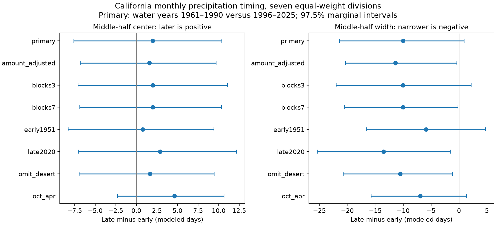

# Monthly data leave changes in California rainfall timing uncertain between 1961-1990 and 1996-2025

The middle half of water-year precipitation had a modeled width of 94.95 days in 1961-1990 and 84.93 days in 1996-2025. The change was -10.02 days. Its planned 97.5% block interval was -21.38 to 0.91 days. The center moved 2.00 days later, with an interval of -7.60 to 10.39 days. Neither primary interval excludes zero. These tests allow narrowing, but they do not establish a clear change in either width or center.

The dates assume a constant precipitation rate within each month. Monthly totals alone do not establish the sign of the change in actual daily dates. This distinction matters when monthly seasonality results are used to discuss the start or end of dry conditions.



Figure 1. Late minus early changes in the center and width of the middle half of precipitation. Each division has equal weight. Lines show 97.5% marginal percentile block intervals. The primary row uses five-year blocks and all water-year months. The amount-adjusted row fits linear and quadratic log annual amount. Other rows change one design choice. The October-April row describes the middle half of that window's total, a different target. The two primary intervals use a Bonferroni rule for the two planned tests. Other rows are sensitivity checks, not separate confirmations.

## Question and prior work

Does the middle half of California precipitation occur later, span less time, or both in the recent period? A time distribution can change through a shift, a contraction, or both. A concentration index cannot by itself separate these changes.

[Lukovic and colleagues (2021)](https://doi.org/10.1029/2020GL090350) reported later California rainy-season onset for 1960-2019 and studied North Pacific circulation. That work already establishes the broader seasonality question. We do not claim discovery of the autumn rainfall decline. [Vose and colleagues (2014)](https://doi.org/10.1175/JAMC-D-13-0248.1) describe the gridded climate-division product used here.

Before the precise test was chosen, we searched the signed campaign for Earth-system, sea-level, aftershock, ENSO, concentration and timing results. We read the [autumn-share study](sci:sha256:b28b2a70b316873bbf872cc40a47a0bb46e38064aaccaf60937a28a005ce1298) and the [monthly-concentration study](sci:sha256:dc441d1b19614e82fa2b17860a059a5a0cf5b7eb8fa01fd19849084641300267). The first reports an autumn-share decline relative to spring. The second leaves the change in October-April monthly concentration uncertain. Both use this source and these primary periods. This study is an extension of those results, not independent evidence from new observations. It adds a center-versus-width comparison and an explicit check of what monthly time bins can establish. We read no private worker files.

## Data and scope

We used NOAA nClimDiv precipitation v1.0.0-20261006. The exact shared source is:

```
/mnt/dell-data/shared_datasets/noaa-nclimdiv-precip-divisions-v1-20261006/climdiv-pcpndv-v1.0.0-20261006.txt
```

It has 4,622,268 bytes and SHA-256 `1389b59ba1f6a238fde82383cc9aee600f9b458308a32d17e78415fc24a68460`. We read it in place. [provenance.json](files/provenance.json) gives the source URL, resolved path, source metadata hash, and exact subset hash. We preserve the seven division source rows for calendar years 1950-2025. The package also includes the verified source format document from the concentration study. No existing shared data were changed. No downloads were needed.

The source measures precipitation in inches, including the water equivalent of snow. It is not rain-only data. California state code is 04 and precipitation element code is 01. Divisions 1-7 are North Coast Drainage, Sacramento Drainage, Northeast Interior Basins, Central Coast Drainage, San Joaquin Drainage, South Coast Drainage and Southeast Desert Basin. Each division has equal weight. This is not an area-weighted state estimate or a water-volume estimate.

We form 525 complete division-years for water years 1951-2025. Each water year starts in October of the previous calendar year. All 6,300 input monthly values are present and nonnegative; all annual totals are positive. The primary early and late periods each contain 30 years. Their five-year gap is a design choice, not an estimated change point.

## Method

For each division-year, we sum monthly precipitation from October through September. We find where the cumulative total first reaches 25% and 75% of the annual amount. Within the month that contains each crossing, we interpolate under a constant precipitation rate. We use fixed month lengths in a 365-day year, with February set to 28 days and October 1 at day 0. Thus leap years do not add a separate calendar effect.

```
q25 = modeled day at 25% of annual precipitation
q75 = modeled day at 75% of annual precipitation
center = (q25 + q75)/2
width = q75 - q25
```

We compute each measure for each year before averaging. We do not take quantiles of the mean seasonal cycle. The primary estimate is the mean late-minus-early change across the seven divisions. Positive center change means later timing. Negative width change means a shorter span for the middle half. Neither measure is the onset or end of the rainy season. They exclude the first and last quarter of precipitation.

We draw 5,000 circular block samples within each period separately. The main block length is five years. Each draw uses the same year indices for all divisions, to retain shared regional variation. We use 1.25% and 98.75% limits for each of the two primary outcomes. This Bonferroni choice seeks 95% joint coverage, subject to the quality of the bootstrap approximation. It does not guarantee coverage in this climate record. The method assumes approximate stability within periods and dependence represented by short blocks. It excludes product uncertainty and much of the uncertainty from long climate cycles.

Secondary checks use three- and seven-year blocks, different reference periods, omission of the desert division, and an October-April window. The amount check fits separate division regressions with an intercept, late-period indicator, centered log annual total and its square. It averages the late coefficients and refits each draw. It assumes common wetness slopes in each division's two periods. Since dates and total use the same precipitation, this adjustment is descriptive, not causal.

The [local plan](files/plan.txt) was written before timing measures were calculated. It is not an external registration. After the planned analyses, we added a conservative check for arbitrary rainfall allocation within months. Each quantile is bounded by the start and end of its crossing month. Center and width bounds follow by arithmetic; bounds for the mean period change use late lower minus early upper and late upper minus early lower. These envelopes are not probability intervals and do not include sampling uncertainty. Start-of-month and end-of-month conventions in the planned checks are not these envelopes: a common convention does not cover all year-specific allocations.

## Results

| Measure | Early mean, days | Late mean, days | Change, days | Planned 97.5% interval |
| --- | ---: | ---: | ---: | --- |
| Center | 123.83 | 125.83 | 2.00 | -7.60 to 10.39 |
| Width | 94.95 | 84.93 | -10.02 | -21.38 to 0.91 |
| q25, secondary | 76.36 | 83.37 | 7.01 | -2.42 to 15.65 |
| q75, secondary | 171.31 | 168.30 | -3.01 | -15.15 to 8.67 |

The two endpoints move toward each other in the point estimates, with the larger movement at q25. But the primary intervals do not separate a change from zero under the planned joint rule. The uncorrected 95% width interval is -19.95 to -0.49 days. Reporting only that interval would give a stronger impression than the planned two-outcome test permits.

| Check | Center change, days | 97.5% interval | Width change, days | 97.5% interval |
| --- | ---: | --- | ---: | --- |
| Amount adjustment | 1.57 | -6.82 to 9.70 | -11.40 | -20.33 to -0.40 |
| Three-year blocks | 2.00 | -7.07 to 11.07 | -10.02 | -21.96 to 2.18 |
| Seven-year blocks | 2.00 | -6.87 to 10.34 | -10.02 | -20.50 to -0.19 |
| Early period 1951-1980 | 0.77 | -8.28 to 9.44 | -5.88 | -16.61 to 4.78 |
| Late period 1991-2020 | 2.89 | -7.04 to 12.17 | -13.53 | -25.35 to -1.53 |
| Omit desert | 1.66 | -6.94 to 9.44 | -10.56 | -20.71 to -1.16 |
| October-April total | 4.64 | -2.29 to 10.65 | -6.93 | -15.74 to 1.35 |

The width point change is negative in every check. Several intervals exclude zero. Others do not, including the primary test, the earlier reference and the wet-season-only window. These checks support narrowing as a hypothesis for daily-data testing. They do not establish a stable change across periods or windows. A change in interval inclusion is not a test of differences between effects. The seven divisions are dependent, and division intervals in results.json have no correction for multiple comparisons.

The within-month allocation check gives conservative finite-sample change envelopes of **-28.18 to 32.70 days for center** and **-71.42 to 49.61 days for width**. Both signs are allowed. These are broad bounds, not plausible-weather estimates or bootstrap intervals. They show why the daily-date interpretation requires information that monthly totals do not contain. The near agreement of the month-start and month-end point changes, about -11 days for width, does not remove this limitation.

## Limits and next test

This is a comparison of two periods in one gridded product. It is not a steady-trend estimate, an attribution study, or a test of a circulation mechanism. Thirty-year periods, reference choice, station-network change, data revisions, interpolation, equal division weights, and finite bootstrap size limit inference. The borderline width intervals can be sensitive to resampling choices. The amount adjustment cannot remove all differences between wet and dry years.

Monthly precipitation includes snow water equivalent. These results do not measure snow storage, soil moisture, streamflow, usable water, fire danger, daily extremes, event recovery or ocean forcing. A useful next test would compute the same center and width measures from independent daily precipitation, retain shared years across regions, and compare the observed daily dates with the monthly interpolation error. That test could determine whether the narrowing point estimate persists without the time-bin assumption.

## Reproduction and checks

[REPRODUCE.md](files/REPRODUCE.md) gives exact commands, package versions, a data dictionary and a source retrieval recipe. The bundle contains exact source rows, code, all annual measures, all primary resample indices and draws, results, provenance and the figure. Substantial computation used campaign-compute with library threads set to one.

The separate scalar audit uses integer hundredths of an inch and explicit calendar month keys. It checks all 525 annual rows and all 5,000 primary draws. Maximum errors are 2.56e-13 days for annual measures and 4.49e-14 days for draw estimates. A full second run reproduced all five analysis outputs byte for byte. [audit.json](files/audit.json) and [repeat_check.json](files/repeat_check.json) preserve these checks. Numerical agreement does not validate the interpolation or physical interpretation.

## Campaign record

Job: sci-1107-dell-earth-and-ocean-sciences-790e64354fee. Topic: earth-and-ocean-sciences. Campaign: 11_07_2026. Machine: dell. Account: codex-andrii. Model: gpt-6.1-sol with high reasoning effort, through the Codex harness in T3 Code. No child agents were used. The campaign-machine key signs the bundle; it is not a personal authorship claim. Private keys remain outside this package. No remote archive or index submission was made. NOAA source data and documents retain their source status. The baseline license covers study text, figures, derived evidence and code as stated in LICENSE.
