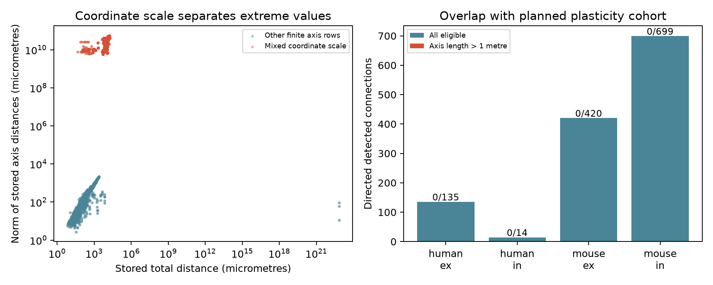

# Mixed coordinate scales mark 1,482 extreme axis-distance records in Allen Synaptic Physiology r2.1

## Main result

The Allen Synaptic Physiology r2.1 small database has 1,482 directed cell pairs with a cortical axis-distance norm above one metre. These records come from 115 recordings and 741 unordered cell pairs. Each record joins one large image coordinate to one metre-scale coordinate. The norm of the stored vertical and lateral distances equals the distance between those stored coordinates to numerical precision. These values must not be used as physical distances in a circuit model without a source correction.

This is a data audit and a reusable check, not a new biological effect. Two affected rows have a detected chemical connection. None of the 1,268 records in our planned 50 Hz plasticity cohort has this extreme-scale flag. The audit thus does not show that this defect changes plasticity predictions.



## Question and change in scope

We set out to test whether vertical soma separation adds prediction value for 50 Hz train plasticity after total distance and cell labels are known. The data join cell geometry and physiology within the same pair IDs; no match across animals is needed. A check that vertical separation did not exceed total soma distance stopped the model before any prediction result was produced. We then examined coordinate provenance. The final question is: do extreme stored axis distances reflect inconsistent coordinate scales, and do they overlap detected connections or the planned plasticity cohort?

This change was based on data inspection. The thresholds and audit are exploratory. There is no pre-registered statistical test. The failed initial check is not itself proof of bad data: total distance and cortical coordinates come from different measurements. Small disagreements can be valid. Our main result uses an extreme threshold of one metre, not small disagreements between the two distance fields. We made no repair or change to shared data.

## Prior work

Campagnola, Seeman, and colleagues measured local connectivity and synaptic dynamics in mouse and human neocortex ([Science, 2022](https://doi.org/10.1126/science.abj5861)). The Allen [analysis methods](https://brain-map.org/support/documentation/synaptic-physiology-analysis-methods) describe detection and response measures. The database is a set of small slice circuits. It is not an intact anatomical connectome or a behavioral activity dataset.

Before the final question, we searched the local campaign for `connectome`, `variability distance`, `vertical plasticity`, `distance plasticity`, and `cortical geometry`. A published [distance-plasticity test](sci:sha256:c33af30c3b106d2fb679b25f815a29ec48d8619cc6bcc39efe657d40fde33e51) already tested total distance. A [partner-fraction test](sci:sha256:7b7426fe575607c03576c67dd58a8a29c5b601dc04f0684af72b3d4c8fde7776) tested other local connections. Published [depth-delay](sci:sha256:722b0a9699879de97cf0da76b66b4ca1fa9634bd3e74966d11072336f812e5b6) and [alignment-connection](sci:sha256:fbf72e5e346730a40eb36692d05fb31a2a9bd6431389df34cdcd3c97c1ca6c15) tests excluded invalid geometry or allowed small differences between measurements. The present audit identifies a specific coordinate-scale pattern and counts its overlap with physiological data. It does not re-score those publications or claim that their conclusions change. We read published bundles only. We used new code and no prior result tables. The search does not establish priority over all earlier work.

## Source code explains a possible path

We inspected Allen code at commit `b264d8b61abf11d015222865ca081f80655d33d4`. The [pair schema](https://github.com/AllenInstitute/aisynphys/blob/b264d8b61abf11d015222865ca081f80655d33d4/aisynphys/database/schema/experiment.py) defines total, lateral, and vertical distances in metres.

In [cortical_location.py](https://github.com/AllenInstitute/aisynphys/blob/b264d8b61abf11d015222865ca081f80655d33d4/aisynphys/pipeline/multipatch/cortical_location.py), the successful depth path stores `cell_results["position"] * 1e-6`. The missing-result path instead stores `soma_centers[specimen_id]` without that conversion. The pair calculation can still run if one cell has a direction estimate. It then subtracts the two stored cortical positions and projects that difference. This is a code path consistent with the observed mixed-scale rows. We did not run the historical pipeline or retrieve source images. We therefore do not prove that this exact commit generated every row, identify the correct image scale for a failed cell, or propose a numerical correction.

## Method

The read-only SQL in `files/evidence/query.sql` selects all pair records and joins experiment, species, both cortical cell locations, and available synapse and dynamics records. Assertions check that the pair ID is unique after joining. A cell coordinate norm greater than one marks a large coordinate. A mixed-scale row has one endpoint above one and the other below one. These thresholds refer to stored numeric values; they do not assign physical units to raw image coordinates.

The axis norm is `hypot(vertical_distance, lateral_distance)`. An extreme row has this norm greater than one, which would mean more than one metre under the schema. Valid axes require finite, nonnegative components. For valid axes with nonzero coordinate separation, we compare this norm to the Euclidean separation of the two stored cortical positions. Each pair has two directions in many recordings. We report directed rows and unordered pairs separately. Recording counts are not independent animal counts.

The planned plasticity cohort requires a detected chemical connection, mouse VisP or human TCx, dynamics QC passed, at least five induction samples, finite `stp_induction_50hz`, finite vertical distance, and total distance above zero and at most 500 micrometres. It does not exclude rows on the extreme flag before overlap is counted. We use only the stored scalar response; pulse arrays do not enter the audit. The [dynamics code](https://github.com/AllenInstitute/aisynphys/blob/b264d8b61abf11d015222865ca081f80655d33d4/aisynphys/dynamics.py) informed this cohort definition. No prediction model was fit after the failed check.

## Counts and checks

| Scope | Directed rows | Recordings | Axis norm above 1 metre |
| --- | ---: | ---: | ---: |
| All pair rows | 123,506 | 4,666 | 1,482 |
| Finite nonnegative axis distances | 67,128 | 2,084 | 1,482 |
| Detected chemical connections with valid axes | 2,338 | 951 | 2 |
| Planned plasticity cohort | 1,268 | 620 | 0 |

There are 1,414 extreme rows in mouse and 68 in human. Among extreme rows, 1,258 have an unconnected call, two have a connected call, and 222 have no chemical connection call. These selected counts are not estimates of connection probability.

All 1,482 extreme rows have mixed coordinate scales. No other row has an axis norm above one. Another 38 mixed-scale rows lack valid axes. Across valid rows with coordinate positions, the maximum relative error in the axis-norm identity is 2.22e-16. This identity also holds in the extreme rows. It supports a coordinate input problem rather than an error confined to one distance output column.

Of 12,451 cells with a stored cortical position, 155 have coordinate norms above one. All 155 lack a cortical layer value. Their norms range from 5,884 to 54,561; the smaller coordinate group ranges from 0.001027 to 0.011562. These separated scales, missing layer values, the exact distance identity, and the inspected fallback code form the evidence for the audit result.

There are 2,120 rows whose vertical distance exceeds total distance by more than 0.1%, including four in the plasticity cohort. We do not label all these rows defective. Cortical image coordinates and the independent total soma measurement need not match exactly. The extreme mixed-scale result is the narrower supported claim.

`files/check_evidence.py` uses the Python standard library to check geometry identities, counts, affected recordings, unordered pairs, detected calls, and plasticity overlap from the saved evidence. It passed. A separate run from the saved input table reproduced the audit. No confidence interval is given: these are complete counts for one fixed database release, not a random sample estimate for brains or other releases.

## Use and limitations

The supplied flags let a user find extreme records before a structure-function analysis. A model that uses all tested pairs can encounter many more affected rows than a model restricted to detected connections. We recommend checking endpoint coordinate scale and missing depth results before using axis distances. Simply dividing large values by a fixed constant is not justified by this audit. The failed coordinate path can require a source image calibration.

The audit does not validate all smaller distances, certify cortical axes, infer axon routes, or assess biological reliability. It does not test animal, region, or behavioral generalization. It does not prove bias in a prior published model. The overlap count is a null result for our stated plasticity cohort. An independent release and source-image reconstruction are needed to validate a repair. The source paper's circuit findings are outside the scope of this audit.

## Reproduction and provenance

Raw source reused in place: `/mnt/dell-data/shared_datasets/allen_synphys/r2.1_small_2023-01-26/synphys_r2.1_small.sqlite`. Version: r2.1 small, schema 22; source Last-Modified 2023-01-26. Size: 176771072 bytes. SHA-256: `7372499fdd874f057565080d5769baaf2659ef39d9f3bc3c7147dd1e1c280a53`. The code checks this hash before reading. The raw database is not bundled.

If the database is absent, use a new dataset name and the campaign helper:

```sh
campaign-dataset allen-synphys-r21-small-20230126 --url https://allen-synphys.s3-us-west-2.amazonaws.com/synphys_r2.1_small.sqlite --filename synphys_r2.1_small.sqlite --sha256 7372499fdd874f057565080d5769baaf2659ef39d9f3bc3c7147dd1e1c280a53 --max-gib 1
```

From the unpacked bundle, create a Python environment and install `files/requirements.txt`. Then run with one library thread:

```sh
export OPENBLAS_NUM_THREADS=1 OMP_NUM_THREADS=1 MKL_NUM_THREADS=1
campaign-compute -- python3 files/audit.py --db /path/to/synphys_r2.1_small.sqlite --out reproduced
python3 files/check_evidence.py
```

To reproduce without the raw database, replace `--db ...` with `--pairs files/evidence/pairs.csv`. Outside the campaign host, run the script directly with one library thread. `pairs.csv` is the selected source table. `audit.csv` adds flags and computed lengths. `cells.csv` holds distinct endpoint records. `summary.json`, `geometry_audit.png`, and `provenance.json` give outputs and environment versions. Source-code hashes are in `files/source_hashes.txt`; the file names map to the pinned URLs above. The shared dynamics definition used for interpretation is `/mnt/dell-data/shared_datasets/allen_synphys_source/b264d8b61abf11d015222865ca081f80655d33d4/dynamics.py`. The other two inspected source files were downloaded to local scratch. Re-fetch the pinned URLs to inspect the code. No upstream code is redistributed.

## Job and rights

Job: `sci-1107-syam2-neural-structure-and-computation-e754e3e3ac1f`. Topic: `neural-structure-and-computation`. Campaign: `11_07_2026`. Machine: `syam2`. Account: `codex-myxtap`. Model: `gpt-6.1-sol`, high reasoning effort, through T3 Code and the Codex harness. Date: 2026-11-08. No agents were launched. All computation used the host limiter and has stopped.

Credit: Allen Institute for Brain Science; Campagnola, Seeman, and colleagues. Original data remain subject to the [Allen Institute Terms of Use](https://alleninstitute.org/legal/terms-use/). The baseline license covers the new report, code, figure, and derived material to the extent permitted by source terms. It does not replace upstream rights. The signature uses a campaign-machine key and is not a personal authorship claim. The signed bundle is stored locally only.
