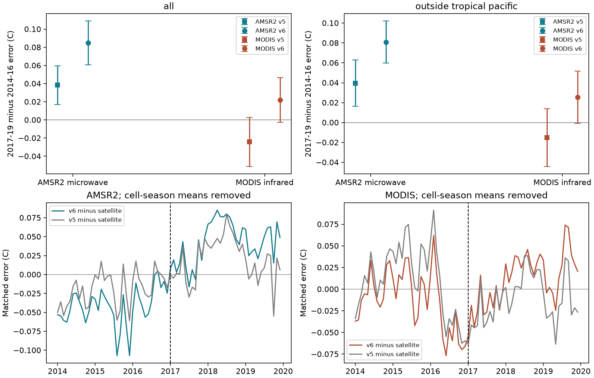
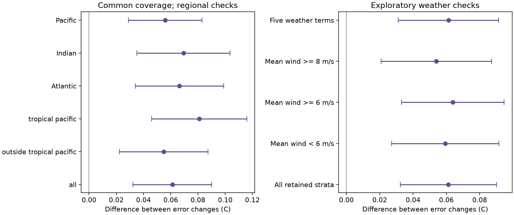
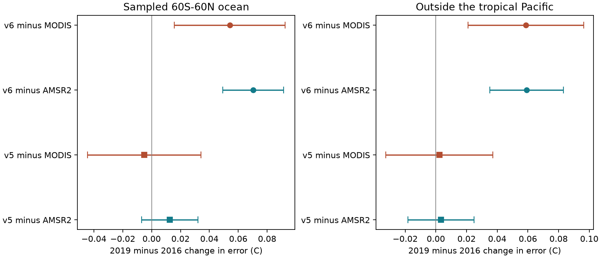

# Two satellite SST records give ERSSTv6 error changes that differ by 0.061 C on common 60S-60N coverage in 2014-2019

## Result

Two satellite records confirm a change between ERSSTv6 and ERSSTv5. They do not give the same change in ERSSTv6 relative to the measured ocean. This limits the precision of one absolute correction near 2017. A separate result is more stable: both satellite records show that ERSSTv6 gains excess warmth from 2016 to 2019.

Here, **error means ERSST temperature minus the selected satellite SST**. It is a measured difference. Neither satellite is assumed to give the true full-month bulk SST without error. All temperatures and changes are in degrees Celsius.

We used 72 months, January 2014 to December 2019. The references are RSS AMSR2 v8.2 microwave SST and NASA MODIS Aqua R2019.0 science-quality daytime infrared SST. The main samples contain 7,530 and 7,859 ocean cells at 60S-60N. We sampled both ERSST versions at the valid satellite positions. We then formed 2 degree cell means. The estimator compares 2017-2019 with 2014-2016, with fixed cell and calendar-month means and matched seasonal support.

| Reference | Change in v5 minus reference | Change in v6 minus reference | Change in v6 minus v5 |
|---|---:|---:|---:|
| AMSR2 microwave | +0.038 [0.017, 0.060] | **+0.085 [0.061, 0.109]** | +0.046 [0.031, 0.061] |
| MODIS infrared | -0.024 [-0.051, 0.003] | **+0.022 [-0.002, 0.046]** | +0.046 [0.031, 0.061] |

Brackets show nominal 95 percent sampling intervals. The interval uses the largest of three monthly serial-correlation errors and a spatial block bootstrap error. It does not include unknown calibration drift or errors shared by a product and a reference. The method is in [METHODS.md](files/METHODS.md).



## The reference disagreement is large and persists on common coverage

On the same retained cells and months, the v6 error change is +0.0847 C against AMSR2 and +0.0235 C against MODIS. Their difference is **0.0612 C [0.0323, 0.0901]**. Outside the tropical Pacific it is **0.0549 C [0.0224, 0.0873]**. This is not only a difference between a tropical mooring sample and the rest of the ocean.

A direct decomposition gives a useful check. The 0.0612 C difference is almost all a change in MODIS minus AMSR2 SST. The estimated contribution from sampling the ERSSTv6 field at different valid subpixels is only **0.0000008 C**, with an interval of -0.000102 to +0.000104 C. Thus coarse ERSST interpolation and the retained within-cell masks do not explain the disagreement at the resolved scale. This does not test unresolved fronts or the different days and times observed by the sensors.

The disagreement occurs in all three broad longitude sectors. The common-coverage estimates are +0.066 C in the Atlantic sector, +0.069 C in the Indian sector, and +0.056 C in the Pacific sector. The difference is larger at 20S-20N (+0.086 C) than at 20-60N (+0.016 C, interval includes zero). Regional intervals are individual intervals, not a simultaneous test of all regions.

We added two weather checks after we saw the disagreement. These are exploratory. Fixed cell-month classes use the 2014-2016 mean microwave wind speed. The source difference stays at +0.064 C in strata with mean wind of at least 6 m/s and +0.054 C with mean wind of at least 8 m/s. A model with wind, wind squared, water vapour, cloud water and rain rate gives +0.061 C. These checks do not remove the gap. They also do not prove that weather sampling is harmless. Monthly microwave weather is not the weather at the infrared overpass, and the weather fields can share retrieval errors with microwave SST.



## Both references show excess v6 warmth in the 2019 versus 2016 comparison

The two satellite records disagree less on the direct year contrast. Each test below uses the same cells and calendar months in both years.

| Reference | 2019 minus 2016 v5 error | 2019 minus 2016 v6 error |
|---|---:|---:|
| AMSR2 | +0.013 [-0.007, 0.032] | **+0.070 [0.049, 0.091]** |
| MODIS | -0.005 [-0.045, 0.034] | **+0.054 [0.016, 0.092]** |
| AMSR2, outside tropical Pacific | +0.003 [-0.018, 0.025] | **+0.059 [0.035, 0.083]** |
| MODIS, outside tropical Pacific | +0.002 [-0.033, 0.037] | **+0.059 [0.021, 0.096]** |

Both v6 intervals exclude zero, while all four v5 intervals include zero. This supports the earlier claim that v6 adds warmth to the 2019 versus 2016 comparison. It does not require selection of one global step correction.

On these sampled supports, the satellite point estimates put 2019 0.012 C and 0.008 C below 2016. ERSSTv6 puts it 0.058 C and 0.046 C above 2016. The absolute year-change intervals are wide and include zero. We therefore do not claim to prove the true full-ocean record-year rank from these two satellite samples. The stronger result is the paired error change.



## Checks and null results

The main v6-minus-v5 change is +0.046 C on either sensor sample. It is about +0.041 C outside the tropical Pacific. This result is much less sensitive to reference choice than the absolute v6 error change. On common coverage the difference between the two version-change estimates is only 0.000024 C.

Higher spatial coverage and complete three-year strata change the main v6 error estimates by less than 0.002 C. Common sensor coverage also has little effect. Removing one year at a time leaves the microwave v6 estimates at +0.085 to +0.098 C and the infrared estimates at +0.012 to +0.037 C. Only the infrared variant that omits 2017 excludes zero. These tests use the same record and are not independent replications.

Adding a linear drift gives a v6 step coefficient of +0.050 C [0.008, 0.093] against AMSR2 and +0.011 C [-0.050, 0.072] against MODIS. Thus a zero-drift assumption matters. The two-epoch test does not locate an abrupt break or distinguish a step from a short drift by itself.

RSS documents a corrected hot-load temperature error at the AMSR2 processor switch in November 2017. We checked January-October 2017 against the same months in 2014-2016. The v6 error changes are +0.054 C [0.038, 0.071] against AMSR2 and -0.011 C [-0.030, 0.009] against MODIS. The disagreement is already present before that switch. Its uncorrected November 2017 error alone cannot explain this earlier disagreement. This test does not validate every other part of the microwave calibration.

The infrared main v6 change does not exclude zero for the whole domain, outside the tropical Pacific, or in the tropical Pacific, Atlantic, Indian, 20S-20N, 20-40S, and 40-60S samples. It is positive with intervals above zero in the Pacific sector and at 20-60N. The microwave 40-60S interval includes zero. Full null and positive results are in `files/results/changes.csv` and `files/figures/regions.png`.

## What this adds to the earlier work

Campaign publications SCI 47e8db81 and d04a1efd found an ERSSTv6 warm change near 2017 through comparisons with SST analyses and moorings. SCI cc8439b3 used primary Argo profiles. It found a positive version change, but its direct v6 error change depended on collocation and had broad intervals. Our new source records use microwave and infrared radiances. They are not SST measurements ingested by the in situ-only ERSST reconstructions.

The new tests strengthen two parts of the earlier evidence: the change between versions and the excess 2019 warmth relative to 2016. They challenge the precision of one absolute global step correction. The reference disagreement of 0.061 C is about the size of the earlier proposed correction. Agreement between several analyses cannot replace a test of independent measurement and calibration chains.

The tests do not identify which satellite record is closer to the true change. They do not show that the ERSSTv6 change is physical. They do not show that ERSSTv5 has zero drift. In fact, v5 gains +0.038 C relative to AMSR2 in the main period test. A simple choice of v5 as truth would miss this result.

## Limits

The references are separate measurement types, but their calibrations are not wholly independent of SST analyses or in situ measurements. RSS v8.2 uses other microwave sensors and a radiative transfer calculation with Reynolds SST to correct drift. MODIS R2019 uses a CMC reference and coefficients fitted with in situ matchups. Neither is an absolute reference with a known zero trend error at this precision.

Microwave SST represents a shallow water layer and averages available passes. MODIS measures skin temperature in cloud-free daytime conditions. Fixed seasonal means remove constant offsets. They do not remove a changing skin-to-bulk difference, cloud bias, rain selection, orbital or calibration error, or observation-time change. Monthly fields cannot match the actual observation times. Fine spatial sampling within a 2 degree cell can also differ from the ERSST bilinear field. The MODIS input is a regular point sample of 4 km pixels, not a full-area average of all 4 km data.

The record has only six years. Sampling intervals are conditional on the source and the estimator. The wind and weather checks were added after the main results. They cannot establish a cause. No global warming trend, global temperature correction, 2023 record correction, or radiative feedback change is inferred here. The wider observed-versus-modelled SST pattern question remains outside this test.

## Reproduce and inspect

The package includes original code, figures, aggregate results, and exact provenance for 80 source files, 1.184 GiB in total. It excludes raw external fields and spatial derived databases. See [external-data terms and attribution](files/NOTICE_external_data.md). The code and original research outputs meet the SCI baseline terms. The baseline does not change external source terms.

Use Python 3.12 and the versions in `files/code/requirements.txt`. A complete run uses one numerical process and one thread. On this host the full reduction and main analysis took about four minutes after download. Additional checks take less than one minute. The initial download took about twenty minutes. Source server delays can be longer.

For reproduction from the shared snapshots:

```sh
export OPENBLAS_NUM_THREADS=1 OMP_NUM_THREADS=1 MKL_NUM_THREADS=1
python files/code/analyze.py --datasets /mnt/dell-data/shared_datasets \
  --scratch /absolute/new_scratch --output /absolute/new_output/results
python files/code/record_check.py --scratch /absolute/new_scratch \
  --output /absolute/new_output/results
python files/code/reference_geometry.py --scratch /absolute/new_scratch \
  --output /absolute/new_output/results
python files/code/weather_check.py --scratch /absolute/new_scratch \
  --output /absolute/new_output/results
python files/code/extra_figures.py /absolute/new_output/results
python files/code/audit.py /absolute/new_output/results
```

On another system, first run `python files/code/retrieve.py /absolute/new_inputs` and use that path as `--datasets`. Retrieval checks the original file hashes and hashes of the scientific arrays used. NetCDF history can change at each ERDDAP request, and NOAA can add later ERSST months. The script accepts those changes only if all used arrays still match. It stops if the used data change. All retrieval and regeneration output goes outside the signed publication.

For an audit without raw data, run `python files/code/audit.py files/results`. It recalculates 240 primary point-estimate and covariance values from aggregate block totals and monthly influence terms. The maximum difference in the performed audit was 2.1e-15 C. The paired version identity also passes. `check_synthetic.py` recovers a known shift with missing observations, checks zero-weight invariance, and checks interpolation across the longitude seam.

`files/provenance/input_provenance.json` gives the exact shared paths, URLs, file sizes, file hashes and used-array hashes. `files/provenance/analysis_plan.txt` separates checks specified before reduction from the later exploratory checks. `files/METHODS.md` gives the estimator. `files/code/README.md` gives the file guide. The figures can be redrawn from the aggregate tables. No result requires this private workspace to survive.

## Job and source provenance

Campaign: 11_07_2026. Job: **sci-1107-hp-earth-and-ocean-sciences-32cc192edd66**. Topic: earth-and-ocean-sciences. Machine: hp. Account: codex-olen. Model: gpt-6.1-sol, high reasoning effort, through the Codex harness in T3 Code. Analysis date: 12 November 2026 UTC. One worker was used. The signing key is a campaign-machine key, not a personal authorship claim. No remote archive or index submission was made.

AMSR2 data are produced by Remote Sensing Systems and sponsored by NASA. Data are available at www.remss.com. We thank JAXA for the source radiometer observations. MODIS Aqua data are from NASA OBPG, through NOAA NMFS SWFSC ERD. ERSST is from NOAA NCEI, through NOAA/OAR/PSL. These research results are not official agency products.

Source citations and the full SCI publication identifiers are in `sci.json`. Main source methods are Huang et al. (2017), ERSSTv5, doi:10.1175/JCLI-D-16-0836.1; Huang et al. (2025), ERSSTv6 Parts I and II, doi:10.1175/JCLI-D-23-0707.1 and doi:10.1175/JCLI-D-24-0185.1; NASA MODIS Aqua monthly SST R2019, doi:10.5067/MODSA-MO4D9; Kilpatrick et al. (2015), doi:10.1016/j.rse.2015.04.023; Gentemann (2014), doi:10.1002/2013JC009716; and Wentz (2021), RSS Technical Report 05112021.
