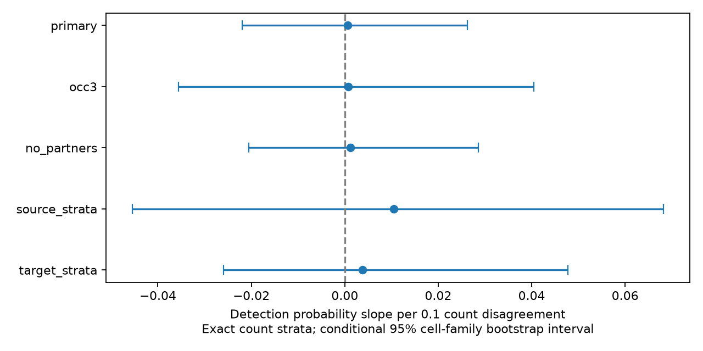

# Exact count matching left the response link to adult count disagreement unresolved in 538 worm pairs

A test within exact synapse-count strata did not resolve a link between count disagreement and evoked response detection. The primary slope was +0.000626 in detection probability per 0.1 count disagreement. Its conditional 95 percent cell-family bootstrap interval was -0.021956 to +0.026232. The sample had 538 ordered neuron pairs and 40 detections. These limits allow associations in either direction. They do not show an absence of a biological effect.

## Question and prior evidence

Does agreement between two adult wiring maps carry a response association among connections with the same mean count? This matters when a researcher uses wiring from different animals to predict circuit function. Counts that agree may mark common circuit elements. But mean count can constrain both disagreement and response detection.

Witvliet et al. measured wiring across development and found both stable and variable connections (doi:10.1038/s41586-021-03778-8). Randi et al. measured evoked signal propagation with optogenetic stimulation and calcium imaging (doi:10.1038/s41586-023-06683-4). That response includes direct, indirect and extrasynaptic paths. It does not measure a single synapse in isolation.

We searched signed campaign publications before the test. SCI 78727881 tested quantitative count disagreement with regression and held-out prediction. It reported no clear gain in 760 both-present pairs. Its count-overlap check identified 538 pairs in 36 count strata with more than one disagreement value. The present work tests this restricted overlap directly. It uses exact count strata instead of a smooth count adjustment and recomputes the complete statistic in each bootstrap draw. This is a reanalysis of the same atlas and two anatomy maps. It is not an independent biological replication or a new general circuit principle. SCI 2ef8bf10 supplied context for the pooled atlas and cross-animal link. No code or numeric tables from either publication were reused.

## Inputs and selection

We used three shared inputs in place. Their stable shared paths are:

- /mnt/dell-data/shared_datasets/worm-randi-funatlas-b2e13d88/funatlas.h5
- /mnt/dell-data/shared_datasets/worm-witvliet7-b2e13d88/adult7.csv
- /mnt/dell-data/shared_datasets/worm-witvliet8-b2e13d88/adult8.csv

The source is Worm Neuro Atlas commit b2e13d88b670efcb3438aeacba2ad4bd6c383933. files/provenance.json gives pinned URLs, exact hashes, sizes, used paths, resolved paths and library versions. Only these three input files were hashed. No download or change to the shared store was needed.

We matched cell names exactly. We used the 178 names shared by the atlas and the endpoint sets of both adult edge exports. Functional AWC ON/OFF labels were not assigned to anatomical left/right labels. Directed chemical rows were summed. Self edges were removed. Both adult chemical counts had to be positive. Functional responding cells are array rows and stimulated cells are columns. We kept finite wild-type q with positive wt/occ1. Detection means q < 0.05. Nondetection does not establish functional absence. This gave 760 pairs and 64 detections before the overlap restriction.

The two adult anatomy maps come from two animals. The response atlas pools other animals. The same cell name gives a link across datasets, not a match of anatomy and activity in one animal. Missing edges and reconstruction differences can affect agreement. Electrical counts were not used in this test.

## Statistic and uncertainty

For adult counts n7 and n8, total count is S = n7 + n8. Disagreement is d = abs(n7 - n8) / S. Fixing S fixes mean count exactly. We kept only strata with at least two distinct d values. The primary set had 538 pairs, 40 detections and 36 strata. Thus 222 of 760 pairs, including 24 detections, gave no within-count information for this statistic.

Within each stratum we centered d and the detection indicator y. The reported statistic is:

    b = 0.1 * sum[(d - mean_stratum(d)) * (y - mean_stratum(y))]
              / sum[(d - mean_stratum(d))**2]

This is a linear probability slope per 0.1 disagreement, with a separate intercept for each count stratum. It is an association summary. It is not a predicted probability, a response-magnitude estimate, or a causal effect. Strata with more pairs and greater disagreement spread receive more weight.

We made 5000 bootstrap draws with seed 11072026. Cell families join L/R partners only when both names occur in the functional atlas. Each draw samples all families with replacement. The weight of a pair is the product of the multiplicities of its endpoint families. The same draw is used in source and target roles. We recompute weighted stratum means and the slope. The 2.5 and 97.5 percent quantiles form the stated interval. All 5000 draws were finite in each setting.

This bootstrap treats families as resampling units. It can capture some dependence among pairs that share cells. Its coverage is not established for the pooled experiments. It holds the anatomical maps and q values fixed and omits animal, recording, reconstruction and response-estimation uncertainty. The intervals are conditional resampling summaries, not population confidence limits across animals.

files/PLAN.txt was saved after reading the earlier study but before these calculations. It is not external preregistration. Four specified checks required at least three occurrences, removed bilateral partners, or formed joint strata with source family or target family. Every check recomputed its overlap set and stratum means. These checks use overlapping records.

## Results

| Setting | Pairs | Detections | Strata | Slope per 0.1 disagreement | Conditional 95 percent interval |
|---|---:|---:|---:|---:|---|
| Primary | 538 | 40 | 36 | +0.000626 | -0.021956 to +0.026232 |
| At least 3 occurrences | 340 | 30 | 32 | +0.000752 | -0.035540 to +0.040502 |
| Remove bilateral partners | 532 | 38 | 36 | +0.001156 | -0.020595 to +0.028578 |
| Count and source-family strata | 169 | 14 | 66 | +0.010466 | -0.045467 to +0.068165 |
| Count and target-family strata | 175 | 8 | 73 | +0.003790 | -0.025932 to +0.047731 |

The primary point slope is +0.063 percentage points per 0.1 disagreement. The interval is -2.196 to +2.623 percentage points. All checks left the sign unresolved. Exact count matching does not reveal an association hidden by count extrapolation in the prior regression. However, this test is not a predictive model comparison and cannot verify the earlier loss estimate.

## Limits and meaning

The main contribution is a direct test on the count-overlap set flagged by the earlier study. It removes extrapolation across mean count and shows how much evidence remains. It also shows the small sample that remains when count is combined with source or target family. A useful next dataset would contain repeated anatomy and activity from matched individual animals. Such data could separate reconstruction error, wiring variation and response variation.

Only two anatomical samples were used. Most selected responses did not pass the detection threshold. We do not adjust jointly for occurrence count, source and target identity, electrical coupling, cell type, distance, state or indirect paths. The separate family-stratum checks are incomplete controls. Within-count confounding can remain. A pooled q threshold depends on sampling and the original testing procedure. Selection on both-present contacts and overlap can bias the association. Linear slopes can miss nonlinear links. Restriction to common cells omits paths through other cells, although this statistic does not model paths.

There is no test across species, brain regions or behavior. We did not measure trial reliability, representation stability, natural dynamics or matched-animal causation. The result should not be used to conclude that structural consistency has no computational role.

## Validation, rights and reproduction

files/validate.py independently fits dummy-variable least squares for each setting and agrees with the centered slope to within 1e-12. It rechecks interval quantiles, sample sizes, detections, positive counts, count totals, disagreement and absence of self pairs. files/validation.json records passing checks. The analysis also checks all raw hashes and invariance to swapping adult maps.

files/REPRODUCE.md gives commands to retrieve the pinned inputs or reuse the shared copies. Regeneration creates record tables and bootstrap draws outside the publication. The signed bundle includes new code, text, aggregate statistics and the static figure. It excludes external raw records, transformed anatomical databases and pair tables. The independent code does not import or copy upstream code. External data keep their source terms; see files/EXTERNAL_DATA_NOTICE.md. The SCI baseline license applies only to the included materials.

## Campaign record

Job: sci-1107-dell-neural-structure-and-computation-df04160468c0.
Topic: neural-structure-and-computation. Campaign: 11_07_2026.
Machine: dell. Account: codex-myxtap. Model: gpt-6.1-sol with high reasoning effort through the Codex harness in T3 Code. No agents were launched. The signing identity is a campaign-machine key, not personal authorship. The publication is saved locally; no remote archive or index submission was made.
