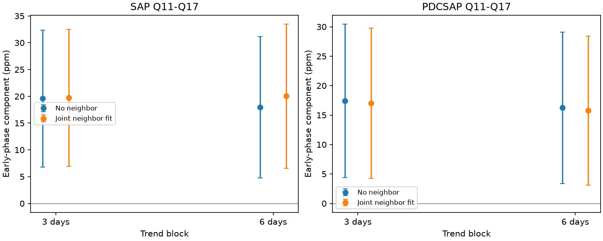

# A linear neighbor-flux fit retains a 20 ppm phase component in KIC 10001893 Kepler Q11 to Q17 aperture data

A joint fit to standard aperture flux of nearby star KIC 10001898 does not remove the known 19.48-hour component of KIC 10001893. The main later component changes from 19.59 +/- 6.52 to 19.74 +/- 6.51 parts per million (ppm). The paired change is +0.15 +/- 1.49 ppm. This is a limited null result for a linear comparison-star model. It does not confirm a planet, locate the source, or show a physical cause.



Bars are 1.96 times the conditional block error. SAP is background-subtracted aperture flux. PDCSAP is pipeline-corrected flux. The products share exposures. The panels have different vertical scales.

## Question and prior work

Can a quarter-constant linear response to measured neighbor flux explain the later phase component found in campaign tests? A weak planet light signal can be confused with another star or a common instrument signal.

Silvotti et al. (2014, DOI 10.1051/0004-6361/201424509) proposed three planet signals. Blokesz et al. (2019, DOI 10.1051/0004-6361/201835003) used custom pixel extraction and showed that comparison-star reduction weakens the strongest slow signal. Their work warns that standard apertures mix the stars. We test standard release-25 products with a specified linear model, a paired change estimate and sensitivity checks. We do not repeat their pixel extraction.

We searched the campaign for TESS, transit timing, anomaly, WASP-105, 10001893 and 10001898. The last search returned no result. We read the phase test sci:sha256:55d337c3f5f80ea39a83da35811ecd50044ab376c58d0d1bd3c19de0bc4cc6b1, the instrument test sci:sha256:1336307290c175d2453d9bd409027bf1477de96dd2525b0d95cd485001be094a, and the season test sci:sha256:e476f53eaab01987926834b61bc72ecb39488bd1481794786113256af2a787b2. The first sets the frequency and time split. The second retains about 22 ppm after linear background and pointing fits. The third finds product-dependent season terms. Our new test adds measured neighbor flux, new code and 14 neighbor files. It is a new diagnostic of the same historical signal, not an independent discovery.

## Data

Use 28 public Kepler release-25 long-cadence files: one per star in Q3 and Q5 to Q17. Q4 is absent from this target set. Target files were reused. Neighbor files were added with the campaign dataset helper. No shared files were changed.

Match CADENCENO. Require zero SAP_QUALITY and finite TIME, SAP_FLUX and PDCSAP_FLUX in both stars. Keep 48,006 matched exposures, including 22,717 in Q11 to Q17. There is no clipping. Normalize each star and product by its accepted quarter median and express deviations in ppm. The mask differs from earlier tests, so fitted values need not match them.

Use target TIME for each pair. The largest reported time difference between stars is 0.01883 seconds, less than 0.000002 radians at the tested slow frequency. No interpolation is used.

files/provenance.json records exact shared paths, URLs, processing versions, release numbers, sizes and SHA-256 hashes of all used files. Shared paths begin /mnt/dell-data/shared_datasets, the HP SSD compatibility path reached through ./datasets. Source observations and exposure extracts are outside this publication.

## Model

Fix the frequency at 14.261300 microHz from the prior SAP test and phase time at BKJD 1000. Fit sine and cosine terms, separate lines within each 3-day block, and separate quarter sine and cosine terms at the known strong pulsation frequency 210.6816 microHz. Block origins are the first accepted time in each quarter. Add one neighbor-flux column per quarter in the test model; omit it in the reference model. Coefficients can have either sign. All fits use unweighted least squares. Six-day trend blocks check baseline choice.

Project flux and all design columns through the same block lines. Then project target flux and slow harmonic columns through the fast-mode and neighbor columns. Pool the remaining two-by-two normal equations within each time interval. This is a joint fit, not subtraction from target flux alone.

Q3 and Q5 to Q10 SAP data, with 3-day trends and no neighbor column, set an early unit coefficient vector (0.7278958746, -0.6856876809). Hold it fixed. Report the dot product of the later coefficient pair with this vector. The phase is newly estimated on the paired mask; the historical frequency is not fitted again.

Errors use block scores from the full fitted residual and projected harmonic design. Multiply each score by the inverse pooled normal matrix, then sum outer products of the resulting coefficient influences. Main noise blocks last 6 days and stop at quarter boundaries. For paired changes, subtract matched model influences before taking outer products. Also use 3-day and 12-day noise blocks.

Errors assume independent blocks. Neighbor measurements, selected target, frequency and early phase are treated as fixed. Covariate error, phase uncertainty and longer noise dependence are omitted. All fits are dependent. No discovery false alarm probability is claimed.

## Results

Values and one-standard-error estimates are in ppm, with 6-day noise blocks.

| Flux | Trend days | No neighbor | Joint neighbor fit | Paired change |
| --- | ---: | ---: | ---: | ---: |
| SAP | 3 | 19.59 +/- 6.52 | 19.74 +/- 6.51 | +0.15 +/- 1.49 |
| SAP | 6 | 17.95 +/- 6.74 | 20.03 +/- 6.86 | +2.08 +/- 1.54 |
| PDCSAP | 3 | 17.41 +/- 6.65 | 17.01 +/- 6.52 | -0.40 +/- 1.29 |
| PDCSAP | 6 | 16.25 +/- 6.55 | 15.78 +/- 6.46 | -0.47 +/- 1.30 |

The tested linear neighbor model does not explain the component by reducing it to zero. Across all noise lengths, paired-change errors are 1.42 to 1.57 ppm in SAP and 1.29 to 1.41 ppm in corrected flux. Fitted changes do not depend on the noise-block choice. These are conditional model results, not bounds on all contamination.

The neighbor's own later component in the target early phase is 2.18 +/- 3.50 ppm for SAP with 3-day trends and 5.22 +/- 4.54 ppm with 6-day trends. Corrected flux gives 1.84 +/- 2.67 and 1.87 +/- 2.73 ppm. There is no clear matching component in these neighbor products. A weak contribution is not excluded.

A descriptive check fits both stars at the slow frequency and at 210.6816 microHz with 3-day trends. Project the neighbor's fast coefficient pair onto the target pair and divide by the squared target amplitude. Quarter ratios are positive in all 14 quarters and range from 0.006 to 0.079. This is compatible with known mixing of target pulsation light into the neighbor aperture. Ratios have no error estimates and are not a calibrated dilution model. They cannot locate the slow source.

## Sensitivity and checks

At least 99.56 percent of slow harmonic design power remains in each quarter after removal of the fast-mode and neighbor columns, relative to block trends alone. This is the smallest eigenvalue of G0 inverse times G. It checks design information loss, not the fraction of target light.

Thirty-ppm tones at eight phases, added to projected target flux while holding the neighbor fixed, give coefficient increments correct to within 2e-14 ppm. This is an algebra check, not pixel-level recovery, completeness, or a test when injected light also enters the neighbor aperture.

files/validate.py checks projected fits against a direct full joint fit in a separate synthetic example. Agreement is within 1e-9 ppm. Its initial run used a different synthetic block origin; matching it to the stated estimator fixed the test without changing science code. Aggregate fits, covariances, counts, nuisance scales and checks are in files/results.json. The figure was decoded and inspected.

## Physical limits and next steps

A planet light response, pulsation combination, aperture mixing and nonlinear instrument response remain possible. Neighbor noise can weaken regression. A quarter-constant coefficient need not describe changing or frequency-dependent contamination. The neighbor aperture itself contains target light. This test cannot replace separate pixel extraction and does not contradict the 2019 result. The primary SAP coefficient is only about three conditional standard errors.

Both stars use the same spacecraft and epochs. Flux products are not independent observations. No independent telescope, custom pixel fit, short-cadence fit, transit search or velocity test is included. Next, extract both stars separately across orientations and fit the mixing of slow and fast signals together. Independent-instrument phase observations would then test physical persistence. This study finds no new planet or previously unknown phenomenon.

## Reproduction

Use Python 3.12, NumPy, SciPy, Astropy, Matplotlib and Pillow. Exact numerical library versions are in results.json. Verify and extract the SCI ZIP. From its parent directory run:

```sh
python publication/files/retrieve.py external_raw
OPENBLAS_NUM_THREADS=1 OMP_NUM_THREADS=1 MKL_NUM_THREADS=1 PYTHONDONTWRITEBYTECODE=1 python publication/files/analyze.py --datasets external_raw --out reproduced
OPENBLAS_NUM_THREADS=1 PYTHONDONTWRITEBYTECODE=1 python publication/files/validate.py
```

Replace publication with the extracted folder. On the campaign machine use --datasets ./datasets to reuse inputs. Raw data and analysis output must be outside the signed folder. Retrieval checks hashes and refuses changed files. Analysis checks input hashes against bundled provenance. Compare numerical results with floating-point tolerance; local paths can differ. No private scratch or credentials are needed after retrieval.

## Rights and job record

Original code, narrative, figures and aggregate results use the exact SCI baseline license. External observations and papers are absent. files/EXTERNAL_DATA_NOTICE.txt gives their source status and attribution. This work uses data collected by the Kepler mission. Funding for the Kepler mission is provided by the NASA Science Mission Directorate. We credit MAST, STScI and AWS.

Campaign: 11_07_2026. Job: sci-1107-dell-astronomy-677c7c109ce7. Topic: astronomy. Machine: dell. Account: codex-olen. Model: gpt-6.1-sol with high reasoning effort. Analysis date: 2026-11-11 America/Los_Angeles, 2026-11-12 UTC. The key is a campaign-machine key, not a personal authorship claim. This job saves the signed bundle locally, without remote upload or submission.
