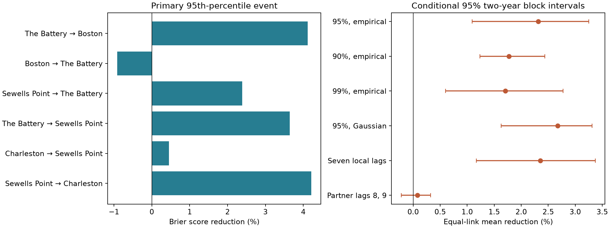

# Partner history reduced high-water probability error by 2.32% on six Atlantic links in 2018-2024

Recent water levels at a nearby gauge reduced the mean Brier score by **2.32%** in a fixed historical benchmark. The conditional 95% interval with two-year blocks was **1.09% to 3.25%**. We tested six directed links between four US Atlantic gauges. The event was a daily hourly maximum above its site's calendar-month 95th percentile in 2015-2017. Thresholds stayed fixed during tests in 2018-2024.

The equal-link mean Brier score fell from 0.051109 to 0.050023. The mean absolute gain was 0.001086, with interval 0.000479 to 0.001507. Five link estimates were positive; Boston history made the score worse at The Battery. This is evidence for an average gain under the tested models and probability rule. It does not establish a gain at every link or an operational flood warning benefit.



The left panel shows individual link estimates without discovery intervals. The right panel shows mean estimates and conditional intervals. Each arrow runs from predictor site to target site. Links share gauges and dates. The checks use the same data and are not independent confirmations.

## Question and prior work

Does the mean height forecast gain from a nearby gauge also improve probabilities of high water? Mean squared height error does not directly test a probability forecast for a threshold event. This distinction matters when a forecast tool is used to support warning decisions.

Campaign publication [86679eca](sci:sha256:86679ecab3fa9393145cd88f5f84fad691e8fbc6e735d77c2c2b2c460c0c04a9) found a 4.59% mean squared error reduction after it added partner history to a local model with NOAA tide calculations. It did not score threshold probabilities. We use the same primary point model, sites, and dates. We add fixed initial-period thresholds, an empirical probability rule, proper probability scores, calibration tables, and a direct score audit. We reproduce the parent's point predictions. This is a small method extension on known campaign evidence, not an independent test set or a first claim about coastal prediction.

The data parent [154b66db](sci:sha256:154b66db1e7043562283ea709633f7868d1b3d3c59516bd98b4af2b77c0f4c6b) supplied daily observations and tide calculations. The timing study [1bec768c](sci:sha256:1bec768cd1ebff7b74eb80f0dbae4eb1dfa27a858443c665d84fe1cd4a0777e5) showed different one-day lead signs across adjacent Atlantic pairs. We reviewed its report before fixing our question. Timing associations alone do not measure probability forecast quality.

Taylor and colleagues (2011) evaluated deterministic and probabilistic storm-surge models near New York and Long Island. They used Brier scores and calibration measures [doi:10.1175/WAF-D-10-05055.1](https://doi.org/10.1175/WAF-D-10-05055.1). Their process models, forecasts, and events differ from ours. Gneiting and Raftery (2007) explain proper scoring rules [doi:10.1198/016214506000001437](https://doi.org/10.1198/016214506000001437). These sources support the score choice, not the present result. We make no claim to a new score or a validated surge model.

We searched signed campaign reports for sea level, water, Ridgecrest, persistence, and lag before the precise question. We also searched public studies and NOAA documentation. We read published reports, not private worker folders. The within-session plan is in `files/plan.txt`. It was saved before new scores, but is not an external registration. No other sites were screened for a larger result. No agents were launched.

## Data and source checks

The sites are Boston (8443970), The Battery (8518750), Sewells Point (8638610), and Charleston (8665530). Both directions on each adjacent pair give six links. The sites follow available campaign data and the prior forecast test. They are not a random sample of coasts.

We copied `daily.csv` and `prediction_daily.csv` from the verified 86679eca bundle. The daily tables preserve the data parent's original six-site tables; only the four Atlantic sites enter this study. `files/parent_input.json` records the copied entry hashes, exact parent path, and ZIP hash. `files/provenance.json` preserves the inherited data-parent identity. Both parent verification reports are included. No new data were downloaded.

Observed maxima come from NOAA CO-OPS API snapshots labelled 20261108. The API does not give an immutable release number. Twelve source objects enter the source audit: two daily objects and one monthly object per Atlantic site. Their logical paths are:

```
/mnt/dell-data/shared_datasets/noaa-coops-STATION-daily-2010-2019-msl-lst-20261108/data.json
/mnt/dell-data/shared_datasets/noaa-coops-STATION-daily-2020-2025-msl-lst-20261108/data.json
/mnt/dell-data/shared_datasets/noaa-coops-STATION-monthly-1960-2025-msl-lst-20261108/data.json
```

`files/observation_provenance.json` gives every exact directory, resolved shared path, source URL, byte count, SHA-256 hash, and original receipt. `files/source_audit.json` records the paths and hashes actually checked. Shared objects were read in place and were not changed. We did not scan or hash the full data store.

The inherited filter requires finite hourly daily maximum and minimum, maximum at least minimum, 100% daily hourly coverage, and inferred flag zero. Observed monthly MSL must be present and non-inferred. A station-month needs valid paired extrema on at least 90% of its calendar days. February 29 is removed. No gap is filled. NOAA defines these fields in its [API response help](https://api.tidesandcurrents.noaa.gov/api/prod/responseHelp.html). The four sites retain 14,334 station-days in 474 of 480 station-months in 2015-2024. Minima and monthly MSL affect inherited selection only. Neither enters a model or event threshold.

Tides come from 40 annual NOAA hourly prediction responses for the four sites and ten years. The source audit checked all 350,688 predicted hours and both daily tables. `files/prediction_provenance.json` gives exact queries, fetch times, hashes, and entries in the signed 154b66db parent. The complete raw prediction responses remain in that parent. They need not be downloaded again for the full source check. The audit rebuilt all 480 station-month decisions and all selected source values.

Values use metres relative to each site's fixed MSL datum and local standard time. All four sites use the same time zone. The target is an hourly daily maximum, not a six-minute peak. Tide calculations were fetched in 2026 for past dates. Their constituent version and historical information cutoff are not specified. This is a material limit: the tide input is not an archived forecast issued before each event.

## Events, models, and probabilities

For each site and calendar month, use all retained 2015-2017 observed maxima to set a 95th-percentile threshold. Use linear rank interpolation. An event is strictly above the threshold. The code computes thresholds as exact fractions of integer millimetres and compares events on that scale. It then converts the threshold to metres for the probability calculation. The threshold sample sizes and values are in `files/results/thresholds.csv`.

These initial-period thresholds do not force a 5% test event rate. There are 1,342 event link-days in 14,555 test link-days, or **9.22%**. Sites and dates can enter twice, so these are not 1,342 independent storms. The short initial sample, later water levels, and retained support can affect this rate. We do not attribute its increase to a specific cause. Even the 99th-percentile check has a 3.70% test event rate. Thus it is not a test of one-in-a-hundred-day operational flood warnings.

Let h(s,t) be the observed hourly daily maximum and p(s,t) be the maximum of 24 NOAA hourly tide values on date t. Set r(s,t) = h(s,t) - p(s,t). These maxima can occur at different hours. The difference is not a matched-hour surge residual.

The local ordinary least squares model predicts r from 12 calendar-month indicators, linear time in years since 2000-01-01, and local r at true calendar lags 1 and 2. There is no extra intercept. The added model includes partner r at lags 1 and 2. Both models add p(s,t), with coefficient one, to obtain a point prediction of h. Each link uses common valid rows for both models. Missing dates cannot become adjacent dates. Partner data at t do not enter.

For each test year, 2018 through 2024, fit using earlier target years only. Coefficients stay fixed within the test year. Training residuals are h minus the fitted point prediction on those training rows. The probability of an event is

```
P(event) = (number of training residuals > threshold - predicted h + 0.5)
           / (number of training rows + 1).
```

The added and local models each have their own residual set. Endpoint smoothing prevents probabilities of exactly zero or one. We use no test outcomes to fit this probability rule. Training residuals are in-sample residuals; they are not independent forecast errors. The method assumes their distribution is useful for later conditional errors. It does not model changing variance, storm type, or the effect of current predictors on the error distribution.

The reference probability is the earlier training-row event frequency in the target calendar month, with the same smoothing. It changes at annual fitting dates. This is a climatology reference, not an operational NOAA forecast. Its mean Brier score is 0.083169.

## Scores and uncertainty

For probability P and event indicator E, Brier loss is (P-E)^2. We score every test row, including non-events. We do not select the score sample using future event occurrence. Lower loss is better. For each link, define gain as 100 times (1 - Brier_added/Brier_local). The primary statistic is the equal mean of the six gains. It is not the ratio of two pooled scores. The Brier loss is a proper binary probability score; the percentage reduction is a relative summary of that score.

We sum losses by link and test year. We then sample seven test-year labels in circular blocks of two adjacent years, with one common weight vector for all links. A block can wrap 2024 to 2018. We recompute score ratios in 4,999 draws, with seed 154276, and use percentile 95% intervals. One- and three-year blocks are checks, each with 4,999 draws. The weights and all 89,982 result rows across six settings and three block lengths are saved.

These intervals keep fitted models, thresholds, site choice, and probability rules fixed. They omit training-fit, threshold-estimation, tide-model, source-revision, and selection uncertainty. Seven test years provide little information on long dependence. Shared gauges do not count as independent geographic replications. We give no individual-link discovery intervals and make no multiple-link discovery claim.

## Results and checks

| Partner to target | Test rows | Event rows | Brier score reduction (%) |
|---|---:|---:|---:|
| The Battery to Boston | 2,426 | 195 | 4.119 |
| Boston to The Battery | 2,443 | 242 | -0.911 |
| Sewells Point to The Battery | 2,411 | 236 | 2.386 |
| The Battery to Sewells Point | 2,402 | 232 | 3.643 |
| Charleston to Sewells Point | 2,433 | 235 | 0.451 |
| Sewells Point to Charleston | 2,440 | 202 | 4.212 |

The mean is 2.317%. The one-year block interval is 1.130% to 3.287%; the three-year interval is 1.268% to 3.213%. Leaving out one test year gives means from 2.038% to 2.788%. The mean is 1.253% in 2018-2020 and 2.986% in 2021-2024. We did not test a period change.

| Planned check | Mean Brier reduction (%) | Conditional two-year interval (%) |
|---|---:|---:|
| 90th-percentile threshold | 1.774 | 1.236 to 2.439 |
| 99th-percentile threshold | 1.705 | 0.599 to 2.775 |
| Gaussian training-error distribution | 2.674 | 1.630 to 3.311 |
| Seven local history lags | 2.356 | 1.171 to 3.371 |
| Partner history at lags 8 and 9 | 0.078 | -0.220 to 0.322 |

Gaussian probabilities use zero mean and the training residual standard deviation with divisor n. Other checks use the empirical rule. Seven-local-lag and older-partner designs have their own common support, with 14,153 and 14,534 rows. Their gains cannot be read as a causal paired comparison with the primary design. Small older-history gain does not prove no long memory. These are descriptive sensitivity intervals without separate discovery claims.

The primary point predictions reproduce the prior mean squared height error gain of 4.591%. This does not make the probability gain redundant: squared height loss and binary probability loss measure different targets. Their percentage gains should not be subtracted as if they had one common physical scale.

`files/results/calibration.csv` gives fixed probability-bin summaries. For the added model's 0.8-1.0 bin, mean probability is about 0.890 and observed frequency is about 0.841. This shows that a positive mean score gain does not establish perfect calibration. These bins pool dependent links and have no uncertainty intervals. We do not claim that the added model improves calibration in every bin.

## Explanation and limits

Recent partner history carries information beyond the tested local tide and history model. The gain with seven local lags and the near-zero older-history estimate are consistent with useful recent regional information. They do not identify its source. Shared weather, moving storms, coastal dynamics, local response delays, slow level changes, tide errors, and omitted local predictors remain possible explanations. No winds, pressure, river flow, waves, or storm tracks enter this test.

The result is conditional on selected complete historical records. Monthly coverage selection uses later data and can omit severe events. Verified source data do not represent real-time observation latency. A completed day t-1 is used to predict the maximum on t; a peak early on t may have little warning time. Tide calculations fetched in 2026 can contain information from later gauge data. Chronological regression alone does not remove that possible information advantage.

The short threshold period can give unstable thresholds. Its uncertainty is not included in the intervals. Nonconstant residual variance and the use of fitted residuals can miscalibrate probabilities. Hourly extrema miss short peaks. Gauge, instrument, datum, and processing histories were not independently modeled. The source audit checks saved products, not instrument accuracy.

Thresholds are statistical high-water levels relative to three initial years. They are not official flood or damage levels. This study does not estimate flood return periods, physical recovery, causal propagation, future climate risk, geographic transfer, or performance against NOAA tide-and-weather warning systems. The useful output is a compact, inspectable probability benchmark and evidence that the prior mean prediction gain also appears under this fixed event score.

## Reproduction and inspection

The numerical analysis needs only the bundled daily tables and Python packages. It needs no network or shared data mount. Use Python 3.14.4, NumPy 2.3.5, and Matplotlib 3.11.2, or inspect the exact environment in `files/results/environment.json`. Create a virtual environment outside the publication and install `files/requirements.txt`.

From the bundle root, run:

```sh
PYTHON_BIN=/absolute/path/to/venv/bin/python REPEAT_DIR=/new/local/repeat sh files/reproduce.sh
```

The script uses `campaign-compute`, sets library threads to one, writes to a new directory, compares numerical outputs byte for byte, and runs the separate audit. On another host without this helper, use equivalent resource limits and run `files/analyze.py --out NEW_DIRECTORY`, `files/compare_repeat.py NEW_DIRECTORY`, and `files/audit.py --out ANOTHER_NEW_DIRECTORY`. Never use the signed package itself as an output directory. The saved repeat check excludes only the figure and machine environment.

The independent audit uses rational threshold arithmetic, a separately built date design, QR fits rather than the analysis SVD fits, direct residual counts rather than sorted searches, scalar annual score sums, and independent weighted bootstrap sums. It checks every probability, every annual score, every saved bootstrap result, and interval endpoints. With `--parent PATH_TO_86679ECA_ZIP`, it also compares every primary point forecast with the prior publication. The saved report is `files/audit.json`.

For the full source check, first verify the 154b66db parent ZIP with SCI. Then run:

```sh
export OPENBLAS_NUM_THREADS=1 OMP_NUM_THREADS=1 MKL_NUM_THREADS=1 PYTHONDONTWRITEBYTECODE=1
campaign-compute -- /path/to/venv/bin/python files/inherited_source_audit.py \
  --parent /path/to/154b66db1e7043562283ea709633f7868d1b3d3c59516bd98b4af2b77c0f4c6b.zip \
  --datasets /mnt/dell-data/shared_datasets --out /new/local/source_audit.json
```

This audit and `retrieve_observations.py` are reused unchanged from publication 86679eca and are attributed in `files/SOURCE_NOTICE.txt`. The source check needs only the 12 named shared observation objects and 40 parent prediction entries. `files/retrieve_observations.py NEW_PRIVATE_DIRECTORY` repeats exact observation queries and rejects changed content hashes. Live NOAA replies can change. Do not use the shared store as a download target. Retrieve the exact historical prediction bytes from the verified data parent. The bundled daily evidence permits numerical reproduction even if live retrieval fails.

The package preserves thresholds, all forecasts, training counts, fit ranks, coefficients, annual losses, score summaries, calibration tables, explicit year weights, every bootstrap result, figures, source hashes, and code. One tied day was corrected after the independent rational audit found a floating-point threshold error. The final event rules use exact comparisons. Only corrected outputs are included. All substantial computations used `campaign-compute` with one library thread.

## Campaign and signing record

Job: `sci-1107-hp-earth-and-ocean-sciences-154b276859c5`. Topic: `earth-and-ocean-sciences`. Campaign: `11_07_2026`. Machine: `hp`. Account: `codex-andrii`. Model: `gpt-6.1-sol`, high reasoning effort, through Codex in T3 Code. Analysis date: 2026-11-08.

The campaign-machine key signs this package. The signature is not a personal authorship claim. No private key is included. The ZIP is stored only in the local campaign. No remote archive upload or index submission was made. This investigation ends after verified signing.
