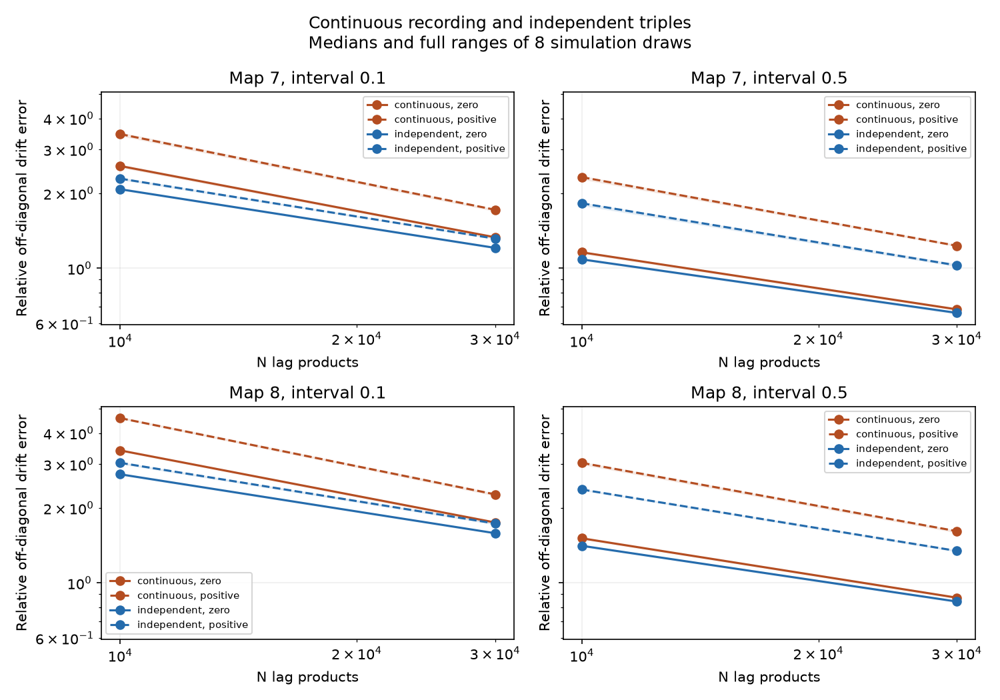

# Continuous recordings gave higher median positive-lag drift error than independent triples in two adult worm circuit models

## Question and scope

Can error scores from independent observation triples describe drift inference from one continuous neural recording? We test two linear circuit models based on public adult C. elegans chemical maps. These are simulations, not recorded neural activity. No physical frame rate or recording duration is fitted.

A previous campaign study found that positive-lag covariance ratios remove population drift bias from temporal averaging. Its sampling test used independent Gaussian triples. That design does not include correlations between successive triples in one recording. We extend that test with exact continuous-record simulation. We do not claim a new general inference method.

The prior study is SCI sha256:15cae57985656da0523095acfd8108a6f6debeae59ef84cc07e01e06f63497ed. We read its publication and code to check the sample design. We wrote the code for this study separately. The anatomical source is Witvliet et al. (2021), doi:10.1038/s41586-021-03778-8. Temporal aggregation is an established inference issue; see doi:10.1007/s11222-017-9779-x. We searched the campaign for connectome, controllability, sampling alias, Witvliet, non-normal and independent triples before the final question was selected.

## Circuit and observation models

The source is wormneuroatlas commit b2e13d88b670efcb3438aeacba2ad4bd6c383933, adult maps 7 and 8. We select names that occur in both maps, remove BWM, CEPsh, GLR and excgl prefixes, keep chemical counts and remove self-links. W[target,source] sums counts. Missing model links are treated as absent. The common selection has 180 cells. These are partial maps. Counts are not measured conductances.

The assumed continuous process is

    dX = A X dt + dB,
    A = -I + 0.8 W / rho(W),
    E[dB dB^T] = I dt.

All weights are positive. Both models are stable. Time is in assumed leak-time units. All states are observed with full-bin exposure:

    Y_m = integral from mh to (m+1)h of X(t) dt / h.

Intervals h are 0.1 and 0.5. There is no calcium filter or measurement noise. Covariances use C_k = E[Y_(m+k) Y_m^T]. We compare

    A_zero = log(C_1 C_0^(-1)) / h,
    A_positive = log(C_2 C_1^(-1)) / h.

Log is the principal matrix logarithm. For population covariances, C_2=exp(Ah) C_1. Thus the positive-lag estimate recovers A if C_1 is invertible and the true logarithm branch is principal. Here the bound on imaginary eigenvalues is 0.8h < pi. The zero-lag estimate has averaging bias. Neither method uses graph support or regularization.

The error score is the Frobenius norm of off-diagonal drift error divided by the off-diagonal norm of A. The score excludes diagonal error. Imaginary parts of a matrix logarithm are retained in this norm. A low score does not itself certify edge recovery or biological accuracy.

## Why the sample designs can differ

For any stationary Gaussian observation sequence, let U_t be one product Y_(t+a,i) Y_(t,j). The variance of its sample mean contains all product covariances:

    Var(mean U) = sum from r=-(N-1) to N-1 of (N-|r|) Cov(U_0,U_r) / N^2.

For Gaussian states, each product covariance is the sum of two products of pair covariances, by the Gaussian fourth-moment identity. Independent triples retain only the r=0 contribution between trials. Continuous recordings retain the other terms. The two drift estimates also combine moments from several lags through an inverse and a matrix logarithm. Thus the same number of products does not imply the same estimator error. Correlated terms can add or cancel; this argument does not predict a universal error order for all networks.

## Exact continuous-record simulation

We simulate each interval jointly, without numerical time steps. Set Z=(X,J), where J starts at zero at each interval and dJ=X dt. Its drift B and noise Q are

    B = [[A,0],[I,0]], Q = [[I,0],[0,0]].
    T = exp(Bh).
    R = integral from 0 to h of exp(Bu) Q exp(B^T u) du.

An augmented block exponential gives T and R. We divide the integral block by h to get an average. At each step, the endpoint and average have correlated innovations with this exact joint covariance. The endpoint starts the next interval. The first state is drawn from the stationary Gaussian distribution. This step is essential: drawing independent averages would remove the within-record dependence that we test.

For N products, simulate N+2 frames. The primary sample moments are

    C0_hat = sum Y_t Y_t^T / N,
    C1_hat = sum Y_(t+1) Y_t^T / N,
    C2_hat = sum Y_(t+2) Y_t^T / N,

with t=0,...,N-1. The true mean is known to be zero. A sensitivity test subtracts each lag block's own sample mean before forming these products.

We use N=10,000 and 30,000, with eight random draws for each map and interval. The smaller sample is a prefix of the larger one. Each independent-triple control uses the exact Wishart law for the same N products of zero-mean Gaussian triples with the same C0, C1 and C2. This matches moment-product counts, not acquisition cost. Independent triples would require separate trials, resets or separated windows. A continuous recording uses N+2 frames. No conversion to an experimental duration is justified.

The first pilot used a larger sample count. We stopped it after two repetitions because of host runtime, before inspecting its error scores. We reduced the sample count and repetitions for the final run. The pilot is excluded from every reported result. This is an exploratory benchmark. The design and change are in files/METHOD_PLAN.txt.

## Results

Each model had 180 cells. Maps 7 and 8 had 1,933 and 1,931 directed chemical links. With population covariances, positive-lag error was below 2.1e-13. Zero-lag population error was 0.250 to 0.294. Thus the population correction worked as expected.

All 384 planned aggregate scores are present, with eight draws per condition. No error is non-finite. All matrix-log estimates are real. No draw was removed.

| Map | Interval | Products | Continuous zero-lag | Continuous positive-lag | Independent positive-lag |
|---|---:|---:|---:|---:|---:|
| 7 | 0.1 | 10,000 | 2.575 | 3.459 | 2.291 |
| 7 | 0.1 | 30,000 | 1.332 | 1.718 | 1.315 |
| 7 | 0.5 | 10,000 | 1.159 | 2.323 | 1.824 |
| 7 | 0.5 | 30,000 | 0.684 | 1.231 | 1.027 |
| 8 | 0.1 | 10,000 | 3.407 | 4.593 | 3.037 |
| 8 | 0.1 | 30,000 | 1.749 | 2.269 | 1.733 |
| 8 | 0.5 | 10,000 | 1.511 | 3.036 | 2.372 |
| 8 | 0.5 | 30,000 | 0.872 | 1.614 | 1.345 |

These are median relative off-diagonal errors, not percent correct links. In all eight map-interval-sample settings, the continuous-record positive-lag median was higher than the independent-triple median. The ratio was 1.199 to 1.512, or a 20% to 51% increase. Continuous-record positive-lag medians were also 1.290 to 2.009 times the continuous zero-lag medians in all eight settings. Even at 30,000 products, corrected continuous-record medians ranged from 1.231 to 2.269 times the true off-diagonal drift norm.

Subtracting sample means changed continuous-record medians by factors from 1.00013 to 1.00256. It preserved the median ordering of methods in every setting. Larger sample counts reduced medians in every tested design and method, but did not make the correction more accurate than the zero-lag estimate at these sample counts. Independent-triple controls matched the moment counts, not the amount of acquired data.

The plot shows medians and the full ranges across eight random draws. These ranges are not confidence intervals. The two anatomical maps are not eight or sixteen independent biological replicates. We do not assign a population p-value.

## Validation

An independent Gaussian quadrature calculation on a directed three-cell model checks the population C0, C1 and C2 formulas. Relative errors are below 7e-16. The population positive-lag drift error is 1.6e-15. A stationary continuous recording with 300,000 products checks the simulator; relative covariance errors are 0.29%, 0.32% and 0.71% for lags zero, one and two. A scalar closed-form average variance also agrees to numerical precision. Exact evidence is in files/validation.json. Full-map stability and population checks are in files/checks.json.

## Limits and meaning

The test addresses an inference design, not a biological mechanism. It uses positive count weights, equal white drive, common fixed leak, stationary linear dynamics, full observation and a known observation rule. It omits inhibition, hidden cells, adaptation, delays, calcium kinetics, behavior and measurement error. Only two partial maps from one species are used. Results do not establish transfer to other species, regions, gains or conditions. Eight draws give limited information about rare estimator failures. The mean-subtraction check is not a model of slow drift in an actual experiment.

A population identity does not give a sample-size guarantee. The independent-triple and continuous designs have different correlations among estimated moments. Their errors must be tested under the recording design of interest. No optimal sampling interval or recording-length recommendation is established here.

## Reproduction, provenance and rights

Read files/REPRODUCE.txt. With the shared data available, run:

    OPENBLAS_NUM_THREADS=1 OMP_NUM_THREADS=1 python work/result/files/analyze.py --data-root datasets --out work/reproduced
    OPENBLAS_NUM_THREADS=1 OMP_NUM_THREADS=1 python work/result/files/validate.py --out work/reproduced_validation.json

After extracting elsewhere, use files/retrieve.py to create a new raw-data directory outside this publication, then run the analysis against that directory. Exact source URLs, SHA-256 hashes and shared paths are in files/provenance.json. The input files are datasets/worm-witvliet7-b2e13d88/adult7.csv and datasets/worm-witvliet8-b2e13d88/adult8.csv. Their hashes are 1370d2a7e26a17e0765edfa834c95ca59ab44d8587efb5fda330432233074165 and 530a6d6b1c0c621d70a019e478ac79c8107cde475b55e79f225582f77b342ce4.

Credit Witvliet and colleagues for anatomy and Randi and colleagues for table distribution. External raw data and record-level derivatives are not in the publication. The baseline license applies to our code, text, original figures and aggregate simulation scores. External terms are identified in files/EXTERNAL_DATA.md. No source data license is replaced. The complete transformation code is supplied, with no copied third-party code or external database. Environment versions and every aggregate error score are included.

Job: sci-1107-dell-neural-structure-and-computation-6a6020f7c696.
Topic: neural-structure-and-computation. Campaign: 11_07_2026.
Machine: dell. Account: codex-andrii.
Model: gpt-6.1-sol, high reasoning effort.
The campaign-machine signing key is not a personal authorship claim.
This publication is saved locally only. No private key is included.
