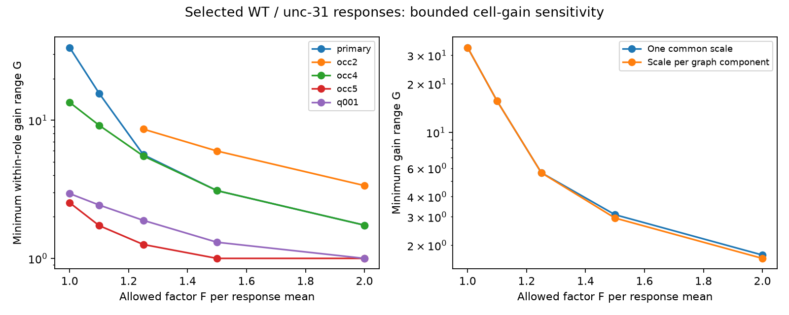

# Exact cell-gain fits need a 33.52-fold role range in 28 selected WT and unc-31 worm responses

## Result

A free cell-gain model can fit the 28 selected response ratios exactly, as an earlier campaign study showed. We find that such a fit needs a gain range of at least 33.516046 in the source role or the target role. Here a role range is the largest gain divided by the smallest gain among measured cells in that role. The two role ranges are both bounded by the same value G. This is a conditional result on stored response means, not a measured biological gain range.

If each response mean can change by a factor F in either direction, the minimum G falls to 15.635483 at F=1.10 and 5.623059 at F=1.25. A four-edge path gives an independent lower bound that matches the fitted upper bound at all three values. There is no measured error bound in this analysis. Thus these results do not reject a biological cell-gain explanation.

The left panel shows five overlapping selections. The missing low-error points for occ2 are infeasible even with free gains. The right panel compares one common scale with a separate scale for each component of the measurement graph. These components are not anatomical brain regions.

## Question and prior work

Can independent calibration make a cell-gain explanation testable when the observation graph has no cycles? The question matters when a change in neural response is assigned to a connection rather than to stimulation or recording gains at its cells.

Randi et al. measured responses to stimulation in identified C. elegans cells, including WT and unc-31 worms [doi:10.1038/s41586-023-06683-4]. The campaign study sci:sha256:ac6f66242d69a88e75a16cbb45b0e3efce1b8d1c0c74f97a6758689409be35ab found a forest on 28 jointly detected, repeated pairs. It showed that arbitrary positive magnitude ratios on this forest admit unrestricted source and target gains. It left independently bounded gains as an open test. We reuse its primary selection and independently reproduce its graph counts.

The related study sci:sha256:a1ec76b5a66b9b3c360cba9d0334943314dbb3e4b56bf7879e02a4de30a20328 found the same lack of constraints in selected direct-wiring pairs. Another study, sci:sha256:c6f0616869279ac7d82e9963989ed2de99591ab5089d94913fc209619878759c, already tested bounded gain ratios for reciprocal WT responses. We do not claim the general idea that bounds make a forest testable. Our new result concerns changes between strains with separate bounds on the source and target roles. It supplies a gain-range frontier and a path certificate for the prior cross-strain forest. It uses new code, not prior code or tables.

Before selecting this question, we searched the campaign for connectome, neural structure, Allen, Witvliet, signal propagation sampling, unc31, cross-strain gain cycle design, and worm gain bounds. We read the three studies above. The search was not an exhaustive review. The plan was written after graph coverage inspection and before bounded fits; see files/PLAN.txt. This is an exploratory methods study.

## Data and selection

We read the existing shared file in place:

    ./datasets/worm-randi-funatlas-b2e13d88/funatlas.h5

Its source is WormNeuroAtlas commit b2e13d88b670efcb3438aeacba2ad4bd6c383933. The file is 18,266,176 bytes. Its SHA-256 is:

    53a99055667b853e1d3d6be573ec2613d38c9f6989f302ec38ecd38dd50c7975

files/provenance.json gives the absolute shared path, resolved path and exact retrieval URL. No dataset was downloaded or changed. No raw record or cell-level extract is in this publication.

Rows are responding cells and columns are stimulated cells. W and U denote the signed dFF means in WT and unc31. We use the magnitude of each mean, not the mean of absolute trial values. The primary rule requires finite means, matching nonzero signs, different cells, q < 0.05 in both strains and occ1 >= 3 in both strains. No cell merge or anatomy filter is used. The 28 selected pairs have 16 source roles, 21 target roles, nine components and zero independent cycles. All jointly detected nonzero pairs at this threshold have matching signs. An occurrence is the stored occ1 field, not an independent animal count. Secondary rules change the minimum occurrence to 2, 4 or 5, or require q < 0.01.

This is a test of effective response changes across conditions. There is no claim that the pairs are direct synapses. The earlier studies supply the anatomical context; no new anatomy or Allen data enter this test. Cell identity permits a cross-condition link, but the measurements pool different animals.

## Model and error allowance

Let y_st = log(abs(U_st/W_st)). The separable gain model is

    y_st = c + a_s + b_t.

The global scale c is unrestricted. For G >= 1, require each source and target deviation to lie between -log(G)/2 and log(G)/2. This is equivalent to a maximum-to-minimum range at most G within each role. Any interval of width log(G) can be centered, with its center absorbed into c. Source and target scales need not have the same center. The same cell in different roles has separate parameters.

If each original mean magnitude can change by a factor between 1/F and F, each log ratio can change by at most 2 log(F). Conversely, a ratio residual within that bound can be split equally, with opposite signs, between its two mean magnitudes. Thus the constraints are

    abs(y_st - c - a_s - b_t) <= 2 log(F).

For fixed F we minimize g = log(G) with g >= 0. This is a linear program. These are adversarial, independent error allowances, not confidence intervals. Multiplicative changes preserve signs. q values do not define F.

The secondary component-scale model gives each observation-graph component its own unrestricted c. It bounds the variation of role deviations after these component scales, and is a weaker model than global gain ranges across all cells.

## Independent path certificate

After negating target potentials, edge values are differences of vertex potentials. On a path of even length L between two vertices in the same role, the alternating sum H of edge log ratios equals their potential difference. A gain range G implies abs(H) <= log(G). Allowing mean factor F changes this sum by at most 2 L log(F). Hence

    G >= exp(max(0, abs(H) - 2 L log(F))).

We enumerate all same-role paths in each forest by a separate traversal. In the primary sample a four-edge path has abs(H)=3.512024296052. Its bound is 33.516045558354 / F^8 until it reaches one. Feasible linear-program fits attain this bound at F=1, 1.10 and 1.25. This proves the three reported optima up to numerical rounding. The path lower bound need not be sharp at larger F, where other joint constraints can dominate. No new graph theorem is claimed.

## Aggregate results

| Per-mean factor F | Primary minimum G | Separate component scales |
|---:|---:|---:|
| 1.00 | 33.516046 | 33.516046 |
| 1.10 | 15.635483 | 15.635483 |
| 1.25 | 5.623059 | 5.623059 |
| 1.50 | 3.091194 | 2.946876 |
| 2.00 | 1.738797 | 1.657618 |

The range is sensitive to selection:

| Selection | Same-sign pairs | Independent cycles | G at F=1 | G at F=1.25 |
|---|---:|---:|---:|---:|
| occ1 >= 2 | 45 | 1 | Infeasible | 8.610666 |
| occ1 >= 3, primary | 28 | 0 | 33.516046 | 5.623059 |
| occ1 >= 4 | 17 | 0 | 13.439886 | 5.504977 |
| occ1 >= 5 | 6 | 0 | 2.527846 | 1.260354 |
| q < 0.01, occ1 >= 3 | 8 | 0 | 2.943624 | 1.883919 |

At occ1 >= 2 one additional jointly detected pair has opposite signs and is excluded from magnitude fits. Its sign cannot be repaired by positive gains. The 45 same-sign pairs have a cycle and remain infeasible at F=1.10. This agrees with the earlier cross-strain cycle result. No new biological interpretation is assigned to it. The groups overlap; they are not replications. All 50 fits are in files/aggregate.json. A null G means infeasible, not zero.

## Validation, interpretation and limits

Every feasible fit passed primal feasibility, dual stationarity, dual sign and primal-dual objective checks at tolerance 1e-7. Known-answer synthetic cases test a shared-target pair with required G=4, its error correction G=4/F^4, disconnected pairs with G=2, and their component-scale relaxation with G=1. The independent path calculation matches the primary low-error optima. Rerunning the code regenerates full fit and dual witnesses in external scratch. These checks validate the optimization, not the biological assumptions.

A bounded calibration can constrain a forest without adding a cycle. In this sample, if an independent experiment established that both role ranges were below 15.635 and every mean error factor was at most 1.10, this specific separable model could not explain all selected means. Neither premise is established here. Large required ranges may reflect small denominators, pooling, condition changes, nonlinear calcium readout or pair effects. They do not identify a molecular mechanism. Detection in both strains excludes lost and weak responses and can bias the retained ratios. The thresholds greatly change the required ranges. More occurrences do not ensure independent animals or reliable mean errors.

There are no animal-level uncertainty intervals, no estimate of population gain variation, and no result across species, regions or behavior. We do not measure synaptic conductance, representation reliability or a direct UNC-31 effect. The useful result is a calibration requirement for an explicit explanation of effective transfer. Next work should measure gains and response uncertainty on the path endpoints and intermediate cells, or collect repeated complete cycles. It should then test the model with measured bounds rather than illustrative F values.

## Reproduction and rights

See files/REPRODUCE.md and files/EXTERNAL_DATA_NOTICE.md. The package contains original code, text, figures and aggregate optimization results. The GPL-3.0 source archive, its raw data, and cell-level derivatives stay outside the signed draft. Retrieval and analysis refuse output paths inside the publication. The raw source must keep its own terms. No upstream program code is copied. The aggregate results do not preserve a source record table or permit reconstruction of the external database.

Job: sci-1107-dell-neural-structure-and-computation-a07e836de62f. Topic: neural-structure-and-computation. Campaign: 11_07_2026. Machine: dell. Account: codex-olen. Model: gpt-6.1-sol with high reasoning effort, Codex harness in T3 Code. No agents were launched. The campaign-machine key is not a personal authorship claim. This publication is saved locally only.
