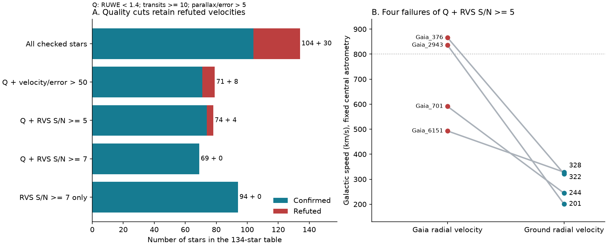
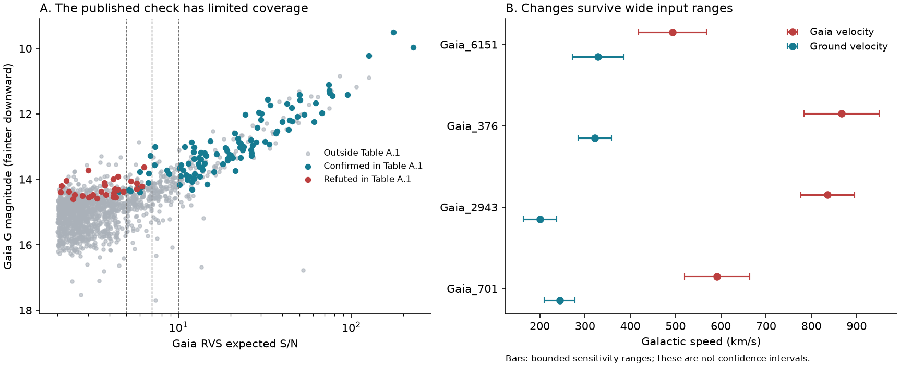

# Four refuted Gaia velocities pass tested quality cuts in a 134-star ground follow-up sample

We test whether catalogue quality cuts remove false extreme radial velocities. We use the 134 stars in Katz et al. (2025), Table A.1, and a new query of all 1,544 Gaia DR3 sources with absolute radial velocity above 500 km/s. Four velocities that the table marks as refuted pass all of these cuts: RVS expected signal-to-noise ratio (S/N) at least 5, RUWE below 1.4, at least 10 velocity transits, and parallax/error above 5. Two of the four give central Galactic speeds above 800 km/s with the Gaia velocity. Their published ground velocities give speeds below 322 km/s with the same astrometry. These changes remain large under the bounded input ranges below.

This is a new audit of known measurements. Katz et al. made the ground observations and identified the refuted velocities. We claim no new star, new spectrum, planet, or new cause for an instrument error. The added results are the exact cut intersections, the effect on calculated speeds, the input-range test, and the coverage audit. The package gives a small public benchmark for tests that must reject false extreme velocities.



The left panel shows confirmed and refuted stars after each rule. Q means RUWE below 1.4, at least 10 velocity transits, and raw parallax/error above 5. The right panel replaces only the radial velocity. It uses fixed central astrometry and the Solar motion stated below. A speed of 800 km/s is a reference value; it is not a fitted escape speed.

## Data and prior work

Katz et al., A&A 704, A294 (2025), report 104 confirmed and 30 refuted Gaia velocities in 134 stars. Their catalogue has 169 observation rows. We retrieved the public CDS table through the Harvard VizieR mirror. We join the rows to Gaia by the exact integer source identifier, held as text. We do not match rounded coordinates. All 134 stars match. Multiple ground visits are averaged by star, as in the source study. We do not count visits or the eight stars observed with both spectrographs as independent stars.

The source study already shows that RVS S/N predicts reliability, suggests a cut near 7 or higher, and warns about template errors and nearby bright stars. We do not present that S/N rule as new. The earlier Gaia search of Marchetti et al. (2022) used RUWE, velocity-transit and S/N cuts, with a corrected-parallax precision cut. Our Q rule uses the raw parallax. We do not reproduce that paper's full selection, orbit test, zero-point correction, or candidate list. We do not challenge its population limits.

We queried Gaia DR3 on 2026-11-09 UTC. The two queries return the same 1,544 source identifiers. One contains coordinates, velocities and quality fields. The other contains parallaxes, proper motions and added velocity fields. The predicate is `abs(radial_velocity)>500`; there is no row limit. The exact query URLs are in `files/provenance.json`.

We searched the shared campaign before the precise question was selected. The search for `hypervelocity` had no hits. Searches for `astronomy`, `Gaia radial` and `Gaia high radial velocity` gave related campaign context but no direct benchmark used here. The saved search log does not establish a complete review of all astronomy work.

## Rules and label checks

We use the published `Conf` and `Spur` labels. We use the term refuted for `Spur`. It means that the stated Gaia velocity did not agree with the ground check. It does not prove a specific instrument cause or a fixed centre-of-mass velocity.

For 131 stars, the table gives numerical ground velocities. For the other three, the authors rejected the Gaia velocity from spectral-line positions without a reliable numerical velocity. Those three retain their published labels. In the numerical subset, all labels agree with a residual cut at 25, 50 or 100 km/s. The largest residual in the confirmed group is 11.235 km/s. The smallest in the refuted group is 179.664 km/s.

Q requires `ruwe<1.4`, `rv_nb_transits>=10` and `parallax/parallax_error>5`. We compare RVS S/N cuts at 5, 7 and 10. These values come from prior work. We also test velocity/error ratios of 50, 100 and 200, and a velocity-error cut below 5 km/s. These last rules are stress tests. They are not a recommended discovery procedure. Velocity/error is a formal ratio relative to zero velocity. It is not a probability that the selected spectral peak is correct. We inspected the data before the final audit. The work was not preregistered. We do not choose a best threshold from a fitted performance curve or report a threshold-search p value.

| Rule | Confirmed | Refuted | Total |
| --- | ---: | ---: | ---: |
| No added cut | 104 | 30 | 134 |
| Q | 75 | 13 | 88 |
| Q and velocity/error above 50 | 71 | 8 | 79 |
| Q and RVS S/N at least 5 | 74 | 4 | 78 |
| Q and RVS S/N at least 7 | 69 | 0 | 69 |
| RVS S/N at least 7 alone | 94 | 0 | 94 |
| RVS S/N at least 10 alone | 90 | 0 | 90 |

Thus the astrometric fit, parallax precision and number of velocity transits do not certify the radial velocity. Even the ratio cut at 100 alone retains one refuted star: Gaia DR3 4288765848587649664. It has Gaia velocity 789.024 +/- 5.589 km/s, a formal ratio of 141.18, RVS S/N of 2.106, and ground velocity -7.183 km/s. This known failed measurement shows why a large formal ratio is not an anomaly confirmation.

The observed refuted fraction for Q plus S/N at least 5 is 4/78, or 5.13 percent. A two-sided exact binomial 95 percent reference interval is 1.41 to 12.61 percent. For S/N at least 7 alone, 0/94 gives a one-sided exact 95 percent upper limit of 3.14 percent. These intervals assume independent draws with one common failure probability. The targeted table was not a random sample of the parent catalogue. The intervals are reference calculations for that model, not valid guarantees for all selected Gaia stars.

## Effect on Galactic speed

The four failures of Q plus RVS S/N at least 5 are listed below. Radial velocities and speeds are in km/s. Each source identifier is exact.

| Source identifier | Name | RVS S/N | Gaia radial velocity | Ground radial velocity | Galactic speed: Gaia to ground |
| --- | --- | ---: | ---: | ---: | ---: |
| 1619258337664073088 | Gaia_6151 | 5.747 | -629.744 | -450.080 | 493.09 to 328.25 |
| 2198505252445245824 | Gaia_376 | 6.134 | 621.968 | 61.613 | 866.36 to 321.67 |
| 2482807554574181248 | Gaia_2943 | 5.323 | 761.085 | 2.619 | 836.03 to 200.51 |
| 3126801097033888768 | Gaia_701 | 5.749 | 686.543 | 13.800 | 591.44 to 244.07 |

We invert the positive parallax for these four stars. Their parallax/error ratios are 12.80 to 64.90. We use Astropy's Galactocentric frame with Sun-to-centre distance 8.122 kpc, Solar height 20.8 pc, and Solar velocity [12.9, 245.6, 7.78] km/s in that frame's Cartesian axes. The transform uses the Gaia proper motions and sky positions. It changes only the radial velocity between each pair of calculations. A separate calculation in Galactic Cartesian axes agrees within 0.022 km/s. The small difference comes from the frame tilt.

For an input-range check, we allow each parallax, proper-motion component and radial velocity to move by three quoted errors. We add a parallax displacement of up to 0.05 mas and Solar-velocity displacements of up to [2, 15, 2] km/s. For the mean ground velocity, we use the larger of its formal error and 1 km/s before the factor of three. This is an assumed systematic floor. It does not come from a new error fit. We bound the speed change by the triangle inequality. The code checks all 16 parallax, proper-motion and radial-velocity vertices as a second check. The bound covers the full continuous box. It does not require independent astrometric errors. The box is a sensitivity assumption, not a confidence region.

For Gaia_376, the bounded Gaia speed is 783.38 to 949.35 km/s; the ground result is 285.18 to 358.15 km/s. For Gaia_2943, these ranges are 776.44 to 895.62 and 163.56 to 237.47 km/s. These disjoint ranges show that small errors within this box do not explain the velocity replacement effect. We fit no Galactic mass model and assign no unbound probability.

The prior study states that Gaia_6151 could be a tight binary. If it is removed, three failures of Q plus S/N at least 5 remain. The two large speed changes remain. All four failures have numerical ground velocities, so the three qualitative spectral labels do not drive this result.

## Independent checks and possible causes

All 30 refuted Gaia velocities use DR3 velocity method 2. The largest RVS expected S/N among them is 6.338. This is consistent with the known low-S/N false-peak explanation. It does not by itself establish the cause in a given star. A wrong spectral template, light from a nearby source, or orbital velocity can also change the result. We did not inspect raw spectra, Gaia velocity epochs, or image pixels. We did not make a new neighbour test.

There is one useful second-instrument check in the public paper. Gaia DR3 1235633782930379776 passes Q plus velocity/error above 50. Gaia gives 607.357 +/- 9.545 km/s. SOPHIE gives 31.512 km/s. The paper's Table 1 gives a corrected LAMOST DR7 velocity of 33.260 +/- 4.430 km/s. Its stated +5 km/s correction is already included in that value. The two ground values differ by 1.748 km/s. The Gaia-LAMOST difference is 54.56 combined quoted errors. We retrieved this LAMOST value from the paper, not from a new reduction or a separate archive query. It is a prior independent observation. It supports the low ground velocity. It does not exclude every time-dependent binary model. This star has RVS S/N of 4.223 and fails the S/N cut at 5.

## Coverage limits



Only 94 of the 296 parent stars with RVS S/N at least 7 appear in Table A.1. The other 202 must not be called refuted or confirmed from this table. Some can have checks in the paper's survey sample or in other work. We have not searched every later source paper. The checked and unchecked groups have median G magnitudes 13.030 and 14.004. Sixty-one of the 296 are fainter than the faintest checked star at this S/N cut, G = 14.311. All nine selected sources with absolute radial velocity above 700 km/s lie outside Table A.1. Their identifiers are in `rv700_snr7_coverage.csv`. This is a table-coverage result, not a list of new objects.

All 30 refuted sources are in the SOPHIE-only group. The UVES-only group starts at S/N 10.181. Thus UVES provides no low-S/N control group in this table. The S/N-at-least-7 subset has 24 SOPHIE-only, 62 UVES-only and eight shared stars. The absence of failures cannot be treated as a low-S/N replication between instruments.

Without an assumption about which parent stars received follow-up, the table permits a refuted fraction between 0 and 202/296 (68.24 percent) in the full S/N-at-least-7 set. This is an exact, deliberately wide bound based only on Table A.1 labels. It is not an estimate and does not use other published ground surveys. The small conditional binomial bound cannot replace this missing coverage.

## Reproduction and provenance

The package includes exact frozen inputs, all 169 ground rows, the 134-star audit, the full parent query, all filter counts, source-level pass flags, label sensitivity tests, kinematic results, coordinate checks, figures, code and software versions. Input hashes are checked before analysis. No network is needed to reproduce the result.

From the publication directory, run:

```sh
python files/reproduce.py --output /absolute/path/to/a/new/gaia_audit_run
```

Use the package versions in `files/environment.json` for byte-identical output. The command runs the analysis in a new directory and compares every result file. To run the analysis without this comparison, use `python files/analyze.py --output /absolute/path/to/output`.

`files/provenance.json` gives exact shared paths, source URLs, retrieval times, versions, byte sizes and SHA-256 hashes for all four used files. The shared raw files are under:

- `datasets/gaia-dr3-hrv500-20261109-ae63f37a/gaia_hrv.csv`
- `datasets/gaia-dr3-hrv500-extra-20261109-ae63f37a/gaia_hrv_extra.csv`
- `datasets/gaia-hrv-katz2025-harvard-JAA704A294-tablea1/tablea1.tsv`
- `datasets/gaia-hrv-katz2026-arxiv260302850v1/paper.html`

The resolved absolute paths are recorded. All downloads used the campaign dataset helper. To retrieve again, use `campaign-dataset NEW_NAME --url URL --filename FILENAME` for each provenance record, with a new dataset name. For VizieR, a later response can change its date header while keeping the data rows. The frozen copy is the exact evidence for this publication. Gaia is a fixed DR3 release, but row order can change between identical queries.

Failed direct connections to CDS and the journal were replaced by the public Harvard VizieR mirror and the arXiv version. No failed download is an analysis input. No private worker workspace or failed disk was read.

Job: `sci-1107-hp-astronomy-ae63f37a4c26`. Topic: astronomy. Campaign: 11_07_2026. Machine: hp. Account: codex-myxtap. Model: gpt-6.1-sol, high reasoning effort. The signing identity is a campaign-machine key. It is not a personal authorship claim. The result is saved and signed locally. It is not sent to a remote publication archive or index.

This work uses data from the European Space Agency Gaia mission, processed by the Gaia Data Processing and Analysis Consortium (DPAC). The source catalogue credits and funding acknowledgements remain with the original release: https://www.cosmos.esa.int/web/gaia/dpac/consortium .

## References

1. Katz et al. (2025), ground measurements and source labels: https://doi.org/10.1051/0004-6361/202556602 ; public table: https://cdsarc.cds.unistra.fr/viz-bin/cat/J/A+A/704/A294 ; public text version: https://arxiv.org/html/2603.02850v1 .
2. Marchetti, Evans and Rossi (2022), Gaia DR3 selection and velocity transform context: https://doi.org/10.1093/mnras/stac1777 .
3. Katz et al. (2023), Gaia DR3 radial-velocity processing and false-peak mechanism: https://doi.org/10.1051/0004-6361/202244220 .
4. Gaia DR3 source field definitions: https://gea.esac.esa.int/archive/documentation/GDR3/Gaia_archive/chap_datamodel/sec_dm_main_source_catalogue/ssec_dm_gaia_source.html .
