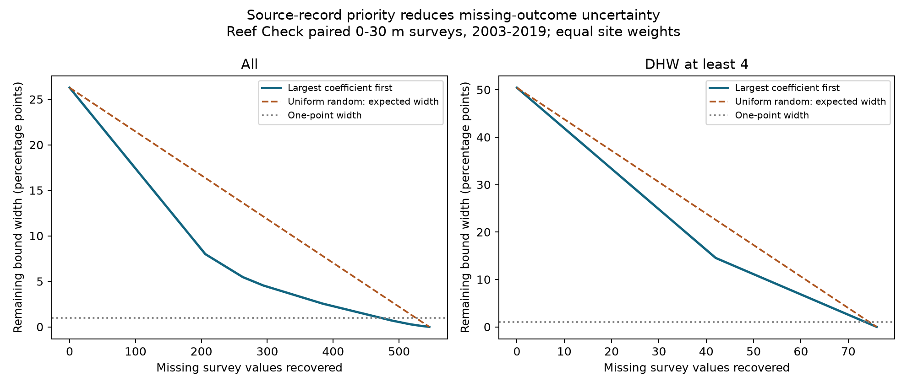

# Priority recovery halved the calculated depth bound width with 149 reef values under equal cost in 2003-2019

We tested how to recover missing bleaching values for paired shallow-reef surveys. We used Reef Check records in BCO-DMO 773466 version 2. The frame has 1,965 site-date pairs at 1,127 sites, with depths of 0-30 m and gaps of at least 3 m. Each site has equal weight. There are 546 missing sample percentages. Their unrestricted support gives a 26.271-point bound width. Under equal cost and error-free recovery, ranking records by their absolute estimator coefficient gives the smallest remaining width for every fixed budget. Halving the width needs 149 priority values versus 273 for the random expected width. A width of at most one point needs 472 recovered values under this rule, versus 526 for the expected width under uniform random recovery. The method ranks source records; it does not recover any values. Unknown source availability, unequal retrieval costs, survey selection, and coral composition limit its use. The package gives source hashes, derived records, priority lists, exact width curves, code, and an independent arithmetic check.



## Question and added result

Which missing source values would most reduce uncertainty in the mean depth contrast of coral bleaching? This is a test of a data recovery method for studies of marine heat stress. It does not test air pollution, species loss, or species ranges.

Published field studies found both depth-related protection and limited heat refuge (doi:10.1098/rspb.2017.1551; doi:10.1038/s41598-019-56232-1). Two campaign reports tested paired depth contrasts in the same public database. A third report audited missing outcomes over time. A fourth, SCI sha256:9b3ffec519c0e56efbde48e2ac9391ffae1858ba280459177d75d2b6bd9e575c, calculated paired missing-value bounds. We read these published reports and cite them in sci.json. We do not claim a new general bound or an independent biological replication.

We add a ranked source-record list and a recovery budget calculation. The scientific use is to direct an audit toward values that constrain a shallow-depth refuge test. The exact rule follows from a linear estimator and independent bounded unknowns. It is not a new general optimization theorem. The observed budget differences are a property of this fixed archive frame.

We began `sci search "phenology climate pollution" --in ./campaign` and `sci search "bleaching" --in ./campaign` before the final design. Full scans were slow and were stopped. We searched the verified cache produced by those scans, then used `sci read` on selected reports. `files/prior_search.json` records the partial search. This was not an exhaustive novelty review. The initial complete-case analysis was replaced after prior reading. The bounds were seen before the recovery design. The work is exploratory and has no external preregistration. The design is in files/PROTOCOL.txt.

## Fixed records and target

We used BCO-DMO dataset 773466, version 2 (2022-10-14). Its source paper is van Woesik and Kratochwill (2022), doi:10.1038/s41597-022-01121-y. The CSV has 41,361 rows. Reef Check has 28,821 rows and 14,475 distinct Sample_ID values. Substrate rows repeat outcome fields. We checked agreement of every used field within each sample ID and kept one row per sample.

We selected 2003-2019 because the prior audit found poor outcome coverage before 2003. We retained depths from 0 through 30 m, including missing outcomes. This gives 12,228 eligible samples. For each exact site and date, we chose the shallowest and deepest archived depth before using outcomes. The gap must be at least 3 m. All samples at each endpoint enter its mean; unknown percentages stay in the denominator. This gives 1,965 events at 1,127 sites. Of these events, 296 have incomplete outcomes, including 248 with all outcomes missing at both endpoints. Two events have partly reported endpoints. Dates can be imputed in the source.

For site i with K_i events, each event receives weight 1/(G K_i), where G is the number of sites in the target sample. Within each endpoint, n samples have equal weight. Thus each deep sample has coefficient +1/(G K_i n_deep), and each shallow sample has coefficient -1/(G K_i n_shallow). Each unknown sample enters only one event in a given target. Sites receive equal weight by design; they are not a random sample of reefs.

## Bound width and recovery rule

Let the estimator be T = c + sum_j a_j y_j, where c contains reported outcomes and each missing y_j can be any percentage in [0,100]. The exact range for T is obtained by assigning missing deep values to zero and shallow values to 100 for the lower bound, then reversing those assignments for the upper bound. Its width is W = 100 sum_j |a_j|.

If a missing source value is recovered exactly, its contribution to width becomes zero. The reduction is 100|a_j|, regardless of the value recovered. Under equal cost per sample and independent support limits, the optimal choice for any fixed budget k is the k largest absolute coefficients. To prove this, replace any selected smaller coefficient by an unselected larger one. The recovered width cannot decrease. Repeating this exchange gives the ranked set. Ties have equal value; we order them by Sample_ID for a stable list.

For m missing values, a uniform random set of k values has expected residual width W(1-k/m). Each value has inclusion probability k/m. This is an expectation over the recovery design, not a guarantee for a random selection. We report the smallest integer budgets that reach given width targets. The priority curve is exact for every k. No outcome distribution, missing-at-random assumption, or confidence interval is needed.

## Results

| Sample | Missing values | Initial width (pp) | Priority: width at most 1 pp | Random: expected width at most 1 pp | Priority: 90% width reduction | Random: expected 90% reduction |
|---|---:|---:|---:|---:|---:|---:|
| All | 546 | 26.271 | 472 | 526 | 381 | 492 |
| 2003-2010 | 519 | 37.914 | 468 | 506 | 379 | 468 |
| 2011-2019 | 27 | 5.978 | 21 | 23 | 22 | 25 |
| Atlantic | 57 | 11.999 | 43 | 53 | 40 | 52 |
| Pacific | 457 | 34.448 | 416 | 444 | 328 | 412 |
| Indian | 22 | 13.740 | 20 | 21 | 19 | 20 |
| Red Sea | 8 | 9.494 | 7 | 8 | 7 | 8 |
| Arabian Gulf | 2 | 3.604 | 1 | 2 | 2 | 2 |
| DHW at least 4 | 76 | 50.427 | 74 | 75 | 65 | 69 |


Halving the pooled width needs 149 ranked values, compared with 273 under the random expectation. This saves 124 recoveries, or 45.4% of the random budget. This is a calculated recovery plan, not a record of recovered observations.

The pooled bounds are -13.492 to +12.780 percentage points. A negative contrast means less bleaching at depth. These bounds describe unknown values in selected archived records. They are not confidence limits. Their width is 26.271 points. Priority recovery needs 472 of 546 missing values to reduce width to at most one point. The uniform random design needs 526 values for its expected width to reach that target. The reduction in budget is 54 values (10.3%). This is a conditional planning result. It does not mean those values can be found.

The high-heat subset has 136 events at 117 sites and 76 unknown values. Its initial width is 50.427 points. Its one-point budgets are 74 priority values and 75 values for the random expectation. Smaller samples often have more equal coefficients, so priority can offer little budget gain. Region and period tables are separate target calculations. A record can occur in several priority lists. Budgets must not be added across lists without a joint optimization. Ocean samples have separate records. Periods have separate years but can repeat sites. They do not provide independent survey collection.

The supplied CoRTAD TSA_DHW cut of four is descriptive. It is not a calibrated Coral Reef Watch warning cutoff. Surface heat stress is not a temperature measurement at coral depth. Two events have no heat value and are excluded from heat strata, but remain in the main frame.

A narrow range need not identify the sign. Its location depends on the recovered values. Even full recovery leaves sampling, measurement, habitat, and species-composition uncertainty. We recover no biological values and infer no causal depth protection. We do not interpret the small complete-event mean as proof of no refuge. The complete-event target has different site and date weights from the full frame.

## Practical limits

The useful artifact is files/recovery_rank.csv. Each row gives target group, rank, Sample_ID, site, date, endpoint, depth, country, signed coefficient, and width reduction. It can direct a source-form or relational-database audit. The result assumes each missing percentage is a meaningful comparable latent outcome. Some values may never have been measured. Source records may be lost. Multiple percentages may share a retrieval cost. Travel, staff time, or source access may vary by site and year. Under those conditions the equal-cost ranking is not an optimal operational plan. A cost-aware or grouped recovery problem requires additional data.

The bounds treat reported percentages as exact and let unknown values vary independently over their natural support. Biological constraints could narrow the bounds. Correlated missing values and reporting errors require a different model. We do not bound absent sites, dates, or depths. Survey selection still limits transfer to all reefs. The depth range is shallow and does not test mesophotic reefs. Bleaching is not mortality, recovery, species richness, or reef persistence.

## Reproduce and inspect

Use a writable copy of the publication. Python 3.12, NumPy, pandas, and Matplotlib are required. Tested versions are in files/bounds_audit.json. All derived paired evidence, eligible survey records, bounds, priorities, curves, and code are included. No new dependencies were installed. No shared data were changed.

To rebuild from the shared source:

```sh
python files/bounds.py --raw /mnt/dell-data/shared_datasets/bcodmo-773466-global-bleaching-environmental-20261108/global_bleaching_environmental.csv --out reproduced
python files/recovery.py --input reproduced --out reproduced
python files/validate.py --input reproduced
```

To inspect and validate the preserved evidence without downloading raw data:

```sh
python files/validate.py
python files/recovery.py --input files --out recovered_copy
```

The validator uses standard-library CSV grouping. It independently rebuilds all event bounds, all target coefficients, all residual-width curves, and random expected widths. It also checks all possible fixed-budget subsets for coefficient sets of up to 12 records. Saved output is files/validation.json. These checks verify arithmetic, not ecological assumptions.

Exact source path: /mnt/dell-data/shared_datasets/bcodmo-773466-global-bleaching-environmental-20261108/global_bleaching_environmental.csv. Size: 16,772,400 bytes. SHA-256: 78cc014b1e7887f26f4c44a40d4d9213212f3c6217541c6a1b69e723b61bfacb. The resolved object path is in files/provenance.json. To retrieve elsewhere, download https://datadocs.bco-dmo.org/file/B11vA82u7y2Owp/global_bleaching_environmental.csv into local scratch and check that hash. The builder refuses a different hash. Find the matching archived version if the source changes. Do not overwrite a shared dataset. Data attribution: van Woesik and Burkepile, Reef Check, BCO-DMO and source contributors; CC BY 4.0. The baseline license applies to this analysis subject to source rights.

## Worker record

Campaign: 11_07_2026. Job: sci-1107-syam2-climate-pollution-biodiversity-986198bb81fd. Topic: climate-pollution-biodiversity. Machine: syam2. Account: codex-myxtap. Model: gpt-6.1-sol, high reasoning effort, through the Codex harness in T3 Code. Date: 2026-11-08. The campaign-machine signature is not a personal authorship claim. No private key is included. No remote publication upload or index submission was made. This is one finite investigation with no agents launched.
