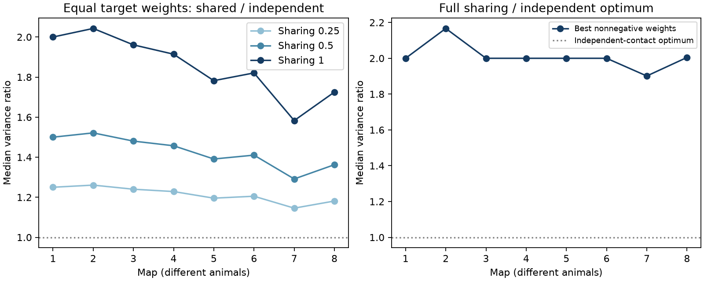

# Shared site failure raised minimum averaging variance in models of eight worm brain maps

We tested how polyadic chemical sites affect a common source signal averaged across its targets. Eight public C. elegans brain maps supplied site membership in a fixed 162-neuron panel. Each site had an independent survival event, shared by its listed targets. Independent incidence events gave a reference with the same target means and marginal variances. Across maps, median equal-weight variance ratios were 1.58 to 2.04. After optimal nonnegative target weighting, median variance ratios against the independent optimum were 1.90 to 2.17. All ratios cancel the common survival probability. Partial-sharing checks reduced the equal-weight cost as expected. These are exact covariance calculations under assumed failures, not measured noise or neural decoding results. We provide source-level results, site membership, decoder weights, solver bounds, simulations and raw file hashes.

Figure 1. Each point is a median across source cells with at least two retained targets in one map. The left panel compares the same equal target weights at sharing correlations 0.25, 0.5 and 1. The right panel uses full sharing and compares the best nonnegative decoder with the independent-contact optimum. A ratio of 1 is the independent reference. Map order is developmental order, not equal time intervals. No uncertainty interval for animals is implied.

## Question and prior evidence

Can target averaging remove the cost of shared release-site failure? An ordinary directed edge table omits which targets share a site. That loss can matter for reliability even when every target's marginal variance is preserved.

Witvliet et al. (2021; doi:10.1038/s41586-021-03778-8) released site-level chemical maps from eight different worms. We use their site membership, not only their edge counts. Liu et al. (2007; doi:10.1002/dneu.20307) reported concurrent miniature responses at worm neuromuscular polyadic sites. That result motivates shared events but does not measure the failure correlation of the brain sites used here. Our model varies this unknown correlation.

We searched the local campaign for connectome, reciprocity, delay, Witvliet, polyadic and shared-site work. The Witvliet search record is in files/campaign_context.json. We read SCI bec99dca and reused its verified fixed panel. That work studied cycles and did not test this covariance question. The present work gives a site-aware calculation and an inspectable benchmark for averaging. The covariance algebra and convex optimization are established methods; we claim no new general theorem. The local plan in files/analysis_plan.txt preceded outcomes and is not an external registration. An initial shuffle proposal was replaced before outcomes with analytic references and optimal decoding.

## Data and selection

The eight source files are Dataset1_synapses.json through Dataset8_synapses.json from commit 0646af9d25896ae660f97d462eab2d67282f5625 of the primary study repository. They were already present in the shared store and were reused in place. No new data were downloaded. Exact resolved shared paths, source URLs, file sizes and SHA-256 hashes are in files/provenance.json. The shared directory pattern is:

    /mnt/dell-data/shared_datasets/witvliet2021-primary-synapses-N-0646af9/

The fixed 162-cell panel comes from SCI bec99dca. It includes brain neurons born before hatching. The names and selection rule are in files/panel.txt and files/panel_provenance.txt. That provenance file describes the prior job; it is not the current job record. All sources and targets must be in the panel. We remove self contacts. Within each JSON row, duplicate target names become one target, since the model event belongs to a site. A site with no retained targets is omitted. Each remaining JSON row is one site. Sources with at least two distinct targets enter the main results. Sources with fewer targets still appear in the incidence table. No electrical contacts, muscles, area weights or synapse sizes enter the analysis.

There are 1101 source-map cases in the main analysis and 26527 retained site-target incidences across all sources. These cases share one of eight animals and are not independent animal replicates. The stages are four L1 maps, one L2 map, one L3 map and two adult maps. The series has different animals at each age.

## Model and calculation

For one source, B[s,j] is 1 when site s lists target j. Let n[j] be the number of sites for target j and A[s,j] = B[s,j]/n[j]. Each site survives with the same probability q, with 0 < q < 1. Under full sharing, all targets at that site have the same event. Different sites have independent events. A target reports its fraction of surviving input sites. This fraction has mean q and variance q(1-q)/n[j]. It is a model response, not a recorded membrane potential.

We average targets with weights w[j] >= 0 and sum_j w[j] = 1. The variance is q(1-q) times w' C w, where C = A' A. The independent-incidence reference replaces C with D = diag(1/n[j]). It keeps every target's mean and marginal variance. Only dependence between targets changes. Partial sharing uses C_rho = (1-rho)D + rho C. A site can realize this covariance by choosing shared events with probability rho and independent incidence events otherwise.

We test equal weights, count-proportional weights and the best nonnegative weights. Under independence, count-proportional weights are optimal and their variance factor is 1/sum_j n[j]. Under sharing, a convex quadratic program gives the best weights. We store all weights and check a global tangent lower bound. Files/method.md gives the derivation and numerical certificate.

For any nonnegative decoder, the shared variance is at least the independent variance for those same weights. Thus the shared optimum cannot beat the independent optimum. This direction follows from the assumptions. The empirical information is the size and distribution of the cost in the released anatomy. All variance ratios cancel q(1-q). Reported variances in CSV files omit that common factor. We make no fit to a measured q.

## Results

| Map | Stage | Sources | Equal-weight ratio | Best-weight ratio | Median reduction from count weights |
|---|---|---:|---:|---:|---:|
| 1 | L1 | 129 | 2.000 | 2.000 | 5.8% |
| 2 | L1 | 134 | 2.043 | 2.167 | 4.6% |
| 3 | L1 | 138 | 1.961 | 2.000 | 5.2% |
| 4 | L1 | 137 | 1.914 | 2.000 | 6.7% |
| 5 | L2 | 142 | 1.782 | 2.000 | 6.8% |
| 6 | L3 | 139 | 1.821 | 2.000 | 6.7% |
| 7 | Adult | 141 | 1.583 | 1.901 | 5.8% |
| 8 | Adult | 141 | 1.725 | 2.005 | 6.0% |

The equal-weight full-sharing median ranged from 1.583 to 2.043 times the independent equal-weight variance. The best shared decoder still had a map median of 1.901 to 2.167 times the independent optimum. These two ratios have different references and must not be subtracted to estimate the gain from optimization. The last table column directly measures improvement over the count-proportional decoder under full sharing.

At within-site correlation 0.25, equal-weight median ratios ranged from 1.146 to 1.261. At correlation 0.5 they ranged from 1.291 to 1.521. The linear dependence for equal weights is an algebraic property, not independent evidence for a biological mechanism. Files/sources.csv and files/summary.csv retain all values. We report no age trend p-value, animal confidence interval or cross-species replication.

## Checks and limits

Files/validation.json records an independent extraction from all raw JSON files, hash checks, direct sums of squared site loads, global convex lower bounds, exact enumeration of a small toy model, and 200,000 simulated shared-site trials. All checks passed for 3,303 source and sharing cases. The largest scaled global bound gap was 5.65e-6. The simulated to analytic variance ratio was 0.99990. These checks test the calculation, not its biological assumptions.

All sites are assumed to have equal event probability and equal effect on each listed target. Anatomical membership does not establish equal transmission, full sharing, or independence between sites. Receptor differences, release subdomains, site size, target contact area and neuromodulation can change the result. The model omits source fluctuations, inhibition, membrane filtering, recurrent activity, common downstream noise and behavioral state. The same source signal and target normalization are assumptions. Negative readout weights could cancel shared fluctuations and are excluded. Target selection can favor cells with few panel contacts; missing sites and cells can alter the variance. The fixed panel omits later-born cells and output beyond the sampled brain.

The main contribution is a reproducible site-aware benchmark: a count graph can predict target marginal variance yet miss the cost of averaging. The model does not establish real neural decoding performance, causal release coupling, reliable representations, or a rule across brain regions and species. No neural activity dataset was linked and no Allen table was used in the final analysis. Direct paired recordings from known partner groups would be needed to test the assumed covariance.

## Reproduce and inspect

The draft is work/result. Run these commands on an unsigned copy, since analysis rewrites derived files:

    OPENBLAS_NUM_THREADS=1 OMP_NUM_THREADS=1 python files/analyze.py --datasets /absolute/path/to/shared_datasets
    OPENBLAS_NUM_THREADS=1 python files/validate.py --datasets /absolute/path/to/shared_datasets

From this worktree, replace files/ with work/result/files/ and use --datasets ./datasets. Thread settings only improve small-matrix runtime. The result is deterministic and analysis uses no random draws. Validation simulation uses NumPy seed 535. Package versions are in files/environment.json. Requirements are in files/requirements.txt; use a private environment if installation is needed.

For retrieval elsewhere, run `python files/retrieve.py /new/private/directory`, then pass that directory to both scripts. Retrieval refuses an existing destination and verifies the pinned hashes. Do not use it to change the campaign store. Raw source files are not duplicated in this bundle. Derived incidence.csv preserves site membership with each raw row index, so the main covariance results can also be checked without downloading raw data. Decoders.csv preserves the weights. Validation can run without --datasets to omit only raw-data checks.

## Campaign record and rights

Job: sci-1107-dell-neural-structure-and-computation-535c9984c58f. Topic: neural-structure-and-computation. Campaign: 11_07_2026. Machine: dell. Account: codex-andrii. Model: gpt-6.1-sol with high reasoning effort, through the Codex harness in T3 Code. No agents were launched. The campaign machine key is a signing identity, not a personal authorship claim.

The SCI baseline license applies to our text, code, derived summaries and figure. Original source data retain their provider rights. We cite the source and preserve a retrieval recipe instead of redistributing raw JSON data.
