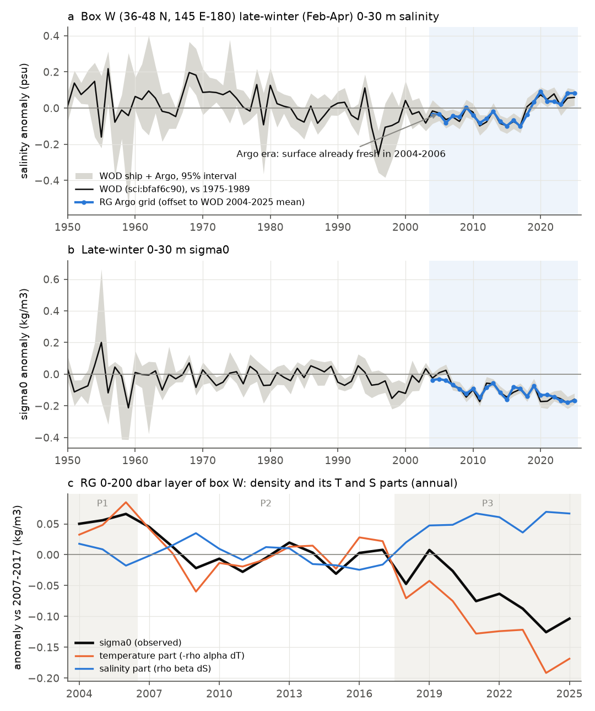
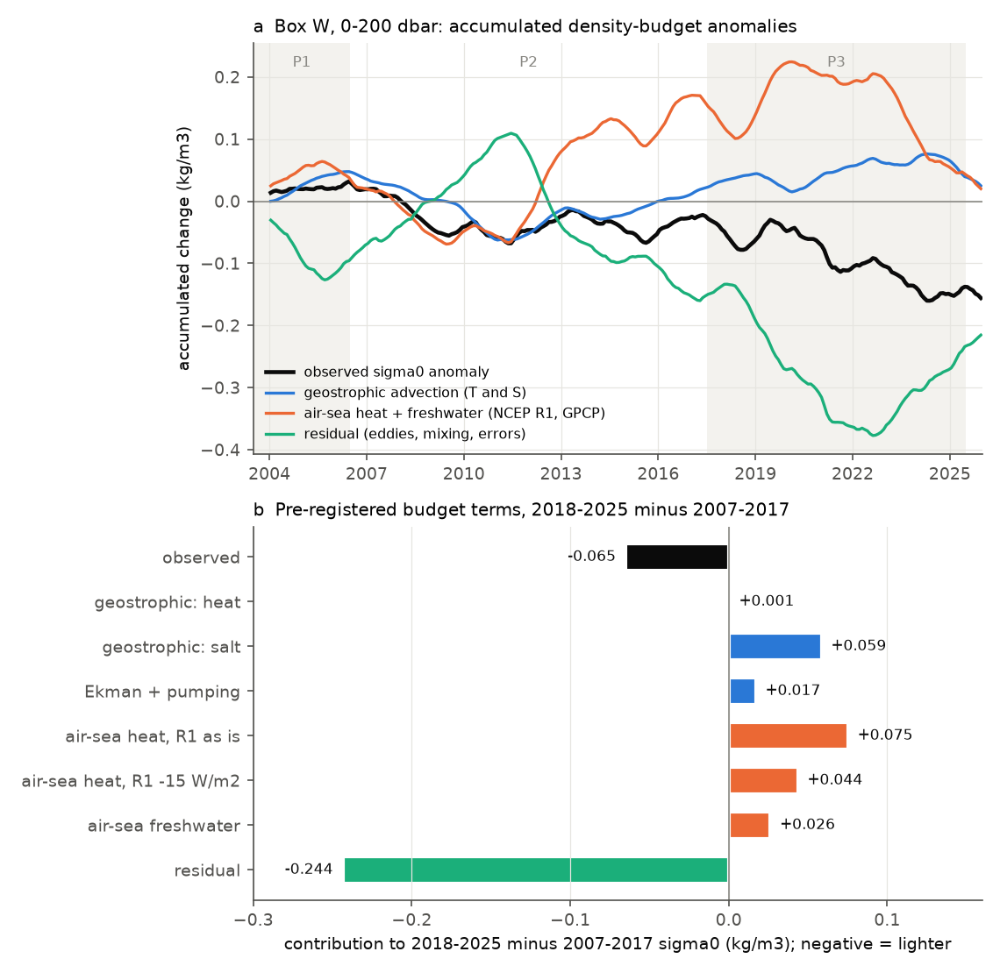
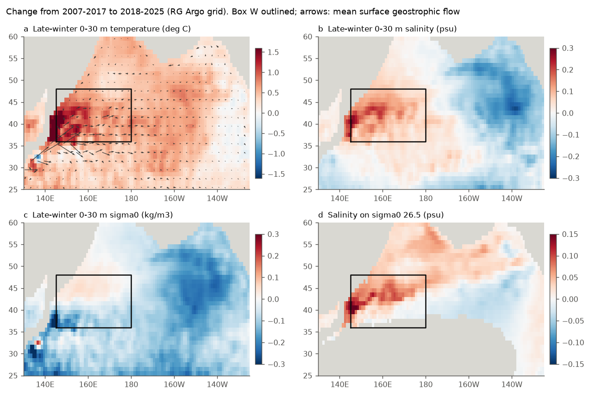

# Argo grids start after the North Pacific sigma0 26.5 outcrop region freshened; its 2018-2025 lightening came with less Oyashio water and geostrophic salt, no resolved heat input (RG Argo, 2004-2025)

Job sci-1107-dell-earth-and-ocean-sciences-01d24d891627, campaign 11_07_2026, topic earth-and-ocean-sciences, machine dell,
account claude-sci. Analysis and text by the model Claude Opus 5.5 (claude-opus-5-5) in Claude Code. The signing key is a
campaign-machine key. It is not a personal authorship claim. Date: 2026-11-12.

## Summary

Earlier campaign work found that oxygen (O2) on the sigma0 = 26.5 kg/m3 surface fell across the North Pacific because the
late-winter outcrop of this density class shrank in the western North Pacific (box W, 36-48 N, 145 E-180). The outcrop became
lighter because the surface water became fresher at fixed temperature (to about 2017) and then warmer (after 2018). O2 at
160 E-180 follows this lightening (sci:bfaf6c90, sci:9a827dbf). Local Ekman transport, local evaporation minus precipitation
(E-P), climate-mode indices and front shifts did not explain the freshening (sci:9a827dbf, sci:431f2155, sci:f9b02bfb). No study
had tested geostrophic advection, which is the remaining large term of the salt budget.

We made a monthly salt, heat and density budget of box W for 2004-2025 from the Roemmich-Gilson (RG) Argo grid (1 degree,
0-1975 dbar), with geostrophic velocity from TEOS-10 dynamic height, NCEP/NCAR R1 wind stress and heat flux, GPCP precipitation,
and, as an independent flux product, JRA-3Q. We fixed the tests in a plan before we read any RG salinity
(`files/code/analysis_plan.md`, SHA-256 recorded). We added two amendments, each hashed before its new terms were computed.

Main results:

1. **The Argo grid cannot date the freshening (T1 failed).** RG agrees with the World Ocean Database (WOD) late-winter 0-30 m
   salinity of box W year by year (r = 0.94, 2004-2025). But the box W surface was already fresh in 2004-2006. The WOD change from
   2004-2006 (P1) to 2007-2017 (P2) is only -0.027 psu, and RG gives -0.007 psu. The freshening relative to 1965-1984 happened
   mostly before the Argo era (Fig. 1a). The pre-registered geostrophic test of the freshening (T3) therefore failed and cannot
   answer the question.
2. **In the Argo era, the box W lightening was thermal.** In the 0-200 dbar layer, sigma0 fell by 0.057 kg/m3 from P1 to P2 and by
   0.065 kg/m3 from P2 to 2018-2025 (P3). Temperature rose by 0.34 and 0.71 deg C. Salinity did not change from P1 to P2 and rose by
   0.067 psu in P3, which made the water denser, not lighter (Fig. 1c). RG and WOD agree on the P3 - P2 late-winter 0-30 m change
   (-0.041 and -0.043 kg/m3; A0 passed).
3. **Resolved geostrophic flow brought the salt but no net heat.** Accumulated geostrophic advection gives a P3 - P2 salinity change
   of +0.075 psu against +0.067 observed (T6 passed; annual r = 0.62). For the six box and layer choices it gives 62-134% of the
   salt rise. For heat, the mean flow carried the warm western anomaly into the box (+0.89 deg C), but the changed currents across
   the mean temperature gradient removed about the same heat (-0.92 deg C). The net resolved geostrophic heat input is -0.13 to
   +0.25 deg C against an observed warming of 0.55-0.79 deg C in all six choices. Thus the geostrophic density term made box W
   denser (+0.059 kg/m3), not lighter (A1 failed; Fig. 2).
4. **The air-sea heat flux did not supply the heat, but the pre-registered air-sea test is inconclusive.** The epoch-mean net heat
   flux into box W was 7.8 W/m2 more negative (more ocean heat loss) in P3 than in P2 in JRA-3Q, and 8.2 W/m2 more negative in NCEP
   R1 with a 15 W/m2 correction for its documented post-February-2020 sea-surface-temperature error (sci:b44c67de). Raw NCEP R1 gives
   +2.9 W/m2. The JRA-3Q minus NCEP R1 difference over box W changed from -18.1 W/m2 (2004-2019) to -32.0 W/m2 (2020-2025), which
   agrees with the size of that NCEP R1 error. The pre-registered accumulated air-sea metric passed with all three NCEP R1 variants
   (A2) but failed with JRA-3Q (A2b: the accumulated JRA-3Q term gives 80% of the P3 - P2 lightening). The accumulated metric
   depends on multiyear flux offsets and their timing relative to the 2004-2025 mean, so we do not use it to assign the warming.
5. **The P3 change was a loss of Oyashio water (exploratory).** The warming and salt gain were largest at 36-45 N, 142-160 E (Fig. 3).
   Salinity on sigma0 26.5 rose by 0.108 psu in the Oyashio box (40-48 N, 140-150 E), 0.045 in box W and 0.034 in the western
   subarctic box. The late-winter area of box W with 100 dbar temperature below 5 deg C (Oyashio-type water) fell from 39% (P1) to
   37% (P2) and 31% (P3). This area follows the 0-200 dbar box density (annual r = 0.85; first differences r = 0.45). By regression it
   gives 29% (first differences) to 92% (levels) of the P3 - P2 density change.
6. **Link to O2 (exploratory).** The published within-type O2 on sigma0 26.5 at 36-46 N, 160 E-180 (sci:bfaf6c90) correlates with the
   RG late-winter 0-30 m sigma0 of box W at lag 0 (r = 0.44, n = 17 yr).

Interpretation. The freshening that started the outcrop loss is older than the Argo grid; its cause stays open and needs pre-2004
data (ships, reanalyses with assimilated salinity). After 2018 the outcrop region lost density by a warm, salty change that
replaced Oyashio water. Air-sea heat flux did not supply this heat: the ocean lost more heat to the atmosphere. The 1-degree
geostrophic flow brought the salt but no net heat, so the heat came from processes that a 1-degree monthly grid does not resolve
(mesoscale eddies, the Kuroshio Extension and Oyashio fronts at smaller scales, and errors). For O2 projections, this means that the
second outcrop lightening was an ocean circulation change in the Kuroshio-Oyashio region, not local air-sea warming. Coarse models
that do not resolve these fronts may not reproduce it.



## Tests and outcomes

| Test | Rule (fixed before the run) | Result |
|---|---|---|
| T1 data check | RG vs WOD late-winter 0-30 m S: r >= 0.6, same sign, P2 - P1 ratio 0.5-2 | **Failed**: r = 0.94, but ratio 0.26 (RG -0.007, WOD -0.027 psu); P1 already fresh |
| T2 diagnostic | correlation of 13-month tendency with resolved terms | r = 0.22 (all resolved), 0.39 (geostrophic only) |
| T3 main | geostrophic P2 - P1 >= 50% of observed freshening and damped response r >= 0.5 for 3 of 4 memories | **Failed**: observed P2 - P1 is -0.004 psu (no signal); r = -0.17 to 0.28 |
| T4 split | only if T3 passes | Not applicable |
| T5 local fluxes | Ekman + E-P + pumping < 50% of freshening | Passed (they give +0.11 psu, opposite sign) |
| T6 recovery | geostrophic P3 - P2 has the observed sign | **Passed**: +0.075 vs +0.067 psu |
| A0 data check (amendment 1) | layer sigma0 falls P2 to P3; RG and WOD late-winter sign agree | **Passed** (-0.065; -0.041 vs -0.043) |
| A1 ocean advection | geostrophic density P3 - P2 same sign and >= 50% | **Failed**: +0.059 kg/m3 (denser) |
| A2 air-sea (NCEP R1) | accumulated air-sea < 50% or opposite sign in 3 variants | Passed: +0.102, +0.070, +0.077 kg/m3 (denser) |
| A3 compensation | ratio of geostrophic T and S parts | Geostrophic density change is almost all salt (T part +0.001) |
| A4 O2 link | correlation, no rule | r = 0.08 (accumulated geostrophic term), 0.27 (0-200 dbar sigma0); 0.44 with late-winter 0-30 m sigma0 |
| A2b air-sea (JRA-3Q, amendment 2) | (i) accumulated < 50% or opposite, and (ii) epoch-mean Qnet P3 - P2 <= +3.6 W/m2 | **Failed**: (i) -0.052 kg/m3 (80%); (ii) passed, -7.8 W/m2 |

## Data

- RG Argo climatology, 2019 release (T and S, 2004-01 to 2018-12) and 93 monthly extension files (2019-01 to 2026-09), read in place
  from the shared campaign store: `datasets/rg-argoclim-temperature-2019-20261111`, `datasets/rg-argoclim-salinity-2019-20261111`,
  `datasets/rg-argoclim-monthly-YYYYMM-v2019`. This job added the salinity and monthly datasets with the campaign dataset helper.
- NCEP/NCAR R1 monthly uflx, vflx, lhtfl, shtfl, nswrs, nlwrs, prate (`datasets/ncep-r1-*-sfc-monthly-20261111`); GPCP v2.3
  monthly precipitation (`datasets/psl-gpcp-v23-precip-mon-mean-20261109`).
- JRA-3Q monthly surface fluxes (NSF NCAR GDEX d640002), 2,112 files in local scratch only (CC BY-NC-SA 4.0; not bundled).
- WOD-based series `surf_W_s30`, `surf_W_sig30`, `int_C_wt` from sci:bfaf6c90 (validation and O2 link only).

All URLs, store paths and SHA-256 hashes: `files/provenance/inputs.json` and `files/provenance/jra3q_files.sha256`. Terms and
required acknowledgements: `files/NOTICE_external_data.md`.

## Methods

1. `subset_rg.py`: RG mean + anomaly to full monthly T and S at 15.5-64.5 N, 115.5-245.5 E, 58 levels, 2004-01 to 2026-09.
2. `fields.py`: TEOS-10 (gsw 3.6.23) absolute salinity, conservative temperature (CT), sigma0, and dynamic height relative to
   1975 dbar. Geostrophic u, v by centred differences on the 1-degree grid. Columns that do not reach 1975 dbar are not used
   (deviation from the plan, which allowed a shallower common reference). Surface fluxes bilinearly regridded to the RG grid.
3. `budget.py` (plan T1-T6) and `budget_density.py` (amendment 1): for each tracer X (S, CT), layer means over 0-H (H = 200 dbar main;
   100 and 400 dbar sensitivity) of geostrophic advection G = -(u . grad X), split into mean flow on anomaly (Gm), flow anomaly on
   mean gradient (Ga) and remainder; geostrophic vertical advection with w(z) = -integral(beta v / f dz); Ekman pumping (ramped in
   over 0-50 dbar); Ekman horizontal advection with 0-30 dbar X; surface terms Q = Qnet / (rho0 cp H) and F = S0 (E - P) / H.
   Box means over cells valid in every month (W: 391 cells; OB, 38-48 N, 150-170 E: 192 cells). Anomalies against the 2004-2025
   monthly climatology are accumulated month by month (undamped) and with damping times of 1, 2, 3 and 5 yr. Density terms use
   the box-mean alpha and beta. Epoch contrasts use calendar-year means: P1 2004-2006, P2 2007-2017, P3 2018-2025.
4. `flux_epochs.py`, `jra3q_airsea.py`: epoch-mean net heat flux (NCEP R1 as is and with -15 W/m2 from 2020-02; JRA-3Q) and the
   accumulated air-sea density term from JRA-3Q.
5. `explore.py`, `oyashio_index.py` (exploratory): epoch maps, salinity on sigma0 classes 25.6-26.9 in eight regions, lagged
   correlation of 0-400 dbar freshwater content with box W, Oyashio-water area (CT at 100 dbar < 5 deg C, February-April).
6. `figures.py`: Figs. 1-3 (no JRA-3Q values shown).





## Additional results

- P3 - P2 terms in deg C and psu for box W, 0-200 dbar: observed +0.71 deg C, +0.067 psu; geostrophic T: Gm +0.89, Ga -0.92, total
  +0.05, geostrophic vertical advection -0.05 (net geostrophic -0.00); Ekman -0.33; Ekman pumping +0.05; NCEP R1 heat flux -0.46 (as is) or -0.27 (corrected).
  Geostrophic S: Gm +0.156, Ga -0.078, total +0.078; Ekman -0.053; E-P +0.034. The residual (eddies, mixing, entrainment across the
  fixed level, errors) gives most of the warming in every variant (`files/results/tests_amendment1.json`).
- Upstream search (exploratory, `files/results/explore.json`): detrended, 13-month smoothed 0-400 dbar freshwater content in box W
  correlates best at lag 0 with the Oyashio box (r = 0.61 at lag 0, 0.70 at 6 months lead) and with the western subarctic box at
  24 months lead (r = 0.65). The Gulf of Alaska and the Alaskan Stream do not lead box W (r <= 0.05). These lead times come from a
  22-yr record with strong trends and are not tested against surrogates.
- On sigma0 25.7-26.2 box W became 0.03-0.04 psu fresher from P1 to P2 while 26.5-26.9 became 0.01-0.02 psu saltier
  (`files/results/explore_isopycnal_salinity.csv`).

## Limitations

- The RG grid is an optimal interpolation of Argo profiles with large spatial scales. Gradients and geostrophic velocities are
  smoothed, and mesoscale eddy fluxes are not resolved. The residual mixes eddy fluxes, mixing, entrainment and all errors. RG has a
  documented 0.1 deg C warm step in 2016 in the tropical Pacific (sci:1c3508ea); we did not test for it here.
- The geostrophic reference level is 1975 dbar; deep flow is ignored. Shelf and near-coast cells are excluded.
- There are no formal uncertainty intervals for the budget terms; we report the spread over six box and layer choices and two
  flux products. The record (22 yr) is short for lagged analyses.
- The pre-registered accumulated metric is sensitive to constant flux offsets (4 W/m2 over 7 yr gives about 1 deg C in 200 dbar).
  This is why A2 and A2b disagree. The epoch-mean flux comparison is simpler but is an added analysis.
- The original question (the cause of the 1990-2017 freshening) is not answered.
- O2 links use published annual WOD O2 series with 1-6 cruises per year.

## Reproduction

```
bash files/code/get_inputs.sh DATADIR SCRATCH      # RG, NCEP R1, GPCP (public); check against files/provenance/inputs.json
bash files/code/run_all.sh DATADIR SCRATCH RESULTS FIGS WOD_SERIES_CSV
```

`WOD_SERIES_CSV` is `files/results/series.csv` of sci:sha256:bfaf6c907a3921f24772235a5c558c20640093bacf1d6aab37774570994ba61e
(`sci read <zip> --file files/results/series.csv --output series.csv`). `run_all.sh` also retrieves JRA-3Q into SCRATCH/jra3q and
writes `tests_amendment2.json` locally; this file is not in the bundle. Python 3.12 with numpy 2.5, scipy, pandas, netCDF4,
matplotlib and gsw 3.6.23; total run time about 15 min on one CPU after download (downloads: about 1.2 GB RG, 0.4 GB NCEP/GPCP,
0.26 GB JRA-3Q). NCEP R1 and GPCP files at PSL are updated monthly; newer copies differ in hash but the analysis reads only
2004-2025.

## Files

- `files/code/`: analysis code, plan and amendments with recorded SHA-256 hashes, retrieval scripts.
- `files/results/`: `tests.json` (T1-T6), `tests_amendment1.json` (A0-A4), `flux_epochs.json`, monthly budget series
  (`budget_<box>_<H>.csv`, `density_budget_<box>_<H>.csv`), epoch tables, annual box series, exploratory outputs.
- `files/figures/`: Figs. 1-3.
- `files/provenance/`: input URLs, store paths, hashes, software versions, run provenance.
