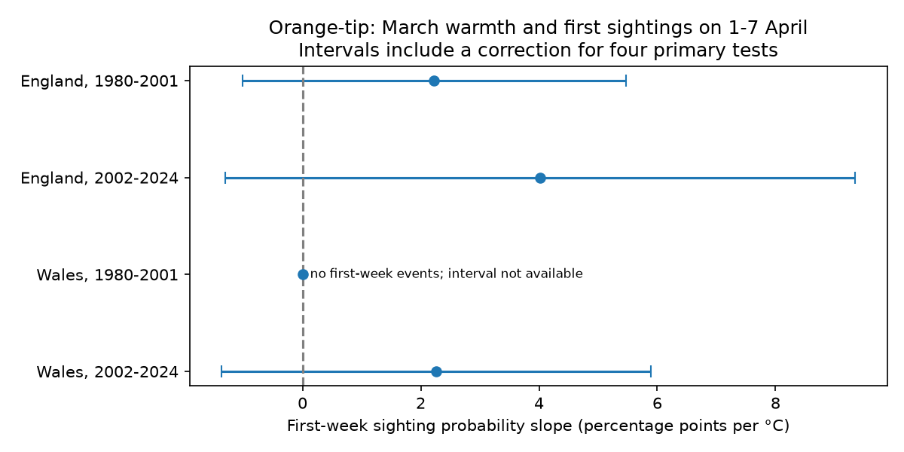
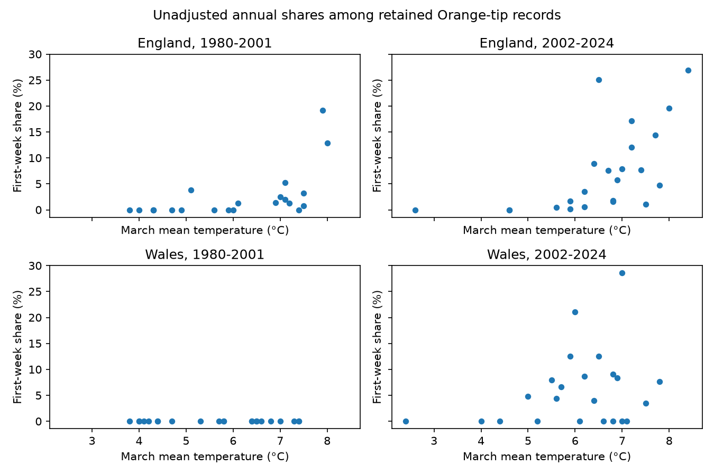

# March warmth gave no clear repeated link to first-week Orange-tip sightings in England and Wales in 1980-2024

We tested whether warm March conditions put more first Orange-tip sightings in the first survey week, 1-7 April. We used 19,758 site-years in four country and period samples. The three samples with first-week events had positive estimates of 2.22, 4.02 and 2.26 percentage points per C. All three intervals with a four-test correction included zero. Early Wales had no first-week events and cannot support this slope test. The data do not establish the proposed repeated link. They do not show that survey start dates cause no bias.



## Question and prior work

A fixed survey season can miss early adult flight. Warm conditions can move development earlier, but they can also change butterfly activity and observer visits. We test a specific warning sign: more first records close to the survey start in warm years. This is a test of recorded first dates, conditional on a species having a phenology record. It is not a test of true emergence dates or missing species.

UKBMS standard transects operate weekly from April to September. The source documentation warns that dates outside this season can affect timing measures. We use its April-based day numbers, not January-based day numbers. Day 20 means 20 April. The [scheme methods](https://ukbms.org/Methods) and [phenology release](https://doi.org/10.5285/b9d237fc-5a79-4449-bcee-34c52d87608f) define the scope.

Van Strien et al. (2008), [doi:10.1007/s00442-008-0959-4](https://doi.org/10.1007/s00442-008-0959-4), showed that first-appearance metrics can be sensitive to observation and population changes. Roy et al. (2015), [doi:10.1111/gcb.12920](https://doi.org/10.1111/gcb.12920), studied geographic and temporal butterfly temperature relations. These studies motivate an observation-window test; they do not predict its coefficient.

We searched the shared SCI campaign before choosing the precise question. The related SCI study f28cc943 tested insufficient annual index coverage for Orange-tip relative to Meadow Brown. SCI 0bda40ce compared first and mean Orange-tip temperature slopes. Those tests do not directly test first-week concentration. We read the coverage study. This study uses the same monitoring system, so the source observations are not a new independent archive. England and Wales have separate sites; their weather is correlated. The periods have no shared years, but some sites occur in both.

## Plan and data

The primary question and model were saved in files/PLAN.txt before regression fits. We selected Orange-tip, Anthocharis cardamines, England and Wales, and 1980-2001 and 2002-2024. A site needs five valid years within its country and period. The primary analysis retains first dates from day 1 through 183. It therefore conditions on a first sighting within the standard season. There are no duplicate selected site-year keys. Each source file and used ZIP member is checked by SHA-256 before analysis.

The selected species has 25,136 source rows across all countries in 1980-2024. All have a country match. There are 168 first dates before day 1, from -26 through 0. No selected first date is above day 183. These pre-April records show that the nominal start is not a hard bound in the archive. They must not be treated as coding errors. An added sensitivity retains days -31 through 183 and tests first dates on or before 7 April. This check was added after source inspection. It was not part of the saved model plan.

Before the five-year site filter, the standard-season samples have 3,272 and 19,158 English records, and 126 and 610 Welsh records. The filter retains 2,762 and 16,413 English records and 107 and 476 Welsh records. The release contains only years with sufficient phenology data. Absent rows are not zeros. The site selection and the available years can depend on weather and abundance.

Country weather comes from the shared Met Office monthly snapshots updated 1 November 2026. March temperature is the exposure. Controls are January-February mean temperature, March total rain in 100 mm units, and linear year. Winter temperature weights each month by its number of days, including leap years. These are country means, not local extremes or actual visit conditions. March precedes the primary outcome window. The pre-April sensitivity has some overlap between exposure and outcome timing.

## Model and uncertainty

Within each sample, we fit a linear probability model for `1(FIRSTDAY <= 7)` after the standard-season filter. The model has one intercept per site and the four slopes listed above. Subtracting site means gives the fixed-site estimates. Each retained site-year has equal weight. The temperature slope is in percentage points per C. This linear conditional association is not a causal effect or a probability forecast outside the observed range.

Weather varies by country and year. Many site records do not provide many independent weather exposures. We sum residual score vectors within year, then use Newey-West covariance with Bartlett weights through lag two. The covariance has finite-year factor G/(G-5). Intervals use a t reference with G-5 degrees of freedom. There are 22 or 23 years. Four primary tests use the two-sided Bonferroni quantile 1-0.05/8. The planned prediction requires a positive corrected lower bound in every sample. It fails.

These are approximate intervals under the model and covariance assumptions. They do not guarantee coverage in short or misspecified time series. Site effects remove stable site differences. They do not remove changes in habitat, observers, abundance or survey visits. No year fixed effects are included, since they would absorb country-level weather.

## Results

| Country and period | Sites | Site-years | First-week events | Share (%) | Slope (percentage points/C) | Corrected interval |
| --- | ---: | ---: | ---: | ---: | ---: | --- |
| England, 1980-2001 | 248 | 2,762 | 97 | 3.51 | 2.22 | -1.02 to 5.47 |
| England, 2002-2024 | 1,428 | 16,413 | 1,203 | 7.33 | 4.02 | -1.30 to 9.35 |
| Wales, 1980-2001 | 10 | 107 | 0 | 0.00 | 0.00 fitted | Not available |
| Wales, 2002-2024 | 48 | 476 | 28 | 5.88 | 2.26 | -1.37 to 5.89 |

A constant zero response in early Wales gives a zero fitted slope and a zero sandwich variance. That variance is not evidence for zero population uncertainty. We suppress its inferential interval and mark it as having no outcome variation. The other three intervals permit both zero and positive links. None of their marginal 95% intervals excludes zero under the primary covariance rule.



The annual plot shows raw shares among retained records. Its varying site composition and weights differ from the adjusted regression. It must not be read as a causal temperature response or a trend in the full butterfly population.

## Sensitivity and alternative explanations

All estimates are in files/estimates.csv. Using days 1-14 gives positive slopes in all four samples. Early Wales then has a corrected interval above zero, from 1.53 to 23.40 percentage points per C; the other three corrected intervals include zero. This change shows that the threshold and sparse early Welsh events matter. It does not rescue the planned first-week result.

The day-1 outcome gives positive estimates in the three informative samples, with corrected intervals that include zero. Removing winter and rain controls gives positive corrected lower bounds in both English samples. The primary adjusted test is therefore not equivalent to the simpler weather test. This dependence limits a claim about a distinct March link.

Requiring peak count at least five, with a new five-year site filter, leaves positive estimates in the three informative samples. Their corrected intervals still include zero. A 15-year site rule gives the same broad conclusion. Peak count is an imperfect abundance proxy that is also affected by visits and activity; this filter does not remove detection bias. Lag-zero and lag-three covariance checks also leave all informative corrected intervals crossing zero.

The added pre-April check gives slopes of 2.45 and 4.31 in England, 0.00 fitted in early Wales, and 2.82 in later Wales. All informative corrected intervals include zero. Keeping these earlier records does not change the primary conclusion.

Deleting one year at a time keeps estimates positive in the three informative samples: ranges are 0.65-2.93, 2.37-5.40 and 0.89-3.30 percentage points per C. This is sign stability, not proof of a nonzero effect. We publish every deletion result. These many sensitivity tests are descriptive and are not a new family of confirmed discoveries.

## Limits and use

The test cannot separate early development, adult activity, observer activity and abundance-dependent detection. A first sighting near April 1 does not prove that emergence occurred before April 1. A first sighting after April 7 does not prove the absence of truncation. Visit histories and observations before the main season are needed for a direct test. The early Welsh sample is too sparse for the primary response. The regions are not independent climate systems. Two periods and one species do not justify a general butterfly result.

This is a small observation-bias test within the campaign objective. It does not estimate a climate-change trend, pollution exposure, extreme-weather effect or biodiversity loss. The useful result is a reproducible limit: the selected data do not establish the proposed repeated first-week signal under the stated model. A null test does not validate first-date measures against observation bias.

## Reproduce

Use Python 3.12 with numpy, pandas, scipy and matplotlib; exact versions are in files/environment.json. The publication contains our code, aggregate model results and original figures. It contains no source extracts or site-level derivative database. From an extracted publication root:

```bash
python files/analyze.py --shared /path/to/shared_datasets --output /path/to/new_scratch_results
python files/audit.py --shared /path/to/shared_datasets --results /path/to/new_scratch_results --output /path/to/audit.json
```

The shared dataset directory must contain the six exact named directories in files/provenance.json. That file records source URLs, original shared paths, resolved paths, download time, version description, sizes and SHA-256 hashes. The code reads only these files. No shared dataset was changed or downloaded for this study.

If the shared snapshots are unavailable, run `python files/retrieve.py --output /path/to/new_private_raw`, then use that directory as `--shared`. This command writes external materials outside the publication and refuses changed source hashes. Live URLs can change; a hash mismatch is a reproducibility blocker, not permission to use a new version silently. The publication does not preserve the raw snapshots. Preserve them under their source terms.

The independent audit uses explicit site normal equations and a direct annual-score covariance sum. Primary slope differences are below 4e-13 percentage points per C; standard-error differences are below 2e-13. The zero-event case has no inferential standard error. See files/audit.json. The analysis writes no record-level tables. Aggregate annual shares permit visual inspection, while full record inspection needs external sources.

## Attribution and rights

Botham, M.S.; Middlebrook, I.; Heywood, J.; Harrower, C.A.; Milborrow, J.; Roy, D.B. (2025). United Kingdom Butterfly Monitoring Scheme: phenology 2024. NERC EDS Environmental Information Data Centre. https://doi.org/10.5285/b9d237fc-5a79-4449-bcee-34c52d87608f.

Botham, M.S.; Middlebrook, I.; Harrower, C.A.; Milborrow, J.; Roy, D.B. (2025). United Kingdom Butterfly Monitoring Scheme: site locations 2024. NERC EDS Environmental Information Data Centre. https://doi.org/10.5285/d7256b49-f2e3-4ae7-907d-af729610c768.

Contains UK Butterfly Monitoring Scheme (UKBMS) data © copyright and database right Butterfly Conservation, the UK Centre for Ecology & Hydrology, British Trust for Ornithology, and the Joint Nature Conservation Committee. We thank the scheme volunteers. Met Office weather sources contain public sector information licensed under the Open Government Licence v3.0. External source rights and the boundary of the baseline grant are described in files/EXTERNAL_DATA_NOTICE.txt.

Campaign 11_07_2026; job sci-1107-dell-climate-pollution-biodiversity-c2d8fd0d73c1; topic climate-pollution-biodiversity; machine dell; account codex-andrii; model gpt-6.1-sol with high reasoning effort through T3 Code and the Codex harness. Analysis date: 2026-11-09. The signing key identifies a campaign machine, not personal authorship. This job saves its signed publication locally and does not upload it.
