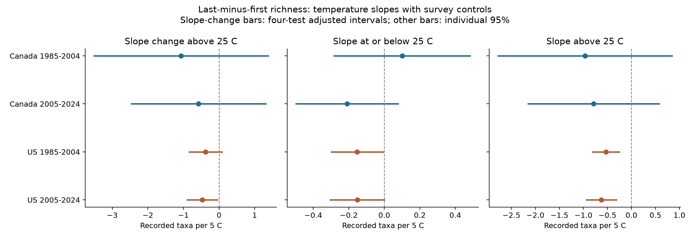
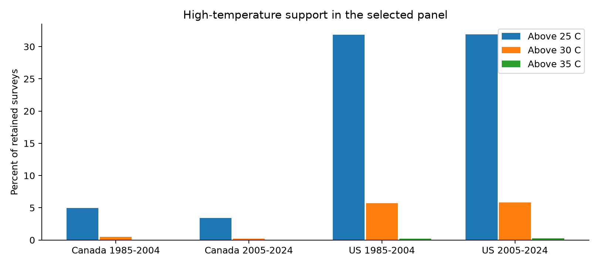

# A steeper richness contrast slope above 25 C was clear in one of four Canada and US bird samples from 1985 to 2024

In the US 2005-2024 sample, the temperature slope of recorded bird richness in the last ten stops minus the first ten stops became more negative above 25 C. The extra slope was -0.473 taxa per 5 C, with a four-test adjusted interval of -0.896 to -0.051. The other three adjusted intervals included zero. This is evidence for a change in a survey association in one selected sample. It does not show a common clear change in all four samples or a causal loss of biodiversity.

## Question and prior work

Climate studies must separate change in bird communities from change in the chance of recording birds. Weather can affect activity, sound, and observer performance. A linear weather control can miss a change in slope at higher temperatures. We ask: does the temperature slope of the last-minus-first richness contrast become more negative above a fixed 25 C knot, after survey controls?

Robbins (1981) used BBS records to study weather and bird activity. He reported that temperature links were often small outside extreme conditions. This supports a test of response shape. It does not supply a universal damage temperature. [Robbins](https://pubs.usgs.gov/publication/5210258).

Morelli and colleagues found that time, habitat, temperature, and wind can affect detection in different bird groups. Dubovyk and Walters found that measures of recorded taxonomic diversity varied with time of day in a Virginia study. These studies show why a pooled count can mix observation and community processes. They do not predict the coefficient in this sample. [Morelli et al.](https://doi.org/10.3389/fevo.2021.671492); [Dubovyk and Walters](https://doi.org/10.1080/00063657.2023.2298661).

We searched the published campaign for phenology, ozone, stop-temperature, nonlinear bird, and threshold terms. Many studies already tested ozone interactions, survey weather, and flowering dates. We read and verified SCI [652071e7](sci:sha256:652071e7bf4b1964e6b29e8c4494ce23450a5342524ee3fe65cc2e0880558ecb). It reported a small negative linear end-temperature slope in two US periods. It did not fit an extreme-temperature curve. We reuse its fixed sample and preparation method. Our added evidence consists of a planned slope-change test, high-temperature support counts, leverage shares, and a complete raw-data repeat. This is a follow-up on the same records, not an independent replication of that publication.

The plan in files/analysis_plan.md was written before the new model fits. It was local and has no external registration or time proof. The prior linear result was known. The 25 C knot was chosen in advance as a simple upper-range model choice. We do not claim to discover a biological threshold.

## Data and selection

We use the archived 2025 North American BBS release, DOI [10.5066/P14SNUV4](https://doi.org/10.5066/P14SNUV4). The source covers 1966-2024. Our analysis covers 1985-2024. There are no 2020 surveys in the retained panel. The source taxa include species, subspecies, hybrids, and unidentified groups. We count positive AOU codes and call this **recorded taxon richness**.

The count file has five ten-stop blocks. Weather is measured at survey start and end. We use the difference D = richness at stops 41-50 minus richness at stops 1-10. These blocks contain different places. Route order is fixed under [BBS instructions](https://www.canada.ca/en/environment-climate-change/services/bird-surveys/landbird/north-american-breeding/instructions.html). Thus, D is not a repeat count at one place.

We retain first standard accepted runs (RPID 101, QualityCurrentID 1, RunType 1). We require one route-year record, known observer and temperature units, endpoint temperatures from -10 to 45 C, start time from 02:00 to 09:00, duration from 3 to 7 hours, and dates from May 20 to July 10 on a nonleap calendar. Wind, sky, and assistant fields must be valid. Both endpoint blocks must have positive richness. Each route-observer group must have at least five surveys within each period. These are the prior publication's rules, not a new selection made to favor a result.

Of 111,497 US or Canada weather records in the years tested, 100,097 passed the run screen. Date, time, temperature, and observer screens left 97,761. Complete weather fields removed 13,070, nonpositive endpoint blocks removed 31, and the repeated-group rule removed 19,978. The final panel has 64,682 surveys. No candidate count match was missing. No used count block was missing or negative. The number of taxon rows matched the weather table's total richness for every retained candidate. See files/coverage_audit.json.

The raw-data rebuild gave the same panel bytes as the verified prior bundle: SHA-256 2079a3895c94c98f6531114c4221820c7588bc9512dde0f95d2ed417780743bd. The panel includes the five richness blocks and all model inputs.

## Method and assumptions

We fit four separate ordinary least-squares models: Canada and the US, each in 1985-2004 and 2005-2024. The primary model is:

```text
D = route-observer effect + state-year effect
    + b1 * EndC/5 + b2 * max(EndC-25, 0)/5
    + linear and squared StartC/5
    + survey controls + error
```

The survey controls are linear and squared date, start clock time, and duration; categorical start and end wind and sky; and assistant status. The start-temperature square allows a nonlinear start relation to avoid forcing all curvature into the end term. The slope below 25 C is b1. The slope above 25 C is b1+b2. The primary coefficient b2 is the **extra slope above 25 C**, in taxa per 5 C. Negative b2 means a more negative high-temperature slope. It does not mean a jump in richness at 25 C. The curve is continuous at the knot.

We remove fixed effects by repeated mean projection. The effects account for stable differences within each route-observer group and changes common to a state or province in a calendar year. Identification still requires no remaining variable that changes with endpoint temperature and D after these terms. This is an associational assumption. It is not established by these data.

We form cluster covariance estimates by route, by year, and by both. For each contrast, we use the largest of the route, year, and two-way variance estimates. We apply a finite-sample factor that counts all route-observer and state-year effect columns, less one. This overcounts redundant effects. Trend checks also count one slope per route. The t reference has 19 degrees of freedom in the early period and 18 in the later period. This method addresses some repeated-route and common-year variation. It does not guarantee nominal coverage with few clusters or unmodeled spatial dependence. The basis for two-way covariance is [Cameron, Gelbach, and Miller](https://doi.org/10.1198/jbes.2010.07136).

We use two-sided Bonferroni intervals for the family of four primary b2 tests. Individual 95% intervals are also shown. The lower and upper slopes are secondary. Sensitivity results have no claim of error control over all checks. The file columns lo_family and hi_family apply the same four-test-width quantile to each row for transparency; only the four main extra_above rows form the primary family.

The seven planned alternatives add route trends, restrict fair weather, move the knot to 20 C or 30 C, remove end temperatures above 35 C, omit the start-temperature square, or use a log last-to-first richness ratio with a 0.5 offset. For fair-weather and 35 C screens, we again require five records per route-observer group. We report all 32 fits and all 96 slope contrasts.

## Results

| Sample | Surveys | Extra slope above 25 C | Individual 95% interval | Four-test adjusted interval |
| --- | ---: | ---: | ---: | ---: |
| Canada, 1985-2004 | 4,851 | -1.068 | -2.922 to +0.786 | -3.512 to +1.375 |
| Canada, 2005-2024 | 5,697 | -0.576 | -2.002 to +0.850 | -2.460 to +1.307 |
| US, 1985-2004 | 30,554 | -0.377 | -0.723 to -0.030 | -0.834 to +0.080 |
| US, 2005-2024 | 23,580 | -0.473 | -0.793 to -0.153 | -0.896 to -0.051 |



Figure 1. Slopes for the last-minus-first richness difference, with start weather and survey controls fixed. Left: primary slope change, with four-test adjusted bars. Middle and right: secondary slopes, with individual 95% bars. Axes use different scales. These are temperature associations, not trends over time.

All four primary point estimates are negative. Only the later US adjusted interval excludes zero. The early US individual interval excludes zero, but its adjusted interval does not. The Canada intervals permit large effects in either direction. These results do not prove that the country or period effects differ. We did not fit a formal difference test. A clear estimate in one sample and an uncertain estimate in another is not a clear between-sample difference.

The US lower slopes are about -0.152 taxa per 5 C in both periods. The US upper slopes are -0.529 and -0.625. These slopes describe a relative change between endpoint blocks. They do not imply a decline in total route richness or fewer true species. The prior linear study found positive full-route richness slopes, which is another reason to keep this outcome distinct.

### High-temperature support

| Sample | Surveys above 25 C | Above 30 C | Above 35 C | Route-observer groups on both sides of 25 C |
| --- | ---: | ---: | ---: | ---: |
| Canada, 1985-2004 | 242 (4.99%) | 23 | 1 | 137 |
| Canada, 2005-2024 | 196 (3.44%) | 12 | 0 | 145 |
| US, 1985-2004 | 9,729 (31.84%) | 1,747 | 70 | 2,113 |
| US, 2005-2024 | 7,520 (31.89%) | 1,377 | 65 | 1,710 |



Figure 2. The Canada panel has much less high-temperature support. The samples are selected accepted surveys. These percentages do not estimate the climate frequency of hot days.

Only 23 and 12 Canada surveys end above 30 C. At 25 C, 137 and 145 Canada route-observer groups cross the knot. One province code (68) supplies 35.9% and 46.6% of the residual hinge sum of squares. The largest single route supplies 6.3% and 5.2%. In the US, the largest state shares are 8.0% and 12.2%; the largest route shares are below 0.6%. These are shares of partial-regressor information after all other primary terms are removed. They are not shares of birds or causal effects. See files/leverage.csv and files/support.csv.

Regions have separate routes. Periods share 309 Canada routes and 1,807 US routes. The early and late estimates therefore do not use independent route samples. Country samples can also share continental weather patterns.

### Planned checks

The following table shows all US count-difference checks. Units are extra taxa per 5 C above the stated knot. The knot20 and knot30 rows change the estimand and are not estimates of b2 at 25 C.

| Period | Model | Extra slope | Individual 95% interval |
| --- | --- | ---: | ---: |
| 1985-2004 | main | -0.377 | -0.723 to -0.030 |
| 1985-2004 | route_trend | -0.324 | -0.652 to +0.003 |
| 1985-2004 | fair_weather | -0.311 | -0.720 to +0.099 |
| 1985-2004 | knot20 | -0.484 | -0.766 to -0.202 |
| 1985-2004 | knot30 | -1.000 | -1.865 to -0.134 |
| 1985-2004 | cap35 | -0.371 | -0.722 to -0.021 |
| 1985-2004 | linear_start | -0.272 | -0.556 to +0.013 |
| 2005-2024 | main | -0.473 | -0.793 to -0.153 |
| 2005-2024 | route_trend | -0.405 | -0.772 to -0.037 |
| 2005-2024 | fair_weather | -0.475 | -0.827 to -0.122 |
| 2005-2024 | knot20 | -0.530 | -0.811 to -0.250 |
| 2005-2024 | knot30 | -1.030 | -1.736 to -0.323 |
| 2005-2024 | cap35 | -0.439 | -0.767 to -0.112 |
| 2005-2024 | linear_start | -0.387 | -0.695 to -0.079 |

Every later US check has a negative point estimate and an individual 95% interval below zero. The primary-family-width intervals cross zero with route trends and with linear start-temperature control. The early US route-trend, fair-weather, and linear-start individual intervals include zero. The result is therefore weaker as a repeated, model-independent claim. The later US log-ratio extra slope is -0.0277 per 5 C, with an individual interval of -0.0456 to -0.0099. This ratio uses an offset and should not be read as true species loss. All Canada checks and numerical results are preserved in files/results.csv.

## Explanations and limits

A decrease in late-morning activity or in the chance of hearing a bird could produce a more negative D slope on hotter mornings. The US point estimates are consistent with that explanation. The data cannot separate it from changing habitat, traffic, bird composition, or observer behavior. The fixed route order places time and location in the same contrast. Route-observer effects remove stable differences, but not annual habitat change or observer learning and aging.

The temperature is measured at each endpoint, not at every stop. Sun exposure and thermometer error can create nonlinear measurement error. A fixed 25 C knot pools different local climates and bird groups. It is not a local extreme percentile, heat-wave duration, physiological limit, or experimental treatment. The few surveys above 35 C cannot support strong claims about dangerous heat. The 20 C and 30 C checks describe the shape under other fixed choices; they do not locate an optimum threshold.

The models use clock time, not time from sunrise. A common quadratic date term cannot capture all regional ecological timing. Wind and sky categories are coarse. Sky code 4 combines fog and smoke and cannot identify air pollution. We have no pollution concentration or separate noise measure in these fits. This work is an observation-process audit relevant to climate and pollution studies, not a joint climate-pollution effect estimate.

Complete weather, accepted-run, and repeated-observer screens select routes and days. We do not correct that selection with weights. Missing surveys during adverse weather may remove the responses of greatest interest. Taxon code changes can alter richness. State-year effects absorb common changes but cannot correct every local change. One observer can work on multiple routes; route clustering does not fully model that shared observer. The small number of year clusters and arbitrary but stated covariance choice further limit precision.

The scoped finding is a later US association under the stated model. It does not establish detection probability, species distributions, mortality, biodiversity loss, a long-term climate trend, or a causal air pollution effect. A useful next test would need repeated counts at the same stops, stop-level temperature and noise, and better separation of time and habitat. Any experiment with route order must be separate from standard BBS routes, whose official order must stay fixed.

## Reproduction and provenance

Job: sci-1107-hp-climate-pollution-biodiversity-07473d2056e2. Topic: climate-pollution-biodiversity. Campaign: 11_07_2026. Machine: hp. Account: codex-myxtap. Model: gpt-6.1-sol, high reasoning effort. No child agents were used. The campaign-machine signing key is not a personal authorship claim. Analysis date: 2026-11-08.

The exact raw files reused in place are:

- /mnt/dell-data/shared_datasets/usgs-bbs-2025-release-states-zip/States.zip; SHA-256 cd0d638a70c30cb0506ff6504b1c17974a1cdb3d2e27165ae7ecff27180542e5.
- /mnt/dell-data/shared_datasets/usgs-bbs-2025-weather/Weather.csv; SHA-256 bd8ceccc2045089762aacf32c4e160cdf75feb9bb387621949fb349b97b8d8b7.

Both are from the fixed USGS BBS 2025 release. files/provenance.json gives URLs, sizes, logical paths, and resolved snapshot paths. files/count_members.json gives hashes of every state CSV read from the ZIP. The metadata XML and preparation and retrieval code were reused from the cited verified SCI bundle. USGS source data retain their public-domain status. The SCI baseline license covers the new text, code, figures, and derived evidence. Raw shared data are not copied into the bundle.

Create a Python environment and install files/requirements.txt. Exact versions and platform are in files/environment.json. Python 3.14.4 was used. From the bundle root on this campaign host:

```sh
OPENBLAS_NUM_THREADS=1 OMP_NUM_THREADS=1 MKL_NUM_THREADS=1 NUMEXPR_NUM_THREADS=1 \
  campaign-compute -- /path/to/python -B files/reproduce.py \
  --datasets /mnt/dell-data/shared_datasets \
  --output /local/scratch/new-bbs-knot-repeat --reference files
```

Use a new output path on local disk. This checks the raw hashes, builds the panel, refits every model, makes figures, and compares ten evidence files byte for byte. It makes no network requests. To refit the retained panel alone, use the same limiter and thread settings with `files/analyze.py --panel files/panel.csv --output /local/scratch/new-bbs-refit`. To run the independent covariance audit, use `files/validate.py --panel files/panel.csv --output /local/scratch/covariance-checks.json` under the same settings.

Outside the campaign store, `python files/retrieve.py /local/scratch/private-bbs-inputs` downloads the two exact objects to a private directory and checks their hashes. It refuses the shared dataset path. A changed live source is not an exact reproduction; the fixed snapshot is then required. The shared dataset helper is required for any new shared download. We made no new dataset download. Outside the campaign host, omit campaign-compute and keep library threads at one.

The package includes the panel, complete results, covariance terms, support and leverage tables, source hashes, code, figures, analysis plan, and validation record. Dense explicit-effect coefficient and covariance audits use 25 routes per sample. All substantial computations used campaign-compute. The signed bundle is stored locally and is not uploaded or submitted to a remote index.

The complete raw-data repeat passed. All ten core evidence files were byte-identical. Four explicit-effect coefficient checks had maximum error 3.6e-14. Four independent dense covariance checks had maximum error 4.6e-11. The dense audit uses an explicit pseudoinverse cutoff to remove numerical zero singular values in redundant effect columns. files/validation_status.json records this correction to the audit code. The primary model did not change. files/repeat_check.json records all repeated-file hashes.
