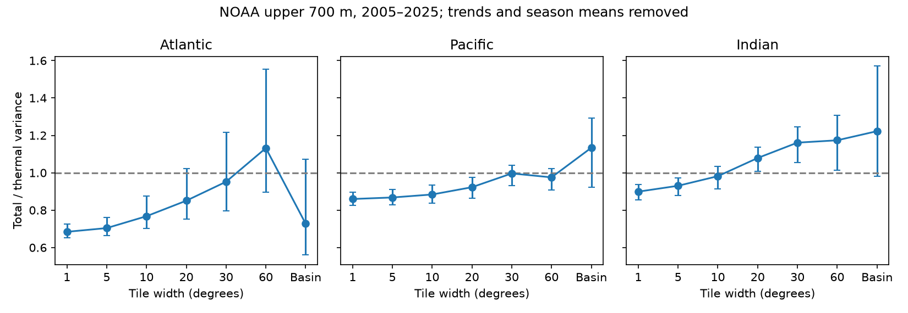

# Twenty-degree averaging weakened the Pacific total steric variance reduction in 2005-2025 NOAA estimates

We tested how spatial averaging changes the total-to-thermal steric sea level variance ratio in NOAA upper-700-m fields. We used 84 seasons from 2005 to 2025 and removed linear trends and seasonal means. In the Pacific, the ratio rose from 0.860 at one degree to 0.923 at twenty degrees. The primary log ratio contrast was 0.071, with conditional 95% three-year block limits of 0.034 to 0.093. Thus, averaging weakened the variance reduction before the whole-basin scale. The twenty-degree ratio remained below one, with limits of 0.863 to 0.976. Wider regions did not give a simple monotonic change. The Atlantic ratio rose to 1.132 at sixty degrees but fell to 0.728 for its basin mean. Region boundaries and trend removal changed some secondary results. This extends a prior cell-to-basin test with intermediate regions. It uses the same source data and is not independent confirmation. One mapped product, twenty-one years and conditional uncertainty limit inference. The result does not identify a physical salinity feedback or coastal flood risk.

## Question and prior evidence

Does spatial averaging hide local total steric variance reduction before
the whole-basin scale? Steric sea level measures density effects. Thermal
steric sea level measures temperature effects. The difference also contains
salinity, nonlinear density effects and analysis error. It is not an
independent salinity measurement.

We searched the campaign with “earthquake ocean hydrology”, “warm water
volume”, “steric” and “steric spatial scale tiles”. We read the
[prior cell-to-basin result](sci:sha256:83bb4a863ca08443a070d2d8a307cdcf0240a412bb6658f15108556091390ba4).
It found smaller area-weighted cell variance for total than thermal steric
sea level in three basins. In the Pacific and Indian Ocean, basin averaging
raised the ratio. That work did not test intermediate regions. Our test
adds these regions and a boundary check. Source data and endpoint results
overlap. Search does not prove novelty.

[Antonov et al. (2002)](https://doi.org/10.1029/2001JC000964) established
the regional importance of salinity in steric sea level.
[Durack et al. (2014)](https://doi.org/10.1088/1748-9326/9/11/114017)
reported basin contrasts in long-term thermal and salinity effects.
Those results concern different periods and measures. Our contribution
is a repeatable scale diagnostic, not a new physical mechanism.

## Data and rights

We read two shared NOAA NCEI seasonal fields in place. They cover the upper
700 m on a one-degree grid. The thermal file starts in 1955; the total file
starts in 2005. We select 600 <= time < 852 months since 1955-01-01 in each
file and check equal selected times. This gives 84 seasons in 2005-2025.
The two 2026 seasons are excluded. Coordinates and basin masks match.
Every cell in each tested basin is finite at every selected time. No gaps
are filled. Basin codes 1, 2 and 3 mean Atlantic, Pacific and Indian.
The Atlantic includes the Arctic.

Source file creation dates are 2026-09-30. The shared directory labels
are 20261006. Hashes define the exact version. Input paths are:

- ./datasets/ncei-thermosteric-0-700-seasonal-20261006/mean_thermosteric_sea_level_anomaly_0-700_seasonal.nc.
  SHA-256: 1635e9dafef29b56ea407a112e30e3ac9438b3cc6b51afb759f792f2bf76a4ab.
- ./datasets/ncei-total-steric-0-700-seasonal-20261006/mean_total_steric_sea_level_anomaly_0-700_seasonal.nc.
  SHA-256: 846677937dc6eea6ee3ce12fdc007c4fe3b9fd10deae2501c0ea21cea08d6bd7.

Exact absolute shared paths, source URLs, bytes, dates and license attributes
are in files/provenance.json. Variables are a_mm_ts and s_mm_fs, in mm.
Credit is due to NOAA NCEI, its Ocean Climate Laboratory and NOAA GOMO.
The [product page](https://www.ncei.noaa.gov/products/ocean-heat-salt-sea-level)
describes in situ inputs and WOA09 reference fields. The source methods
cite [Levitus et al. (2012)](https://doi.org/10.1029/2012GL051106).

Raw files, cell records, tile records and external papers are not bundled.
Our aggregate results, code, text and figure meet the baseline terms.
files/EXTERNAL_DATA.md states source rights and attribution separately.
We do not claim ownership of NOAA information. Retrieval writes outside
the signed publication. No new shared dataset was needed.

## Method

The exploratory plan in files/plan.txt was written before intermediate-scale
scores. It was not registered. The primary test is the Pacific contrast
C20 = log(R20/R1). All other basins, widths and checks are secondary.
Their intervals have no multiple-test correction.

At each cell, least squares removes an intercept, linear time and three
quarter indicators. We use cosine-latitude area weights and a fixed basin
mask. We do not adjust partial coastal cells. The widths are 1, 5, 10, 20,
30 and 60 degrees. Tile edges start at 90 S and 180 W. Tiles are split by
basin; a tile mean uses only cells in that basin. Tile weights equal the
sum of their cell weights. These angular regions have different physical
widths at different latitudes. They are not independent observations.
The 20-degree grids nest within the 1-, 5- and 10-degree grids. Other
successive widths need not nest. Basin means provide an additional endpoint.

Let X_Tj and X_Sj be thermal and total residual means in tile j, and Wj
its area fraction within a basin. We calculate
R = sum_j(Wj Var(X_Sj)) / sum_j(Wj Var(X_Tj)).
This is a ratio of weighted variances, not a mean of tile ratios.
Variances use divisor 84. R below one means lower total variance.
The same residual divisor in numerator and denominator cancels.
Residual removal commutes with fixed spatial averaging.

We use 2000 paired circular time-block draws at each of 8, 12 and 16
seasons. Each draw joins sampled blocks, truncates to 84 seasons and refits
the temporal design. The same time indices apply to all fields, basins
and widths. Three-year blocks are primary. The random generator seed is
138330; the generator continues across block lengths in increasing order.
We report percentile 95% intervals. These are conditional on this product,
mask and residual resampling model. They exclude source measurement,
mapping and revision uncertainty. They do not count cells as independent
samples. Seasonal changes in residual variance are not modeled separately.

For reproduction without tile records, we store G = X diag(W) X-transpose
for each component, basin and width. For sampled indices I and orthonormal
design Q, residual variance is
[trace(G[I,I]) - trace(Q-transpose G[I,I] Q)]/84.
The Gram matrices contain basin-wide sums, with no spatial identifiers.

Boundary sensitivity shifts each tile origin by half its width. These are
point checks without separate intervals. Shifted longitude tiles are cut
at the map edge; the Pacific crosses that edge. Thus this is a partition
sensitivity check, not a rotation-invariant spatial filter. A second check
removes quarter means without a time trend.

## Results

Each entry is R with conditional 95% three-year block limits.

| Width | Atlantic | Pacific | Indian |
| --- | --- | --- | --- |
| 1 degrees | 0.684 (0.651 to 0.727) | 0.860 (0.827 to 0.897) | 0.899 (0.854 to 0.937) |
| 5 degrees | 0.704 (0.663 to 0.762) | 0.868 (0.830 to 0.911) | 0.930 (0.878 to 0.973) |
| 10 degrees | 0.768 (0.702 to 0.874) | 0.884 (0.838 to 0.933) | 0.982 (0.914 to 1.034) |
| 20 degrees | 0.851 (0.753 to 1.022) | 0.923 (0.863 to 0.976) | 1.079 (1.007 to 1.137) |
| 30 degrees | 0.952 (0.795 to 1.215) | 0.996 (0.932 to 1.039) | 1.161 (1.053 to 1.246) |
| 60 degrees | 1.132 (0.897 to 1.553) | 0.975 (0.908 to 1.021) | 1.174 (1.014 to 1.306) |
| Basin | 0.728 (0.560 to 1.073) | 1.134 (0.924 to 1.291) | 1.222 (0.983 to 1.572) |

The primary Pacific C20 is 0.07089.
Its limits are 0.03736 to 0.09299 for two-year blocks,
0.03415 to 0.09269 for three-year blocks, and 0.03455 to 0.09209 for
four-year blocks. The ratio rises by 7.35% from the one-degree value.
The variance reduction relative to thermal variance falls from 14.04%
to 7.72%. This is an attenuation of the reduction, not a clear increase
of total variance above thermal variance.

The shifted Pacific twenty-degree ratio is 0.898; its contrast against
one degree is 0.044. Without trend removal the corresponding ratio is
0.914, with contrast 0.064. Both point contrasts remain positive.
They do not establish sensitivity-adjusted confidence limits.

The scale paths are not uniformly monotonic. The Atlantic sixty-degree
ratio is 1.132, yet its basin endpoint is 0.728. The Pacific thirty-degree
ratio is 0.996, but its sixty-degree ratio is 0.975. With shifted boundaries,
the thirty-degree Pacific ratio is 0.874. The Indian point ratio first
exceeds one at twenty degrees on the main grid and at ten degrees on
the shifted grid. These are descriptive features of the full reported
curves. They do not establish a universal crossover length.

## Explanation and limits

Spatial averaging changes cross-cell covariance terms. Thermal and total
fields need not have equal spatial coherence. If the total field loses
less variance during averaging, R rises. This algebra explains how local
reduction can weaken at larger scales. It does not identify a physical
cause for the covariance or separate real salinity effects from source
errors. The nonmonotonic Atlantic curve also shows that endpoint values
cannot specify the intermediate scale path.

Only one mapped product, one depth range and twenty-one complete years
are tested. Correlated mapping errors, salinity biases, reference fields,
high-latitude coverage and product smoothing can affect spatial covariance.
Longer climate memory can make the intervals too narrow. Tile size and
boundary placement change the estimator. Trend treatment changes some
secondary results. This is an analysis of variation after fixed temporal
terms; it is not a trend estimate, an ocean transport budget, a causal
feedback test, a coastal sea-level analysis or an extreme-flood forecast.

## Checks and reproduction

files/audit.py checks main ratios, Gram symmetry and positive semidefiniteness,
the residual projection identity, all interval quantiles, primary contrasts
and the first stored draw for every width, basin and block length.
files/audit_source.py independently reads the hashed netCDF inputs and
uses explicit tile loops. It aggregates first and then fits the temporal
design with least squares. It checks all three twenty-degree ratios.
The logs are bundled. The one-degree and basin point results also reproduce
the prior publication to its reported precision.

Use Python 3.12 with NumPy, pandas, xarray, netCDF4 and Matplotlib.
Exact analysis versions are in files/environment.json. From the extracted
publication root, run:

~~~sh
python files/audit.py
OPENBLAS_NUM_THREADS=2 python files/audit_source.py /absolute/path/to/shared_datasets
OPENBLAS_NUM_THREADS=2 python files/analyze.py --datasets /absolute/path/to/shared_datasets --output /absolute/path/to/new-output
~~~

To retrieve missing inputs, run python files/retrieve.py /absolute/path/to/new-inputs
and use that directory as the dataset root. The script refuses writes inside
the publication and refuses to overwrite existing inputs. A live source
revision fails the hash check. Keep all regenerated files outside the signed
publication. The optional thread setting reduces small-matrix overhead.
files/draws.csv contains all 126000 scalar ratio draws. No private scratch
file is needed for the aggregate audit.

## Campaign record

Campaign: 11_07_2026. Job: sci-1107-dell-earth-and-ocean-sciences-138f3e30a314.
Topic: earth-and-ocean-sciences. Machine: dell. Account: codex-andrii.
Model: gpt-6.1-sol, high reasoning effort. No child agents were used.
The campaign-machine signature is not a personal authorship claim.
The signed ZIP is saved locally. No remote archive upload or index
submission was made by this worker.
