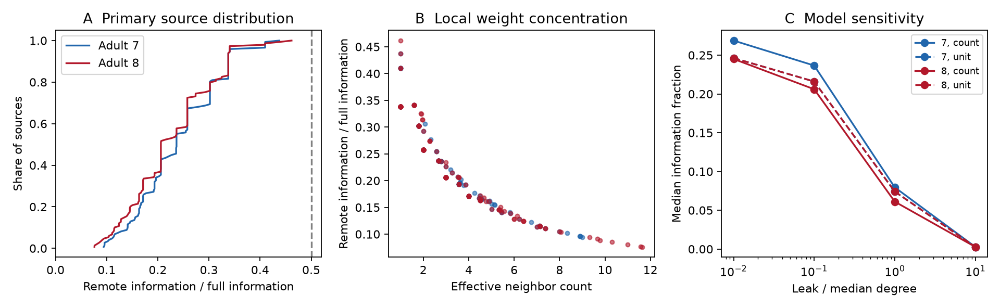

# A source-excluded readout has less than half the long-window information in an equal-noise passive network

An optimal readout of all cells except the input cell has less than half the full-population information about a constant input amplitude in the model tested here. The result holds for any finite symmetric network with nonnegative link weights, positive membrane leak, and equal independent white current noise at every cell. It applies to long-window mean voltages. It does not bound information in a complete voltage time series.

We derive an exact local formula. We check it on two partial adult C. elegans electrical maps and on random weighted graphs. At the primary leak setting, median information fractions are 0.2366 and 0.2060 in maps 7 and 8. The score depends only on the source's direct weights and leak. Links among other cells can change mean voltages and noise correlations, but cannot change this particular optimal score when these source properties stay fixed.

Figure 1. A: Each curve is the empirical distribution across sources at count weights and leak equal to 0.1 times median weighted degree. The dashed line is the strict upper bound of one half. B: A more even spread of a fixed total source weight lowers the bound; leak also varies relative to each source degree in these data. C: Median fractions across the tested leak grid for count and unit weights. Cells and model settings are not independent animal samples.

## Question and prior work

How much information can a source-excluded population recover about a constant current input in a passive network? This asks about a population readout, rather than one remote voltage. It provides a reference test for claims that wider signal spread must improve reliable representation.

Varshney et al. used Laplacian dynamics to study the worm electrical network [1]. Witvliet et al. supplied brain maps across development [2]. Beck et al. studied linear Fisher information in recurrent networks [3]. Moreno-Bote et al. showed why response covariance and signal direction must be considered together [4]. Linear Fisher information, covariance inversion and projection methods are established. We do not claim that the general information-invariance principle or the projection method is new. The contribution here is an explicit source-exclusion formula, its half bound for this passive model, and a checked graph benchmark.

We searched signed campaign results before fixing the test. The initial link-addition question overlapped with a prior link-removal study [5], so we changed the question before new computations. A later campaign study joined single-cell signal and noise under link removal [6]. That study explicitly excluded an optimal population decoder. Our study uses all remote cells jointly and does not remove links in the primary analysis. We reused the two studies' graph selection rules and model context, but no code or numerical tables. files/prior_search.json records searches; files/PLAN.txt records the final local plan before computations. The plan was not externally registered. Search results are not an exhaustive review.

No activity measurements enter this analysis. The data support a structural model test. We do not link separate animals as if they were matched functional experiments. No Allen data are used. Transfer to other species, regions and behavior is not tested.

## Model and information measure

Let W be a symmetric matrix of nonnegative link conductances with zero diagonal. Let d_i be its row sum, L = diag(d)-W, and M = L+diag(ell), with positive leaks ell_i. Each cell has unit capacitance. The input has unknown constant amplitude theta at a known source s. Independent unit white current noise enters every cell, including s:

    dV = (-M V + theta e_s) dt + dB.
    G = inverse(M).

The mean has settled before observation. Its derivative with respect to theta is g = G e_s. The covariance of the stationary temporal mean over a long window T is K/T + O(T^-2), where K = G G^T. The equality uses unit independent current noise. For observed cells R, Gaussian Fisher information per unit time tends to

    J_R = g_R^T inverse(K_RR) g_R.

This is also squared optimal linear signal-to-noise ratio per unit time for unit amplitude. The covariance does not depend on theta. We assume exact voltage observation, known model parameters and unrestricted linear decoder weights. No added recording noise or finite-trial covariance estimation is included.

For all cells, J_all = 1. An invertible linear filter changes signal and noise together, so it cannot change this full-observation long-window score. This is not a claim that the network creates or destroys no information under every possible observation.

## Exact source-exclusion formula and proof

Let R contain every cell except s. The rows of G_R form a matrix A with full row rank. Then g_R = A e_s and K_RR = A A^T. Thus J_R is the squared length of the orthogonal projection of e_s onto the row space of A. Its one-dimensional orthogonal complement is spanned by m = M e_s: G_R m = 0. It follows that

    J_remote = 1 - (e_s^T m)^2 / (m^T m)
             = q_s / ((d_s+ell_s)^2 + q_s),
    q_s = sum_j W_js^2.

Only source-incident weights and source leak remain. Every remote cell is observed; an arbitrary smaller subset need not have this property. The optimal decoder itself can still depend on the entire network.

Because weights are nonnegative, q_s <= d_s^2. For d_s > 0 and ell_s > 0,

    0 < J_remote < 1/2.

An isolated source gives zero remote information. More generally, positive leak at every cell ensures M is invertible. The proof also allows unequal positive leaks. For effective neighbor count k_eff = d_s^2/q_s,

    J_remote = 1 / (1 + k_eff (1+ell_s/d_s)^2).

With fixed total source weight and leak, distributing weight more evenly across neighbors lowers this score. A single neighbor approaches one half as leak tends to zero. Many equal source weights approach 1/(1+k) at small leak. These statements concern noise entering every cell; they are not general claims that divergence harms biological coding.

For unequal independent current-noise intensities r_i > 0, set H = sum_(i != s) M_is^2/r_i. The corresponding formula is

    J_remote = (1/r_s) H / (M_ss^2/r_s + H),
    J_all = 1/r_s.

The half bound can fail. A two-cell circuit with unit link, leaks 0.1, source noise 1 and remote noise 0.01 has remote fraction 0.9880. This checked example shows that equal noise is a necessary restriction for the stated universal half bound. Equal input noise also does not imply independent voltage noise.

## Data and graph construction

We used only the two raw tables listed below. Source version: wormneuroatlas commit b2e13d88b670efcb3438aeacba2ad4bd6c383933, exports of Witvliet adult maps 7 and 8. We reused them in place through the shared dataset links. No download or shared data change was needed. The compatibility paths point to the available SSD store; we did not read the failed HDD.

| Shared raw file | SHA-256 |
|---|---|
| /mnt/dell-data/shared_datasets/worm-witvliet7-b2e13d88/adult7.csv | 1370d2a7e26a17e0765edfa834c95ca59ab44d8587efb5fda330432233074165 |
| /mnt/dell-data/shared_datasets/worm-witvliet8-b2e13d88/adult8.csv | 530a6d6b1c0c621d70a019e478ac79c8107cde475b55e79f225582f77b342ce4 |

The file sizes are 55,102 and 55,153 bytes. files/provenance.json gives exact workspace and resolved shared paths, source URLs, checksums and download metadata. We checked both used raw hashes against stored metadata.

We take names that occur as an endpoint in both tables. We exclude names with prefixes BWM, CEPsh, GLR and excgl, following [5,6]. We retain positive electrical rows with distinct endpoints, interpret each as one symmetric link, and check that unordered pairs are unique. We select the largest electrical component in each map. This gives 147 cells and 258 links in map 7, and 149 cells and 294 links in map 8. Electrical annotation is partial. An omitted edge is not a verified absent junction.

Count weights treat each contact as one arbitrary conductance unit. Unit weights give each recorded link one unit. Uniform leak is alpha times the median weighted degree, with alpha = 0.01, 0.1, 1 and 10. Count-weight median degree is 4 in both maps, so primary leak is 0.4. Unit-weight median degree is 3. These values are model assumptions, not fitted membrane measurements. Each source is tested with all other cells observed.

## Numerical results

| Count weights | Sources | Minimum fraction | Median fraction | Maximum fraction | Median best-single / all-remote score |
|---|---:|---:|---:|---:|---:|
| Map 7, alpha 0.1 | 147 | 0.0943 | 0.2366 | 0.4377 | 0.4964 |
| Map 8, alpha 0.1 | 149 | 0.0761 | 0.2060 | 0.4616 | 0.4640 |

The best single remote cell retains about half the all-remote score at the median source under this setting. The chosen single cell is an oracle choice from the known model, not a decoder fitted to trials. All-remote scores describe optimal weights over the entire remote population.

At alpha 0.01, count-weight median fractions are 0.2688 and 0.2451. At alpha 1, they are 0.0795 and 0.0611; at alpha 10, both medians are 0.0027. Unit weights give primary medians of 0.2160 in both maps. The equality of these medians does not imply equal circuits. All 2,368 source-model combinations are in files/source_results.csv. These are exact calculations on two fixed graph inputs, not estimates from thousands of animals. No biological p value or animal confidence interval is justified.

## Checks and scope limits

Direct covariance solves agree with the local formula for every source at every tested setting. Maximum absolute error is 5.50e-13. Full-population information matrices agree with the identity matrix to 2.39e-12. Independent checks use QR projections at both primary maps and change all remote-to-remote weights while keeping the source column fixed. Random complete weighted graphs of sizes 2, 3, 7 and 20 test both equal- and unequal-noise formulas, with seed 1107. Exact check errors are saved in files/checks.json and files/validation.json.

The half bound is an infinite-window rate statement. For four selected sources, we also compute finite-window information from the exact stationary mean covariance:

    T Cov(mean V) = G^2 - G^3 (I-exp(-M T))/T.

At T times leak equal to 1000, the relative difference from the limit is below 0.024%. Short windows can have information per unit time above one half in this statistic; this does not contradict the asymptotic bound. Finite-window full-population information is also not constrained to equal one per unit time. No physical time unit is fitted.

The anatomy is incomplete, the two maps come from one study, and conductance is assumed. The theorem is broader than these maps but narrower than a neural theory: it excludes active channels, chemical synapses, rectification, correlated current noise, distributed signal inputs, additional recording noise and restricted decoder weights. It does not address unknown source location or stimulus-dependent covariance. The result concerns temporal mean voltages, not all information in continuous trajectories, spike trains or calcium signals. No live-animal reliability or cross-species law follows.

The useful reference is specific: with equal independent current noise and an ideal long-window population readout, source-local conductance concentration fixes the source-excluded information ceiling. Remote wiring can still matter for single-cell readouts, finite windows, feasible decoder weights and other noise models.

## Reproduction, sources and campaign record

See files/REPRODUCE.md. The package includes original code, derived graphs, primary matrices, all source scores, finite-window checks, raw provenance, retrieval code, software versions, and a static PNG. Raw shared tables are not duplicated. Run scripts in a copy to preserve signed bytes.

[1] Varshney et al. Structural properties of the Caenorhabditis elegans neuronal network. doi:10.1371/journal.pcbi.1001066.

[2] Witvliet et al. Connectomes across development reveal principles of brain maturation. doi:10.1038/s41586-021-03778-8.

[3] Beck, Bejjanki and Pouget. Insights from a Simple Expression for Linear Fisher Information in a Recurrently Connected Population of Spiking Neurons. Neural Computation 23, 1484-1502 (2011). https://www.princeton.edu/~bejjanki/Documents/Beck_bejjanki_Pouget_2011_neco.pdf.

[4] Moreno-Bote et al. Information-limiting correlations. doi:10.1038/nn.3807.

[5] SCI sha256:21a5bdb55f830f3a318433a7beef6a3907eadd5f34cd022db6c8ca846ad3f5ce. Redundant link removal raised remote voltage in passive models of two partial adult worm maps.

[6] SCI sha256:e43b2b2b6ea6cc8e63bd79199c4cc2f509332b8064d5e0d31a35704132fd0628. Voltage gains did not ensure long-window signal-to-noise gains in two partial adult worm circuit models.

Job: sci-1107-dell-neural-structure-and-computation-b976c677220b. Topic: neural-structure-and-computation. Campaign: 11_07_2026. Machine: dell. Account: codex-andrii. Model: gpt-6.1-sol, high reasoning effort, Codex harness in T3 Code. Date: 2026-11-09. One worker did this investigation. No agents were launched. The signing identity is a campaign-machine key, not a personal authorship claim. Private keys are excluded. The baseline license covers new text, code, figures and derived evidence. Raw sources retain their source terms. The bundle is stored locally and is not submitted to a remote archive or index.
