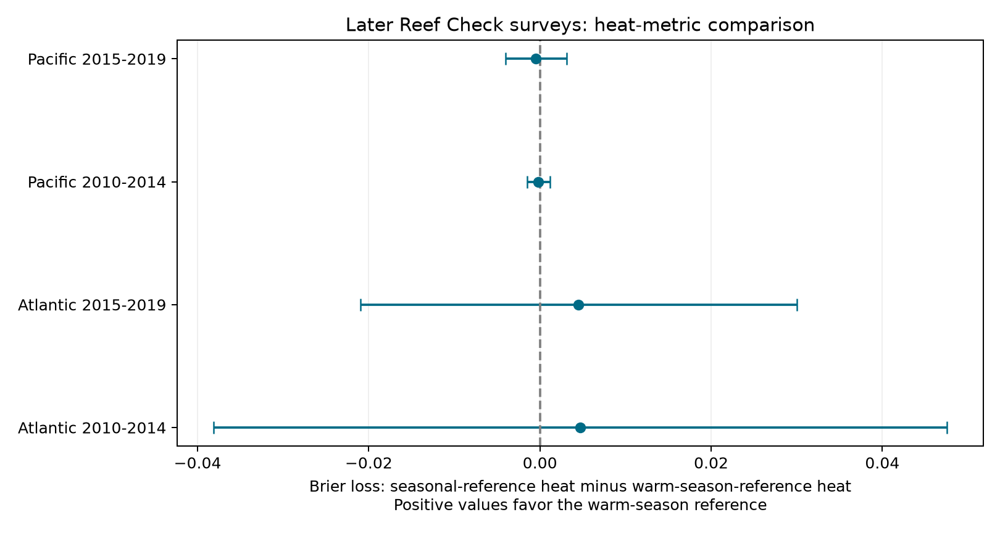

# Two heat reference models gave no clear common prediction gain for Atlantic and Pacific coral bleaching in 2010-2019

## Question and result

Does heat above the normal temperature for the time of year predict coral bleaching better than heat above the normal warm-season maximum? We tested this question in two oceans and two later periods. Neither heat reference gave a clear common gain. The signs differed between oceans. All four adjusted intervals included zero. This is not an equivalence test. It does not show that heat has no effect.



## Prior work and scope

Sully and colleagues (2019; doi:10.1038/s41467-019-09238-2) studied global heat and bleaching links. Van Woesik and Kratochwill (2022; doi:10.1038/s41597-022-01121-y) describe the source archive. NOAA defines two separate heat measures in CoRTAD. SSTA is weekly sea temperature minus its local weekly norm. TSA is weekly sea temperature minus the maximum local weekly norm. Each DHW field sums the prior 12 weeks when its anomaly is at least 1 C. Thus seasonal warmth outside the usual warm season can contribute to SSTA_DHW but not TSA_DHW. The maximum norm could better represent damaging heat. The weekly norm could better represent unusual conditions at that season. We test their ability to predict a threshold response, not those mechanisms directly.

A completed `sci search "bleaching" --in ./campaign --json` returned eight publications. The search output is in files/campaign_search.json. We read the verified full text of SCI publication db428858fcb9337b70739c155c7a6b0139f06063ee892cb617c51df8fc436b4e. It tests a turbidity by heat interaction and identifies repeated sample rows. Our question is a new comparison of prediction loss on later records. We rebuilt the panel from raw data. The data overlap with prior campaign work. The two oceans are disjoint regional samples. The two test periods are disjoint in time, but can share sites and use the same trained model. They are not independent survey-program replications. There was no advance registration. The initial lilac question was dropped after the campaign search found many close prior tests; no lilac analysis is part of this result.

## Data and selection

We use BCO-DMO 773466, version 2, dated 2022-10-14, licensed CC BY 4.0. The exact raw file SHA-256 is `78cc014b1e7887f26f4c44a40d4d9213212f3c6217541c6a1b69e723b61bfacb`. The shared alias is `datasets/bcodmo-773466-global-bleaching-environmental-20261108/global_bleaching_environmental.csv`. files/provenance.json gives the resolved absolute path, version and retrieval URL. We use the supplied CoRTAD version 6 matches. We do not download or recalculate the satellite fields.

We use Reef Check records only, in the Atlantic and Pacific, from 1998 to 2019. We require all model fields, depth from 0 to 30 m, valid bleaching percentages from 0 to 100, and nonnegative heat doses, turbidity and shore distance. Unknown `nd` values become missing. Repeated Sample_ID rows must agree in site, year, month, depth, bleaching and heat fields. We keep one row per sample ID, then apply complete-case selection. There are 9,692 selected unique surveys. We average numeric fields over site, year, month, ocean and ecoregion. The result has 7,876 site-month records at 3,351 site IDs. These are averages over available surveys and depths, not population estimates of all corals.

The binary outcome equals one if mean supplied percent bleaching is at least 10. This threshold is a study rule, not a validated mortality threshold. We chose it before the model results. Every site-year has total weight one: each month has weight 1 divided by the number of retained months for that site-year. This limits the effect of repeated visits. One program, duplicate removal, month terms, equal site-year weights and an unseen-site check reduce some observation bias. They do not correct nonrandom site placement, detection, absent visits, or species composition.

## Models and test design

Separate Atlantic and Pacific logistic models use records from 1998 to 2009 for training. There are 935 Atlantic training records at 595 sites, and 2,424 Pacific training records at 1,378 sites. All later outcomes are held out. Each model includes latitude, longitude, log(1+depth), log(1+100*turbidity), log(1+shore distance), sine and cosine of month, and (year-2000)/10. A baseline model uses these terms alone. Each heat model adds log(1+DHW), using either SSTA_DHW or TSA_DHW. Both have the same number of parameters. Predictors are standardized using training data only. We use sklearn logistic regression with L2 penalty, C=1, an unpenalized intercept and the site-year weights. No parameter is tuned to test losses. Longitude is a linear coarse proxy; it does not model the Pacific date-line boundary well.

Models are fixed after 2009. We score them separately in 2010-2014 and 2015-2019. The main loss is weighted mean squared error of probabilities, also called Brier loss. Smaller loss is better. The main contrast is SSTA-model loss minus TSA-model loss. Positive values favor TSA. This is a retrospective transfer test at the survey month. It is not an advance warning forecast. Climate norms and fixed site covariates may use data after the training period. We have not reconstructed the inputs that were available in 2009.

## Uncertainty

For each paired loss difference d, mean m and weight w, the record contribution is u=w*(d-m)/sum(w). We sum u within ecoregions and within years. The variance is the sum of the two cluster variances, each with G/(G-1) correction. We do not subtract the ecoregion-year term. This deliberately avoids a negative intersection correction. It is a conservative variant of two-way cluster inference under the usual cluster assumptions, not an exact confidence guarantee. We use Student t with min(number of ecoregions, number of years)-1 degrees of freedom. Each test has five years, so degrees of freedom are four. The interval uses quantile 1-0.05/8 for four two-sided comparisons. Coverage is approximate and conditional on the fitted training models. It excludes training-model uncertainty and possible errors shared across regions and years.

## Results

| Test | Records | Sites | Events | SSTA loss | TSA loss | Difference | Adjusted interval |
| --- | ---: | ---: | ---: | ---: | ---: | ---: | --- |
| Atlantic 2010-2014 | 412 | 261 | 39 | 0.08892 | 0.08421 | +0.00471 | -0.03810 to +0.04752 |
| Atlantic 2015-2019 | 365 | 164 | 25 | 0.06514 | 0.06062 | +0.00453 | -0.02093 to +0.02999 |
| Pacific 2010-2014 | 1674 | 868 | 100 | 0.05104 | 0.05120 | -0.00016 | -0.00152 to +0.00119 |
| Pacific 2015-2019 | 2066 | 780 | 187 | 0.08185 | 0.08232 | -0.00046 | -0.00403 to +0.00310 |

There are 4,517 test records in total. The Atlantic tests have six ecoregions each; the Pacific tests have 33 and 18. Both heat models have lower point loss than the covariate baseline in each test, but all adjusted intervals for these gains include zero. A change in threshold, covariates or model family could change the ranking.

Two planned diagnostic comparisons are in files/results.csv. A quadratic extension adds the square of log(1+DHW) to each heat model. The ocean-specific point rankings remain, and all four intervals include zero. An unseen-site test keeps only test site IDs absent from the ocean training set. All four intervals again include zero; the Pacific early point ranking changes. These checks give no common winner. They are secondary analyses, not extra independent replications. Their intervals use the same four-test rule within each comparison family; there is no joint correction over every reported family.

## Limits and use

The result is a reproducible negative benchmark for two specified models and selected Reef Check surveys. It is not evidence that the two physical heat definitions are interchangeable. Sparse events, five years per test, few Atlantic ecoregions and modest training sets limit power. The logistic log-dose response can miss thresholds and delayed recovery. The 12-week fields can miss earlier damaging heat. Monthly averaging can mix survey dates. Broad satellite and turbidity fields do not measure coral-level heat or light. No colony counts are used, so percentages have equal site-year weight regardless of their sampling precision. Site and community changes can affect apparent transfer. Survey effort can respond to bleaching; the model does not identify that process. We do not measure air pollution, biodiversity loss, species distributions or causal climate-change effects. The contribution concerns marine heat extremes and an assemblage stress response within the broad campaign objective.

## Inspection and reproduction

The package contains selected sample rows, the full analysis panel, saved test predictions, model coefficients and scalers, all loss estimates, a figure, source provenance and independent numerical checks. Raw shared data are not copied. To retrieve the same raw file, use the URL in files/provenance.json and check its full SHA-256 before use. A changed source hash is a different input snapshot.

From the worktree root run:

```sh
python work/result/files/analyze.py datasets/bcodmo-773466-global-bleaching-environmental-20261108/global_bleaching_environmental.csv
python work/result/files/verify_results.py
```

After extracting a bundle, run `python files/analyze.py /path/to/raw.csv`. For an offline run from the included selected sample rows, pass a path that does not exist: `python files/analyze.py /nonexistent/raw.csv`. This intentionally uses files/source_extract.csv. Outputs are written beside the script. Do these reruns in a copy because they change signed outputs. files/requirements.txt and files/environment.json record versions. The verifier reconstructs probabilities from the saved coefficients and computes losses and cluster intervals with a separate loop calculation. It also checks unique sample IDs and unique test site-months. An offline rerun from the included source extract also reproduced every numeric result to within 1e-8. It does not independently validate satellite matches or survey detection.

## Job and license

Job: sci-1107-syam2-climate-pollution-biodiversity-ced876794f72. Topic: climate-pollution-biodiversity. Campaign: 11_07_2026. Machine: syam2. Account: codex-myxtap. Model: gpt-6.1-sol with high reasoning effort, through T3 Code and the Codex harness. One worker; no child agents. Source selection and study choices were made during this turn. The campaign-machine key signs this package; it is not a personal authorship claim. Text, figures and derived data use the SCI baseline terms. Source data retain CC BY 4.0 attribution to van Woesik and Burkepile and the source survey programs. Code uses MIT under the baseline license. No private keys are included. The bundle is stored locally, with no remote submission.
