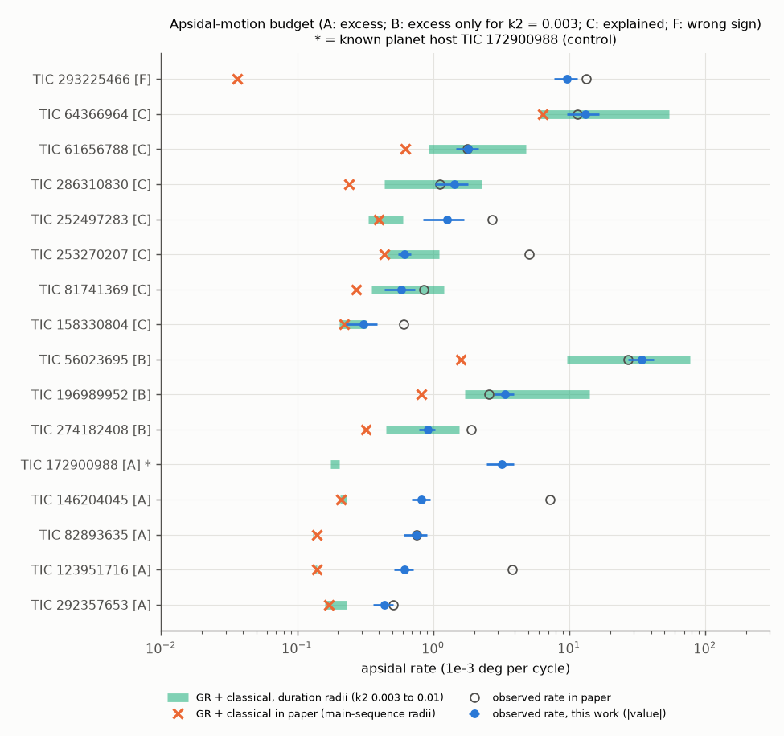
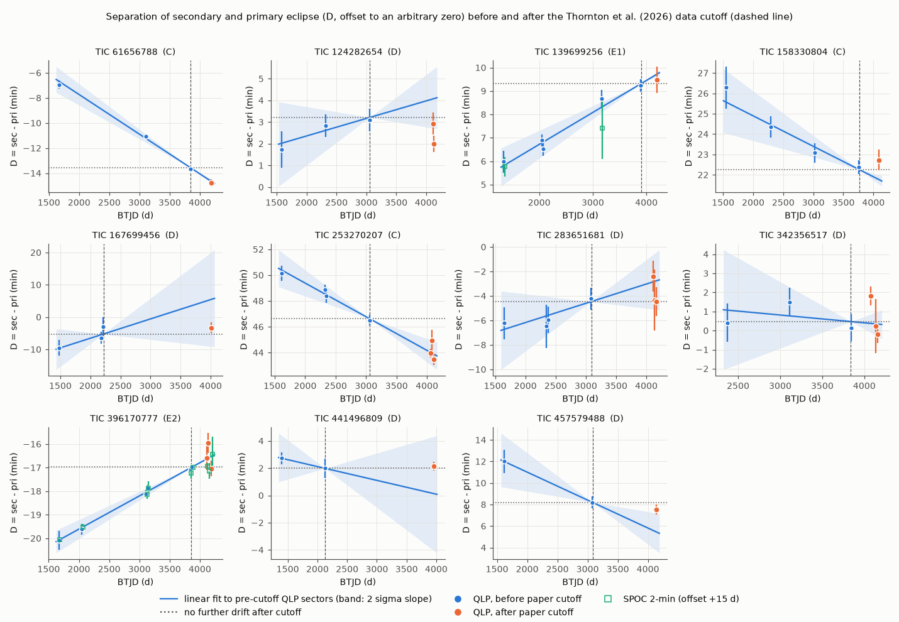
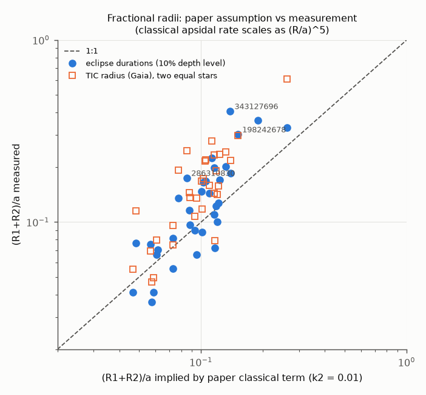

# TESS eclipse times confirm the drifts of most apsidal-motion circumbinary-planet candidates, but tidal precession explains many of them

## Summary

Thornton et al. (2026, MNRAS, arXiv:2512.07934v2) use TESS QLP light curves of eclipsing binaries (EBs). They report 36 EBs with apsidal precession above the general-relativity (GR) and classical (tidal plus rotational) rates. They give 27 of these EBs as circumbinary-planet candidates. Their classical rate uses main-sequence radii from Teff relations.

We did an independent test of all 36 EBs and one control. The control is TIC 172900988, a known circumbinary-planet host with known apsidal motion (Kostov et al. 2021). We measured 1,871 individual eclipse times in 256 QLP and 79 SPOC 2-min light curves (TESS sectors 1 to 104). For each sector, we calculated D, the time from the primary eclipse to the secondary eclipse. Apsidal motion changes D. Light-travel-time effects (LTTE) and period errors do not change D.

Main results:

1. **Replication.** In the data before the paper cutoff, 21 of 32 comparable EBs have a D drift above 3 sigma. All 21 drifts have the same sign as the drifts in the paper's O-C figures, and the median amplitude ratio is 0.99. In the other 11 EBs, the drift is below 3 sigma in our data. For TIC 124282654, our drift has the opposite sign.
2. **Forecast.** Eleven EBs have TESS sectors after the paper cutoff (20 sector values). Over the 20 values, chi-square is 18.3 when the drift continues and 82.7 when the drift stops. Two EBs give most of this result: TIC 253270207 and TIC 61656788. The other nine EBs do not give a decision.
3. **Sign rule.** Prograde apsidal motion (GR, tides, or a coplanar companion) has a fixed sign. D must decrease when the primary eclipse is the shorter eclipse. D must increase when the primary eclipse is the longer eclipse. We could test the rule in 15 of the 36 EBs. The rule is correct in 14 EBs and in the control. It fails in TIC 293225466 (P = 129.3 d).
4. **Radii and the classical term.** We measured the fractional radius sum (R1+R2)/a from the eclipse durations. These values agree with independent TIC (Gaia) radii. Many hosts are subgiants or giants (TIC log g below 3.8, or TIC class GIANT). In 25 of 35 EBs, the measured radius sum is larger than the approximate value implied by the paper's classical term (median ratio 1.31, maximum 2.9). The classical rate changes as (R/a)^5. Thus, with the same k2, our classical rate is larger than the paper's value by a median factor of 3.8, by more than 10 in 9 EBs, and by about 200 for TIC 343127696.
5. **Budget.** We compared our apsidal rate with GR plus the classical rate from the measured radii. The planet candidates fall into these classes:
   - A, 4 EBs (TIC 123951716, 146204045, 292357653, 82893635): a 3.5 to 5 sigma excess remains with apsidal constant k2 = 0.01. The control TIC 172900988 is also in class A (4.2 sigma).
   - B, 3 EBs (TIC 56023695, 196989952, 274182408): the excess remains only with k2 = 0.003.
   - C, 7 EBs (TIC 61656788, 64366964, 81741369, 158330804, 252497283, 253270207, 286310830): GR plus classical precession explain the rate.
   - D, 7 EBs: the drift is below 3 sigma in our data.
   - E, 5 EBs: the orbit is almost circular or the eclipse widths are almost equal. Thus e sin w is not measured and the rate is not determined. In 2 of these EBs (E1), the classical rate can supply the minimum rate.
   - F, 1 EB (TIC 293225466): the drift has the wrong sign for prograde motion.

TIC 146204045 also has a 16.8-min LTTE signal (Thornton et al.). Thus its companion is probably a star. The three remaining class-A EBs are the best candidates for a non-transiting third body. Our apsidal rate for TIC 123951716 is 6 times smaller than the published rate. Thus its minimum companion mass decreases from 0.14 to about 0.02 Jupiter masses. This value applies at the stability limit and uses the scaling of Thornton et al. (2026).

These results do not show that planets are present or absent. The results show that a drift alone is not sufficient evidence for a planet. The classical term must use measured radii.



## Question

Do the primary-secondary timing drifts of the Thornton et al. (2026) candidates (a) occur again in an independent measurement, (b) continue in TESS data taken after the paper cutoff, and (c) remain above GR plus classical precession when the classical term uses measured stellar radii?

## Data

- Target list: Table "tic_omega_dot" (36 EBs) of Thornton et al. (2026). We copied the table from the arXiv v2 TeX source (`files/data/thornton2026_table.csv`; source tarball SHA-256 `32ac6ae94e1da9159902cda2446358302e5bd4a8af85e8f7df0ce67b3f4d59d4`). The paper excludes 9 EBs from its 27 planet candidates. We kept the reason for each exclusion in the column `paper_note`.
- Paper cutoffs and divergences: we read the first and last plotted epoch and the change of (secondary O-C minus primary O-C) by eye from the O-C figures in the arXiv source (`files/data/paper_oc_digitized.csv`). The accuracy is about 20 percent or 0.5 min. We used these values only for the in-sample/out-of-sample split and for the replication plot.
- Light curves: MAST, retrieved 2026-11-08. These are the QLP HLSP FFI light curves (doi:10.17909/t9-r086-e880; cadence 1800 s, 600 s, and 200 s) and the SPOC 2-min light curves. The file list and download URLs are in `files/data/obs_list_clean.csv` and `files/data/dl_list.txt`. The SHA-256 of all 335 files is in `files/data/lc_files_sha256.csv`. The raw files (247 MB) are not in this bundle.
- TIC v8.2 parameters (Teff, log g, radius, mass, luminosity class): MAST catalog query, `files/data/tic_params.csv`.
- The shared campaign dataset store had no data for these targets. We did not add a shared dataset.

## Method

All code is in `files/code/`.

1. `03_time_target.py`. For each EB, we load QUALITY == 0 data, split each light curve into segments at gaps, and normalise each segment by its median. A binned box search on a period grid near the published period finds the primary and secondary eclipses. The search gives separate periods. Each eclipse type gets a symmetric Mikulasek (2015) profile, 1 - A{1 - (1 - exp[1 - cosh(x/D)])^G}. We integrate the profile over the exposure time of each cadence, so the 1800-s QLP data do not bias the shape. For each eclipse, we fit the mid-time, the depth, and a quadratic local baseline to the raw flux, with D and G fixed. We do the fit two times, and the second pass uses per-sector aligned templates. For each sector and eclipse type, we calculate the weighted mean O-C against one common linear ephemeris. The error is the formal error, or the formal error times sqrt(reduced chi-square) if that value is larger. D_s is the secondary mean O-C minus the primary mean O-C. Primary means the deeper eclipse (template depth A).
2. `05_widths.py`. For each sector, we fit the profile again with free shape. We use the half width at half depth of each eclipse type. s_w = (W_sec - W_pri)/(W_sec + W_pri) approximates e sin w. We add a systematic error of 0.02 because impact-parameter differences and the profile shape also change the widths. The full widths at the 2 % and 10 % depth levels give (R1+R2)/a = pi T/P (circular, i = 90 deg). This value is a lower limit for b > 0.
3. `04_analyze.py`.
   - Replication: a weighted linear fit of D to the QLP sectors up to 30 d after the paper's last plotted epoch.
   - Forecast: we extrapolate that fit to the later sectors. The prediction error includes the parameter covariance and the scaled sector errors. The null model keeps D at the value at the last in-sample epoch.
   - Rate: w_dot = -(pi/2)(dD/dt)/s_w rad per cycle. dD/dt comes from all QLP sectors. Prograde motion needs dD/dt * s_w < 0 (`sign_check.py` confirms this with a numerical Keplerian orbit).
   - Classical rate: Sterne (1939) as written in Baroch et al. (2021), with equal stars r_i = r_sum/2, synchronous rotation, and k2 = 0.01 (the paper's value) or 0.003. Equal radii give the smallest sum of r_i^5 for a fixed sum, so this choice is conservative. We used the GR rate from the paper. For the control, we calculated it from Kostov et al. (2021) masses.
   - Classes: A to F use the 10 %-level radii and the excess significance (rate minus GR minus classical)/error. Class E uses a lower limit, (pi/2)|dD/dt|/e_max.
   - For TIC 293225466, few sectors contain both eclipses. Thus we fitted the primary and secondary O-C separately and used the difference of slopes.
4. `06_figures.py`: the figures, and a check of the SPOC 2-min D slopes against the QLP D slopes.

## Results

### Replication (Figure 2)


Drifts above 3 sigma (21 EBs) agree with the paper in sign and size (median ratio 0.99). One large difference is TIC 146204045. We do not detect its secondary eclipse in the early 1800-s and 600-s sectors. Our D therefore starts in sector 62, and in sectors 62 to 90 it agrees with the paper (change of about -2 min). The other differences are drifts below 3 sigma in our data: TIC 124282654, 51629874, 283651681, 355503224, 95622298, 165615442, 167699456, 441496809, 342356517, 121092916, and 115396972.

### Forecast (Figure 1)



| TIC | Class | New sectors | Predicted change (min) | Observed change (min) | chi2 continue | chi2 stop |
|---|---|---|---|---|---|---|
| 253270207 | C | 99 100 101 | -2.68 +- 0.82 | -2.49 +- 0.39 | 0.9 | 59.7 |
| 61656788 | C | 104 | -1.10 +- 0.25 | -1.20 +- 0.48 | 0.0 | 6.3 |
| 396170777 | E2 | 101 102 104 | 0.39 +- 0.10 | 0.45 +- 0.25 | 4.4 | 6.3 |
| 457579488 | D | 102 | -2.75 +- 1.25 | -0.69 +- 0.74 | 2.4 | 0.9 |
| 158330804 | C | 100 | -0.49 +- 0.41 | 0.47 +- 0.61 | 2.1 | 0.6 |
| 124282654 | D | 101 102 | 0.86 +- 1.09 | -0.74 +- 0.47 | 4.1 | 4.0 |
| 167699456 | D | 98 | 10.8 +- 8.3 | 1.9 +- 2.3 | 1.1 | 0.7 |
| 283651681 | D | 101 102 103 | 1.67 +- 1.85 | 0.75 +- 1.12 | 0.9 | 1.9 |
| 139699256 | E1 | 104 | 0.41 +- 0.28 | 0.17 +- 0.62 | 0.1 | 0.1 |
| 342356517 | D (paper: low significance) | 100 102 103 | -0.12 +- 1.06 | 0.15 +- 0.81 | 1.7 | 2.2 |
| 441496809 | D (paper: low significance) | 97 | -1.86 +- 2.72 | 0.16 +- 0.78 | 0.5 | 0.0 |

The two EBs that clearly continue their drift are both in class C. Tidal apsidal motion also predicts a steady drift. Thus the forecast test confirms that the timing signal is real, but it does not separate a planet from tides.

### SPOC check

In seven EBs, SPOC 2-min data have at least two sectors with D. In six of these EBs, the SPOC D slope agrees with the QLP slope within 1.4 sigma (`files/results/spoc_vs_qlp_slopes.csv`). For example, TIC 343127696 has -5.29 +- 0.47 min/yr (QLP) and -5.29 +- 0.41 min/yr (SPOC), and TIC 64366964 has -5.80 +- 0.15 and -5.76 +- 0.08 min/yr. TIC 198242678 has a 3.8 sigma difference. The paper notes fast short-term timing variations in this EB.

### Radii (Figure 4)



Duration radii and TIC radii agree (examples: TIC 139699256, 0.282 and 0.278; control TIC 172900988, 0.071 and 0.072). The radius sum implied by the paper's classical term is smaller in 25 of 35 systems. We calculated this implied value by inverting the classical formula with equal stars and k2 = 0.01, so it is approximate. Examples are TIC 343127696 (0.14 implied, 0.41 measured), TIC 286310830 (0.085 and 0.18), and TIC 139699256 (0.11 and 0.22).

### Budget (Figure 3, `files/results/summary.csv`)

Rates are in 1e-3 deg per cycle. "Classical" uses the 10 %-level radii with k2 = 0.01. "Excess" is the excess significance in sigma with k2 = 0.01.

| TIC | Class | Rate (this work) | Rate (paper) | GR | Classical (paper) | Classical (this work) | Excess |
|---|---|---|---|---|---|---|---|
| 123951716 | A | 0.62 +- 0.10 | 3.84 | 0.136 | 0.003 | 0.002 | 5.0 |
| 146204045 | A (LTTE) | 0.82 +- 0.13 | 7.2 | 0.205 | 0.005 | 0.010 | 4.8 |
| 82893635 | A | 0.76 +- 0.15 | 0.76 | 0.130 | 0.010 | 0.001 | 4.3 |
| 292357653 | A | 0.44 +- 0.07 | 0.51 | 0.150 | 0.020 | 0.031 | 3.5 |
| 172900988 (control) | A | 3.19 +- 0.71 | (2.41) | 0.172 | - | 0.011 | 4.2 |
| 56023695 | B | 34 +- 7 | 27.3 | 0.39 | 1.2 | 30.8 | 0.4 |
| 196989952 | B | 3.4 +- 0.6 | 2.57 | 0.42 | 0.40 | 4.3 | -2.5 |
| 274182408 | B | 0.91 +- 0.13 | 1.9 | 0.26 | 0.06 | 0.63 | 0.2 |
| 64366964 | C | 13.1 +- 3.5 | 11.5 | 0.49 | 5.9 | 18.7 | -1.7 |
| 61656788 | C | 1.81 +- 0.34 | 1.79 | 0.42 | 0.20 | 1.68 | -0.9 |
| 286310830 | C | 1.43 +- 0.39 | 1.12 | 0.22 | 0.02 | 0.72 | 1.2 |
| 252497283 | C | 1.26 +- 0.43 | 2.7 | 0.30 | 0.10 | 0.12 | 2.0 |
| 253270207 | C | 0.62 +- 0.07 | 5.1 | 0.34 | 0.10 | 0.39 | -1.7 |
| 81741369 | C | 0.59 +- 0.15 | 0.85 | 0.25 | 0.02 | 0.33 | 0.0 |
| 158330804 | C | 0.31 +- 0.08 | 0.61 | 0.19 | 0.03 | 0.05 | 0.9 |
| 293225466 | F | -9.6 +- 1.9 | 13.3 | 0.036 | 0.000 | 0.000 | (wrong sign) |

The paper rate for the control (2.41) is the third-body rate from its own method check. In class B, the excess is above 3 sigma only with k2 = 0.003. In classes C and B, the classical rate with k2 = 0.01 can be larger than the observed rate. Thus k2 for these evolved stars is probably below 0.01.

### TIC 293225466 (Figure 5)


The deeper eclipse is shorter (HWHM 0.272 d) than the shallower eclipse (0.345 d). The time from the deeper eclipse to the shallower eclipse increases by 6.7 min per year. Prograde apsidal motion causes a decrease. The paper's plotted drift has the same direction as our drift, so the timing agrees. The interpretation does not agree. Possible causes are retrograde apsidal motion from an inclined third body, or a grazing geometry in which impact-parameter differences, not e sin w, control the width ratio. In the sectors after the paper cutoff (96, 98), the drift is 8.3 +- 2.6 min below the in-sample linear trend. Thus the drift becomes slower.

## Limitations

- e sin w comes from the duration ratio. This is a first-order approximation. Different impact parameters, limb darkening, and unequal stars cause errors. We used a 0.02 systematic floor, but this value is an estimate. The rate depends on 1/(e sin w).
- The classical rate uses equal stars, synchronous rotation, and one k2 for both stars. Measured k2, rotation, and masses for each star would change the rates by factors of a few. We have no spectroscopic masses.
- The duration radius sum ignores the impact parameter and the eccentricity. It is a lower limit for b > 0, so the classical rates are conservative in that respect.
- We read the paper cutoffs and divergences by eye from figures. The forecast split has an error of a few days. The replication values have errors of about 20 %.
- Most post-cutoff data cover only one to three sectors and a baseline of 1 to 2 years. Nine of 11 forecasts do not give a decision.
- We did not model starspots. In near-circular EBs (class E), spots can cause opposite timing shifts of the two eclipses.
- We did not detect some early QLP eclipses (for example, the early secondaries of TIC 146204045). The cause is coverage and gap rules in the per-eclipse fit.

## Reproduction

The commands use Python 3.12, numpy 2.5.4, scipy 1.18.1, astropy 8.0.2, pandas 3.1.1, matplotlib 3.11.2, and astroquery 0.4.11.

```
mkdir -p work/src work/data work/out
cp files/code/* work/src/ ; cp files/data/*.csv files/data/dl_list.txt work/data/
python work/src/00_targets.py            # target table (already in files/data)
python work/src/01_list_obs.py           # MAST product list (needs astroquery)
bash   work/src/02_download.sh           # 335 light curves; check against lc_files_sha256.csv
for t in $(cut -d, -f1 work/data/thornton2026_table.csv | tail -n +2) 172900988; do python work/src/03_time_target.py $t; done
for t in ...same list...; do python work/src/05_widths.py $t; done
python work/src/04_analyze.py ; python work/src/06_figures.py
```

The per-eclipse times, per-sector values, width fits, and templates are in `files/results/timing/`. `summary.csv` has one row per EB with all derived quantities and the class. `sector_separations.csv` has D per sector.

## Provenance

- Campaign 11_07_2026. Job sci-1107-dell-astronomy-278c74e78e19, topic astronomy, machine dell, account claude-andrii. Model: Claude Opus 5.5 (claude-opus-5-5), used as an autonomous research agent. The signing key is a campaign-machine key. It is not a personal authorship claim.
- Data: MAST TESS QLP HLSP and SPOC light curves, and the TIC v8.2 catalog. All were retrieved 2026-11-08. The table values come from arXiv:2512.07934v2.

## References

- Thornton M., Montet B. T., White R., Shao A., Kumar D. T. 2026, MNRAS, arXiv:2512.07934.
- Kostov V. B. et al. 2021, AJ 162, 234 (TIC 172900988).
- Huang C. X. et al. 2020, RNAAS 4, 204 (QLP).
- Mikulasek Z. 2015, A&A 584, A8 (eclipse profile).
- Gimenez A. 1985, ApJ 297, 405 (GR apsidal motion).
- Baroch D. et al. 2021, A&A 649, A64 (classical apsidal motion formulae); Sterne T. E. 1939, MNRAS 99, 451.
