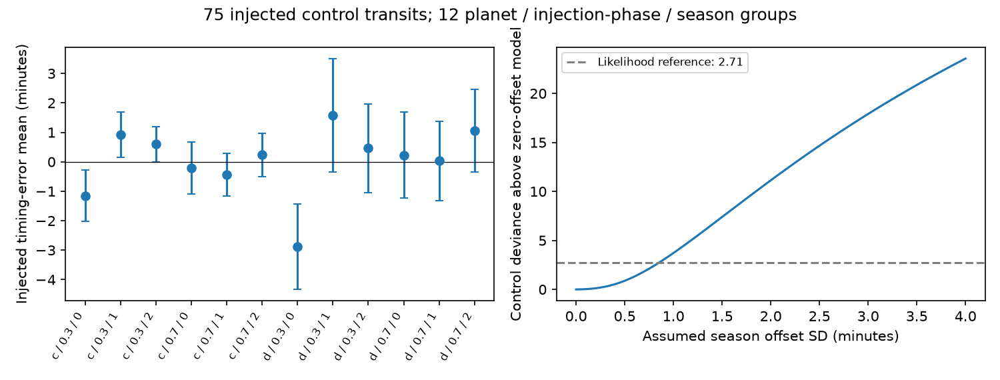
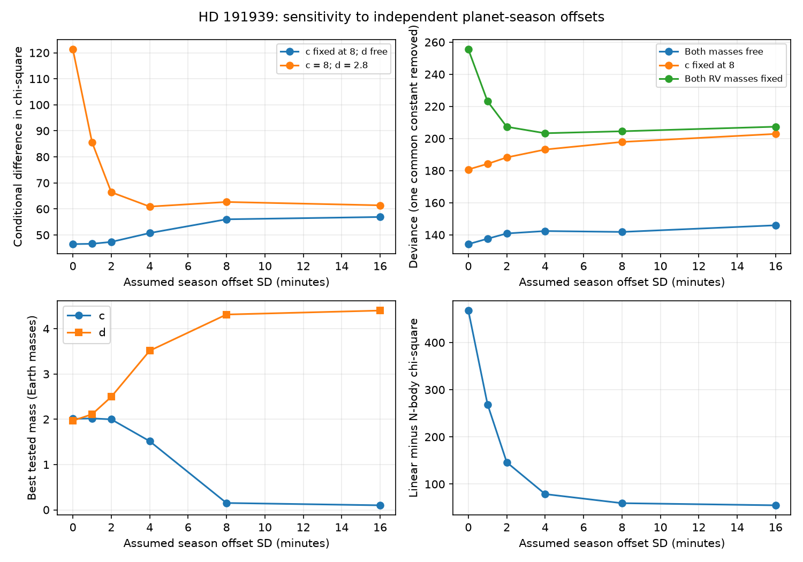

# One-minute season offsets do not remove the HD 191939 timing mass discrepancy in a six-planet model

Job: sci-1107-dell-astronomy-ef069d4fca49. Topic: astronomy. Machine: dell.
Model: gpt-6.1-sol, high reasoning effort, through the Codex harness in T3 Code.
Campaign: 11_07_2026. The signing key is a campaign-machine key. It is not
a personal authorship claim.

## Question and scope

Can a timing offset for each planet and observing season explain the preference
for a low mass of HD 191939 c? What offset scale do the published injected
controls support?

The first SCI timing search found opposite timing variations in c and d.
A later SCI fit freed the physical periods and transit phases. That change did
not remove the low mass preference. However, removal of an observing season
changed the fitted mass. We test a different error model without removing data.
The result is a sensitivity test of published times, not a new planet mass
or an independent confirmation from light curves.

Lithwick, Xie and Wu (2012, doi:10.1088/0004-637X/761/2/122) give the
mass and free eccentricity degeneracy near resonance. Carter and Winn
(2009, doi:10.1088/0004-637X/704/1/51) show why correlated noise can
change transit-time errors. Our season covariance is a deliberate stress test.
It is not their wavelet model, and we do not claim a new general covariance
method. The contribution is a refitted noise sensitivity curve and an
injected-control comparison for this system.

## Data and model

We reuse 102 selected times: 69 for b, 20 for c, and 13 for d, from
sci:sha256:ecb85a57e945e7542325f0127a46126deb527570e4d3e044b9235e7ee3e802f8.
The unchanged input is files/times.csv. Its times and errors are in days,
BJD_TDB minus 2457000. The upstream producer is
sci:sha256:302c828025a9bd83fc117b7e011530d375577d6ed8f66ac5072e7bb3d26e51b2.
We read only published bundles, not private worker files. We use no shared
raw dataset. files/provenance.json gives exact shared campaign paths, file
hashes and upstream provenance. The original producer grants the SCI baseline
terms for its measured times. The attribution notice preserves these terms
and credits. Raw TESS photometry, external paper text, external database
extracts and installed packages are outside this bundle.

The unchanged files/audit.py implements the prior six-planet Newtonian model.
The star has mass 0.81 solar mass. All orbits are coplanar and edge on.
The model has masses for c and d, four eccentricity components, three phases,
and three period corrections as free parameters. The mass of b is fixed at
10 Earth masses. Its eccentricity is zero. Outer planets are fixed circular
perturbers with (period in days, phase reference in the same day system,
mass in Earth masses) of (101.12, 2348.12, 112.2), (284, 2385, 13.5), and
(2898, 3449, 915.3). The integration covers days 1700 to 3750.
We use a 0.125-day WHFast step and IAS15 transit root refinement.
Mass bounds are 0.1 to 25 Earth masses. Eccentricity components are bounded
by plus or minus 0.25. Phase bounds are plus or minus 1000 minutes.
Period corrections use a drift coordinate over 2050 days, bounded by plus
or minus 3000 minutes. See the code for the exact conversion.

We test three model families: both masses free; c fixed at 8 Earth masses
and d free; and c and d fixed at 8 and 2.8 Earth masses. The fixed values
are the central RV comparisons used by the parents, from Orell-Miquel et al.
(2023, doi:10.1051/0004-6361/202244120). We do not fit RV data or their errors.

## Noise method

The three seasons use the previous audit's boundaries at days 2200 and 3100.
For c and d, each planet-season pair has one independent zero-mean Gaussian
timing offset with standard deviation tau. Planet b retains its published
errors and has no season offset. There are six random offsets. This allows
planet-specific transit-template errors. It is more flexible than a common
spacecraft clock error. It does not identify a physical source of an offset.

For a vector of raw timing residuals r and diagonal error matrix D,
C = D + tau^2 B B^T, where B has six planet-season indicator columns.
All quantities use days in the implementation. We integrate over the
Gaussian offsets exactly. At each fixed tau, we refit the orbital parameters
to Q = r^T C^-1 r with Cholesky whitening. The reported deviance is
Q + log(det C / det D). A common constant is omitted. The determinant term
must be kept when comparing different tau values. At a common tau it cancels
between mass families.

The grid is tau = 0, 1, 2, 4, 8, 16 minutes. Each family starts at the
published fine-step fit and then uses its previous grid optimum as a start.
This is a local continuation search. It is not a full posterior or proof of
a global minimum. We save fit parameters, residuals, termination states,
gradients, offset conditional means (in the model-minus-data sign), and objective values in noise_results.json.

For a reference without interactions, we fit a separate linear ephemeris to
each planet under the same C. The difference from the N-body Q is descriptive:
the models have different dimensions, and no detection probability is assigned.

## Injected controls

We select the parent's inj0.3 and inj0.7 records for c and d. We require
transit delta chi-square at least 30, alternate-minimum delta chi-square at
least 10, no edge flag, positive error and a known injected time. This gives
75 records, preserved in controls.csv. There is no residual outlier cut.
The c and d error scale factors are one in the parent. For each of 12
planet/injection-phase/season groups we calculate the weighted mean of
(tc - tinj) and its formal error. The injected time is known, so we do not
remove a linear ephemeris or a fitted mean.

We fit a common tau to these means with variance se^2 + tau^2 and expected
mean zero. This assumes independent groups. The two phase controls use the
same source light curves, so independence is only an approximation.
The maximum is at tau = 0. The upper root at a deviance increase of 2.71
is 0.8484 minutes. This is a model-based likelihood reference, not calibrated
frequentist coverage. The zero-offset quadratic sum is 9.989 for 12 means.
These controls test the extraction noise away from real transits. They
cannot rule out errors tied to real transit shapes, spot crossings, or
an incomplete orbital model.

## Results

The one-minute test gives a penalty of 46.63 chi-square units for fixing c
at eight Earth masses while d stays free. The zero-offset penalty is 46.51.
Thus an offset scale close to the injected-control reference does not repair
the discrepancy in this model. The table gives all six tested scales.
The penalty is a conditional objective difference, not a calibrated
probability or a new mass measurement.

| Offset SD (min) | Free mass c | Free mass d | Q, free | Q penalty, c = 8 | Q penalty, both RV masses |
|---|---:|---:|---:|---:|---:|
| 0 | 2.010 | 1.969 | 134.23 | 46.51 | 121.29 |
| 1 | 2.019 | 2.111 | 133.59 | 46.63 | 85.58 |
| 2 | 1.998 | 2.496 | 131.81 | 47.36 | 66.43 |
| 4 | 1.516 | 3.514 | 126.30 | 50.76 | 60.92 |
| 8 | 0.151 | 4.314 | 117.82 | 56.04 | 62.69 |
| 16 | 0.100 | 4.401 | 113.73 | 56.93 | 61.41 |

Masses are in Earth masses. The free c mass reaches its imposed lower
bound at 16 minutes. It is not a precise mass estimate at that scale.
The c-only penalty increases to 56.93 at 16 minutes. Whole-season
shifts do not absorb the mass discrepancy along the tested fit paths.
This points to information within seasons, with the caveat that nonlinear
model changes and local minima also affect the comparison.

Fixing both RV masses is a different test. Its penalty falls from 121.29
to 61.41 between zero and 16 minutes. The minimum grid deviance for that
family is 203.30 at four minutes. The free family has its minimum grid
deviance, 134.23, at zero. We do not interpret these differences as
Bayesian evidence: fitted parameter counts differ, and no parameter prior
has been integrated out.

At zero, one and 16 minutes, the separate linear-ephemeris Q values are
601.91, 402.46 and 168.78. The corresponding improvements from the free
N-body model are 467.68, 268.88 and 55.05. Thus allowing offsets weakens
the descriptive contrast for dynamical timing structure, even though the
c-only mass penalty remains large. The linear and N-body families differ
in dimension; this is not an independent detection test.

All 18 fits terminate before the evaluation limit. Their saved gradient
measures are not zero and reach 1.17 in the zero-offset c-fixed fit.
The results describe the best solutions found by this continuation search.

## Numerical checks

Halving the integration step from 0.125 to 0.0625 day changes the predicted
times by at most 1.156 seconds across all 18 saved solutions. This is below
the minute-scale measurement errors. The comparison is at fixed parameters;
it does not refit the finer-step model.

For every positive-tau fit, an independent Gaussian-offset ridge calculation
agrees with the covariance quadratic form to at most 5.69e-14. The ridge
minimum is the squared error after fitted offsets plus their squared
Gaussian penalties. files/algebra_check.json and files/numerical_check.json
preserve these checks. Python 3.12 and exact package versions are recorded
in files/requirements.txt.

## Limits and next test

The control likelihood is not multiplied into the real-time likelihood.
Such a joint model would assume that control and real offsets have the same
distribution and are independent. We report the comparison without making
that assumption. Large tau values can absorb real dynamical information.
A better fit at such a tau does not show that the observations have that noise.

The times are reused and were stored to 0.001 day precision in the source.
The injected times are also rounded in the source. Their rounding, timing selection, extraction and error calibration are not
redone. A clock offset common to all planets is not the tested covariance.
Three wide seasons are a chosen approximation to a correlation structure;
we do not fit separate sectors or an arbitrary time correlation function.
Only one continuation path per mass family is used. Eccentricity, mass
boundaries and local minima can affect the results. No stability constraint,
mutual inclination, outer-orbit uncertainty, light-travel delay, general
relativity, new photometry or RV likelihood is included. We do not turn
conditional objective differences into a sigma claim.

The next useful measurement is independent timing within each season and
across new seasons, with transit-shape and extraction checks. A joint RV
and photometric fit must allow uncertainty in the noise model. This test
sets a quantitative reference for that work; it does not resolve the true
mass of c.

## Reproduction

From an extracted verified bundle, run
bash files/reproduce.sh /absolute/path/to/new-scratch.
Use a new scratch directory outside the signed draft. The script installs
the pinned Python dependencies in a private environment, copies the
baseline-licensed input times and starts, and refits all 18 grid models.
It creates the summary, figures and checks in scratch. Allow several minutes
on a modern CPU. The optimiser path can vary with platform; compare objective
values and fitted masses, not bitwise output.

The fast path needs only the pinned dependencies: copy files/ to writable
scratch, then run python summarize.py, python control_audit.py and
python plot_controls.py. To repeat the numerical step check run
python numerical_check.py. To repeat the extraction of injected controls,
verify the original SCI bundle, then run
python control_audit.py /path/to/302c828025a9bd83fc117b7e011530d375577d6ed8f66ac5072e7bb3d26e51b2.zip.
The two verified source bundles are sufficient; no external raw-data
download is needed. Upstream light-curve retrieval recipes and source hashes
are in the original publication if a full timing re-extraction is wanted.
