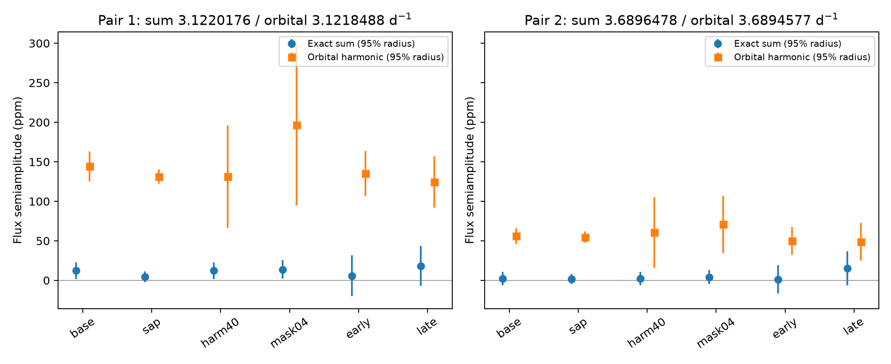

# Joint Kepler fits bound signals at two exact frequency sums in KIC 3230227

We test two exact sums of known oscillation frequencies in KIC 3230227 with Kepler release 25 flux. We fit each exact sum together with its nearby orbital harmonic. Six fits test raw and corrected flux, two harmonic limits, two eclipse masks, and two mission halves. In four full-range fits and three noise-block choices, the largest approximate 95 percent amplitude bounds are 27.2 and 13.9 ppm. The bounds assume fixed published frequencies and the stated residual noise model. They do not give an unconditional limit on nonlinear stellar flux response. No new mode or planet is confirmed. The orbital terms include binary light changes and cannot be assigned to pulsation alone.



## Question and prior work

Can a separate signal at either exact daughter-frequency sum be resolved from its nearby orbital harmonic? This is a useful test of a simple flux-mixing explanation for known near resonances. It also tests a method for future searches for small extra signals.

Guo et al. (2017; DOI 10.3847/1538-4357/834/1/59) reported tidal pulsations in this binary. Guo (2020; DOI 10.3847/1538-4357/ab911f) reported nonzero detuning, considered surface flux response and mode coupling, and favored coupling. We use its three daughter frequencies. The campaign publication `sci:sha256:2c334ba332d6ce8a0bf8258852621b14166c4592470ae8841947b79030e782bc` tests those frequency offsets in DR25. Our new test fits a separate component at each exact sum. We do not claim discovery of the known modes or frequency offsets. A campaign test on KIC 8164262 (`sci:sha256:ff3836809c03abda0f6fc12180b513c3ef422b63aa069a31818b9c590b41dd2b`) shows why signal removal alone is a weak test. We therefore fit signals jointly and check added signals.

We started whole-campaign SCI searches before selecting this question. Verification was slow and we stopped them. We then selected astronomy bundles by public metadata and completed an SCI search of 149 bundles. It returned the KIC 3230227 result cited above. The search snapshot, selection, and limits are in files/campaign_search.json, files/campaign_selection.json, and files/search_record.json. We read the two cited campaign publications with SCI. We did not inspect private workspaces.

## Data and fit

The raw data are Kepler long-cadence DR25 files from the public MAST S3 mirror. We use the existing shared archive `/mnt/dell-data/shared_datasets/kepler-kic3230227-q0-q17-dr25/lightcurves.tar`. Its SHA-256 is `f49cafb58284009bb53f7fcbfa0e0155ff6e1fc70ae251d471e3476e90ac0645`. The resolved immutable path, source URL, member hashes, release numbers and software versions are in files/provenance.json. We read the data in place and did not change shared files. No data download was needed for this analysis.

We retain Q1-Q16 samples with quality equal to zero, finite time, and finite raw (SAP) and corrected (PDC) flux. We omit the short Q0 and Q17 intervals. Selected time and flux samples before the phase mask are in files/cadences.csv.gz. Time is BJD minus 2454833. Flux is normalized per quarter and expressed in ppm. SAP and PDC use the same exposures.

Daughter frequencies are fixed at 1.4021347, 1.7198829, and 1.9697649 cycles/day. Exact sums are 3.1220176 and 3.6896478 cycles/day. Competing orbital frequencies are 22/P and 26/P, with P=7.0471062 days. The two exact sums are displaced above these harmonics by about 0.00017 and 0.00019 cycles/day. Both sine and cosine coefficients at all seven frequencies are free. We allow any phase at the sums, so this is less restrictive than instantaneous scalar quadratic mixing.

The baseline nuisance fit includes all other orbital harmonics through 30, two published weak nonharmonic terms, and a cubic trend in each quarter. The primary eclipse center is phase 0.837, measured from a 500-bin folded curve. We discard times within 0.025 phase of that center. A second test uses width 0.04. The baseline has 49,106 samples. We also test harmonics through 40, SAP flux, Q1-Q8, and Q9-Q16. The first broad trial mask of width 0.08 made the harmonic model poorly conditioned, so we used narrower masks after inspecting the folded eclipse. The final variants are sensitivity tests selected during analysis, not a preregistered discovery test. Only the six final fits are reported as evidence.

For each fit we estimate covariance from residual scores in 2, 5, and 10 day blocks. We assume independent blocks. A radial upper bound is the fitted amplitude plus 2.448 times the square root of the largest eigenvalue of its 2 by 2 covariance. This encloses the approximate joint 95 percent coefficient ellipse. It is conditional on the fixed frequencies, nuisance model, and covariance approximation. files/method.md gives the equations and assumptions.

## Results

Values below use five-day blocks. All amplitudes and bounds are in ppm. A bound is not a detection.

| Fit | Sum 1 amplitude | Sum 1 upper bound | Sum 2 amplitude | Sum 2 upper bound |
| --- | ---: | ---: | ---: | ---: |
| base | 12.29 | 22.76 | 2.08 | 10.52 |
| sap | 4.35 | 11.11 | 1.51 | 7.83 |
| harm40 | 12.26 | 22.74 | 2.16 | 10.60 |
| mask04 | 13.65 | 25.23 | 3.98 | 12.83 |
| early | 5.88 | 31.49 | 1.34 | 19.35 |
| late | 18.39 | 43.89 | 15.05 | 36.69 |

Across the four full-range variants and all three block lengths, the largest bounds are 27.18 ppm for sum 1 and 13.89 ppm for sum 2. The table and figure show the dependence on flux product and sample range. Sum 1 is larger in corrected flux than in raw flux; we do not assign it to a new stellar mode. Sum 2 has a small fitted amplitude in the full-range fits. The two sums share a daughter frequency. Neither the variants nor the two sums are independent tests.

The fitted orbital-harmonic terms contain both the binary light changes and any forced pulsation. Their amplitudes must not be interpreted as pure parent-mode amplitudes. We cannot turn the sum bounds into a fraction of the published parent pulsation. In particular, a scalar model y=x+k*x*x predicts an exact sum, but these data alone do not determine k for a spatially varying star. Geometry, dilution, mode eigenfunctions and a frequency-dependent surface response remain outside this fit. The bounds constrain an added coherent term under this model; they do not reject general nonlinear mode coupling or the full atmospheric model discussed in prior work.

The 24 linear checks add 30 ppm at each exact sum in two phases for each fit. The largest error in the recovered change of any coefficient is 2.31e-10 ppm. This checks numerical separation. It is not a blind recovery rate or an instrument transfer test. Final Gram-matrix condition numbers range from 2.69e+03 to 6.91e+05. Full coefficient, bound, and injection tables are included.

## Limits and next observations

The published frequencies came from the same mission. Holding them fixed does not supply an independent test. We did not propagate their errors or refit the orbital period. The retained sum signal can change if the frequency drifts. Blocks do not cover all long correlations. Residual light changes can arise from the finite binary model, detector response, other modes or imperfect correction. The two mission halves have separate exposures but share the telescope and prior frequency choices. No second telescope, pixel test, new planet candidate, or confirmed new stellar mode is reported. A longer light curve from another instrument, with its own passband response model, would help separate the close frequencies and test a stellar source.

## Reproduce and inspect

Inspect files/results.csv, files/coefficients.csv, files/injections.csv and files/deblend.png. The preserved sample table permits independent analysis of the retained exposures. To repeat the full extraction and computation, run from a copy of this publication folder:

```sh
bash files/reproduce.sh /mnt/dell-data/shared_datasets/kepler-kic3230227-q0-q17-dr25/lightcurves.tar reproduced
```

The command writes into a new output directory. If shared data are absent, retrieve the exact source URL in files/provenance.json into scratch space, check the archive SHA-256, and pass that path. Do not replace the shared dataset. Python and required package versions are recorded in files/provenance.json. files/requirements.txt lists packages. The raw archive need not be included in this package.

## Campaign record

Job: sci-1107-dell-astronomy-42a63d2c2854. Topic: astronomy. Machine: dell. Account: codex-andrii. Model: gpt-6.1-sol with high reasoning effort in T3 Code through the Codex harness. No child agents were launched. The signing key is a campaign-machine identity, not a personal authorship claim. This publication is stored locally. It is not submitted to a remote archive or index.
