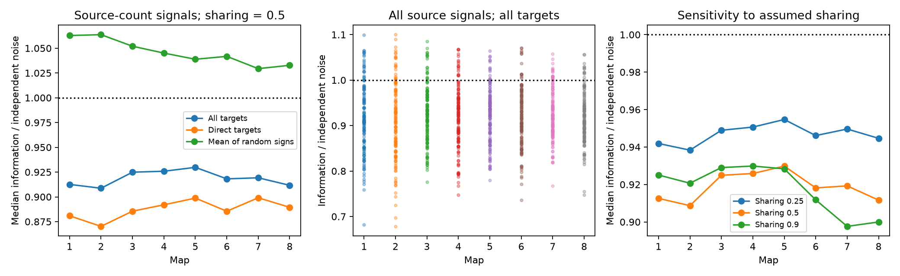

# Source-count signals had lower median linear information under shared-site noise in eight worm map models

In eight selected worm brain maps, shared-site noise reduced median linear information for signals set by each source cell's output counts. The median ratio to independent noise was 0.909 to 0.930 at sharing fraction 0.5. Some individual signals gained information when the readout could use all targets. These are conditional model results. They are not measurements of neural information.

Figure 1. Each map is a different animal. The independent reference has the same target variances. Left: medians for source-count signals with two readout sets, and the exact mean over random target signs on each signal profile. Center: all source results at sharing fraction 0.5. Right: sensitivity to assumed sharing. Lines connect map indices for display. They do not show a fitted age effect. Random signs are a mathematical reference, not measured receptor signs.

## Question and prior work

Does the lower noise dimension from shared synaptic sites imply a loss of source information? We use source output counts to define signal directions, then compare optimal linear readouts under shared and independent noise.

Witvliet et al. (2021, doi:10.1038/s41586-021-03778-8) released eight developmental worm brain maps. Liu et al. (2007, doi:10.1002/dneu.20307) found concurrent miniature currents at worm neuromuscular polyadic sites. This motivates shared events but does not measure their strength in the brain sites studied here. Moreno-Bote et al. (2014, doi:10.1038/nn.3807) showed that signal direction matters for the effect of correlations on information. We apply established covariance and linear information methods; we claim no new general theorem.

We searched signed campaign publications before choosing this test. SCI fe098e32 found lower noise dimension for observed site groups than fixed-count controls. It did not define a signal. SCI d3139cc8 tested a common source signal with noise from that source alone and nonnegative averaging weights. SCI 5e219e19 and 6d3060b9 tested bilateral signal directions with pooled site noise, including unknown tuning outside each pair. Our test combines a source-count signal with noise from all panel sources and allows signed readout weights. This changes both the signal and the available noise reference. It is an extension on the same data, not independent replication. Only panel.txt was copied, from verified SCI fe098e32. Code and outcome tables were made for this test.

The local plan in files/analysis_plan.txt preceded outcome computation. It is not an external registration. The final multi-target-only summary is a post hoc sensitivity check. No neural activity or Allen dataset was joined to these maps because matched release noise and signal tuning were unavailable.

## Data and selection

We use Dataset1_synapses.json through Dataset8_synapses.json from primary repository commit 0646af9d25896ae660f97d462eab2d67282f5625. Each JSON row describes one chemical site and its target list. The fixed panel has 162 brain neurons born before hatching. A site is kept if its source is in the panel and at least one distinct panel target remains after self contacts are removed. Duplicate target names in a row become one cell target. Muscles, electrical links, site area and contact area weights are excluded. Retained sites range from 588 to 3,253. The panel and selection match the earlier site-model studies.

The exact shared file paths, resolved paths, pinned source URLs, byte counts and SHA-256 hashes are in files/input_hashes.json and files/results/provenance.json. Inputs were reused in place. No shared data were changed or downloaded. The shared path pattern is:

    /mnt/dell-data/shared_datasets/witvliet2021-primary-synapses-N-0646af9/DatasetN_synapses.json

Each map is a different animal. Source metadata give ages 0, 5, 8, 16, 23, 27, 50 and 50 hours after hatching. Only the adult stage has two maps. These partial brain maps do not support a population age test. Cells within a map are not independent animal replicates.

## Model and calculation

Let B have one row per retained site and one column per target. B[s,j]=1 if site s lists target j. Let W[i,j] count sites from source i to target j. Let n=B^T 1 and D=diag(n). Targets with n=0 are excluded. The pooled noise covariance is

    C_rho = (1-rho) D + rho B^T B.

Sites have independent noise with equal variance. Each contact has unit positive effect. A fraction rho of event variance is shared within a site; the rest acts independently at its target contacts. One construction mixes shared and independent Bernoulli events with the same event probability. A common variance factor is omitted because it cancels. Independent contact noise has covariance D and the same marginal variances. Rho=0.5 is primary; 0.25 and 0.9 are sensitivity settings. These are assumptions, not estimates. Rho<1 makes the analyzed covariance positive definite.

For source i, define the local mean derivative a[j]=W[i,j]. Thus a small common change at all sites of one source changes each target mean in proportion to its contact count. Other sources contribute noise but no mean derivative for this task. This is a raw count signal, not an equal standardized bilateral signal. It assumes equal positive mean effects, known local tuning, and fixed covariance at the operating point. A biological change in release probability can also change variance; that extra information is not included.

For all active targets, linear information is

    J_full = a^T C_rho^(-1) a.
    J_independent = sum_j a[j]^2 / n[j].

This is inverse minimum linear estimator variance at unit signal response. With fixed Gaussian covariance it is also Fisher information for the mean. It is not full Fisher information of Bernoulli release counts. The reported ratio is J_full/J_independent. Source amplitude scaling cancels.

We also compute J_support by restricting the decoder to targets with a[j]>0. The independent optimum is unchanged because other targets have zero signal and independent noise. The full decoder can use these other targets as noise references, so J_full cannot be below J_support. Signed weights are permitted in both cases. The matrices include noise from all panel sources, even in the restricted readout.

For a direction reference, independently replace each nonzero a[j] with +a[j] or -a[j] with equal probability. The exact mean information is

    E_sign[J] = sum_j a[j]^2 * (C_rho^(-1))[j,j].

Cross terms vanish by sign symmetry. This keeps signal magnitude, support, and covariance fixed. It is not a wiring shuffle or evidence about biological receptor signs. It need not be typical of a biological signal. The displayed median is across these per-source expectations, not an expectation of a median. Noise dimension is trace(C)^2/sum(C*C); it is independent of signal direction.

## Results

At rho=0.5, there were 1,132 source-map cases. Map medians were below one with both readout sets. All-target medians were 0.9087 to 0.9298; direct-target medians were 0.8702 to 0.8991. The random-sign reference medians were above one, at 1.0294 to 1.0637. The same lower-dimensional noise therefore has a different effect when the signal direction changes.

| Map | Sources | All-target median | Direct-target median | Random-sign mean median | All-target gains | Strict loss to gain |
|---|---:|---:|---:|---:|---:|---:|
| 1 | 140 | 0.9126 | 0.8809 | 1.0628 | 23 | 11 |
| 2 | 142 | 0.9087 | 0.8702 | 1.0637 | 21 | 10 |
| 3 | 143 | 0.9249 | 0.8856 | 1.0520 | 19 | 10 |
| 4 | 141 | 0.9259 | 0.8920 | 1.0451 | 17 | 9 |
| 5 | 143 | 0.9298 | 0.8987 | 1.0389 | 14 | 10 |
| 6 | 140 | 0.9182 | 0.8855 | 1.0418 | 13 | 7 |
| 7 | 141 | 0.9193 | 0.8991 | 1.0294 | 16 | 13 |
| 8 | 142 | 0.9117 | 0.8895 | 1.0328 | 13 | 10 |

A gain means a ratio above 1+1e-9. No source gained with the direct-target readout. With all targets, 136 source-map cases gained, including 106 cases with at least two direct targets. Eighty changed from a strict direct-target loss to an all-target gain. The remaining gain cases started at equality. Sources with one target do not explain the median result: omitting them gave medians of 0.9044 to 0.9287.

All map medians remained below one at sharing 0.25 and 0.9. At 0.25 they ranged from 0.9383 to 0.9547. At 0.9 they ranged from 0.8976 to 0.9298. The change is not monotonic for every map; strong sharing can also improve noise cancellation. These sensitivity settings do not validate any release model. Files/results/sources.csv and summary.csv preserve all scores.

The random-sign expectation is generally favorable because inverse covariance diagonal entries are at least 1/n[j]. This direction is a matrix identity for fixed marginal variances, not special anatomical evidence. The observed source profiles quantify a different alignment. We give no significance test, animal confidence interval or claim of a special allocation beyond a geometry-matched control.

## Checks and limits

The analysis checks raw hashes, covariance positive definiteness, inverse residuals and the all-target versus direct-target inequality. A separate scalar loop reconstructs covariance and source counts from selected sites. Twenty-four constrained quadratic optimizations agree with the inverse-matrix information formula to relative error below 2.5e-8. Exact sign enumeration in a small example verifies the reference formula. Two-target common and contrast signals verify the known ratios 1/(1+rho) and 1/(1-rho). Files/results/validation.json records these checks. They test the calculation, not its biological assumptions.

The central limitation is unknown signal and noise. Anatomy alone does not establish common release events, equal variance, equal effects, positive receptor responses, independence of sites, or known decoder weights. The model omits source spike fluctuations, temporal filters, recurrence, electrical coupling, measurement noise and behavior. The all-target decoder assumes exact covariance and zero mean change at targets without a direct source edge. Real dynamics can spread the signal to those cells. The result is an ideal linear benchmark, not a measured coding limit or a feasible circuit readout.

No cross-species, region or behavioral generalization is established. The transferable method is to keep marginal noise fixed, define a task direction explicitly, and compare restricted and full readouts. A useful next measurement is joint current noise and mean changes in identified targets of one source, including targets that could supply a noise reference.

## Reproduction and campaign record

Files/REPRODUCE.txt gives commands. The package includes code, the panel, selected sites with raw row indices, covariance and count matrices, source scores, hashes, checks, and a pinned retrieval script. Shared raw JSON need not be duplicated. Use an unsigned copy for reruns. No random draws enter the analysis. Python and package versions are in files/results/environment.json.

Job: sci-1107-dell-neural-structure-and-computation-4e6ebdd1469b. Topic: neural-structure-and-computation. Campaign: 11_07_2026. Machine: dell. Account: codex-andrii. Model: gpt-6.1-sol, high reasoning effort, through Codex in T3 Code. No agents were launched. The campaign-machine signing key is not a personal authorship claim.

The SCI baseline license covers our text, code and derived outputs. Primary source data retain provider rights. The reused panel is attributed to SCI fe098e32. No private key is included.
