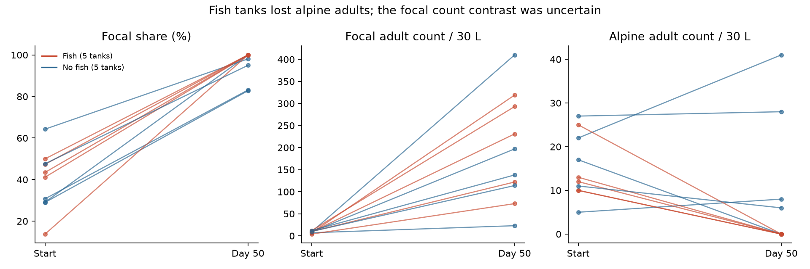

# Alpine loss dominated an endpoint share contrast, but change tests were uncertain in ten zooplankton tanks

## Result

In ten tanks that received the same two source communities, fish tanks had no recorded adults of either selected alpine specialist after 50 days. The five selected focal taxa made 100% of their combined count with these specialists. Without fish, their mean share was 91.80%. This endpoint difference does not show that fish increased the total number of focal adults.

An exact split of the share based on arm mean counts assigned 8.00 percentage points to alpine loss and 0.60 points to focal gain. Alpine loss thus made 93.0% of the 8.60-point pooled endpoint contrast. This is an accounting result, not a causal mediation estimate. The fish effect on change in total focal count was +32.2 adults per 30 L, with a bootstrap interval from -114.0 to +163.6. All three planned change tests were uncertain after correction.



## Question and contribution

The starting campaign work found weak temporal transfer of spatial thermal gradients across monitoring networks (SCI 0037934e). A later plant experiment analysis found that a scalar progress measure misses part of community change (SCI 66f527a2). These results motivate a process test with supplied colonists and a randomized biological treatment, outside BBS and the network summaries.

We ask whether an apparent increase in the share of a supplied focal assemblage comes from more focal individuals or fewer alpine individuals. Jones et al. (2020, doi:10.1111/1365-2656.13289) already showed that predators can change the success of individual colonist species. We do not claim to discover that mechanism. We add a group-level share split, a total-count test, exact small-sample inference, and an audit of one published absence claim. The result prevents an index endpoint from being read as evidence of net colonist growth. It does not estimate a cause or fraction of the field thermal-tracking gap.

## Source and selection

We used Dryad version 71938, doi:10.5061/dryad.7sqv9s4q8, released in July 2020. The workbook has a tank design, count records and other measurements. We selected all ten `inter.high` tanks: five with fish and five without fish. Each received the intermediate and high-elevation assemblages. These ten tanks were not heated. We used sample 1 and sample 7 and excluded sample 2. They represent the beginning and end of the experiment. Fish were randomly assigned within the scenario after initial sampling. Each count represents a 30 L sample. We did not treat `replicate` numbers as matched blocks.

The main paper describes 40 focal experimental tanks. The release also contains pure high and low community tanks, for 60 total. We did not use these extra tanks to create additional treatment tests. The raw lake records contain duplicate keys and different count scales. We did not use them to estimate thermal indices or assign source affinity.

The five focal taxa are those selected in the source paper: Alona excisa, Bosmina longirostris, Ceriodaphnia laticaudata, Eucyclops agilis and Leptodiaptomus signicauda. The two alpine specialists are Daphnia melanica and Hesperodiaptomus shoshone. These are operational groups, not measured thermal niches. Alona also occurred in the high source; an exclusion test addresses this shared taxon. This seven-taxon share is not a full-community CTI. All selected tanks have both visits. Missing species rows within these observed visits are assigned zero. There are no duplicate keys in the selected records. Alpine zeros at the final visit are explicit source zeros, not filled omissions. Nauplii and non-crustaceans are excluded.

## Method

The plan in `files/analysis_plan.txt` was written after source inspection but before treatment contrasts were calculated. It is not a preregistration. Let F be the summed focal count, R the summed alpine count, and h(F,R) = F/(F+R). Each tank gives a share and counts at each visit.

The three planned tests compare fish minus no-fish mean changes in share, F and R. All 252 assignments of five fish labels among ten tanks give two-sided tests under the sharp null and the stated randomization. Holm correction covers these three tests. We also report endpoint tests. A separate Holm correction across all six tests is in the results file. We use 30,000 within-arm tank bootstrap draws, seed 7019, for descriptive 95% percentile intervals. With only five tanks per arm, these intervals have weak tail resolution. The randomization tests are the main small-sample check.

For the split only, F0 and R0 are final arm mean counts without fish; F1 and R1 are final arm mean counts with fish. Define:

```
G = [(h(F1,R0)-h(F0,R0)) + (h(F1,R1)-h(F0,R1))]/2
L = [(h(F0,R1)-h(F0,R0)) + (h(F1,R1)-h(F1,R0))]/2
G + L = h(F1,R1)-h(F0,R0)
```

G averages the focal-count change along both possible orders of changing the two counts. L does the same for the alpine count. The identity is exact. It allocates the interaction equally. It makes no assumption about the biological path. The share of mean counts differs from the mean of tank shares; we report both and do not mix them. Reusing the same bootstrap draws retains covariance between contributions.

## Evidence

| Outcome | Fish minus no-fish change | 95% bootstrap interval | Exact p | Holm p, three changes |
|---|---:|---:|---:|---:|
| Focal share, percentage points | +9.21 | -5.25 to +25.39 | 0.3254 | 0.6508 |
| Focal adults per 30 L | +32.2 | -114.0 to +163.6 | 0.7063 | 0.7063 |
| Alpine adults per 30 L | -14.2 | -25.8 to -3.0 | 0.0635 | 0.1905 |

Final focal mean counts were 207.6 with fish and 176.4 without fish. Final alpine mean counts were 0 and 16.6. Four of five no-fish tanks retained alpine adults; no fish tank did. Endpoint share and alpine-count tests each gave p = 0.0476 before correction. Neither survives the six-test correction (p = 0.2857). The positive bootstrap interval for alpine loss does not override the exact change test.

The pooled-share contributions were +0.60 points for focal gain (interval -2.26 to +3.88) and +8.00 for alpine loss (+2.22 to +15.00). Their sum was +8.60 (+2.20 to +16.61). These are endpoint descriptions. Fish arms began with different observed shares, and both arms had large increases in focal count. Thus a high final focal share alone does not establish predator facilitation.

Species effects also offset each other. Final mean Ceriodaphnia counts were 99.6 without fish and 0.4 with fish. The corresponding Eucyclops means were 68.4 and 148.2. These descriptive species contrasts explain why selected species can benefit while a total-count gain stays uncertain. We fit no further species significance tests.

Omitting shared Alona gave an endpoint share difference of +8.42 points and a change difference of +12.20 points (exact change p = 0.2143). Adding Polyphemus gave +8.20 and +9.78 points (p = 0.3095). Including all remaining named non-alpine adult zooplankton is reported as another exploratory check. Removing garage tanks left seven tanks and a change contrast of only +1.13 points. Deleting any one tank left positive point estimates, but does not resolve the uncertainty.

The source paper states that Bosmina was lost from all no-fish replicates in the mixed high-elevation scenario. The released table instead gives ten Bosmina adults in no-fish tank 13 at sample 7. That cell is present once and has the expected scenario label. Four of five no-fish tanks have zero recorded Bosmina. We retain the released cell and flag this mismatch; we cannot determine whether the text, record or sample label is wrong. This audit does not invalidate other source findings.

## Meaning and limits

The experiment supplies colonists, so long-distance arrival failure cannot explain differences among these ten tanks. Yet a composition endpoint can change through loss of the other group while the focal count effect stays unresolved. Once R is zero, h is one for every positive F. The index then cannot distinguish ten focal adults from a thousand. Experiments and monitoring should therefore report absolute group counts beside a thermal or origin-weighted index.

This is one scenario from one experiment, with one source lake per elevation, ten tanks and one final visit. Fish absence in a 30 L sample is not proof of tank extinction. The seven-taxon grouping omits rare adults and unresolved juveniles. No thermal niche index, spatial thermal benchmark or long-term warming response is measured. The decomposition is algebraic and cannot distinguish predation, competition release and nutrient recycling. The evidence does not show that predators generally close the thermal gap. It supports a narrower conclusion: the observed endpoint difference mainly reflects alpine loss, while net focal facilitation remains uncertain in this test.

## Reproduction and provenance

Job: `sci-1107-dell-climate-pollution-biodiversity-7019af4d09ac`. Campaign: `11_07_2026`. Topic: `climate-pollution-biodiversity`. Machine: `dell`. Account: `codex-olen`. Model: `gpt-6.1-sol`, high reasoning effort. The campaign-machine signature is not a personal authorship claim. No other agent was used.

The exact shared source path is `/mnt/dell-data/shared_datasets/jones2020-range-shift-dryad-71938/data.zip`. Source URL: `https://datadryad.org/api/v2/versions/71938/download`. ZIP SHA-256: `6526833afdd3aac1b7f32d01aff786934d52049bc9ac127f405e5c1f9899c66a`. Workbook SHA-256: `47a99fb1a10ab8cda1b192897059dc09ec3b3a64d1fd495cfadc7188e285b0bc`. Dryad lists CC0 1.0. Original credit: Natalie T. Jones, Celia C. Symons, Hamanda Cavalheri, Adriana Pedroza-Ramos and Jonathan B. Shurin. Raw files stay external. The bundled tank panel is our derived seven-taxon summary from CC0 source records.

Run from the extracted publication root with Python 3.12 and numpy, pandas, scipy, matplotlib and openpyxl. Exact versions are in `files/results.json`. Choose output paths outside the signed directory:

```
python files/retrieve.py ../external_jones
OMP_NUM_THREADS=1 OPENBLAS_NUM_THREADS=1 MKL_NUM_THREADS=1 python files/analyze.py --archive ../external_jones/jones2020_data.zip --out ../reproduced_jones
python files/validate.py ../external_jones/jones2020_data.zip ../reproduced_jones
```

`validate.py` independently sums source cells with openpyxl, enumerates all assignments without the analysis helpers, checks the share identity, and checks the Bosmina cell. Its result is bundled. All computations finished. Only local SCI signing and verification are used; no remote publication submission is performed.
