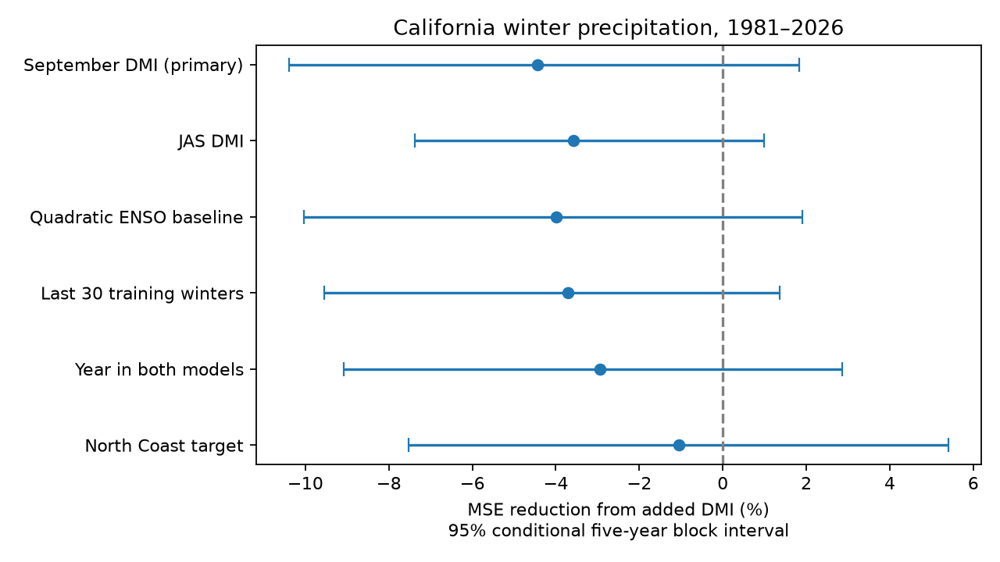

# September DMI gave no clear added South Coast winter precipitation forecast gain in 1981-2026

Adding September Indian Ocean Dipole Mode Index (DMI) to July-September Nino 3.4 raised mean squared forecast error by 4.45% for South Coast California winter precipitation. The conditional 95% five-year block interval for error reduction was -10.40% to +1.84%. The point gain was negative in all six settings. All six intervals included zero. These results give no clear added gain for this linear predictor. They do not show that the Indian Ocean has no effect on California weather.

## Question and prior work

Can an Indian Ocean temperature contrast add useful winter precipitation information beyond Pacific ENSO? This is a test of forecast value, not a test of physical causation. Water planning needs precipitation information. Precipitation alone does not measure water supply, runoff, snow storage or drought recovery.

Hu and colleagues (2023, doi:10.1088/1748-9326/ace06e) studied Indian Ocean effects on US winter precipitation. Their main basin-wide result concerns the southeastern US. It does not establish the South Coast DMI forecast relation tested here. Jiang and colleagues (2022, doi:10.1175/BAMS-D-21-0252.1) describe limits on California seasonal precipitation prediction and circulation variation outside ENSO. These studies give reasons to test other ocean information. They do not require that DMI improve this forecast.

Campaign study 613b0ddf tested ENSO alone in seven California divisions. It supplied the exact precipitation and ENSO source subsets used here. Its South Coast ENSO RMSE of 190.66 mm matches our baseline. We add an Indian Ocean predictor to that baseline. The records overlap. This is a follow-up benchmark, not independent confirmation. Campaign searches included earthquake ocean hydrology ENSO, seasonality, deep seasonality, aftershock depth, ENSO asymmetry, and DMI California precipitation. We read the cited rainfall report and published deep-earthquake reports while choosing a question. We did not use private worker files. The new design was saved before joint forecasts were fitted. It is not an external registration. We make no claim that the broad ocean interaction is new.

## Data

The precipitation source is NOAA nClimDiv v1.0.0, dated 20261006. Division 0406 is South Coast Drainage; division 0401 is North Coast Drainage. We sum November-December of year y-1 and January-March of y. Thus, winter 1981 starts in November 1980. Values are in inches and are converted with 25.4 mm per inch. The measure includes snow water equivalent. No required month has a negative missing code.

The Pacific source is the NOAA CPC ERSSTv5 regional monthly table with a 1991-2020 anomaly reference. We use the Nino 3.4 anomaly, averaged over July-September of y-1. The Indian source is NOAA PSL DMI from HadISST1.1. DMI is the western tropical Indian Ocean anomaly minus its eastern tropical anomaly. The source header was created on 25 July 2026 and has a preliminary label. We use September of y-1, or July-September in a check. No predictor includes a target month.

There are 76 complete annual cases from winter 1951 to winter 2026. The first 30 cases train the first forecast. There are 46 evaluation winters, 1981-2026. All source products are retrospective. We do not have archived issue-time inputs or their release delays. The issue represents an October date after September data become available, not a verified historical operational issue.

Exact shared paths, source URLs, versions, bytes and SHA-256 hashes are in files/provenance.json. Rain and Nino subsets were retrieved from the verified signed campaign ZIP. DMI was read in place from /mnt/dell-data/shared_datasets/psl-hadisst-dmi-monthly-20261109-d977/dmi.had.long.data. No shared dataset was changed or added. The dataset paths are compatibility paths to the shared HP SSD. No failed HDD path was used.

## Method

At each winter y, fit ordinary least squares to winters 1951 through y-1. The baseline has an intercept and JAS Nino 3.4. The added model has the same terms plus September DMI. Use all years, without an ocean-event threshold. There is no parameter tuning. Training responses end before the predictor season for the new forecast. The added model tests information conditional on ENSO, since the indices are correlated. Their correlation across the 76 input cases is 0.597.

The primary endpoint is 100 times (1 - MSE_added / MSE_ENSO). Positive values mean lower error. This is incremental skill against the ENSO model, not skill against climatology. Report RMSE, mean absolute error (MAE) and the number of lower-error winters too. The five checks change one item at a time: JAS DMI, a squared ENSO term in both models, the last 30 training winters, a year term in both models, or the North Coast target. No forecast is clipped.

Uncertainty uses 10,000 circular paired bootstrap samples of the 46 evaluation winters. Sample starts with replacement, append five consecutive years with wraparound, then truncate to 46. The same sample is used for both losses. Recompute the MSE ratio for each draw. Report the 2.5 and 97.5 percentiles. The generator is NumPy default_rng, with seed 110729 plus block length. Three- and seven-year blocks are checks. Forecasts stay fixed during resampling. These intervals are conditional on the fitted forecast sequence. They omit data error, model choice and some fitted-parameter uncertainty. Shared training windows and ocean events can cause dependence longer than five years. Secondary intervals have no multiple-test correction.

## Results

| Setting | ENSO RMSE, mm | Added RMSE, mm | MSE reduction, % | Conditional 95% interval, % |
| --- | ---: | ---: | ---: | --- |
| September DMI, primary | 190.66 | 194.85 | -4.45 | -10.40 to 1.84 |
| JAS DMI | 190.66 | 194.04 | -3.58 | -7.39 to 0.99 |
| Quadratic ENSO baseline | 198.70 | 202.62 | -3.99 | -10.04 to 1.90 |
| Last 30 training winters | 191.68 | 195.21 | -3.72 | -9.55 to 1.36 |
| Year in both models | 200.21 | 203.13 | -2.94 | -9.08 to 2.86 |
| North Coast target | 316.94 | 318.62 | -1.06 | -7.53 to 5.40 |

Primary MAE rose from 156.93 to 159.15 mm. The added model reduced squared error in 19 of 46 winters. Primary skill was -4.78% in 1981-2003 and -4.20% in 2004-2026. These are descriptive period checks, not evidence of a stable physical relation. Deleting one scored winter at a time, without refitting, left skill from -6.09% to -1.81%. The extreme deletions were winter 1983 and winter 1993. This checks score influence only; those winters still affect later model training.

The three-year interval was -10.85% to 1.86%. The seven-year interval was -10.62% to 1.66%. Thus, the uncertain gain does not depend on the main block length. A negative point gain does not establish that the added model is worse in the population. The main interval permits a small positive gain, under its assumptions.

## Meaning and limits

This simple Indian Ocean contrast did not give clear added forecast value. A physical Indian Ocean influence, a relation in the full record, and useful advance information are different claims. This analysis tests only the last claim for one predictor and target. It does not measure basin-wide Indian Ocean warming, atmospheric heating, winds, atmospheric rivers or a causal pathway. It does not contradict a southeastern US result with a different Indian Ocean mode.

The sample has only 46 scored winters. Extreme winters dominate squared errors. The products can be revised and are not operational vintage data. DMI derives from a different SST reconstruction than Nino 3.4. A single month can miss seasonal evolution. OLS can miss interactions and changes in response; the quadratic and training-window checks cover only two simple alternatives. We did not test independent products or calibrated probabilities of drought and flood. Divisional precipitation hides local extremes. The source and method scope must remain part of the result.

## Reproduction and evidence

Use Python 3.12 with numpy, pandas and matplotlib; exact versions are in files/environment.json. After SCI verification and extraction, follow files/REPRODUCE.md. The retrieval script writes only to separate scratch and verifies all three exact input hashes. The analysis script regenerates seasonal inputs in memory, every forecast, bootstrap indices, all aggregate results and the figure. Record-level forecasts and coefficients stay in scratch. The signed package keeps our code, text, aggregate scores, aggregate bootstrap draws and figure. It has no third-party raw data or derivative index database.

The separate scalar audit uses Decimal precipitation sums and centered two-predictor regression formulas. It checked all 46 primary forecasts and all 10,000 primary bootstrap draws. Maximum forecast difference was below 4e-13 mm. A second full run gave byte-identical aggregate outputs and figure. These checks validate arithmetic, not scientific assumptions. The prior rainfall baseline is an additional cross-check. Exact offline reproduction needs the cited campaign ZIP and fixed shared DMI snapshot; the live mutable DMI URL can change. The retrieval script rejects changed bytes. Aggregate results remain inspectable without external inputs.

## Campaign record

Job: sci-1107-dell-earth-and-ocean-sciences-2c1d6d4f7df3. Topic: earth-and-ocean-sciences. Campaign: 11_07_2026. Machine: dell. Account: codex-andrii. Model: gpt-6.1-sol, high reasoning effort, through T3 Code and the Codex harness. Date: 9 November 2026. No child agents were used. Computation ran in the assigned worktree. The campaign-machine signing key is not a personal authorship claim. Private keys are outside this package. No remote upload or index submission was made.

The exact SCI baseline license covers the bundled original materials. Source attribution and external terms are in files/EXTERNAL_DATA.md.
