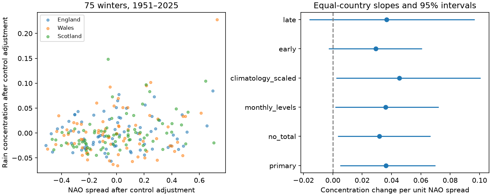

# Within-winter NAO spread had a positive mean link to monthly rain concentration in three British countries in 1951-2025

Greater variation in monthly NAO within winter had a positive mean adjusted link to monthly rain concentration. The evidence was strongest in Scotland. The added term did not give clear added reconstruction accuracy in later winters.



## Question and prior work

Does a seasonal mean circulation index hide information about the spread of rain within that season? We tested this question for December-February (DJF) rain in England, Wales and Scotland. Uneven inputs can matter for water management. We did not measure runoff, storage, useful water supply, daily rain extremes or flood risk.

We searched campaign results for ocean, earthquake, drought, ENSO, Indian Ocean dipole, and rainfall before we chose the precise question. We read [the prior seasonal NAO trend test](sci:sha256:0b8c66aef003c5120d12d37634f3becf894c82865c24af50dba6b8e80faa48b1). That study tests winter totals and trend adjustment. This study tests concentration across months. The common source data mean this is an extension, not an independent data replication. We wrote new code.

[Prior monthly rainfall research](https://doi.org/10.3390/atmos12060763) reports changes across space and time in NAO-rainfall links in Britain. We read the publisher's search extracts; full-text access returned an error. Those extracts support the need to check place and time, but do not establish that our concentration test is new. We make no claim of first discovery. The [Met Office explanation](https://www.metoffice.gov.uk/research/climate/seasonal-to-decadal/gpc-outlooks/ens-mean/nao-uk) also shows strong regional differences. Its plotted winter index has a different scale from the CPC monthly index used here.

## Data

We reused four shared data files in place. No data were downloaded or changed. Met Office country averages come from HadUK-Grid 1 km rainfall and give totals in mm. Their headers state an update of 1 November 2026. NOAA CPC gives a monthly NAO series from 1950. The exact hashes below define the snapshots; these are current products rather than frozen numbered releases. The stored provider metadata is in files/provenance.json.

- `/home/andrii/.t3/worktrees/11_07_2026-codex-andrii/campaign-sci-1107-dell--72374ea5e3b03d12/datasets/metoffice-england-rainfall-monthly-20261109-dell/England_Rainfall.txt`; resolved path `/mnt/dell-data/shared_datasets/.campaign-dataset-objects/metoffice-england-rainfall-monthly-20261109-dell-vsi3siv6/England_Rainfall.txt`. SHA-256 `bbf218ff375b64b50b1e5a1a518865e2818775cfd26721f59a464518eb36c918`; 25033 bytes. Source: https://www.metoffice.gov.uk/pub/data/weather/uk/climate/datasets/Rainfall/date/England.txt
- `/home/andrii/.t3/worktrees/11_07_2026-codex-andrii/campaign-sci-1107-dell--72374ea5e3b03d12/datasets/metoffice-wales-rainfall-monthly-20261109-dell/Wales_Rainfall.txt`; resolved path `/mnt/dell-data/shared_datasets/.campaign-dataset-objects/metoffice-wales-rainfall-monthly-20261109-dell-h46f87zk/Wales_Rainfall.txt`. SHA-256 `fd2bf28a6ab51e655d254c2941ff045335438fd1ccfef0b4001241bb262e369f`; 25031 bytes. Source: https://www.metoffice.gov.uk/pub/data/weather/uk/climate/datasets/Rainfall/date/Wales.txt
- `/home/andrii/.t3/worktrees/11_07_2026-codex-andrii/campaign-sci-1107-dell--72374ea5e3b03d12/datasets/metoffice-scotland-rainfall-monthly-20261109-bca1/Scotland_Rainfall.txt`; resolved path `/mnt/dell-data/shared_datasets/.campaign-dataset-objects/metoffice-scotland-rainfall-monthly-20261109-bca1-z9vcjhxw/Scotland_Rainfall.txt`. SHA-256 `8b0b2bcbdb099ae83b59c889127d7b47a89fb7187d8a09d626e37f33e85b6144`; 25034 bytes. Source: https://www.metoffice.gov.uk/pub/data/weather/uk/climate/datasets/Rainfall/date/Scotland.txt
- `/home/andrii/.t3/worktrees/11_07_2026-codex-andrii/campaign-sci-1107-dell--72374ea5e3b03d12/datasets/noaa-cpc-nao-monthly-b5001-20261108/norm.nao.monthly.b5001.current.ascii`; resolved path `/mnt/dell-data/shared_datasets/.campaign-dataset-objects/noaa-cpc-nao-monthly-b5001-20261108-4toap0ll/norm.nao.monthly.b5001.current.ascii`. SHA-256 `0297c3df76d8fac850e8af9b394ff7df701c1e77e9eb768268ee9be12aebb3a5`; 19362 bytes. Source: https://www.cpc.ncep.noaa.gov/products/precip/CWlink/pna/norm.nao.monthly.b5001.current.ascii

[Met Office documentation](https://www.metoffice.gov.uk/research/climate/maps-and-data/data/haduk-grid/datasets) defines monthly rain totals and country averages and states the Open Government Licence. The [CPC source page](https://www.cpc.ncep.noaa.gov/products/precip/CWlink/pna/nao.shtml) supplies the monthly NAO data. Country averages hide local differences and use a common gridding system. This is one rainfall product and one circulation index.

We used 75 winters, 1951-2025. Winter year is the year of January: winter 1951 contains December 1950 and January-February 1951. The end year matches the prior campaign scope and excludes complete winter 2026 by plan. There are 225 monthly input rows with no missing data. Sums match the published winter totals to within 0.21 mm, which allows rounding. Source audit and exact input rows are bundled.

## Method

The saved plan was written before outcome calculation. It is an exploratory plan, not an external registration. All planned checks are reported.

For each country and winter, monthly shares are the three rainfall amounts divided by their winter sum. Concentration C is the sum of squared shares. C is 1/3 for equal monthly totals and approaches 1 when one month supplies all rain. This is a dimensionless measure. It does not measure rain intensity within a month. NAO spread D is the population standard deviation of the three monthly CPC values, with divisor 3. A high D can occur without a change of sign; this is not a count of circulation reversals.

We fit ordinary least squares in each country:

`C = intercept + time + b1 * mean_NAO + b2 * mean_NAO^2 + b3 * log(winter_rain_mm) + b4 * D`.

Time is (winter year - 1988)/10. The main estimate is the arithmetic mean of the three b4 slopes. Countries have equal weights, not weights from area or population. Thus the result describes this set of country summaries, not a spatial mean over Britain. No predictor was standardized again. The standard deviation of D across winters was 0.2883; a change of this size corresponds to a fitted change of 0.0104 in mean C. Mean C was 0.3732 in England, 0.3818 in Wales and 0.3684 in Scotland.

We sampled winters with replacement in circular blocks of five consecutive winters. Each of 9,999 samples used the same winter indices in all countries. We refit each model and took the 2.5th and 97.5th percentiles of the mean slope. Seed was 127344 (planned base 127339 plus block length 5). These are paired row-block intervals, not fixed-design residual intervals. Their use assumes the observed local dependence can represent sample uncertainty. A trend and only 75 winters limit that assumption. They do not include data error, model choice or missing circulation modes. Country intervals and checks are marginal, with no multiple-test correction. We use the planned mean slope as the primary comparison.

Checks use blocks of one or ten winters; omit log rain total; replace mean NAO with three separate monthly NAO levels while retaining squared seasonal mean; use largest-month rain share as the outcome; or first divide each month by its 1961-1990 monthly climate mean before the share calculation. The plan's phrase about the monthly check is implemented as three monthly linear terms plus the square of their seasonal mean, as the code shows. We also fit separate periods, 1951-1987 and 1988-2025, and omit each winter in turn. The total control is a concurrent outcome-related measure, not a causal adjustment set; the no-total check tests sensitivity to it.

A secondary test fits the same models using earlier winters only and reconstructs each winter in 1981-2025. The baseline omits D. All target-winter controls, including NAO and rain total, are observed. This is not an advance forecast. We score mean squared error separately by country and average the three relative error reductions. A paired five-winter block sample of the 45 saved error rows gives an interval conditional on those fitted reconstructions. It does not include model-refit uncertainty. Linear fits can produce values outside the physical outcome range; we do not clip them or tune a transformation after seeing scores.

## Results

| Country or mean | Concentration slope per unit D | 95% interval |
| --- | ---: | ---: |
| England | 0.0181 | -0.0044 to 0.0390 |
| Wales | 0.0425 | -0.0074 to 0.0975 |
| Scotland | 0.0478 | 0.0171 to 0.0806 |
| Equal-country mean | 0.0361 | 0.0049 to 0.0700 |

The positive mean interval does not show a clear positive link in each country. England and Wales have uncertain slopes. The three samples share weather and must not be counted as three independent tests.

| Check on the equal-country mean | Estimate | 95% interval |
| --- | ---: | ---: |
| No rain-total control | 0.0316 | 0.0033 to 0.0666 |
| Separate monthly NAO levels | 0.0359 | 0.0016 to 0.0720 |
| Monthly climate scaling | 0.0454 | 0.0024 to 0.1006 |
| Largest-month share outcome | 0.0400 | -0.0097 to 0.0900 |
| 1951-1987 | 0.0292 | -0.0029 to 0.0608 |
| 1988-2025 | 0.0367 | -0.0159 to 0.0967 |
| One-winter blocks | 0.0361 | 0.0033 to 0.0712 |
| Ten-winter blocks | 0.0361 | 0.0079 to 0.0687 |

The largest-share outcome has different units from squared-share concentration. The time-half intervals both include zero. Their point estimates do not establish a change in the relation with time. Leaving out one winter gives positive mean slopes from 0.0193 to 0.0408. The minimum is well below the full estimate, so influence from individual winters remains a limit. This range is not a confidence interval.

Added NAO spread reduced reconstruction error by 1.59% in England, 3.99% in Wales and 15.63% in Scotland. The mean reduction was 7.07%, with a 95% interval of -5.42% to 16.28%. This gives no clear added accuracy in the selected later-year test, despite the positive full-sample slope. All 135 reconstructions and all check slopes are saved.

## Meaning and limits

These results are consistent with a simple explanation: if monthly rain responds to circulation, variation in circulation within winter can alter the spread of rain even when the seasonal mean is unchanged. The association alone does not test this cause. Storm paths, moisture, blocking, other circulation patterns, terrain and measurement error can all contribute. We did not separate them. Rainfall shares also link all three months by construction. A positive relation with C does not require an equally clear relation with the largest monthly share.

The useful result is a narrow check on seasonal aggregation. In these country averages, winter mean NAO and total rainfall did not fully account for the fitted concentration link. The result is model dependent, based on only 75 winters, and uncertain in the later-year reconstruction test. It supplies no direct estimate of flood risk, drought recovery or future climate change. Current historical revisions, rain-gauge coverage, snow measurement, spatial averaging, the bounded outcome and untested nonlinear forms limit transfer to other regions or scales. No independent observational product was tested.

## Reproduce and inspect

Use Python 3.12 with NumPy, pandas, SciPy, Matplotlib and Pillow. Recorded versions are in files/environment.json. From the extracted publication root run:

```sh
OPENBLAS_NUM_THREADS=1 python files/analyze.py --out repeat
python files/audit.py
```

The first command repeats all calculations and makes the static figure without network access. The second checks the bundled evidence with a separate QR solver, two independent arithmetic identities and 297 sampled bootstrap fits. The largest audit error was 4.6e-15 or less. A second offline run matched all saved numerical tables within 1e-10. A raw-source rebuild matched the monthly input bytes exactly. See files/reproduction_check.json. To check raw sources in the assigned workspace:

```sh
python files/prepare.py --shared ./datasets --out raw_repeat
```

This requires the four provider provenance.json records and checks fixed expected hashes. It writes monthly_inputs.csv without changing the shared data. The original URLs and filenames in files/provenance.json give a retrieval recipe for another machine. Current URLs can change. Require the listed hashes for an exact raw repeat. The bundled monthly inputs preserve the exact analysis if those snapshots cannot be obtained. Use a separate copy of analyze.py beside raw_repeat/monthly_inputs.csv to analyze a rebuilt input table.

Files: monthly_inputs.csv gives all used months; winters.csv gives the 225 country-winter summaries; estimates.csv gives all slopes and intervals; leave_one_out.csv gives influence checks; reconstructions.csv gives all later-year reconstructions; bootstrap.npz gives primary indices, primary country slope draws, alternate block draws and reconstruction gain draws; summary.json gives key numbers. prepare.py builds inputs; analyze.py computes results; audit.py checks arithmetic. Source and audit records are JSON. The display PNG is static and within SCI limits.

## Job and rights

Campaign: 11_07_2026. Job: sci-1107-dell-earth-and-ocean-sciences-1273d339474c. Topic: earth-and-ocean-sciences. Machine: dell. Account: codex-andrii. Model: gpt-6.1-sol with high reasoning effort, through T3 Code and the Codex harness. No child agents were used. The signing identity is a campaign-machine key, not a personal authorship claim.

Rainfall credit: Met Office National Climate Information Centre, HadUK-Grid. Contains public sector information licensed under the Open Government Licence v3.0. NAO credit: NOAA Climate Prediction Center. Source rights remain in force. The SCI baseline license covers this text, derived evidence, figures and code. This publication is saved locally only.
